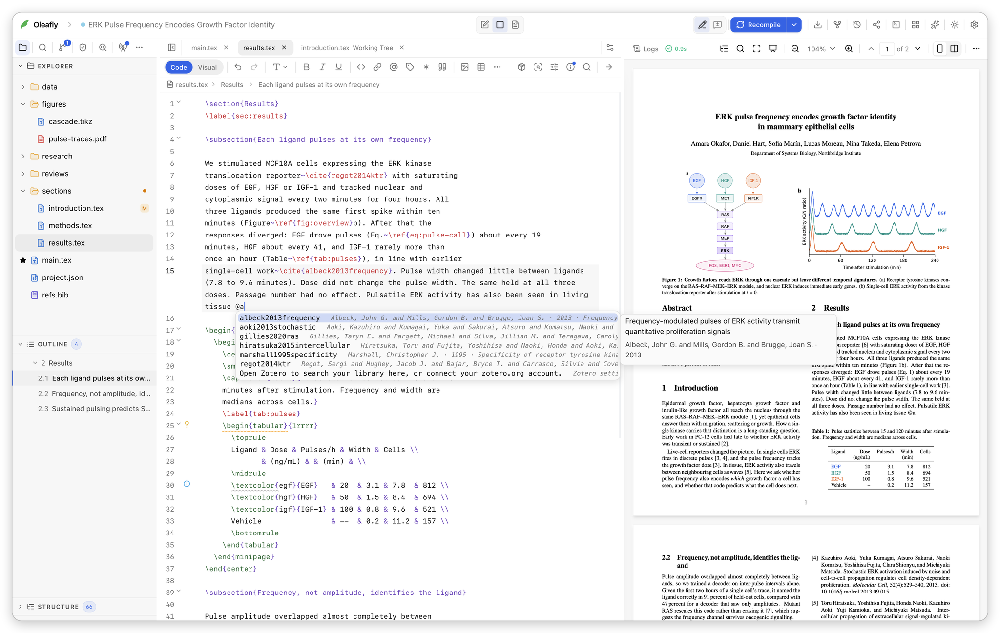
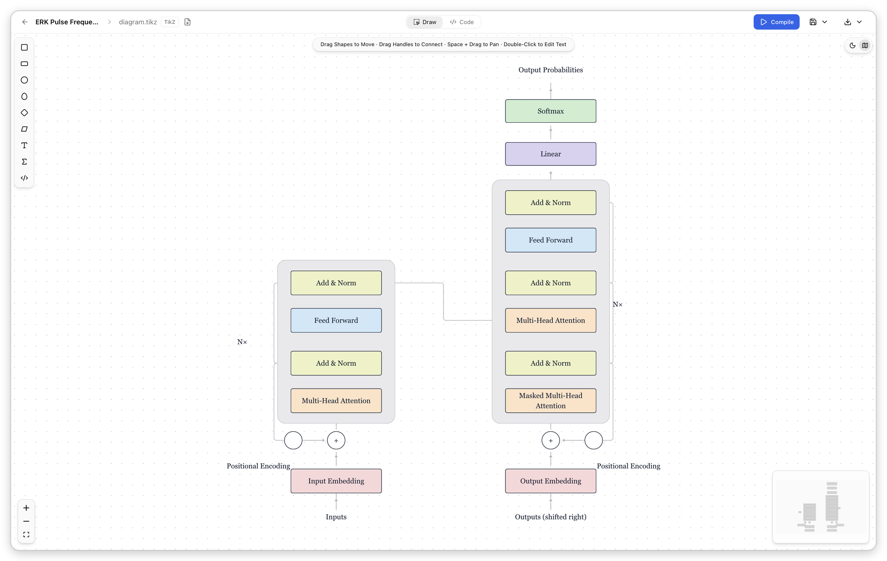
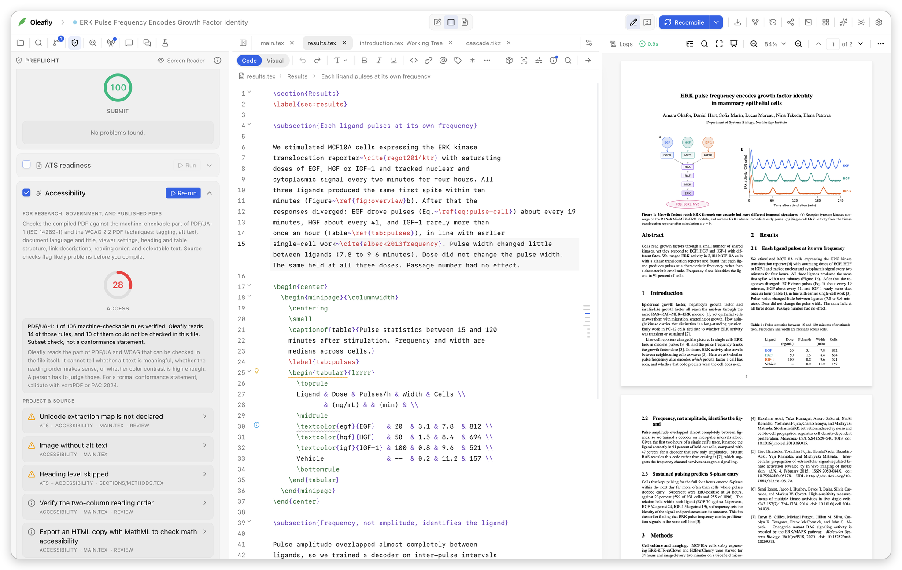

<div align="center">


# Oleafly <sup><em>beta</em></sup>

[Deutsch](docs/readme-translations/README.de.md) | **English** | [Español](docs/readme-translations/README.es.md) | [Français](docs/readme-translations/README.fr.md) | [日本語](docs/readme-translations/README.ja.md) | [한국어](docs/readme-translations/README.ko.md) | [Português](docs/readme-translations/README.pt.md) | [Русский](docs/readme-translations/README.ru.md) | [中文](docs/readme-translations/README.zh.md) | [العربية](docs/readme-translations/README.ar.md)

[](https://github.com/Oleafly/Oleafly/releases/latest)
[](https://github.com/Oleafly/Oleafly/releases/latest)
[](https://github.com/Oleafly/Oleafly/releases/latest)

[](https://github.com/Oleafly/Oleafly/issues) [](https://github.com/Oleafly/Oleafly/releases) [](https://github.com/Oleafly/Oleafly/actions/workflows/ci.yml) [](https://sonarcloud.io/summary/new_code?id=Oleafly_Oleafly) [](https://sonarcloud.io/component_measures?id=Oleafly_Oleafly&metric=coverage) [](https://github.com/Oleafly/Oleafly/pulse) [](https://github.com/Oleafly/Oleafly/commits/main) [](LICENSE) [](https://oleafly.com/discord) [](https://github.com/Oleafly/Oleafly)

<a href="https://trendshift.io/repositories/99082"></a>

**A live collaborative LaTeX, Typst & Markdown editor for research.**

Oleafly is a free, open-source workspace for scientific research writing. It includes a desktop agentic development environment for macOS, Windows and Linux, a server your lab hosts for live collaboration, a command-line tool for local builds and CI, and a web view for coauthors in the browser. It compiles LaTeX, Typst and Markdown with zero setup and keeps every project as a Git repository with automatic checkpoints. The research toolkit has 1,700+ templates, Zotero, BibTeX, statistics calculators, search across arXiv, Semantic Scholar, Crossref, PubMed and OpenAlex, and Preflight checks for broken references, missing figures, blind-review leaks and PDF/UA. Collaborate in real time on the server, which installs with one command, with shared cursors, comments, chat, tracked changes, roles and offline merge. Claude Code, Codex and 13 more AI agents work in your project, with every edit as a diff you review, and experimental Research Tasks run a literature review or a revision pass in the background in isolated worktrees, within a budget you set. The CLI (`check`, `lint`, `mcp`, `ask`, `agent run`, `daemon`) opens all of it to terminals and CI.

<p>
  <a href="https://github.com/Oleafly/Oleafly/releases/latest"><strong>Download free</strong></a>
· <a href="https://oleafly.com/docs/">Read the guides</a> · <a href="https://github.com/Oleafly/oleafly-server">Run a server</a> · <a href="docs/development.md">Build from source</a>
</p>


Free forever · Open source · No Oleafly account · No tracking

</div>

<div align="center">
  
</div>

## Why Oleafly

For years, research writing has been rented. Your research work sits on someone else's server, and the things a researcher needs most are locked behind a paid plan. With Oleafly, you get all that for free. That means real-time collaboration with as many coauthors as you invite, full version history, sync with any Git host, Zotero, grammar checking and AI agents on your own sign-in or key, on a server your lab runs. It needs no account, sends no telemetry and works offline.

<p align="center">
  
</p>

- Write with your coauthors in real time, with shared cursors and comments, on a server your lab sets up with one command.
- An editor made for long documents: completion for labels, citations and commands, live error checking, an outline of the whole project, Vim and Emacs keys, a visual mode and a searchable palette of 236 LaTeX symbols.
- Compile on your own computer. Tectonic, Typst and Pandoc are built in, and TeX Live, MacTeX, MiKTeX or TinyTeX take over when a project needs a full distribution.
- Click in the PDF to jump to the source and back, and the last good PDF stays on screen while you fix an error.
- Every project is a Git repository you can push to GitHub, GitLab, Gitea, Forgejo, Codeberg or your own Git server, and checkpoints save a snapshot after each successful compile.
- Cite from your Zotero library as you type, and search arXiv, Semantic Scholar, Crossref, PubMed and OpenAlex without leaving the editor.
- Spelling and grammar checks tuned for academic writing run on your computer.
- Preflight catches broken references, missing figures, fonts that didn't embed, accessibility gaps and anything that would unblind a review, before you submit.
- Draw figures that stay as TikZ, Typst or Mermaid code, and start from more than 1,700 templates for papers, theses, slides, posters and CVs.
- PDFs, images, spreadsheets, `.bib` files, HTML pages, slide decks and whiteboards open inside the project, each in its own viewer.
- Import from Word, a PDF, an arXiv source, a Git repository or an Overleaf account.
- Coauthors still on an online LaTeX service like Overleaf? Edit the same project live with them from Oleafly while they stay in its web editor. Live editing is experimental and off by default. Turn it on in Settings > Experimentation.
- The `oleafly` command builds, checks and syncs your projects from any terminal or CI job, with the same compilers and settings as the app.
- Cloud sync keeps your projects on every computer you use, and you can keep writing offline.
- Claude Code, Codex and 13 more agents work inside your project, or connect any model, local ones included. AI is optional, and each change it makes is a diff you can review and undo.
- Research tasks run a literature review, an evidence audit or a revision pass in a separate copy of the project while you keep writing, and you pick which changed files to keep. They are experimental and off by default. Turn them on in Settings > Experimentation.
- Notes keep your research notes as Markdown files beside your projects, with links, tags, tasks and a calendar. They are experimental and off by default too.

## Write together, live

Share a project to your lab's Oleafly Server and everyone edits the same files at once. You see each person's cursor and selection, who's online, and what changed while you were away. Click someone's avatar to jump to the line they're working on.

<p align="center">
  
</p>

- Comment on any selection in LaTeX, Typst or Markdown, then reply, mention someone, resolve or reopen. A mentioned coauthor gets one email, and can turn those off.
- Edits you make offline merge when you reconnect. If they overlap with someone else's, Oleafly shows you both and asks before it applies anything.
- AI edits, Zotero citations, renames, deletes and figures all travel too. If two people replace the same figure at once, both versions are kept.
- The main file, compiler, spelling language and Typst options are shared, so the whole team compiles the project the same way.
- Each project has an owner, editors, reviewers, commenters and viewers. Reviewers' edits become suggestions, and owners and editors can switch to Suggesting too. Guests invited by email see only the projects they were invited to.
- Each shared project has a chat, and a history where you can compare versions, restore one or give it a name.
- Co-authors can open a shared project in their browser when the server has browser access on, and read the PDF from the latest compile.

<table>
  <tr>
    <td width="50%" valign="top">
      
      <h3>Talk it through in the project chat</h3>
      Each shared project has its own chat with mentions and reactions, so the conversation stays next to the file it is about.
    </td>
    <td width="50%" valign="top">
      
      <h3>See who is here</h3>
      The Live collaboration panel lists everyone on the project, their role and the file each person has open. Under the list is a feed of recent activity.
    </td>
  </tr>
</table>

### Run the server yourself

Oleafly Server installs with one command on a Linux machine, whether that's a lab workstation, a university VM or a small cloud server:

```bash
curl -fsSL https://oleafly.com/server/install.sh | sudo sh
```

It's a single Rust binary that uses SQLite, keeps files on disk or in any S3-compatible store, and sends email over SMTP if you set it up. People sign in with GitHub or any OpenID Connect provider, so your university's single sign-on works. There are ready-made configs for Docker Compose, Coolify, Render and systemd, and guides for Railway, Cloudflare Tunnel and university certificates.

Admins get a console in Oleafly for people, access rules, projects, email and the security log. Every device signs its changes, and the server builds each snapshot from that signed history instead of trusting uploads.

<p align="center">
  
</p>

Read the [server guide](https://github.com/Oleafly/oleafly-server) for setup, backups and the full list of who can do what.

## Cloud sync across your computers

Turn on cloud sync and your library projects and app settings follow you from one computer to the next. Every download is checked against its record before it replaces a file, and a file you have open with unsaved changes is never overwritten.

You can sync to Dropbox, to Google Drive, or to a bucket of your own on Amazon S3, Google Cloud Storage, MinIO or another S3-compatible service. Pick one under Settings > Data storage > Cloud sync. The same page has a bar that shows what the Oleafly data folder holds and what takes the space.

<p align="center">
  
</p>

- When two computers edit the same file, both versions are kept, each named after the computer that wrote it.
- Deleting most of a project at once puts it on hold until you confirm, so one bad move can't empty it everywhere.
- Files deleted on another computer go to the Trash here instead of vanishing.
- On a new computer, Oleafly asks once whether to keep this computer's settings or the synced ones.

## Bring your projects with you

Moving from an online LaTeX editor? Sign in to your account once from Oleafly, pick the projects you want, and they come over with their files, compiler and main file, ready to compile. It works with a university's own server too.

With a Git token from that account, Oleafly can keep an imported project in sync both ways, so coauthors who stay online keep working the way they do now. Two-way sync uses the service's own Git integration, which needs a paid or university plan on the project owner's account.

Live editing goes further and needs no Git token. Turn it on and you and the coauthors who stay online work on the same project at once: typing, new files and renames reach both sides within a second or so, and you see where each person is working. If your connection drops, keep typing and it catches up when you're back. If your account signs in with Google, your institution or a passkey, use Sign in with your browser. Live editing is experimental. Turn it on in Settings > Experimentation.

<p align="center">
  
</p>

You can also start from a project ZIP, a GitHub repository, a Word document, an arXiv source bundle, or a PDF that Oleafly rebuilds as editable LaTeX. Or open a folder where it already is.

## AI agents that work inside your project

Pick an agent from the catalog and it works in your project with the source, the PDF and the compile log in reach. Each agent signs in with its own account and uses its own model. Oleafly gives it the project and the tools around it.

<p align="center">
  
</p>

<table>
  <tr>
    <td width="50%" valign="top">
      
      <h3>Oleafly Assistant</h3>
      The built-in assistant runs on a provider you connect or on a local model. It opens with research skills grouped by task: research, authoring, figures, review and submission.
    </td>
    <td width="50%" valign="top">
      
      <h3>CLI agents</h3>
      Choose Claude Code, Codex, Gemini CLI or another agent from the row above the message box. It works beside your source and the compiled PDF.
    </td>
  </tr>
</table>

<div align="center">
<table>
  <tr>
    <td align="center" valign="top" width="135"><br />Claude&nbsp;Code</td>
    <td align="center" valign="top" width="135"><br />Codex&nbsp;CLI</td>
    <td align="center" valign="top" width="135"><br />Gemini&nbsp;CLI</td>
    <td align="center" valign="top" width="135"><br />Pi</td>
    <td align="center" valign="top" width="135"><br />OpenCode</td>
  </tr>
  <tr>
    <td align="center" valign="top" width="135"><br />OpenClaw</td>
    <td align="center" valign="top" width="135"><br />Cline</td>
    <td align="center" valign="top" width="135"><br />Hermes&nbsp;Agent</td>
    <td align="center" valign="top" width="135"><br />CodeBuddy</td>
    <td align="center" valign="top" width="135"><br />Kimi&nbsp;Code</td>
  </tr>
  <tr>
    <td align="center" valign="top" width="135"><br />Grok&nbsp;Build</td>
    <td align="center" valign="top" width="135"><br />Cursor</td>
    <td align="center" valign="top" width="135"><br />DeepSeek Harness</td>
    <td align="center" valign="top" width="135"><br />Qoder</td>
    <td align="center" valign="top" width="135"><br />Antigravity&nbsp;CLI</td>
  </tr>
</table>
</div>

<p align="center"><sub>These marks identify compatible tools and remain the property of their respective owners. They do not imply endorsement.</sub></p>

Prefer a chat assistant? Connect a hosted provider, any OpenAI-compatible endpoint, or a local model in Ollama, llama.cpp or Lemonade.

- Every file change is a diff. Approve each one, let the assistant work on its own, or set rules per tool, and undo a single file or a whole turn.
- Plan mode maps the project before anything gets written.
- No API key? Paper Review, inline edits, Fix with AI and the image and equation tools can run on a CLI agent you're already signed in to.
- Agents can use the desktop apps and websites you allow, such as a journal's submission form or a statistics package. It works through Cua Driver, which you install yourself.
- A literature review or a revision pass can run in its own Git worktree while you keep writing. You choose which changed files to keep.
- 39 research skills ship with the app, including literature sweeps, related work, claim checks and response letters. `npx skills add Oleafly/Oleafly` installs them in Claude Code, Codex and other agents too.
- A local MCP server lets an outside AI client use the same project tools. It listens on 127.0.0.1 only.
- `oleafly mcp` gives Claude Code, Codex, Cursor and Gemini CLI the project tools over stdio, with the app open or closed.
- Each release includes `oleafly.mcpb`. Open it and Claude Desktop installs Oleafly as an extension. The MCP Registry lists it as `io.github.Oleafly/oleafly`.

AI is optional. The editor, compiler, PDF, citations, proofreading and checks all work with it off.

## LaTeX, Typst and Markdown, compiled on your computer

Tectonic, Typst and Pandoc ship with the app, so a new project compiles without installing anything. When a project needs a full TeX distribution, switch it to latexmk with TeX Live, MacTeX, MiKTeX, or a TinyTeX that Oleafly installs for you.

<p align="center">
  
</p>

- Click in the PDF to jump to the source, and back again. LaTeX uses SyncTeX, and Typst 0.13 or newer uses Tinymist.
- Compile errors link to the line that caused them, and the last good PDF stays on screen while you fix them.
- Visual mode lets you edit on a page-like view, with the source one click away.
- Completion and live diagnostics for labels, citations, commands, environments and file paths across the whole project.
- Spelling and grammar checks run locally and are tuned for academic writing.
- XeLaTeX, LuaLaTeX, and upLaTeX or pLaTeX for Japanese documents.
- Quarto and Calepin documents run their R, Python or Julia code once you allow code for the project. Oleafly can download either tool for you.
- A Markdown document can build as an article, a report, a book, slides, a poster, a letter or a CV. Set `type:` in its front matter.

<p align="center">
  
</p>

The PDF viewer has search, a document outline, single and two-page views, and fit to width or height.

## Citations, figures, checks and templates

<table>
  <tr>
    <td width="50%" valign="top">
      
      <h3>Cite from Zotero as you type</h3>
      Type <code>@</code> and part of an author, title or year to cite from your Zotero library. Oleafly adds only that entry to the project's <code>.bib</code>. Citation Search covers arXiv, Semantic Scholar, Crossref, PubMed and OpenAlex.
    </td>
    <td width="50%" valign="top">
      
      <h3>Draw figures that stay as code</h3>
      Diagram Composer draws on a canvas and writes TikZ, fletcher for Typst, or Mermaid. Change the drawing or the code and the other one follows.
    </td>
  </tr>
  <tr>
    <td width="50%" valign="top">
      
      <h3>Check before you submit</h3>
      Preflight finds broken references, missing figures, fonts that didn't embed, accessibility gaps, and anything that would reveal the authors in a blind review. It has profiles for arXiv, IEEE, ACM, journals and theses.
    </td>
    <td width="50%" valign="top">
      
      <h3>Start from 1,700+ templates</h3>
      Articles, theses, Beamer talks, posters, CVs and venue-style papers, each with a rendered preview before you create the project.
    </td>
  </tr>
</table>

## Git, history and a terminal

Every project is an ordinary folder with an ordinary Git repository. Stage, diff, commit, push, pull and publish to GitHub, GitLab, Gitea, Forgejo, Codeberg or your own server from the Source Control panel, or use your own terminal, since nothing is hidden from it. Checkpoints save a local snapshot after each successful compile, so you can roll back without making a commit.

<p align="center">
  
</p>

A terminal dock sits under the editor with up to ten tabs per project. Cmd-click (Ctrl-click) a file path in its output to open it at that line.

<table>
  <tr>
    <td width="50%" valign="top">
      
      <h3>A terminal under the editor</h3>
      Run Git, a build script or the <code>oleafly</code> command in the project folder without leaving the window.
    </td>
    <td width="50%" valign="top">
      
      <h3>A version after every compile</h3>
      Versioning keeps a snapshot of the source after each successful compile. Restore any of them in one click, with no commit needed.
    </td>
  </tr>
  <tr>
    <td width="50%" valign="top">
      
      <h3>Your Git host, or your own server</h3>
      Sign in to GitHub, GitLab or Codeberg, or add the address of a Gitea or Forgejo server you run. Then push, pull and publish from the Source Control panel.
    </td>
    <td width="50%" valign="top">
      
      <h3>See where the space goes</h3>
      Settings shows how much your projects, PDFs, Git history and the app's own data take on disk. Deleted projects wait in a Recycle Bin.
    </td>
  </tr>
</table>

The `oleafly` command works on the same projects from any terminal: build, watch, check before you submit, sync with an online LaTeX service, or run the Oleafly agent without opening the app. Every command can print JSON with stable exit codes for scripts and CI. See the [command-line guide](docs/cli.md).

## Notes for your research

Notes is a knowledge base that sits beside your projects. Each note is a Markdown file you own, edited in a rich editor with callouts, tables, charts, diagrams, math, links and backlinks, tags, and tasks with due dates. Notes is experimental and off by default. Turn it on in Settings > Experimentation.

<p align="center">
  
</p>

- Notes open as tabs you can split and dock. Notes Home lists them with search, tags, a task list and a calendar.
- A note can start from a template and live inside a project as `notes/<Title>.md`.
- Share a note through your lab's server to edit it together, and comment on a selection the way you do in a project file.
- The assistant or a CLI agent can suggest changes to a note. You accept or reject each one in place.
- Quick capture is a small floating window for a thought you want to keep.
- Paste a link to a post on X and the note keeps the post's author, date and text.

## Make Oleafly your own

Oleafly follows your system's light or dark setting, or you choose one. Pick an accent color, where the Home dock sits and what is drawn behind your projects. The editor has its own font, theme, colors and keybindings, and Notes shows a live preview while you change its typeface and spacing.

<table>
  <tr>
    <td width="50%" valign="top">
      
      <h3>Accent, dock and background</h3>
      Six accent colors, a dock on the left, bottom or right, and dots, a grid or nothing behind your projects.
    </td>
    <td width="50%" valign="top">
      
      <h3>Type that suits you</h3>
      Pick a typeface, size and spacing for your notes and watch the preview change as you do.
    </td>
  </tr>
  <tr>
    <td width="50%" valign="top">
      
      <h3>Light or dark</h3>
      Switch from the toolbar, or let Oleafly follow your system.
    </td>
    <td width="50%" valign="top">
      
      <h3>Dark in Notes too</h3>
      Charts, tables and callouts in a note are drawn for dark as well as light.
    </td>
  </tr>
</table>

## And a lot more

<details>
<summary>40+ conversion, citation and math tools</summary>

The Tools gallery is in beta and off by default. Turn it on in Settings > Experimentation > LaTeX tools.

#### Import and format conversion

| Tool | Use it for |
| --- | --- |
| PDF to LaTeX | Reconstruct editable LaTeX from a PDF, with math, figures, and structure preserved where the source allows it |
| arXiv to LaTeX | Download an arXiv source bundle by ID, or unpack a saved archive from disk |
| Image to LaTeX | Turn an image of notes, equations, or a table into editable LaTeX |
| Equation to LaTeX | Convert typed math or an equation image into LaTeX |
| Excel to LaTeX | Convert an Excel, CSV, or TSV sheet into an escaped LaTeX table |
| HTML to LaTeX | Convert pasted HTML into a standalone LaTeX document |
| Image to Typst | Turn an image of notes, equations, or a table into editable Typst |
| LaTeX to HTML | Convert LaTeX to standalone HTML with MathML equations |
| LaTeX to Image | Render an equation and export a PNG or SVG |
| LaTeX to Markdown | Convert a LaTeX document into portable Markdown |
| LaTeX to Typst | Convert LaTeX into Typst source you can copy, save, or open as a project |
| LaTeX to Word | Create a Word document with equations stored as native Word math |
| Markdown to LaTeX | Convert Markdown notes into a standalone LaTeX document |
| Markdown to Typst | Convert Markdown notes into Typst source |
| Mermaid to LaTeX | Convert a Mermaid flowchart into editable TikZ code |
| PDF to Markdown | Extract a PDF's text layer, equations, and figures into Markdown |
| PDF to Typst | Extract a PDF's text layer, equations, and figures into Typst |
| Table to LaTeX | Build a LaTeX table in a visual row-and-column editor |
| Typst Editor | Start a Typst project with source editing, live preview, and PDF export |
| Visual Typst Editor | Start a Typst document in the project editor with live preview |
| Typst to LaTeX | Convert Typst markup into LaTeX for journals and submissions |
| arXiv to Typst | Convert an arXiv source bundle to Typst, with a compile check that lists what did not convert |
| CSV to Typst | Paste CSV or TSV rows and get an escaped Typst table |
| Equation to Typst | Convert typed LaTeX math or an equation image into Typst math |
| Excel to Typst | Convert an Excel, CSV, or TSV sheet into an escaped Typst table |
| HTML to Typst | Convert pasted HTML into a standalone Typst document |
| Mermaid to Typst | Convert a Mermaid flowchart into editable fletcher code |
| Typst to HTML | Convert Typst markup into standalone HTML with MathML equations |
| Typst to Markdown | Convert Typst markup into portable Markdown |
| Typst to Word | Create a Word document with equations stored as native Word math |
| Word to Typst | Convert a Word document into Typst and keep extracted media together |
| Word to LaTeX | Convert a Word document into LaTeX and keep extracted media together |

#### Math, tables, writing, and validation

| Tool | Use it for |
| --- | --- |
| BibTeX Validator | Check `.bib` files for syntax errors, missing required fields, and duplicate keys |
| Statistics Calculators | Calculate p-values, sample sizes, and confidence intervals locally |
| Writing Generators | Prepare an abstract, summary, paraphrase, or thesis outline from the open document with the assistant |
| Symbol Reference | Browse LaTeX symbols and insert one at the cursor, or its Typst name in a Typst file |

#### Literature, references, and research

| Tool | Use it for |
| --- | --- |
| Find Citations | Search scholarly indexes, scan a draft for missing support, and export BibTeX |
| arXiv Citation Generator | Look up an arXiv paper and format its citation in eight styles |
| Bibliography Generator | Build, validate, sort, and export a bibliography from structured details or BibTeX |
| Citation Generator | Turn article details or a scholarly identifier into a formatted citation and BibTeX |
| Citation Generators by Style | Compare one reference across APA, MLA, Chicago, IEEE, Harvard, Vancouver, AMA, and ACS |
| DOI to BibTeX | Retrieve a DOI record, review its fields, and export BibTeX |
| ISBN to BibTeX | Retrieve book metadata from an ISBN, correct it, and export BibTeX |
| PubMed to BibTeX | Retrieve a PubMed record from its PMID, review it, and export BibTeX |
| URL to BibTeX | Recognize DOI, arXiv, and PubMed links, or build an editable webpage citation |
| Lab Search | Find research institutions through the OpenAlex directory |
| Conference Deadlines | Filter conference deadlines, mostly in computer science, and view countdowns |

</details>

<details>
<summary>The 39 research skills that ship with Oleafly</summary>

Skills are ordinary `SKILL.md` folders that follow the Agent Skills shape. Run one with a slash command, add your own, or share them with compatible CLI agents on the same computer.

The bundled `research-core` pack ships 39 skills. The names below are the IDs used by the catalog and in project settings.

| Category | Skills |
| --- | --- |
| Research and literature | `citation-management`, `exploratory-data-analysis`, `hypothesis-generation`, `literature-review`, `oleafly-experiment-loop`, `oleafly-literature-sweep`, `oleafly-research-loop`, `openresearch`, `paper-lookup`, `research-lookup`, `scientific-brainstorming`, `scientific-critical-thinking` |
| Manuscript authoring and analysis | `experimental-design`, `oleafly-data-analysis`, `oleafly-manuscript-scaffold`, `oleafly-related-work`, `scientific-writing`, `statistical-analysis`, `statistical-power`, `venue-templates` |
| Figures and visualization | `oleafly-figure-prep`, `scientific-schematics`, `scientific-visualization` |
| Review and evidence | `oleafly-response-letter`, `oleafly-review-manuscript`, `oleafly-verify-claims`, `peer-review`, `scholar-evaluation` |
| Submission | `oleafly-pre-submission` |
| Communication | `oleafly-slides-and-posters`, `pptx-posters`, `research-grants`, `scientific-slides` |
| Tooling and automation | `desktop-apps`, `import-refine`, `oleafly-cli`, `oleafly-latex-build`, `pdf-to-latex`, `template-generate` |

</details>

<details>
<summary>Editor details</summary>

- A searchable palette of 236 LaTeX symbols, which inserts Typst names in Typst files.
- An outline rail on the editor's right edge marks each heading and the section you're reading. Open it for section numbers and the PDF page of each heading from the last compile.
- Viewers for the other files in a project: a PDF with the full preview toolbar, zoomable images, CSV and Excel sheets as a sortable table, a searchable list for `.bib` files, and a live preview for HTML.
- Slide decks written in TSX preview as you type and present like a PDF. A file named `something.excalidraw` opens as a whiteboard you can sketch on.
- Double-click a `.tex`, `.typ` or `.md` file in your file manager and it opens in Oleafly.
- Vim and Emacs keybindings, multi-file tabs, folding, search and replace across the project, and word count.
- Rename or move a file and Oleafly updates the paths that point to it.
- Themes for light and dark mode, any installed font, editable syntax colors, and Zen mode.
- File icons are colored by file type. Switch to short type badges such as TEX or PDF in Settings > Appearance > Project.
- The interface is available in 22 languages.
- Command palette on Cmd+K (Ctrl+K), and one search box for projects, documents, settings and tools on Cmd+Shift+F (Ctrl+Shift+F).

</details>

## Get started

1. [Download Oleafly](https://github.com/Oleafly/Oleafly/releases/latest) for your computer.
2. Create a project from a template, import one, or open a folder you already have.
3. Press Cmd+Enter (Ctrl+Enter on Windows and Linux) to compile.
4. To write with others, click **Share** and send the project to your lab's Oleafly Server.

| Platform | Package | Download |
| --- | --- | --- |
| macOS · Apple Silicon | DMG | [](https://github.com/Oleafly/Oleafly/releases/latest) |
| macOS · Intel | DMG (`x64`) | [](https://github.com/Oleafly/Oleafly/releases/latest) |
| Windows · x86_64 | MSI or EXE | [](https://github.com/Oleafly/Oleafly/releases/latest) |
| Linux · x86_64 | AppImage, DEB, or RPM | [](https://github.com/Oleafly/Oleafly/releases/latest) |
| Linux · ARM64 | AppImage, DEB, or RPM | [](https://github.com/Oleafly/Oleafly/releases/latest) |

The Linux packages need glibc 2.35 or newer (Ubuntu 22.04, Debian 12 or later). Releases include signed update artifacts, and the in-app updater checks the signature before it installs anything.

## Questions people ask

<details>
<summary>Do I need an account?</summary>

Not an Oleafly account. You can write, compile and use Git without signing in to anything. Live collaboration signs you in to your lab's server with GitHub or your university's sign-in, and cloud sync signs in to your cloud storage.

</details>

<details>
<summary>Does it work offline?</summary>

Yes. Writing, compiling, the PDF, proofreading, preflight, Git and checkpoints all run on your computer. LaTeX builds offline once the bundled engine has the packages it needs, and Typst once its packages are cached. Shared projects keep your edits and merge them when you reconnect.

</details>

<details>
<summary>What goes over the network?</summary>

Only what you ask for: sharing with your server, cloud sync, an online LaTeX service you import from or edit live, literature and DOI lookups, your Git host, hosted AI providers, MCP servers you connect, and optional engine, package and template downloads. Release builds also check for an update when the app starts. A local model keeps AI traffic on your computer.

</details>

<details>
<summary>Can my university or company host the server?</summary>

Yes, that's the idea. Oleafly Server runs on your own machine or cloud account, signs people in through GitHub or any OpenID Connect provider, and stores files on disk or in S3-compatible storage. The [server guide](https://github.com/Oleafly/oleafly-server) covers installs, backups and roles.

</details>

## Learn more

- [Product guides](https://oleafly.com/docs/)
- [Oleafly Server](https://github.com/Oleafly/oleafly-server)
- [Feature map](docs/features.md)
- [Editor guide](docs/Editor.md)
- [PDF preview](docs/PDFPreview.md)
- [Citations and literature](docs/Citations.md)
- [Tools gallery](docs/Tools.md)
- [Preflight and accessibility checks](docs/Preflight.md)
- [Templates](docs/Templates.md)
- [Diagram Composer](docs/DiagramComposer.md)
- [Git and source control](docs/SourceControl.md)
- [Checkpoints](docs/Checkpoints.md)
- [AI Copilot](docs/AICopilot.md)
- [Skills](docs/Skills.md)
- [MCP integration](docs/mcp.md)
- [Command-line tool](docs/cli.md)
- [Development setup](docs/development.md)
- [Changelog](CHANGELOG.md)

## Community and support

Thank you to everyone who sent a pull request, and to the people whose issues shaped the most releases.

<p>
<a href="https://github.com/palmtenor" title="Teng Qin (palmtenor)"></a>
<a href="https://github.com/wahidmounir" title="wahidmounir"></a>
<a href="https://github.com/Jianxinnn" title="Jianx (Jianxinnn)"></a>
<a href="https://github.com/multics" title="Not AI (multics)"></a>
<a href="https://github.com/um1chc5" title="Vũ Vương An (um1chc5)"></a>
<a href="https://github.com/a-green-hand-jack" title="Jack Wu (a-green-hand-jack)"></a>
<a href="https://github.com/DEENUU1" title="Kacper Włodarczyk (DEENUU1)"></a>
<a href="https://github.com/mvanhorn" title="Matt Van Horn (mvanhorn)"></a>
<a href="https://github.com/vincencwolff" title="Alexander Wolff (vincencwolff)"></a>
<a href="https://github.com/ssbodda-powern" title="ssbodda-powern"></a>
<a href="https://github.com/Fravoj3" title="Fravoj3"></a>
<a href="https://github.com/Entrery901" title="Pavel Entrery (Entrery901)"></a>
<a href="https://github.com/CherryYang05" title="Minyang Bao (CherryYang05)"></a>
<a href="https://github.com/MaverickJohn026" title="MaverickJohn026"></a>
<a href="https://github.com/marlondecol" title="Marlon Luís de Col (marlondecol)"></a>
</p>

Join the [Oleafly community on Discord](https://oleafly.com/discord) to ask questions, get help with a stubborn build, show what you're writing, and vote on what gets built next. It's free and open to everyone. Prefer GitHub? Report a bug or request a feature in [GitHub Issues](https://github.com/Oleafly/Oleafly/issues).

Oleafly collects no telemetry, so nobody knows who uses it until you say so. Writing your thesis or your lab's papers with it? Say hello in [Who's using Oleafly?](https://github.com/Oleafly/Oleafly/discussions/502).

Oleafly is built by [Prajwal Murthy](https://github.com/prajwal-svm) and contributors. Contributions to code, templates, documentation, and feedback are welcome. Read the [contributing guide](CONTRIBUTING.md) to take part.

⭐ Help us reach more researchers and developers and grow the Oleafly community. [Star this repo](https://github.com/Oleafly/Oleafly)!

## Cite Oleafly

<details>
<summary>Copy the BibTeX entry</summary>

```bibtex
@software{oleafly,
  author  = {Venkateshmurthy, Prajwal S. and {The Oleafly contributors}},
  title   = {Oleafly: a local-first workspace for research writing},
  year    = {2026},
  version = {0.4.13},
  url     = {https://github.com/Oleafly/Oleafly},
  license = {AGPL-3.0-or-later}
}
```

</details>

[Security](SECURITY.md) · [Code of Conduct](CODE_OF_CONDUCT.md) · [AGPL-3.0-or-later](LICENSE)

## Star history

<a href="https://www.star-history.com/?repos=Oleafly%2FOleafly&type=date&legend=top-left">
 <picture>
   <source media="(prefers-color-scheme: dark)" srcset="https://api.star-history.com/chart?repos=Oleafly/Oleafly&type=date&theme=dark&legend=top-left&sealed_token=aHz2JA-SBvmD73PyT7aCcCqMyAUvCPtidSAAvsQQxR8-1xdB-RZ-oXHKRnqIJUfSICl6Dd3_XPcHgb5Menvk_FfalfMb1GRbJC_TdeTMBVDi3jVUIXBBdovZ4dufhj4JWF3UXptJhw8pGmB6lqQ-X7gDOWu_bkPTQ7k-Q0VeBiq_jNgwRb7RSMgrSb-P" />
   <source media="(prefers-color-scheme: light)" srcset="https://api.star-history.com/chart?repos=Oleafly/Oleafly&type=date&legend=top-left&sealed_token=aHz2JA-SBvmD73PyT7aCcCqMyAUvCPtidSAAvsQQxR8-1xdB-RZ-oXHKRnqIJUfSICl6Dd3_XPcHgb5Menvk_FfalfMb1GRbJC_TdeTMBVDi3jVUIXBBdovZ4dufhj4JWF3UXptJhw8pGmB6lqQ-X7gDOWu_bkPTQ7k-Q0VeBiq_jNgwRb7RSMgrSb-P" />
   
 </picture>
</a>
