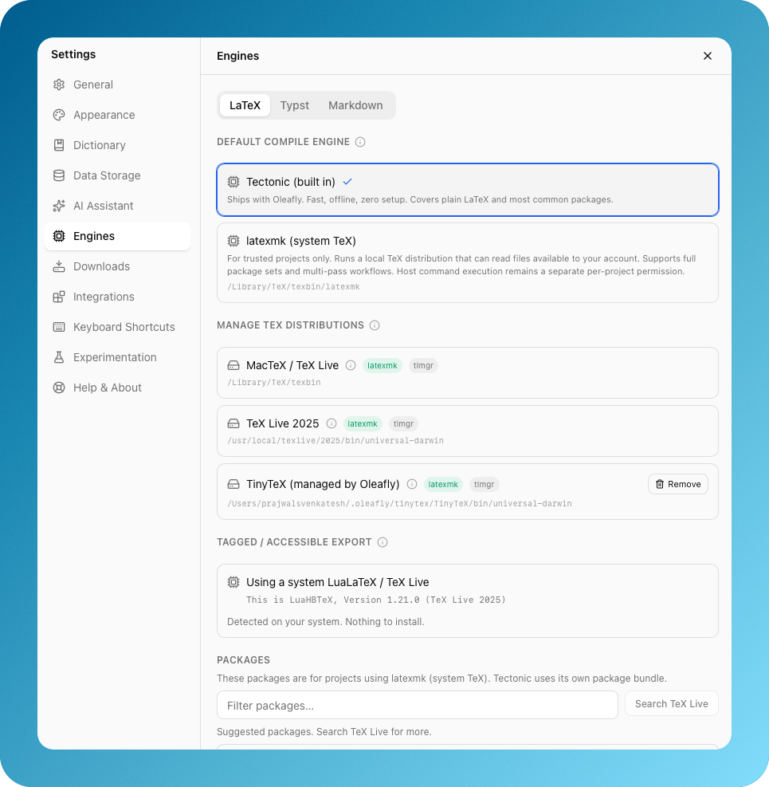

# Compilation engines

Compilation is selected by a `DocumentEngine` descriptor. Frontend controls
consume the descriptor's capabilities instead of guessing from filename
extensions. Rust owns process execution, artifact paths, diagnostics, and
engine-specific policy.

There are five engines: [LaTeX](#latex) (bundled Tectonic, or
[latexmk](#latexmk-system-tex-compatibility) with a system TeX),
[Typst](#typst), [Markdown](#markdown) through Pandoc, and [Quarto](#quarto)
and [Calepin](#calepin) for documents that run R, Python or Julia code.

  

<em>Choose the engine that matches the document and its toolchain needs.</em>

## LaTeX

- Default engine: bundled Tectonic sidecar.
- Supports multi-file projects, images, bibliography files, SyncTeX, and
  cached/offline compilation when packages are available.
- **First compile:** Tectonic downloads files from its TeX package bundle as a
  document asks for them, and it fetches the names on a `.prefetch` list in its
  cache in bulk. Before the first online compile, Oleafly writes that list from
  `crates/oleafly-core/resources/tectonic-prefetch.txt`, unless the cache
  already has one. To regenerate that file, cold-compile the templates with a
  fresh `TECTONIC_CACHE_DIR` for each template, then run
  `node scripts/tectonic-prefetch-list.mjs <cache dirs> > crates/oleafly-core/resources/tectonic-prefetch.txt`.
- The bundle comes from Oleafly's mirror. If the mirror fails, even on a warm
  cache, Oleafly compiles again against the upstream bundle and says so in the
  log. In offline mode, a file that isn't cached yet gets its own message, which
  names the file when the log does.
- For a main document in a subfolder, Tectonic searches that folder first and
  latexmk runs from it when more of the document's references exist only there
  than from the project root. Library projects and linked folders work the same
  way, and `../` references count as long as they stay inside the project.
- **biblatex / Biber:** Tectonic's bundle ships biblatex 3.17, which requires
  Biber 2.17. Oleafly packages a pinned `tectonic-biber` sidecar (see
  `scripts/fetch-biber.sh`) and puts its directory on `PATH` for the compile
  child. Tectonic starts in a scratch folder rather than the project, because it
  looks for `./tectonic-biber` in its working directory before it reads `PATH`.
  The fetch step also patches the Perl inside Biber
  (`scripts/biber/harden-biber.mjs`), because Biber takes options and code-like
  text from what the document writes. **Primary path:** Tectonic discovers `tectonic-biber` mid-build and
  runs it itself. **Recovery path:** if a `.bcf` is left without a usable
  `.bbl` (PATH miss, mid-build tool failure), Oleafly runs the same sidecar via
  the supervised process helper (timeout + cancel) and re-typesets once. This
  avoids GUI `PATH` misses and system-Biber version skew.
- Compile logs are normalized into editor diagnostics. Incomplete bibliography
  steps surface as `[Oleafly]` notes distinguishing “Biber not found” from
  “Biber/biblatex version mismatch”.
- On Tectonic and latexmk, a shipped `<main>.bbl` is used only when the project
  has no `.bib` file and the preamble doesn't use biblatex, and the log says so.
  The job name is `_oleafly_entry`, so a bibliography named with `\jobname` isn't
  found and the compile warns.
- TeX leaves out a character its font has no glyph for and still reports
  success, so a document can compile with its text gone. The log parser turns
  those lines into one warning, and a successful compile with that warning
  shows a notice once per project. Stray text in `nullfont`, which comes from
  TikZ pictures, doesn't count. On XeTeX the warning lists an `xeCJK` setup for
  the scripts it found, using fonts in the Tectonic bundle: `bsmi00lp.ttf` for
  Traditional Chinese, `gbsn00lp.ttf` for Simplified, `ipaexm.ttf` for Japanese
  and `UnBatang.ttf` for Korean. Fandol is not offered because it lacks common
  Traditional characters such as 裡. `CJKutf8` and `CJK` only work on pdfLaTeX,
  so a project that loads them on the built-in engine is also offered that
  switch.
- **Font defaults:** Tectonic compiles write `<build>/tex-defaults` and search
  it after the project, so project files win. It holds `TU` font definitions for
  Times, Helvetica, Courier, Palatino, Bookman, New Century Schoolbook and Avant
  Garde that point to TeX Gyre, which would otherwise fall back to Latin Modern.
  It also holds a `ctexopts.cfg` that makes Fandol the `ctex` default, so a
  document that sets no `fontset` gets Fandol on every system. A document that
  wants Apple fonts sets `fontset=mac`.
- **T1 encoding:** `\usepackage[T1]{fontenc}` breaks typed accents and symbols
  on a Unicode engine, so the generated entry file carries a hook that keeps
  such a document on `TU`. If the default roman, sans or mono family has a T1
  definition and no `TU` one, the document goes back to T1, the log gets
  `[Oleafly] T1 font encoding kept`, and the compile warns with a guarded
  `fontenc` line to paste in. A later `\fontfamily` switch to a T1-only family
  uses T1 for that family. Offline compiles skip this hook and `tex-defaults`.
- Optional LuaLaTeX support can prepare and verify tagged PDF output for
  accessibility-oriented workflows. It is separate from the default Tectonic
  path.
- Import scan (`@oleafly/latex` `scanImportCompatibility`) flags the
  requirements of projects written for other LaTeX setups (biblatex, minted,
  glossaries, shell-escape, fonts) when a project is opened. The same taxonomy
  (`IMPORT_COMPAT_CATALOG`) drives the compile-failure classifier
  (`classifyCompileFailure`) and the engine-picker modal, so every surface
  describes a gap in the same words.
- Some findings come only from a failed compile, because nothing in the source
  predicts them: a class that pins hyperref's `pdftex` driver, an EPS figure
  the bundled engine cannot place, a `.sty` or `.cls` the bundled TeX bundle
  does not carry, and a failed bundle download. `importCompatAction` names the
  one fix each entry offers: switch to pdfLaTeX on system TeX and recompile,
  switch and then install the package, or just compile again. A failed download
  is reported on its own, never as a missing package.

## latexmk (system TeX compatibility)

Projects that need tools Tectonic does not orchestrate, including `minted`
(shell-escape + Pygments), `glossaries`/`makeidx` (external index runs),
`pythontex`, and shell-escape-heavy publisher classes, can pin the `latexmk`
engine instead. It drives a **system TeX distribution** (MacTeX, TeX Live,
MiKTeX, or TinyTeX) via `latexmk` while preserving Oleafly's artifact layout.

- Detection is shared by the app and `oleaflyc`
  (`crates/oleafly-core/src/tex_distro.rs`). A folder from a standard location
  such as `~/texlive/<year>`, from `PATH`, or from a generic location such as
  Homebrew's is ordered first only when it contains `latexmk`, pdfLaTeX,
  XeLaTeX, LuaLaTeX, `kpsewhich`, and Biber. Managed TinyTeX under
  `~/.oleafly/tinytex` and user TinyTeX installations follow. On a Windows
  profile whose path isn't plain ASCII, managed TinyTeX and the Biber unpack
  folder live in `%ProgramData%\Oleafly-<hash>` instead. Symlinks into TinyTeX
  remain in the TinyTeX tier. The same ordered list feeds tool lookup, Settings,
  and the compile child's `PATH`. The app also reads the login shell's `PATH`
  and, on Windows, the `Path` values in the registry.
- Settings > Engines > LaTeX marks the distribution `latexmk` runs from as
  **In use**. **Use for compiles** saves another distribution's folder as
  `tex_distribution` in `config.json`, which `oleaflyc` also reads, and that
  folder goes first while it still holds TeX tools. **Automatic** clears the
  choice.
- MiKTeX needs a Perl on `PATH` to run `latexmk`. Without one, MiKTeX moves
  behind every other distribution, so TinyTeX takes over if it is there. With
  nothing else to use, the compile stops with `tex.latexmk_needs_perl`, and
  Settings shows "latexmk needs Perl".
- The app checks the setup before it starts `latexmk`. With no TeX, or a TeX
  that has no `latexmk`, the compile stops with a setup error. Choosing a
  latexmk compiler in that state opens the engine picker with the TinyTeX offer,
  and a compile shows **Download and use TinyTeX** next to **Use Tectonic**. The
  compile runs again once TinyTeX is installed. A missing compiler or Biber gets
  its own error. These errors name the install command when Oleafly knows the
  distribution: `tlmgr install`, `sudo tlmgr install` on MacTeX, and `apt`, `dnf`
  or `pacman` for TeX from Linux packages.
- On macOS, TeX Live's Biber and the one in managed TinyTeX are universal
  binaries. Their PAR::Packer loader calls `lipo -extract_family` every time
  Biber starts. Recent Xcode's lipo rejects that flag, and a Mac without
  developer tools has no lipo at all, so Biber exits before it reads anything.
  Before a `latexmk` compile, Oleafly copies the slice for the Mac's CPU out of
  the universal file into `~/.oleafly/assets/biber/<fingerprint>/bin` (the same
  bytes `lipo -thin` would write) and puts that folder first on the child's
  `PATH`. The copy sits in that Biber's unpack folder, so pruning deletes it
  once TeX Live replaces the Biber. `oleaflyc` does the same for its `latexmk`
  runs. The in-app terminal puts the folder first on `PATH` and, unless you set
  `LATEXMKRCSYS` yourself, points it at a small rc file that names the copy.
- The TeX engine is set by "Compiler (this project)" in the compile menu,
  which saves the choice as `tex_flavor` in `project.json`. With Auto, the
  source decides: a `% !TeX program = xelatex|lualatex|pdflatex|uplatex|platex`
  magic comment wins, and `% !TeX TS-program` and `% !TeX engine` count the same
  way. Japanese classes come next: `jsarticle`, `jsbook` and
  `jsreport` use pLaTeX, or upLaTeX with the `uplatex` option, the `uj*`
  classes and `jlreq` use upLaTeX, and the `ltj*` classes or `luatexja` use
  LuaLaTeX. The `ctex` classes and package and `xeCJK` use XeLaTeX. For Korean,
  `luatexko` uses LuaLaTeX, while `xetexko` and the Hangul and Hanja font
  commands such as `\setmainhangulfont` use XeLaTeX. `kotex` alone stays on
  pdfLaTeX. fontspec / polyglossia / unicode-math / `\setmainfont` force
  XeLaTeX. If the main file doesn't settle it, a `latexmkrc` or `.latexmkrc` in
  the document's folder or the project root can: Oleafly reads `$pdf_mode`,
  `$latex` and `$pdflatex` as text and never runs the file. After that it
  follows the preamble into `\input` files and local classes and packages, two
  levels deep, and leaves alone any file that branches on the engine. Everything
  else uses pdfLaTeX. The rules live in `oleafly-core` (`project_tex_flavor`), so
  `oleaflyc` picks the same compiler.
- upLaTeX and pLaTeX run through latexmk's DVI route (`-pdfdvi`) with
  `dvipdfmx`, `upbibtex` or `pbibtex`, and `upmendex` or `mendex`. These are
  passed on the command line because latexmk runs with `-norc`. If the
  compiler or `dvipdfmx` is missing next to latexmk, the compile stops. When
  Oleafly can write to that distribution, as with managed TinyTeX or a TeX Live
  whose `tlpkg` folder is writable, the failed compile offers
  **Install Japanese support (about 450 MB)**. That installs
  `collection-langjapanese`, plus `upmendex` for upLaTeX, and compiles again.
  Elsewhere the error is `tex.japanese_compiler_missing_command`, which names
  the install command for that distribution, or
  `tex.japanese_compiler_missing` when Oleafly doesn't know one.
- `-norc` also means index runs come from the command line. Fixed rules build
  the `makeindex` route of `glossaries`, including `order=letter`, and `nomencl`
  lists. `xindy` and lists added with `\newglossary` are not built, and the
  compile warns when one is missing from the PDF.
- Oleafly pins its managed TinyTeX to a monthly release, but tlmgr talks to the
  live repository. Once the repository's infrastructure moves on, tlmgr refuses
  every install until it updates itself, and on Windows it can still exit with
  code 0. Oleafly looks for that message in tlmgr's output, runs `tlmgr update
  --self` for the TinyTeX it manages, and repeats the install once. A system TeX
  Live or a TinyTeX you installed yourself is yours to update, so there the
  error names the command to run.
- The TeX Live that Debian, Ubuntu and Fedora package is managed with `apt` or
  `dnf`, so Oleafly doesn't add packages to it. It spots that `tlmgr` by reading
  the script. Settings says which manager to use, and a missing package gets a
  notice with an `apt-file` or `dnf` hint, plus a TinyTeX offer when the TeX is
  incomplete. Once `tlmgr init-usertree` has given Debian or Ubuntu a package
  database in `~/texmf`, Oleafly uses `tlmgr` in user mode there.
- Arbitrary TeX shell commands are blocked by default. A user can explicitly
  allow them for one trusted project on one computer. The setting is never
  inferred from source, imported, exported, committed to Git, or stored in
  `project.json`. The local grant is bound to the project directory's
  filesystem identity, so copies and recreated project IDs require fresh
  consent. Leaving `latexmk` or deleting the project revokes it.
- Without that consent, system TeX runs with restricted shell escape
  (`-shell-restricted`), not with shell escape switched off entirely. TeX Live
  then permits only the programs on its own allow list in `texmf.cnf`, such as
  `repstopdf`, `extractbb`, `kpsewhich`, and `makeindex`. That is what lets an
  ordinary imported project with EPS figures build on pdfLaTeX, because
  `epstopdf` can convert them during the run. MiKTeX stays at
  `-no-shell-escape`, so EPS figures don't convert during a MiKTeX run. Every
  run without consent also sets `MIKTEX_MIKTEX_CORE_ALLOWEDSHELLCOMMANDS` to
  MiKTeX's default allow list minus `findtexmf`, which covers a MiKTeX install
  Oleafly doesn't recognize.
- System TeX is not a filesystem sandbox and may read files available to the
  user's account even while shell commands are blocked. A project runs system
  TeX only when someone chose it: the default compile engine in Settings >
  Engines, or the project's own engine choice. An opened folder stays on
  bundled Tectonic until it is trusted.
- Project, user, and system `.latexmkrc` files are disabled because they are
  executable Perl. When local consent is enabled, Oleafly passes
  `-shell-escape` directly and supervises the resulting process tree. This can
  execute programs with the user's permissions and should be enabled only for
  fully trusted project files.
- PythonTeX uses an Oleafly-owned three-stage flow (latexmk, the active TeX
  distribution's `pythontex` helper, then latexmk) with bounded output,
  timeout, and cancellation. Unix uses an isolated process group. Windows
  creates the child suspended, assigns it to a kill-on-close Job Object, and
  resumes it only after containment succeeds. It is available only with the
  same explicit local consent.
- latexmk runs the *real* main document with `-jobname=_oleafly_entry`, so all
  artifact paths (PDF, log, SyncTeX) match the Tectonic layout and the preview,
  log pane, and SyncTeX work unchanged.
- TinyTeX can be installed on demand (Settings → Engines → Manage TeX
  distributions, or the engine-picker modal). The installer checks free disk
  space first, reports phased progress (download / unpack / packages), resumes
  interrupted downloads across launches, and intercepts app quit while
  running. A download can be cancelled. It tries the pinned GitHub asset, then
  Oleafly's mirror, and a source that stalls for 60 seconds counts as failed. On
  Linux, TinyTeX runs on the system Perl, so the installer checks for Perl and
  the modules TinyTeX loads before it downloads anything, and a partial Perl
  gets a message to install the full `perl` package. Settings shows **Update**
  when the managed TinyTeX doesn't match the release this version of Oleafly
  pins. Before extraction the installer verifies the pinned archive byte length
  and SHA-256, then validates the exact reviewed member count, expanded size,
  member type and path manifest, duplicate-path policy, and confined symlink
  topology for the current platform. No member is written before that
  preflight succeeds.
- Package lookups ask the local TeX Live database first and only fall back to
  the remote repository when the local answer is empty. A local release older
  than the remote one makes `tlmgr` refuse a remote query or an install
  outright. Oleafly then repeats the operation against that release's final
  snapshot in the TeX Live historic archive (`<year>/tlnet-final`). If that
  fails too, the error names both years instead of showing an empty result, and
  on managed TinyTeX it points to the update in Settings.
- A remote lookup that fails, or answers with something that is not JSON, is
  reported as a repository failure. It is never reported as a package TeX Live
  does not carry: that wording sends people back to their template for a file
  the mirror never answered about.
- When the system TeX tree is read only, an install retries in the personal
  tree. Its location comes from the active distribution
  (`kpsewhich --var-value=TEXMFHOME`), which answers `~/Library/texmf` on
  MacTeX and `~/texmf` on plain TeX Live, so the path is never guessed. If that
  tree has no package database yet, `tlmgr init-usertree` creates one first, and
  a failure there is reported as its own error. The result says where the
  packages landed.
- Settings reads both databases. The system list and
  `tlmgr --usermode list --only-installed` are merged, each row says which tree
  holds the package, and a removal goes to the tree the package came from.
- A package operation holds the compile locks while it runs, so the whole flow
  (search, tree setup, install, re-read) is capped at 15 minutes. Past that it
  is stopped and the error says so, instead of chaining per-command timeouts
  into most of an hour.
- On Windows, TeX Live installs `tlmgr` as `tlmgr.bat`, which `CreateProcessW`
  cannot start, so those calls go through `cmd.exe /D /V:OFF /C` with the path
  and every argument quoted. `/D` skips any AutoRun command and `/V:OFF` turns
  off delayed expansion, so an ambient shell setting cannot change what runs.

## Why `project.json` matters

`project.json` is the project's **portable contract**, and it is the reason two
people opening the same Oleafly project see the same output:

- `engine` pins how the project compiles (`xetex` = bundled Tectonic,
  `latexmk` = system TeX). A coauthor who clones the project compiles with the
  same engine automatically. The choice never lives only in one person's
  app settings. The Settings default is written into each project when it is
  created: a blank project, a template, an import (ZIP, folder, arXiv or
  GitHub), a converted document or a research project. An opened folder with
  no engine of its own follows the default once it is trusted. An imported
  project that pins pdfLaTeX, XeLaTeX, LuaLaTeX, upLaTeX or pLaTeX keeps that compiler when it
  lands on latexmk.
- `tex` (written when a project switches to latexmk or is created on it) records the TeX
  distribution and the `tlmgr` package versions present when the pin was made
  and fills the `package-lock.json` role. On open, coauthors are prompted to install
  missing pinned packages, and a distribution mismatch (e.g. pinned
  "TeX Live 2025", local "MacTeX 2024") gets a heads-up that rendering may
  differ.
- `typst` (Typst projects) pins the Typst version and stores its build
  settings: vendored packages, font folders, inputs, variants, and
  reproducible builds. See `docs/typst-toolchain.md`.
- Permission to execute TeX shell commands is intentionally *not* part of this
  portable contract. Each computer requires a separate, explicit trust decision.
- `main_doc`, `name`, `color`, and export history ride along too.

It lives at the project **root** (not under `.oleafly/`) precisely so that git
and ZIP export carry it: the app-internal `.oleafly/` directory is gitignored
and skipped by exports by design. Do not move engine or pin data into
`.oleafly/` because coauthors would silently stop receiving it.

Every successful compile also writes a small provenance record to
`.oleafly/builds/` (engine, distribution, lockfile hash, and output fingerprint,
local-only, pruned to the last 20) so "my coauthor's bibliography looks
different" is a diagnosable question. Compare the two machines' latest build
records.
- **Supervised PATH:** every supervised compile child (LaTeX, Typst, Markdown
  tooling that goes through the same helper) gets TeX-related directories and the
  sidecar directory prepended to `PATH`. Non-LaTeX engines simply ignore unused
  entries. Directories are only added when they exist on disk.
- **Time limits:** a compile gets 5 minutes, Markdown to PDF gets 15, and Quarto
  and Calepin get an hour. With code off, Calepin's stored results go through
  plain Typst and get 5 minutes. Each download line from Tectonic starts the
  count again, up to 30 minutes in all, or the limit itself when that is longer.
- **Linux aarch64:** upstream has no Biber 2.17 binary, so
  `scripts/biber/build-linux.sh` builds the one Oleafly ships.

## Typst

- Compiles with the Typst version the project pins, or with the default
  version from Settings → Engines → Typst. Oleafly ships one Typst and can
  download 0.11 to 0.15, each checked against a pinned checksum. See
  `docs/typst-toolchain.md`.
- Supports `.typ` source and direct PDF output.
- With Auto compile on, one `typst watch` process stays running and the
  preview refreshes as you type.
- Source and PDF sync goes through Tinymist and needs Typst 0.13 or newer.
  Offline mode works when packages are already cached or vendored into
  `typst-packages/`. Isolated compilation is not supported, so the figure tools
  render CeTZ or fletcher as Typst snippets.
- Typst-specific UI behavior is driven by the descriptor, not extensions.
- One-shot compiles receive the same supervised `PATH` prepending as LaTeX
  (see above). The `typst watch` process that Auto compile keeps running does
  not. Typst does not use Biber or TeX Live bins either way.

## Markdown

- Uses Pandoc with the bundled Tectonic executable as its PDF engine.
- Supports `.md` and `.markdown` projects, structural indexing, citations,
  and conversion exports declared by the descriptor.
- Does not claim SyncTeX, offline compilation, or isolated figure support.
- Packaged builds include Pandoc. The app records a clear prerequisite state,
  and Settings can repair a missing development copy.

## Quarto

- Compiles `.qmd` and `.Rmd` documents with Quarto 1.10.19 or the Quarto on
  your computer. Oleafly looks for `quarto` on `PATH` and in the usual install
  folders first, then for the copy it downloaded.
- The minimum is Quarto 1.5. An older copy on your computer gives way to
  Oleafly's download. With no download, the compile stops and offers one, while
  a document in a `_quarto.yml` project keeps using the older Quarto.
- Settings > Engines > Quarto can download Quarto into
  `~/.oleafly/toolchains/quarto/1.10.19` after you click the download button.
  The download exists for Macs (Apple silicon and Intel), Linux on x86-64 and
  ARM, and 64-bit Windows. On other computers, install Quarto yourself. The archive is
  checked against a pinned size and SHA-256 before anything is unpacked, and
  only links that stay inside the install are accepted.
- The first format the document declares that Oleafly can show decides the
  output: `pdf`, `typst` and `beamer` give a PDF in the build folder, and
  `html`, `revealjs` and `dashboard` give an HTML page that opens in the
  browser. An extension format counts by the last part of its name, so
  `acm-pdf` gives a PDF. Other formats, such as `docx`, are skipped. `.Rmd`
  files that only name an R Markdown `output:` map to the matching Quarto
  format. A `_quarto.yml` or `_metadata.yml` between the document and the
  project root is read when the document declares nothing. With no format
  Oleafly can show, the document builds HTML.
- Quarto runs R through knitr and Python or Julia through Jupyter with your own
  installs. Oleafly passes the R and Python it found as `QUARTO_R` and
  `QUARTO_PYTHON` unless you set them yourself, and on macOS and Linux it does
  the same for Julia with `QUARTO_JULIA`. With code on, a project `.venv`,
  `venv` or `env` that has Jupyter supplies the Python, and an `_environment`
  file in the project root that names `QUARTO_PYTHON` wins over both. If
  `{julia}` chunks never started, the compile warns.
- A PDF format that needs LaTeX, with no TeX installed, shows the TinyTeX offer
  without the Tectonic button. Switching the document to `format: typst` needs
  no TeX install. Adding `pdf-engine: tectonic` doesn't either, but it works
  only once code is allowed for the project.
- Code is off until you allow it for the project. The consent is the one
  latexmk uses for shell escape: per project and per computer. With code off,
  Quarto renders with `--no-execute`. R starts without the project's
  `.Rprofile` and `.Renviron`, and Python does not import from the current
  folder. Filters, shortcodes, `_extensions`, pre and post render scripts and
  inline R code still run code under `--no-execute`, so a project that has any
  of them does not compile until you allow code. With code off and no R
  installed, a `.qmd` with front matter falls back to a plain preview through
  Quarto's `markdown` engine, unless the front matter has a `knitr:` key. A
  `.Rmd` still needs R.
- Quarto writes a working file named after the document beside it: `.tex` for
  PDF and Beamer, `.typ` for Typst. If a file with that name is already there
  and Quarto didn't write it, the compile stops and names the file, unless the
  document sets `keep-tex` or `keep-typ`. A `.pdf`, `.log` or other output file
  with the same name is set aside during the run and put back afterwards.
- Quarto refuses `--output-dir` for a file it doesn't treat as a project input:
  a name starting with `_`, a file left out of `project: render`, or anything in
  a `_quarto.yml` project under the Oleafly library, because Quarto skips paths
  inside dot folders such as `~/.oleafly`. Oleafly then renders the file as a
  plain document and moves the output into the build folder, so a book or
  website in the library produces only that one document.
- Errors and warnings from Quarto, the YAML validator, knitr (with the chunk's
  file and first line), Jupyter (with the exception and the cell's code) and
  the LaTeX step appear in the log pane.
- DOCX and HTML exports run Quarto again into a temporary folder. HTML exports
  embed their resources so the file stands alone.

## Calepin

- Compiles Typst documents that import `/.calepin/calepin.typ` with Calepin
  0.0.61 or the Calepin on your computer. Oleafly looks in `PATH`,
  `~/.cargo/bin` and `~/.local/bin` first, and downloads Calepin the same way
  as Quarto, for the same computers, into
  `~/.oleafly/toolchains/calepin/0.0.61`.
- Calepin needs Typst 0.15 or newer. Oleafly passes its bundled Typst with
  `--set executables.typst=...` and the R it found with
  `--set executables.rscript=...`, and sets `CALEPIN_PYTHON` unless the
  project has its own `.venv`.
- Calepin has no mode that skips code. With code off, Oleafly renders the
  results Calepin stored in `.calepin/` with plain Typst, which runs nothing,
  and the log says so. With nothing stored the compile stops and offers to
  allow code.
- A chunk whose language is missing renders as a short note and the document
  still builds. Typst diagnostics keep their file and line. Calepin's own
  errors and warnings, such as a failed chunk, appear without a line.
- The command line `oleaflyc` does not build Quarto or Calepin projects yet and
  says so.

## Sidecar and supply-chain policy

- Tectonic, Biber, Pandoc, Typst, TexLab, Tinymist, Quarto, and Calepin
  versions are pinned by manifests or release metadata.
- Fetch scripts and runtime installers verify SHA-256 before extraction and
  reject unexpected archive members. TinyTeX pins a canonical manifest naming
  the upstream assets it accepts: Windows x64, a universal macOS archive,
  Linux x64, and Linux ARM64. Those names describe TinyTeX's own downloads,
  not Oleafly's build targets. Oleafly releases macOS for Apple Silicon and
  Intel, alongside Windows x64, Linux x64, and Linux ARM64.
- Language servers are not Tauri external binaries. Tinymist ships inside the
  app as a pinned archive, and the app checks it before installing it into
  app data. TexLab downloads only after the user agrees, and the prompt shows
  its license.

## Engineering anchors

- `src-tauri/src/document_engine.rs`: descriptors and dispatch.
- `crates/oleafly-core/src/tex_distro.rs`, `tex_flavor.rs`, `detect.rs` and
  `compile_limit.rs`: TeX detection, setup errors, the Auto compiler rules and
  compile time limits.
- `src-tauri/src/document_engine/quarto.rs` and `calepin.rs`: the two code
  engines, their trust rules and log parsers.
- `src-tauri/src/notebook_toolchain.rs` and
  `src-tauri/resources/notebook-toolchains.json`: Quarto and Calepin
  detection, pinned downloads, and the R, Python and Julia check.
- `src-tauri/src/latex_engine.rs`: optional tagged LaTeX path.
- `scripts/fetch-tectonic.sh`, `scripts/fetch-typst.sh`, and
  `scripts/fetch-language-servers.mjs`: pinned acquisition.
- `docs/document-engines.md`: capability matrix and extension policy.
- `docs/language-server-toolchain.md`: language-server distribution policy.
