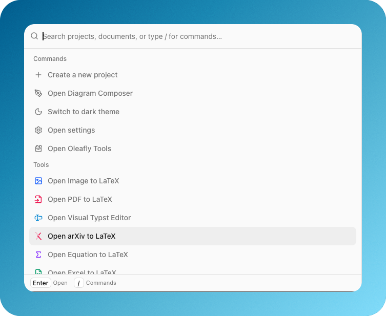
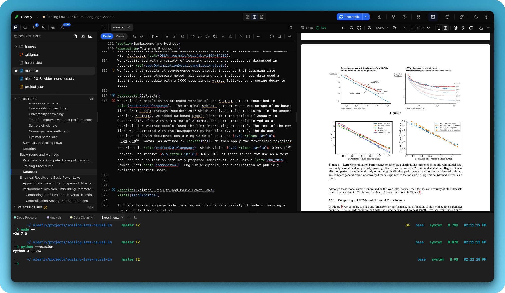

# General application surface

General features are the application shell around the editor and document
engines. They provide project lifecycle, navigation, preferences, and local
state without changing the source format.

## Implemented areas

- Project library with engine, document kind, modification, bookmark, and
  preview metadata.
- Create LaTeX, Typst, and Markdown projects from editable templates.
- Nested source tree with create, rename, duplicate, delete, and main-document
  selection operations.
- Autosave with dirty-state and compile-result freshness tracking.
- Command palette and omnibar for project and document actions.
- System, light, and dark appearance using shared design tokens.
- Settings for engines, language servers, AI providers, MCP, shortcuts, and
  downloads.
- Terminal dock with shell tabs that can be renamed and colored per project.
- Local word count, project search, logs, and diagnostic surfaces.
- Update checks through the signed application updater.

  

<em>Search the workspace and open commands or tools from one place.</em>

## Appearance

Appearance has three choices: System, Light, and Dark. System follows the
operating system and changes when it does, with no restart needed. You can set
it from the theme menu in the toolbar or the home dock, the App tab under
Appearance in settings, the welcome screen, or the command palette.

## Terminal dock

The terminal dock holds one tab per shell session, up to ten per project.
Double click a tab or use the pencil control to rename it in place. Right click
a tab for the same rename, a color from the project cover palette, and the close
actions: this tab, the others, the ones to its right, the ones to its left. A
close action is disabled when nothing sits on that side. The color shows as a
dot before the title and tints the tab while it is active. Titles and colors are
saved per project, so a terminal slot reopens with the name and color it had.
Shift+F10 or the context menu key opens the menu when a tab has focus.

File paths and web addresses in terminal output are links. Hover one to see
where it points, and ⌘-click it (Ctrl-click on Windows and Linux) to open it. A
source file opens in the editor at the line and column the output gives. PDFs
and images open in their viewer tab, and web addresses open in your browser.
Only relative paths that match a project file get a link for now.

Settings > Appearance > Terminal picks the shell new terminals start. On
Windows the choices are PowerShell 7, Windows PowerShell, Command Prompt, Git
Bash, WSL and a custom path, and the default is PowerShell 7 when it is
installed. On macOS and Linux the default is your login shell, and a custom
path works there too. Terminals that are already open keep their shell. The
same section sets the scrollback, copy on select, what Shift+Enter sends and,
on macOS, whether Option works as Meta.

Shift+Enter starts a new line in command-line agents instead of sending what
you typed; the Shift+Enter setting turns it back into Enter. To copy and paste,
use Ctrl+Shift+C and Ctrl+Shift+V on Windows and Linux. On Windows, Ctrl+C
also copies when text is selected (without a selection it stops the running
program) and Ctrl+V pastes. On macOS, ⌘C and ⌘V work as everywhere else.
Ctrl+Shift+F (⌘F on macOS) searches the output, and ⌘K clears it on macOS. While a
terminal has focus, keys go to the shell; [Terminal keys](KeyboardShortcuts.md#terminal-keys)
lists the app shortcuts that still work there.

Tabs you are not looking at keep running and keep all of their output. When a
program rings the bell in one of them, the tab gets a dot, and so does the
terminal button while the dock is closed. Hover a tab to see the title its
program set.

Right click a folder in the file tree, or the empty space below the files, and
choose Open in terminal to start a terminal in that folder. Drag files from the
file tree onto a terminal to type their paths, quoted for the shell. On Linux
this also works with files dragged from the file manager.

Closing a terminal that is still running a program asks first, and so do
closing or switching the project and quitting Oleafly while one runs. Don't ask
again in that question, or the setting in Settings > Appearance > Terminal,
turns it off.

Terminals have the `oleafly` command on their PATH once Oleafly has set it up,
and `OLEAFLY_CLI` holds its full path.

  

<em>Run project commands in a terminal tab without leaving the editor and PDF workspace.</em>

## Local-first policy

Project files, optional Git history, compiled artifacts, indexing, preview
rendering, spellchecking, and preflight remain local unless the user selects a
network operation. The app has no mandatory account or telemetry requirement.
Downloading a spelling dictionary is the one spell-check operation that leaves
the machine. It fetches two files from a public package CDN, so the CDN learns
which language you picked and nothing else: no document text, no project name,
no account. Offline mode refuses the download.

## Engineering anchors

- `src/store/`: application state domains.
- `src/components/library/`: project library and template selection.
- `src/components/settings/`: settings surfaces.
- `src/components/dock/`: terminal dock and its tabs.
- `src/contributions/`: palette, rail, and command registration.
- `src-tauri/src/paths.rs` and `src-tauri/src/sandbox.rs`: path policy.
