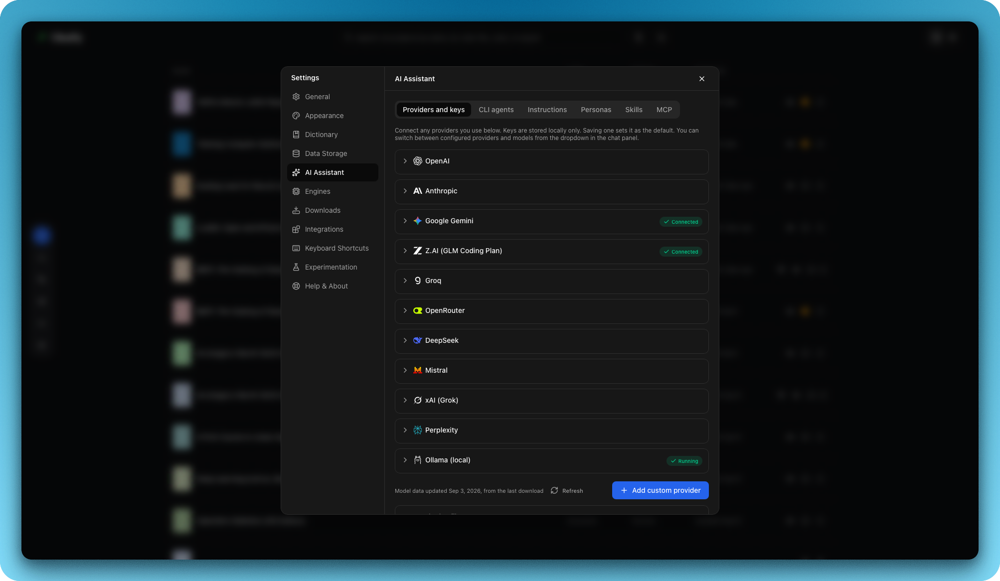

# Integrations

Integrations are opt-in boundaries around the local-first application. Core
editing, indexing, compilation with available local engines, preview, and
preflight do not require an account.

## Supported boundaries

| Integration | Purpose | Boundary |
| --- | --- | --- |
| Online LaTeX service | Import projects, keep a project in two-way sync through the service's Git bridge, and edit it live with coauthors (experimental) | Network calls go only to the service address you sign in to. The sign-in and the Git token stay encrypted on this computer. Browser sign-in uses a separate window that Oleafly closes once you're in |
| Git hosting (GitHub, GitLab, Gitea, Forgejo, Codeberg) | Sign-in with a browser code (github.com) or an access token, repository lists, publish, import, push and pull | Network calls go only to servers you add. Tokens stay in encrypted storage, and Git gets one only for that server's addresses |
| MCP | Expose project tools to external clients | Localhost HTTP with a bearer token you can regenerate, and the same approval model |
| alphaXiv | Lets the assistant search papers, read them and use your alphaXiv library, through alphaXiv's MCP server | API key from alphaXiv; the assistant asks before each call, and a key alphaXiv refuses is not saved |
| Zotero | Search the whole Zotero library while citing, add only the cited entries to the project's `.bib` and keep them up to date, or import a whole library | Read-only. Talks to Zotero on this computer through its local API with no account, or to zotero.org with an API key kept in encrypted storage that never reaches the webview |
| AI providers | Chat, edits, compilation assistance, and figure generation | User-selected hosted provider or local Ollama model; credentials stay local |
| Citation services | DOI, arXiv, Crossref, multi-source literature, optional Serper (Google Scholar), OpenAlex email | Sends the requested identifier, title, or search keywords only |
| OpenAlex contact email | Improves OpenAlex rate limits (polite pool) | Optional; stored locally as connector value `openalex-email`; used only in OpenAlex request User-Agent |
| Optional downloads | Engines, language servers, templates, fonts, and Pandoc | Checksum or manifest policy applies before installation |
| Update feed | Release metadata and signed artifacts | The embedded updater public key must validate the feed artifact |

  

<em>Connections are configured separately from the manuscript and its ordinary files.</em>

## Live editing with an online LaTeX service

Live editing is experimental and stays off until you turn it on in
**Settings › Experimentation**. Then a project you imported from your online
LaTeX service is live whenever it's open. You see your coauthors' typing as
they type in the service's web editor, and they see yours. Files and folders
that someone adds, renames or deletes show up on both sides, and you can see
where each person is working. It uses the same sign-in as importing, with no
Git token.

### What a crash can lose

Oleafly writes every change to disk within 250 ms of your typing it, then
sends it. If the whole app crashes, you lose at most the last 250 ms of
typing. Everything before that goes to the service the next time the project
is live. Typing while offline works the same way: it waits on disk and goes
out once, in order, when the connection is back. If you and a coauthor
changed the same text in the meantime and the two can't be merged, Oleafly
shows both versions and asks which one to keep.

### Characters the service can't store

The online LaTeX service can't store some characters, emoji among them, and
its own editor turns them into `�` (U+FFFD). Oleafly does the same before it
sends your typing, so every copy of the file matches, and it tells you the
first time it happens in a project.

### Visual mode and Git sync

While a project is live, Visual mode is read-only, as it is for projects
shared on an [Oleafly Server](collaboration-server.md). Edit in Code mode.
The project's Git sync with the service stays off while it's live, so the
two never write the same files.

### The service's limits

The service limits how long one document can be, how big one change can be,
and how many comments (500) and tracked changes (2,000) one document can
hold. A file that reaches a limit stops live editing on its own, with a line
that says why, and the rest of the project stays live. Your text stays on
this computer. Once the file is back under the limit, **Try live again**
picks up where it stopped. **Keep mine as a copy** saves your version next to
the file and reloads the one on the service.

### Access and sharing

If a coauthor makes you a viewer, the project turns read-only. As a
reviewer, or while track changes is on, your edits go in as suggestions. If
you lose access or the project is deleted on the service, your copy stays on
this computer. A project is live in one place at a time, so a project that's
live with the service can't also be shared on an Oleafly Server.

### Signing in on Windows, Linux and macOS

The sign-in window works for a password sign-in on every system. For Google,
institution or passkey sign-in, use **Sign in with your browser**: Oleafly
opens the service in a separate, clean window of Chrome, Edge, Brave,
Chromium or Firefox and closes it once you're in. On Windows, Edge is always
installed, so it's the quickest pick. On Linux, browsers installed as a Snap
or a Flatpak work as well as the others. On macOS you can also copy the
sign-in from a browser where you're already signed in; that isn't available
on Windows or Linux.

## Provider adapter model

AI providers implement the common provider interface in
`packages/ai-core/src/providers.ts`. OpenAI-compatible services supply a base
URL and model catalog; provider-specific UI code does not leak into the editor
or compiler packages.

## Security expectations

- No integration may silently send project files.
- User approval is required for file-changing AI actions.
- OAuth, AI, and MCP credentials use encrypted app-managed storage.
- Network-dependent operations expose offline and unavailable states explicitly.
- External clients cannot bypass the application's file sandbox or approval
  policy through the MCP endpoint.

## Engineering anchors

- `crates/oleafly-online/src/live/`: the live session, its document clients
  and the on-disk journal.
- `crates/oleafly-ot/`: text operations and the three-way merge.
- `crates/oleafly-online/src/browser_signin/`: Sign in with your browser.
- `src-tauri/src/forge/`: Git hosting account, publish and import commands.
- `crates/oleafly-forge/`: Git hosting sign-in, account store and server APIs.
- `src-tauri/src/citation.rs` and `src-tauri/src/literature.rs`: metadata
  lookups.
- `src-tauri/src/zotero/`: Zotero local API, Better BibTeX and Web API sync.
- `src-tauri/src/mcp/`: local MCP server.
- `packages/ai-core/`: provider and model abstractions.
- `docs/mcp.md`: protocol-level setup and threat model.
