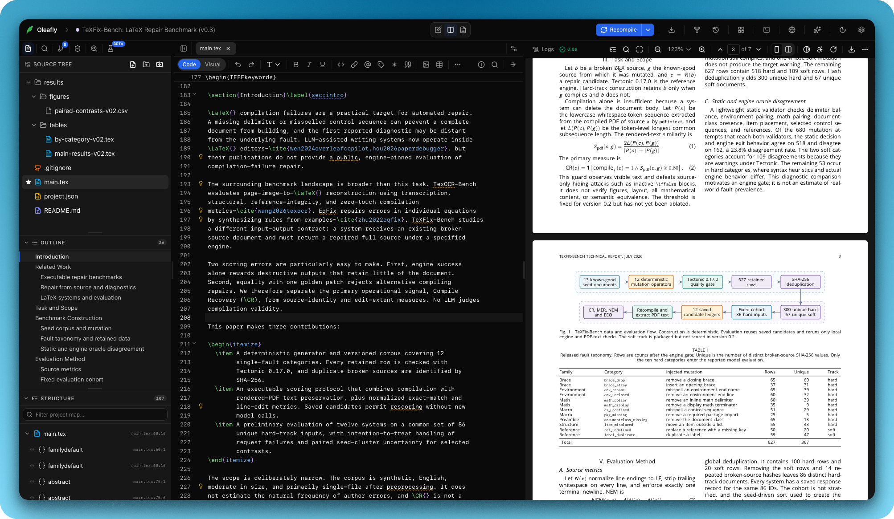

# PDF preview

The preview surface is a PDF.js-backed reader embedded beside the source. It
can also open in a detached preview window. The preview is driven by the
compiled artifact and retains the last accepted PDF while a newer compile is
pending or has failed.

  

<em>Keep the source and the latest accepted PDF visible together.</em>

## Implemented controls

- Continuous scroll with virtualized page rendering.
- Single-page and two-page spread layouts.
- Previous page, next page, and direct page-number navigation.
- Zoom in, zoom out, fit to width, and fit to height.
- Fullscreen preview mode.
- Present the PDF as slides, from the start or from the current page. An
  optional presenter view shows the next slide, a timer, and speaker notes.
- Rotate clockwise by 90 degrees.
- Dark mode draws each page in dark colors: the theme's panel and panel text
  colors in the dark theme, and a dark gray page with light gray text in the
  light theme. The toolbar, search highlights and the space around the pages
  keep the app's own colors. Pick other colors under the PDF dark mode switch in
  Settings > Appearance > PDF Preview, or set the `pdf-dark-page` and
  `pdf-dark-text` tokens in Theme customization or a theme file; each light
  and dark theme keeps its own pair. A page color lighter than the text
  color gives a tinted light page, such as sepia, instead of an inverted
  one.
- Download the displayed PDF with a chosen filename.
- Document outline and in-document text search.
- Compile-log and preview tabs in the same surface.
- Password prompt for encrypted PDFs.
- Stale-preview indicator when the visible artifact is not current.

## Source navigation

When the active engine emits valid SyncTeX data, forward SyncTeX moves from the
editor to the corresponding PDF location and inverse SyncTeX moves from a PDF
click back to source. Engines that do not provide SyncTeX advertise that
capability as unavailable instead of showing a non-functional control.

For LaTeX, a click resolves to the smallest text line under the pointer. A
click in blank space takes the nearest line inside the smallest box around it,
so a click below the last paragraph of a chapter still opens that chapter. The
line number comes from the kern and glue records inside the text line, which
carry the source line each word was read from. A text line's own tag points at
the line that ended its paragraph, so it is only the fallback. Boxes whose input
has no file name, such as table of contents entries Tectonic reads from its
build folder, never become the target. Forward search uses the same records to
find the text line that holds the requested source line.

Typst sync does not use SyncTeX data. It goes through the Tinymist language
server and needs Typst 0.13 or newer (Tinymist 0.13.30 or newer). With an older
Typst, the engine reports sync as unavailable, the same as Markdown, and the
controls stay hidden.

Selecting text in the PDF never jumps to the source, so copying text leaves the
editor where it is. A single click jumps.

## Annotations (experimental)

Annotations are off by default. Turn them on in Settings > Experimentation >
PDF review.

- Select text on the PDF, then pick what you want done with it. The selection
  snaps to whole words.
  - **Comment** asks for a change in your own words.
  - **Delete** asks for the passage to go. It's added straight away.
  - **Replace** asks for the passage to be replaced with the text you write.
  - **Insert** asks for the text you write to go right after the selection.
- For an equation, a figure or anything else you can't select as text, turn on
  **Annotate a region** in the toolbar and drag a box around it. The region
  keeps the text inside the box and the lines just above and below it.
- The card follows the selection while you scroll. Cmd+Enter or Ctrl+Enter
  adds the annotation and Escape cancels.
- Each annotation is drawn on the page as a tinted box with a numbered badge.
  Numbers are never reused, even after you delete one. The **Annotations**
  button lists them with their kind, status, quote, comment and where they
  come from in the source. Click one to scroll to it, click its comment to
  edit it, mark it resolved, or delete one or all of them.
- **Hide annotations** in the toolbar takes the boxes and badges off the page.
  Adding an annotation, or clicking one in the list, brings them back.
- **Send to assistant** adds the ticked annotations to the assistant's message
  box as chips, for the built-in assistant or a connected CLI agent, which gets
  each one as a selection. Open annotations are ticked by default. The text for
  each one is written when the message goes out: what you asked for, the file
  and lines checked again against the current file, the section heading, the
  exact text you selected with the words around it, the source lines and your
  comment. A region also sends where it sits on the page and the text inside
  it. An annotation is marked sent only once the message has gone out.

An annotation is saved as soon as you add it, and its source location is found
in the background. It comes from the same sync as a click in the PDF: SyncTeX
for LaTeX and Tinymist for Typst. When there is no sync, as in Markdown, or
the sync finds nothing, as for a minted code block, the annotation's text is
looked up in the project's source files instead. A region's text is also
checked against the lines the sync found, and looked up the same way when it
isn't there.

Annotations are pinned to the source, not to one PDF. After a recompile each
one follows its lines through any edits, finds where they are typeset now, and
narrows that down with its quote on the page. Typing in the editor while that
runs changes nothing, because the lines are looked up in the text the PDF was
built from. When the engine has no sync, or the PDF is out of date, the quote
is looked for on the annotation's page and the pages next to it. If the
passage can't be found, the annotation is marked **Needs placing** and stays
in the list, with its status unchanged. Choose **Place again**, select the
passage on the PDF and choose **Place here**.

Annotations are saved per project in the project's state folder, `.oleafly/`
for library projects and the linked state folder for folders opened in place.
They stay on this computer, out of Git and out of collaboration sync, and are
never written into the PDF. A file that can't be read is set aside next to the
new one instead of being overwritten, and a file saved by a newer version of
Oleafly opens read-only.

The detached preview window doesn't show annotations yet.

PreviewPane loads `PdfAnnotationsHost` only while PDF review is on, so the
startup chunk carries none of this. The host hands the viewer its props and the
toolbar its controls, and draws its cards in a slot inside the preview.

## Reliability rules

- A PDF result carries a project revision identity.
- A result is accepted only when its revision matches the current project.
- A newer failed compile does not erase the last accepted PDF.
- PDF bytes are transferred as binary IPC data, not base64 embedded in compile
  metadata.
- Rotation, password retry, and reload preserve the visible page where possible
  to avoid a disruptive jump during recovery.

## Implementation anchors

- `src/components/preview/PreviewPane.tsx`
- `src/components/preview/PreviewWindow.tsx`
- `src/components/pdf/PdfViewer.tsx`
- `src/features/synctex.ts`
- `src-tauri/src/synctex.rs`
- `src/features/typst-sync.ts`
- `src-tauri/src/typst_sync.rs`
- `src/store/pdf-view.ts`
- `src/components/preview/use-pdf-annotations.tsx`
- `src/features/pdf-annotations/`
- `src/store/pdf-annotations.ts`
- `src-tauri/src/pdf_annotations.rs`
- `packages/preview/src/pdfMarks.ts`
