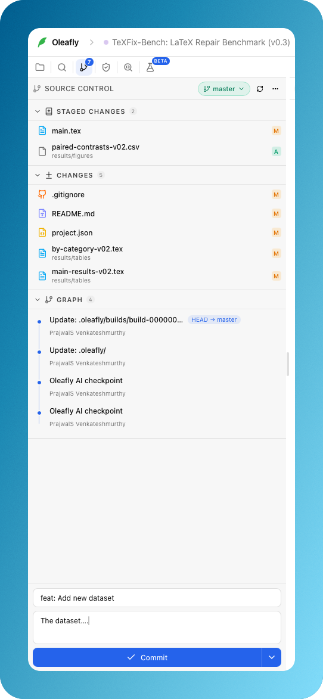

# Source control

An Oleafly project can use a normal Git repository. Oleafly does not hide the
source from command-line tools.

By default a new project is also a Git repository. When Oleafly creates or
imports a project, it runs `git init` in the project folder and records the
project's files as one first commit, "Create project". The Git panel then shows
real differences from the start, and research tasks can work in their own Git
worktree. That first commit runs with hooks, commit signing and the fsmonitor
turned off, so a global hook or a signing prompt cannot block project creation.
If the files add up to more than 100 MB, or the commit fails for any other
reason, the repository is left with nothing staged, the reason goes to the app
log, and the project is created as usual.

Oleafly also skips the first commit when a file looks like it holds a key or
password, such as `.env` or `.env.local`, `*.pem`, `*.key`, `*.p12`, `*.pfx`,
an SSH key like `id_rsa` or `id_ed25519`, `.npmrc`, or `credentials.json`. A
secret that lands in a commit stays in the history even after you add it to
`.gitignore`, so every file is left untracked in the Git panel for you to sort
out, and the app log names the files that stopped the commit. Files the
project's own `.gitignore` already covers don't count. Neither do templates
like `.env.example`, SSH public keys or Keynote `.key` files.

**Publish** uses the same list, in any folder and any mix of upper and lower
case. It commits everything else, and the dialog names the files it left out.
Those stay in the project folder and aren't staged. A push uploads the whole
branch history, so if a file with one of these names was ever committed,
Oleafly lists it and waits for **Cancel** or **Publish anyway** before it
creates anything on the server. The history check only looks at names, so it
lists a Keynote `.key` file too.

Opening a project that has no repository yet only runs `git init`. It stages
nothing and commits nothing. After the first commit, Oleafly commits only when
you ask for it in the panel. Oleafly leaves the folder alone when it already
sits inside another repository or was opened in place. You can turn all of this
off in Settings, under Integrations and then Git hosting, with **Initialise Git
for every project**. With the switch off, Source Control starts only when you
press **Initialize Repository** or publish the project, or when an imported
project already carries its own repository.

  

<em>Use normal Git operations beside the manuscript, with the repository state in view.</em>

## Git hosting

Source Control works with GitHub, GitLab, Gitea, Forgejo and Codeberg, and
with servers you run yourself. Add accounts in Settings, under Integrations and
then Git hosting. For github.com and gitlab.com you can sign in with a one-time
code in your browser. Every server also takes an access token.

**Publish** creates a repository on the account you pick and pushes the project
to it, or links the project to one of your repositories. **Link by address**
takes the HTTPS or SSH address of any repository and pushes there. Oleafly
won't save an address that has a password in it.

Push, pull and fetch don't need an account in Oleafly. Over SSH, Git uses your
own keys. Over HTTPS, Git uses the account saved for that server, or else your
own Git credentials. When a push or pull fails for one of these reasons, Source
Control says so:

- The server asked for a user name and password. Sign in to that server in
  Settings, or set up an SSH key or a Git credential helper.
- SSH doesn't know the server yet. Connect to it once from a terminal to accept
  its host key, then try again.
- The server refused your SSH key. Add your public key to your account on that
  server, or load the key into your SSH agent.

If your organization runs its own certificate authority, add its certificate
file to the account in Settings. Oleafly uses that file for that server only,
for its own requests and for Git.

**Import** can pick a repository from any connected account, or clone any
repository by its address. The imported project keeps the repository's
history.

## When Git is not installed

Oleafly uses the Git installed on your computer. Once it finds Git, it keeps
using it for the session; while Git is missing, it looks again every few
seconds, so a refresh picks up a new install. On a Mac, the `/usr/bin/git`
placeholder counts as missing until Apple's command line tools are installed,
so Oleafly never triggers the macOS install prompt on its own. Without Git,
projects are created and opened as usual, the missing program is written to the
app log once per session, and Source Control explains how to install Git
instead of offering buttons that would fail:

- Windows: install [Git for Windows](https://git-scm.com/downloads/win), then
  restart Oleafly.
- macOS: run `xcode-select --install` in Terminal, then refresh the panel.
- Linux: install the `git` package with your package manager, then refresh the
  panel.

## Product surface

- One first commit when Oleafly creates a project; every later commit is yours.
- Unified and side-by-side diffs for changes in the working tree.
- Stage, discard, commit, push, and pull from the source-control panel.
- Ahead and behind indicators for the configured remote.
- The Explorer marks changed files with the same letters as Source Control (M,
  U, D and so on), and a folder that holds changes gets a dot.
- Publish a project to GitHub, GitLab, Gitea, Forgejo, Codeberg or your own
  server, or link it to any repository by address.
- Continue editing from another editor or terminal without conversion.

## Safety boundaries

- User project paths are resolved through the Rust sandbox before file or Git
  operations.
- Destructive operations are explicit and preserve the application's approval
  policy.
- Saving, compiling, and closing a project never touch Git. Opening a project
  only ever runs `git init`, and only while the setting above is on; it never
  creates a commit. Creating or importing a project makes the single first
  commit described above.
- Oleafly keeps its own files and common clutter out of Git through the
  repository's private exclude file (`.git/info/exclude`), and never edits the
  project's `.gitignore`. In a repository Oleafly creates, the exclude file
  lists `.oleafly/`, `.DS_Store`,
  `Thumbs.db`, `desktop.ini`, `_minted-*/`, `pythontex-files-*/`, and the TeX
  build output that other tools write next to the sources (`*.aux`, `*.log`,
  `*.out`, `*.toc`, `*.blg`, `*.bcf`, `*.run.xml`, `*.fls`, `*.fdb_latexmk`,
  `*.synctex.gz`, `*.synctex(busy)`, `*.nav`, `*.snm`, `*.vrb`, `*.lof`, `*.lot`,
  `*.idx`, `*.ilg`, `*.ind`, `*.xdv`). `.bbl` files stay visible, because arXiv
  sources ship them as their bibliography. Oleafly adds these lines only then.
  When you stage files in any other repository, one you made yourself or one an
  older Oleafly version made, it adds just `.oleafly/`, so your own `.log` and
  `.out` files stay visible and you can still stage them. A rule in the
  project's own `.gitignore` still wins.
- Account tokens never appear in command arguments, remote addresses or
  `.git/config`. Git gets a token only through a credential helper that answers
  for that account's server address and nothing else.
- The Git transport rejects helper syntax that could execute an unexpected
  command.
- Export destinations are validated independently from project paths.

## Engineering anchors

- `src-tauri/src/git.rs`: Git commands, remotes, authentication, and safety.
- `src-tauri/src/forge/`: Git hosting accounts, publish, import and clone
  commands.
- `crates/oleafly-forge/`: account store, server APIs, sign-in and safe HTTP.
  It has no Tauri dependency.
- `src-tauri/src/project.rs`: project metadata and export history.
- `src/store/files.ts`: filesystem-backed file state and autosave.
- `src/components/layout/SourceControl.tsx`,
  `src/components/files/gitStatus.tsx`, and `src/contributions/tabs.tsx`:
  product surface.
