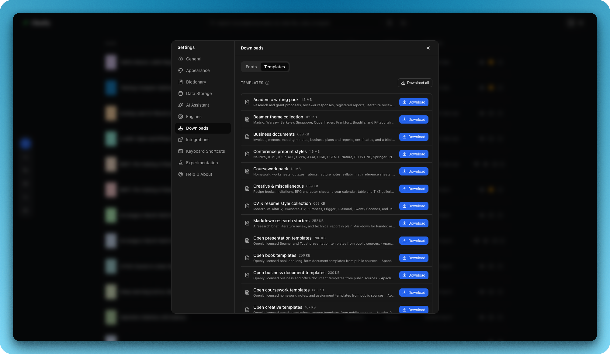

# Templates and project starters

Templates are editable source projects, not opaque document snapshots. A
template declares its engine, document kind, main file, preview metadata, and
optional assets so the library can filter and validate it.

## Catalog surface

- Papers, journals, theses, reports, books, Beamer presentations, posters,
  assignments, letters, bibliographies, resumes, and diagrams.
- Filters for engine, category, offline readiness, and ATS suitability.
- Page-one previews and metadata-driven library search.
- Optional template packs and fonts downloaded only after user selection.
- AI-generated starters can be compiled and saved as ordinary editable
  projects when a provider is configured. LaTeX and Typst starters show a
  page-one preview before you save them.
- Bundled Typst starters cover a blank document, a short report, a technical
  report, a two-column conference-style paper, a thesis, a formal letter, a
  resume, and a standalone figure. Each one compiles with Typst 0.13 through
  0.15 without packages.

  

<em>Choose a starting layout, then edit the files as ordinary project source.</em>

## Your own templates

- Import template, in the New Project gallery and in Settings > Downloads >
  Templates, adds a template from a ZIP, a folder, a page in an online LaTeX
  template gallery, or one of your projects in an online LaTeX account.
- Save as template, in a library project's menu and in the toolbar's Export
  menu, keeps a project's files as a template. The import dialog has a
  checkbox that does the same for a project as it is imported.
- These templates sit under Custom in the gallery and stay on your computer.
  Every source file is kept as it was, and each new project gets its own copy.
- Settings > Downloads > Templates lists them, with the AI-generated ones, and
  deletes them. Deleting a template leaves projects made from it alone.

## Packaging contract

- Bundled starters live under `src-tauri/resources/templates/`.
- Each template includes a `template.json` manifest and source files.
- Fonts and external assets are kept separate from the core application bundle
  and copied into a project only when requested.
- A template must compile through the engine it declares or report a truthful
  prerequisite state.
- A custom template keeps its source under `files/` (named by `files_dir` in
  its manifest), so its own `LICENSE` or `preview.png` is copied into new
  projects instead of being read as gallery metadata. An optional
  `tex_flavor` (pdflatex, xelatex, lualatex, uplatex or platex) starts new
  projects on latexmk with that compiler.

## Engineering anchors

- `packages/templates/`: gallery types, host interface, and modal behavior.
- `src/components/library/`: catalog and generation surfaces.
- `src-tauri/resources/templates/`: shipped starter sources.
- `src-tauri/src/project.rs`: project creation and metadata persistence.
- `src-tauri/src/custom_templates.rs`: importing and saving custom templates.
