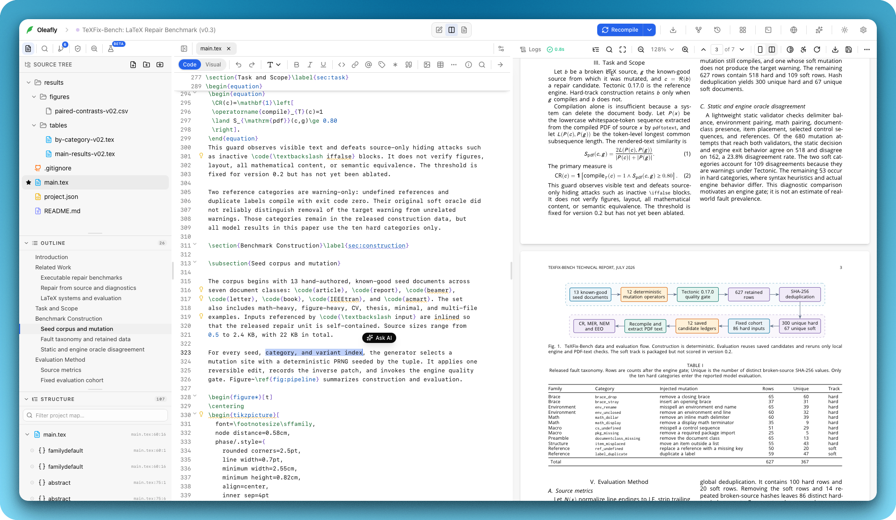

# Product architecture

Oleafly is a pnpm monorepo with a React and TypeScript desktop frontend and a
Rust Tauri backend. The architecture keeps product surfaces composable while
making document engines, filesystem policy, and external integrations explicit.

## Monorepo map

| Area | Responsibility |
| --- | --- |
| `crates/oleafly-core/` | Shared project manifest, path safety, and build-directory policy |
| `crates/oleafly-cli/` | The `oleafly` command (built as `oleaflyc`): its commands, native compiler adapter, JSON contract and MCP server |
| `crates/oleafly-agent/` | Provider-neutral agent runtime |
| `crates/oleafly-history/` | Content-addressed compile checkpoints |
| `crates/oleafly-forge/` | Git hosting accounts, tokens and server APIs, with no Tauri dependency so the CLI can share them |
| `crates/oleafly-collab-protocol/` | Messages shared by the app and the collaboration server |
| `crates/oleafly-collab/` | Live collaboration client: the shared project document, sync and comments |
| `crates/oleafly-server/` | The collaboration server, built on Axum and SQLite |
| `crates/oleafly-acp/` | Agent Client Protocol client for CLI agents, on the official Rust SDK |
| `crates/oleafly-research/` | Research tasks: the store, scheduler, runs and their executors (local, SSH, Slurm, Cua Spaces), and the literature and citation tools |
| `crates/oleafly-sandbox/` | Isolation for task commands and runs (macOS Seatbelt, Linux bubblewrap, the Windows AppContainer sandbox) and run profiles |
| `crates/oleafly-secrets/` | The encrypted secret store, the data folder and private-file helpers, shared by the app and the CLI |
| `crates/oleafly-online/` | Online LaTeX service client: sessions, project lists, folder import, browser cookie reading and Git-bridge sync |
| `crates/oleafly-preflight/` | Preflight checks in Rust, with the same results as the app's panel, for `oleafly check` and research tasks |
| `crates/oleafly-lint/` | LaTeX, BibTeX, spelling and grammar checks for `oleafly lint` |
| `crates/oleafly-doctools/` | Document statistics, SyncTeX file reading and Pandoc exports, shared by the app and the CLI |
| `crates/oleafly-synctex/` | SyncTeX parsing and forward and inverse search, with no file access, shared by the app, the CLI and the browser app |
| `crates/oleafly-synctex-wasm/` | `oleafly-synctex` built to WebAssembly for the browser app (`pnpm synctex:wasm`) |
| `crates/oleafly-downloads/` | TeX toolchain, Typst and template pack downloads, shared by the app and the CLI |
| `src/` | Application shell, stores, Tauri adapters, contributions, and UI |
| `packages/editor/` | Engine-neutral editor and language-service primitives |
| `packages/wysiwyg/` | Tiptap schema and nodes for the visual editor |
| `packages/preview/` | PDF.js viewer and SyncTeX page controller |
| `packages/latex/` | LaTeX parsing, masking, and source operations |
| `packages/latex-intelligence/` | LaTeX command, environment, and package catalogs for completion |
| `packages/pdf-to-latex/` | PDF to LaTeX conversion |
| `packages/conversion-registry/` | Import and export routes behind the conversion matrix |
| `packages/registry/` | Rail tabs, commands, toolsets, and context providers |
| `packages/search-query/` | GitHub-style search queries: parsing, matching, suggestions, and edits |
| `packages/preflight/` | Source, PDF, ATS, accessibility, and reference rules |
| `packages/diagram/` | Host-independent diagram composer |
| `packages/templates/` | Template gallery contracts and host integration |
| `packages/ai-core/` and `packages/ai-tools/` | Provider and tool boundaries |
| `packages/backend-port/` | Typed contract between a frontend shell and its backend |
| `packages/compile-port/` | One contract for compiling, reading the output and SyncTeX, with the engines that run in a browser |
| `packages/i18n-contract/` | Supported locales, catalog helpers, and the translator contract |
| `src-tauri/src/` | IPC commands, project sandbox, Git, engines, downloads, and secrets |
| `src-tauri/resources/` | Templates, licenses, and pinned runtime resources |

## Runtime flow

1. The frontend selects a project and reads its engine descriptor.
2. The shared project index parses source, references, citations, and file
   relationships.
3. A compile request crosses typed Tauri IPC into the Rust engine dispatcher.
4. Rust executes the selected engine inside the project sandbox and emits
   normalized logs, diagnostics, and declared artifacts.
5. The preview consumes the accepted artifact and optional SyncTeX map.
6. Preflight and AI tools consume the same project snapshot and result policy.

  

<em>The shell keeps source, compiled output, and project tools in one workspace.</em>

Step 2 reads project source through a single `read_project_sources` call
instead of one `read_file` per path. Rust hashes every file and sends text back
only where the hash differs from what the caller already holds, so a rebuild
after one edit returns a list of paths rather than the whole project. The cache
of those hashes lives in `src/lib/project-sources.ts`, which reverts to
per-file reads when the batch command is missing.

Document statistics go through the same reader. The `document_stats` command
walks the include closure from the main document and reads every file in one
batch call. Masking and counting happen in Rust, and unsaved buffers travel in
the request so the numbers match what is on screen. The TypeScript counter in
`src/lib/document-stats.ts` stays as the fallback for browser mode and for a
backend without the command. The golden fixtures under
`src-tauri/src/fixtures/document-stats/` fail the Rust tests as soon as the
two counters disagree.

`rag_retrieve` does the same for the assistant. It walks the project and
scores every indexable chunk against the query in Rust, so one message costs
one call rather than one read per file. `src/lib/ai-rag.ts` still reads file by
file when the command is missing, and a golden fixture under
`src-tauri/tests/fixtures/rag/` fails the Rust tests when the two scorers
disagree.

## Extension model

The contribution registry is the supported application extension point. Tabs,
commands, AI toolsets, and context providers register typed contributions.
Packages depend on ports and contracts, not application stores or Tauri globals.
The app shell supplies concrete adapters at the boundary.

The user-facing Tools gallery has its own typed registry in
`src/lib/tool-catalog.ts`. Each entry declares a category, destination, icon,
tone, and slash aliases. Labels, descriptions, and tags come from the locale
catalog, while `src/contributions/commands.tsx` exposes the same entries to the
command palette. Keep those surfaces in sync and update the catalog tests when
adding or removing a tool.

## Package boundaries and ports

- `@oleafly/editor` owns CodeMirror, language primitives, proofing, and editor
  controllers.
- `@oleafly/latex` owns pure LaTeX parsing, masking, and figure serialization.
- `@oleafly/preview` owns the PDF.js viewer and SyncTeX page controller.
- `@oleafly/preflight` owns source, PDF, ATS, accessibility, and reference
  rules without importing app stores.
- `@oleafly/diagram`, `@oleafly/templates`, and `@oleafly/ai-tools` expose
  host interfaces for compile, file, UI, and approval services.
- `@oleafly/registry` owns contribution contracts. It is an internal registry,
  not a dynamic third-party plugin SDK.
- `@oleafly/search-query` parses and runs GitHub-style search queries over any
  list. The app supplies the qualifiers, labels and icons.
- `@oleafly/compile-port` owns the compile contract the desktop and the
  browser app share: compile a target, read what it made, and search its
  SyncTeX. `src/lib/compile-port.ts` puts the desktop's commands behind it,
  and the browser port runs engines in the page.

The app creates the concrete host adapters in `src/`. A package must not import
Zustand stores, Tauri APIs, or `@/` application modules. This keeps package
tests runnable without a desktop runtime and prevents dependency cycles.

## Compilation boundary

`oleafly-core` owns the portable project manifest, project-relative resolution
of the main document, and `.oleafly/build` preparation. Both adapters use it.
The desktop keeps its wider application sandbox for stored projects, figures,
and exports. Compiler execution and diagnostics stay with each adapter: the
desktop runs engines inside that sandbox, and `oleaflyc` runs them directly
against the project directory it was pointed at.

Within the desktop adapter, `DocumentEngine` is the capability contract for
LaTeX, Typst, and Markdown. It declares source extensions, formatting profile,
compile policy, SyncTeX/offline/isolated-compile capabilities, and conversion
exports. The UI must not infer engine behavior from a filename extension.

LaTeX log parsing lives in `oleafly-core::parse_latex_log`, next to the project
policy both runtimes share. The desktop calls it once a compile finishes and
returns the grouped result in `CompileResult.diagnostics`, so the log pane no
longer reparses the whole log on every streamed chunk. The TypeScript parser in
`@oleafly/latex` remains the fallback for a backend that does not send the
field.

The browser app in `web/` compiles through `@oleafly/compile-port` too. A
compile reads every text file from the server in one request, with the
editor's unsent changes on top, and runs an engine listed in
`web/src/compile/engines.ts`. None ships yet; a development build started with
`VITE_OLEAFLY_FAKE_ENGINE=1` gets the test engine. When an engine gives no
diagnostics, its log is read with the `@oleafly/latex` parser. Click-to-source
runs `crates/oleafly-synctex` built to WebAssembly, the code the desktop runs,
on the browser's own output and on output an app uploaded. The uploader's
project folder is worked out from the file's paths, so it doesn't matter where
they compiled. Owners and editors share a compile with the project at most
once a minute, as the app does. `pnpm check:web-budget` limits the JavaScript
loaded at startup and gives each WebAssembly module its own size limit.

## AI providers and model trust

`crates/oleafly-agent` talks to every provider over one of four wire formats
and has no idea which models the app trusts. That decision stays in the
desktop adapter. `ai_model_registry.rs` reads the model catalog (bundled at
`src-tauri/resources/ai-models.json`, refreshed from the CDN on each listing)
and marks each model a provider returns as verified, blocked with a reason, or
untested. Nothing is filtered out any more, so a model the catalog has not
caught up with still shows in the picker. `ai_model_metadata.rs` attaches a
trimmed models.dev snapshot: context window, output limit, modalities, tool
support, cost. The snapshot comes from the bundled copy, a disk cache under
`catalogs/` in the data directory, or a daily CDN refresh, and a listing never
waits on that fetch. `agent_probe_model` runs one bounded tool call round trip
against a model and stores the verdict in the config, where later listings and
the run path pick it up. Before the assistant sends its first request,
`agent_run` refuses a blocked model. It also refuses an untested model whose
metadata says it cannot call tools, but only when the run declares tools: the
composer's chat-only mode sends no tools and goes through. Each listed model
also says where its trust came from (`trustSource` is `catalog` or `probe`),
so the shell can tell a catalog verdict from one of the user's own probes.

## Notifications

A toast answers something the user just did. They clicked Save and it failed,
or they exported a file and it is ready. Nothing else gets a toast.

Background and automatic work never toasts. That includes file watchers,
outline and index refreshes, auto compile, sync, downloads, startup checks,
language servers, and edits made by an AI agent. This work logs through
`logError` in `src/lib/log.ts`, retries on its own, or shows its state where the
app already shows status, like the status bar or the log pane. When a service
such as a language server fails, it retries in the background without telling
the user. If the language server is not installed yet, the Project info panel
offers a Set up button. A dot on the panel's toolbar button shows that setup is
waiting.

Two background failures can lose the user's work: a failed autosave and a
checkpoint that could not be saved. Each one gets a single toast per project for
the whole app session. The toast closes when a later save or checkpoint works,
and it does not come back for that project even if the failure does. A save the
user asks for still reports every failure.

Compiles follow the same split. When the user starts a compile with the
Compile button, the shortcut or the command palette, a failure gets a toast or
opens the engine picker. Auto compile, the compile that runs when a project
opens, and compiles run by an AI agent stay quiet. `recompile` takes an
`origin` of `explicit` or `automatic` to tell them apart. If an automatic
compile fails for a reason the user can fix, the preview's failure view shows
the fix as a button, such as Choose engine or Find and install. When the main
window has no preview (editor-only view, or the preview is in its own window),
the same button sits next to Compile in the toolbar instead.

Show toasts through `src/lib/toast.ts`. The store in `src/store/toast.ts`
handles the rest:

- A toast with the same kind and text as one already on screen, or with the
  same key, refreshes that toast in place. Its timer restarts and a small
  counter (×2, ×3) marks the repeat. Copies never stack.
- After a toast closes on screen, by timeout or the close button, the same kind
  and text stay hidden for two seconds. Any other message shows right away.
  Dismissing a toast from code does not start this window.
- At most four toasts are visible. A fifth pushes out the oldest toast that is
  not sticky.
- Clicking a toast's action button closes that toast, and the same toast can
  show again right away.
- `toast.errorUnique`, `toast.infoUnique` and `toast.successUnique` own a keyed
  slot, so a result replaces its own progress or failure message in place.

`pnpm lint` enforces the boundary with `.biome/toast-imports.grit`. Only
`src/components/ui/sonner.tsx` may import `sonner`, and only `src/lib/toast.ts`,
`src/components/ui/sonner.tsx` and tests may import `@/store/toast`.

## Security boundary

- Rust resolves user paths through the sandbox before filesystem, process, Git,
  or export operations.
- Only the main window's own webview can call every app command. The update,
  preview, presentation and admin console windows get the few commands their
  view uses, and a child webview gets none (`window_commands.rs`). Each window
  has its own capability file for plugin permissions.
- Native open and save dialogs run in Rust (`path_grants.rs`). Exports and
  imports outside a project accept only a path the user picked there, or on
  Linux a path just dropped on the window.
- Connector API keys stay in Rust. The webview can save or clear one and ask
  whether one is saved, never read it back.
- Saving a stdio MCP server with a new program, arguments or environment asks
  first in a native dialog.
- Long-lived credentials use encrypted app-managed storage.
- MCP binds to loopback and uses a bearer token plus the normal approval model.
  Renderer sessions coordinate tools while a window is connected. The Rust
  backend handles the safe native subset when no renderer is connected.
- Downloaded runtimes are pinned and verified. `tinytex_archive.rs` validates
  the exact reviewed member manifest before extracting into staging.
- Hosted integrations are opt-in. The local workflow remains useful offline.

## Repository maintenance

- Keep reusable logic in the smallest applicable package.
- Add or change a port before coupling a package to an app service.
- Update engine descriptors and capability tests together.
- Keep templates, sidecars, and manifests deterministic and checksum-pinned.
- Add unit tests for parser and store changes, Rust tests for filesystem and
  process boundaries, and end-to-end coverage for cross-layer workflows.
- Run the frontend, package, Rust, language-server, and dependency checks
  listed in `docs/development.md` before a release.

## Module resolution and extraction

Workspace packages are consumed as TypeScript source. When a package is added,
keep the aliases in `tsconfig.json`, `vite.config.ts`, and `vitest.config.ts` in
sync, add the workspace dependency at the root, and include package sources in
the Tailwind scan. Tests move with the package. Compatibility shims may remain
at old app paths when a public import path would otherwise churn.

## Detailed references

- [Architecture and package details](architecture.md)
- [Development workflow](development.md)
- [Compilation engines](CompilationEngines.md)
- [Language-server toolchain](language-server-toolchain.md)
- [Contribution registry](architecture.md#extension-model)
