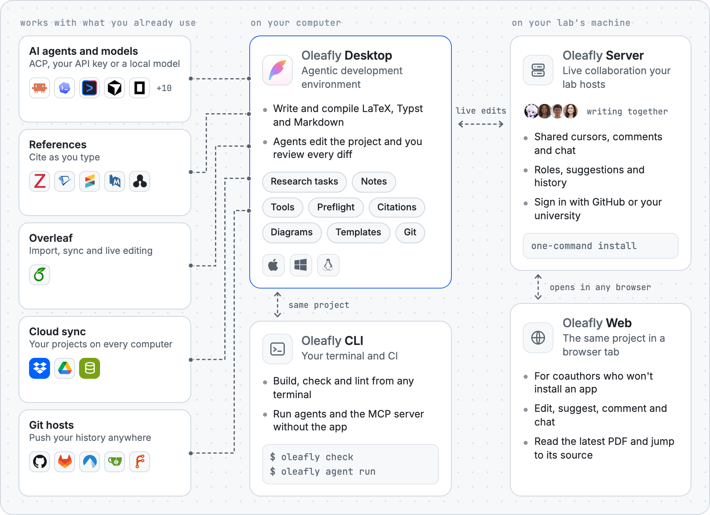
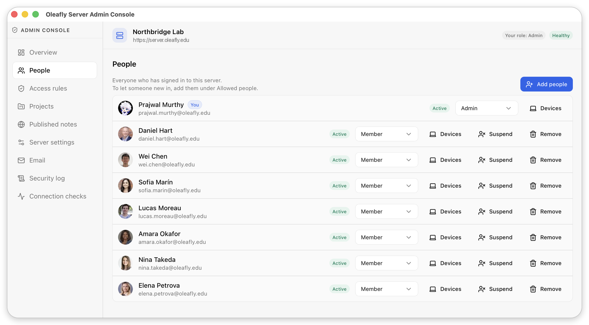
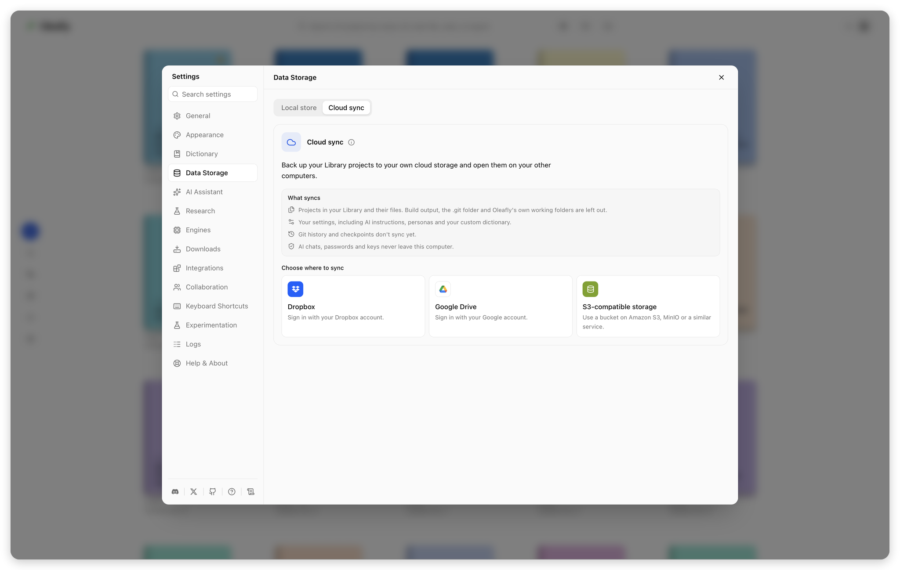
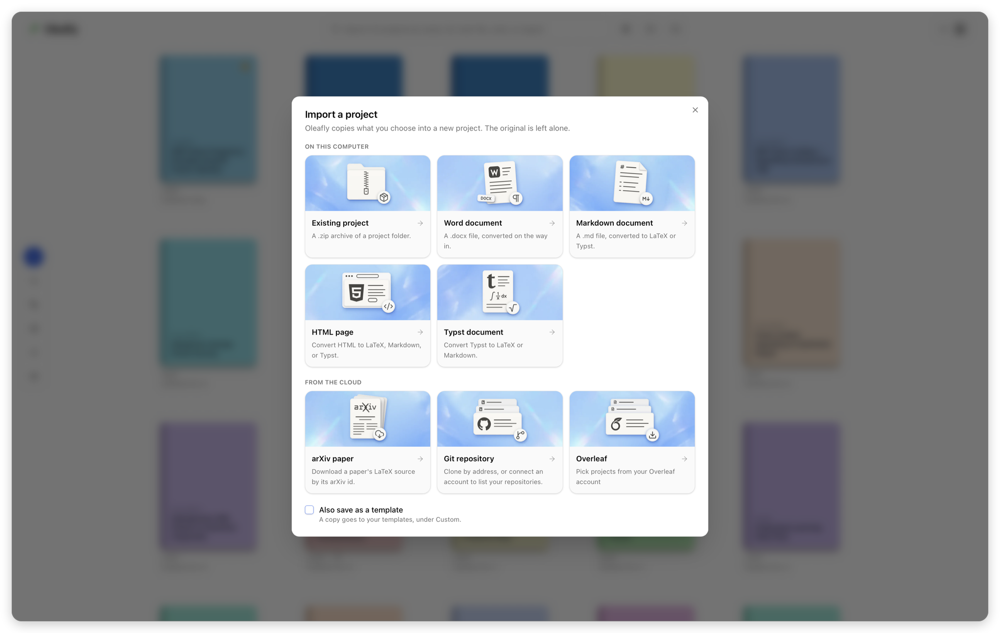
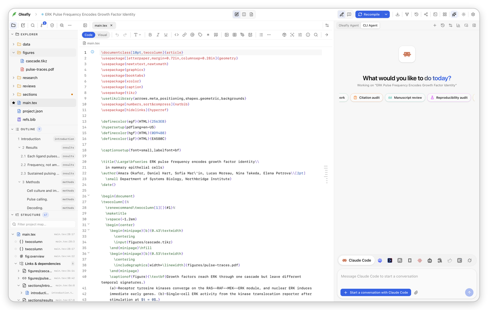
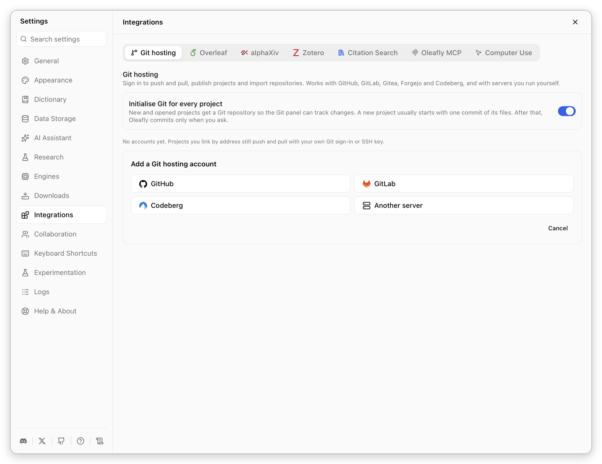
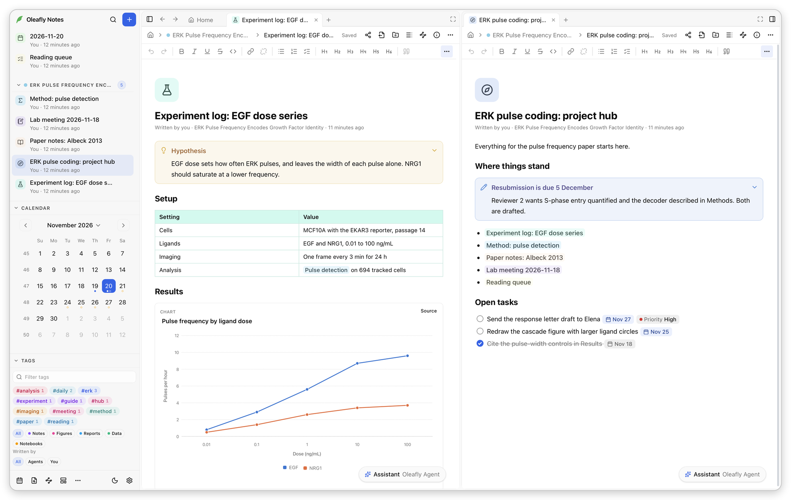
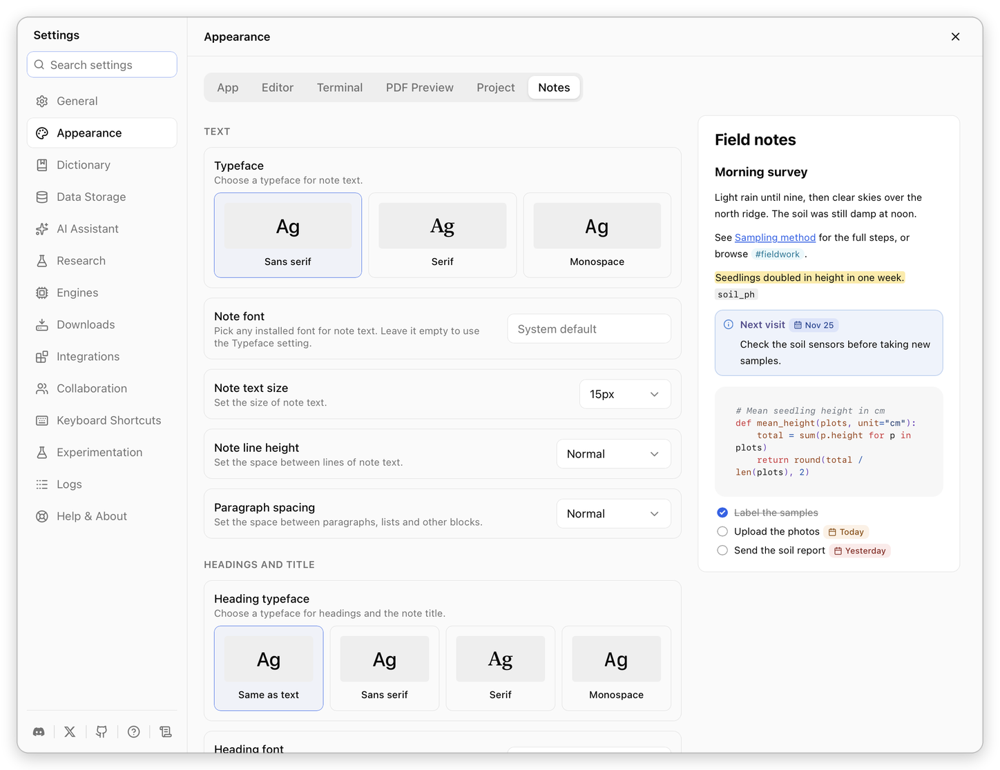
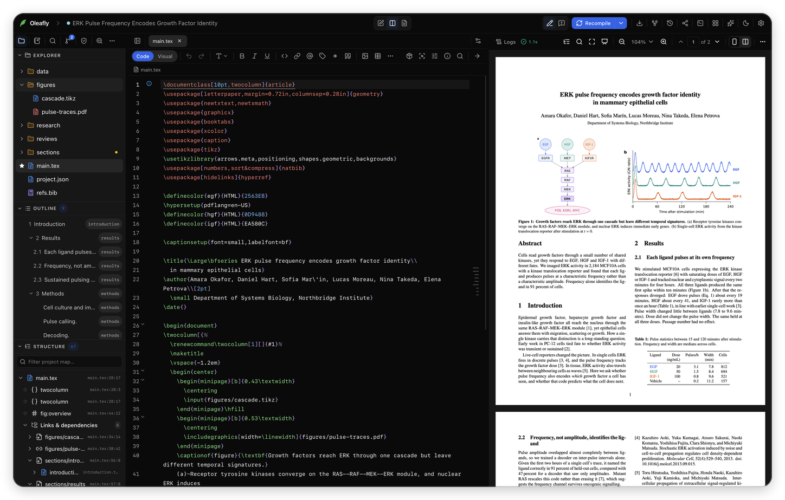
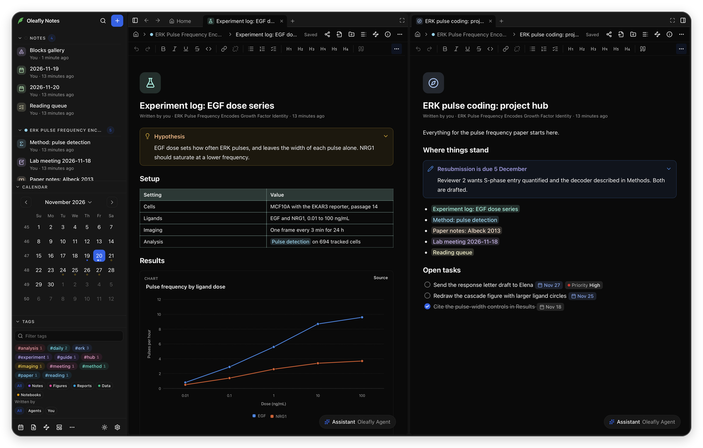

<div align="center">


# Oleafly <sup><em>beta</em></sup>

[Deutsch](README.de.md) | [English](../../README.md) | [Español](README.es.md) | [Français](README.fr.md) | [日本語](README.ja.md) | [한국어](README.ko.md) | [Português](README.pt.md) | [Русский](README.ru.md) | [中文](README.zh.md) | **العربية**

[](https://github.com/Oleafly/Oleafly/releases/latest)
[](https://github.com/Oleafly/Oleafly/releases/latest)
[](https://github.com/Oleafly/Oleafly/releases/latest)

[](https://github.com/Oleafly/Oleafly/issues) [](https://github.com/Oleafly/Oleafly/releases) [](https://github.com/Oleafly/Oleafly/actions/workflows/ci.yml) [](https://sonarcloud.io/summary/new_code?id=Oleafly_Oleafly) [](https://sonarcloud.io/component_measures?id=Oleafly_Oleafly&metric=coverage) [](https://github.com/Oleafly/Oleafly/pulse) [](https://github.com/Oleafly/Oleafly/commits/main) [](../../LICENSE) [](https://oleafly.com/discord) [](https://github.com/Oleafly/Oleafly)

<a href="https://trendshift.io/repositories/99082"></a>

**محرر تعاوني مباشر للبحث العلمي، يعمل باستخدام LaTeX وTypst وMarkdown.**

Oleafly مساحة عمل مجانية ومفتوحة المصدر لكتابة الأبحاث العلمية. تضم بيئة تطوير قائمة على الوكلاء لسطح المكتب على macOS وWindows وLinux، وخادمًا يستضيفه مختبرك للتعاون المباشر، وأداة سطر أوامر للبناء المحلي وCI، وواجهة ويب للمؤلفين المشاركين في المتصفح. يجمّع LaTeX وTypst وMarkdown دون أي إعداد، ويحفظ كل مشروع كمستودع Git مع نقاط تحقق تلقائية. تضم أدوات البحث أكثر من 1,700 قالب، وZotero، وBibTeX، وحاسبات إحصائية، وبحثًا في arXiv وSemantic Scholar وCrossref وPubMed وOpenAlex، وفحوصات Preflight للمراجع المعطوبة والأشكال المفقودة وتسريب هوية المؤلفين في المراجعة المجهولة وPDF/UA. تعاون في الوقت الفعلي على الخادم الذي يُثبَّت بأمر واحد، مع مؤشرات مشتركة وتعليقات ومحادثة وتغييرات متتبَّعة وأدوار ودمج دون اتصال. يعمل Claude Code وCodex و13 وكيلًا آخر للذكاء الاصطناعي في مشروعك، وكل تعديل فرقٌ تراجعه، وتُجري مهام بحث تجريبية مراجعة أدبيات أو جولة تنقيح في الخلفية داخل Git worktrees معزولة، ضمن ميزانية تحددها. وتتيح أداة سطر الأوامر (`check` و`lint` و`mcp` و`ask` و`agent run` و`daemon`) كل ذلك للطرفيات وCI.

<p>
  <a href="https://github.com/Oleafly/Oleafly/releases/latest"><strong>تنزيل مجاني</strong></a>
· <a href="https://oleafly.com/docs/">اقرأ الأدلة</a> · <a href="https://github.com/Oleafly/oleafly-server">شغّل خادمًا</a> · <a href="../development.md">ابنِ من المصدر</a>
</p>


مجاني إلى الأبد · مفتوح المصدر · بلا حساب Oleafly · بلا تتبع

</div>

<div align="center">
  
</div>

## لماذا Oleafly

كتابة الأبحاث تُستأجَر منذ سنوات. عملك البحثي موجود على خادم شخص آخر، وأكثر ما يحتاج إليه الباحث محجوب خلف خطة مدفوعة. مع Oleafly تحصل على ذلك كله مجانًا. ويشمل ذلك التعاون في الوقت الفعلي مع أي عدد تدعوه من المؤلفين المشاركين، وسجل الإصدارات الكامل، والمزامنة مع أي مضيف Git، وZotero، والتدقيق النحوي، ووكلاء الذكاء الاصطناعي بتسجيل دخولك أو مفتاحك، على خادم يشغّله مختبرك. لا يحتاج إلى حساب، ولا يرسل بيانات استخدام، ويعمل دون اتصال.

<p align="center">
  
</p>

- اكتب مع مؤلفيك المشاركين في الوقت الفعلي، بمؤشرات وتعليقات مشتركة، على خادم يُعدّه مختبرك بأمر واحد.
- محرر مصنوع للمستندات الطويلة: إكمال للتسميات والاستشهادات والأوامر، وفحص مباشر للأخطاء، ومخطط للمشروع كله، ومفاتيح Vim وEmacs، ووضع مرئي، ولوحة قابلة للبحث تضم 236 رمزًا من رموز LaTeX.
- جمّع على حاسوبك. تأتي Tectonic وTypst وPandoc مدمجة في التطبيق، ويتولى TeX Live أو MacTeX أو MiKTeX أو TinyTeX المهمة عندما يحتاج المشروع إلى توزيعة كاملة.
- انقر في PDF للانتقال إلى المصدر ثم العودة، ويبقى آخر PDF سليم على الشاشة بينما تصلح خطأً.
- كل مشروع مستودع Git يمكنك دفعه إلى GitHub أو GitLab أو Gitea أو Forgejo أو Codeberg أو خادم Git الخاص بك، وتحفظ نقاط التحقق لقطة بعد كل تجميع ناجح.
- استشهد من مكتبة Zotero الخاصة بك أثناء الكتابة، وابحث في arXiv وSemantic Scholar وCrossref وPubMed وOpenAlex من دون مغادرة المحرر.
- يعمل على حاسوبك تدقيق إملائي ونحوي مضبوط للكتابة الأكاديمية.
- يكتشف Preflight قبل التقديم المراجع المعطوبة، والأشكال المفقودة، والخطوط التي لم تُضمَّن، وثغرات إمكانية الوصول، وأي شيء قد يكشف هوية المؤلفين في مراجعة مجهولة.
- ارسم أشكالًا تبقى شيفرة TikZ أو Typst أو Mermaid، وابدأ من أكثر من 1,700 قالب للأوراق والأطروحات والشرائح والملصقات والسير الذاتية.
- تُفتح ملفات PDF والصور وجداول البيانات وملفات `.bib` وصفحات HTML وعروض الشرائح والسبورات البيضاء داخل المشروع، ولكل نوع عارضه الخاص.
- استورد من Word، أو ملف PDF، أو مصدر arXiv، أو مستودع Git، أو حساب Overleaf.
- هل لا يزال مؤلفوك المشاركون على خدمة LaTeX على الإنترنت مثل Overleaf؟ حرّر المشروع نفسه معهم مباشرة من Oleafly بينما يبقون في محرر الخدمة على الويب. التحرير المباشر تجريبي ومعطّل افتراضيًا. فعّله من Settings > Experimentation.
- يبني الأمر `oleafly` مشاريعك ويفحصها ويزامنها من أي طرفية أو مهمة CI، بالمترجمات والإعدادات نفسها التي يستخدمها التطبيق.
- تُبقي المزامنة السحابية مشروعاتك على كل حاسوب تستخدمه، ويمكنك مواصلة الكتابة دون اتصال.
- يعمل Claude Code وCodex و13 وكيلًا آخر داخل مشروعك، أو يمكنك وصل أي نموذج، بما في ذلك النماذج المحلية. الذكاء الاصطناعي اختياري، وكل تغيير يجريه فرقٌ يمكنك مراجعته والتراجع عنه.
- تُجري مهام البحث مراجعة أدبيات أو تدقيق أدلة أو جولة تنقيح في نسخة منفصلة من المشروع بينما تواصل الكتابة، وتختار أنت الملفات المتغيرة التي تحتفظ بها. وهي تجريبية ومعطّلة افتراضيًا. فعّلها من Settings > Experimentation.
- تحفظ Notes ملاحظاتك البحثية كملفات Markdown بجانب مشروعاتك، مع روابط ووسوم ومهام وتقويم. وهي تجريبية ومعطّلة افتراضيًا أيضًا.

## كتابة مشتركة في الوقت الفعلي

شارك مشروعًا على Oleafly Server الخاص بمختبرك، فيحرر الجميع الملفات نفسها في آن واحد. ترى مؤشر كل شخص وتحديده، ومن المتصل الآن، وما تغيّر أثناء غيابك. انقر على الصورة الرمزية لأي شخص للانتقال إلى السطر الذي يعمل عليه.

<p align="center">
  
</p>

- علّق على أي تحديد في LaTeX أو Typst أو Markdown، ثم رُدّ، أو اذكر شخصًا، أو أغلق التعليق بوصفه محلولًا، أو أعد فتحه. يتلقى المؤلف المشارك المذكور رسالة بريد إلكتروني واحدة، ويمكنه إيقاف هذه الرسائل.
- تُدمج التعديلات التي تجريها دون اتصال عند إعادة الاتصال. وإذا تداخلت مع تعديلات شخص آخر، يعرض لك Oleafly الاثنين ويسألك قبل تطبيق أي شيء.
- تنتقل أيضًا تعديلات الذكاء الاصطناعي واستشهادات Zotero وعمليات إعادة التسمية والحذف والأشكال. وإذا استبدل شخصان الشكل نفسه في الوقت نفسه، يُحتفظ بالنسختين.
- الملف الرئيسي والمترجم ولغة التدقيق الإملائي وخيارات Typst مشتركة، لذلك يجمّع الفريق كله المشروع بالطريقة نفسها.
- لكل مشروع مالك ومحررون ومراجعون ومعلّقون ومشاهدون. تصبح تعديلات المراجعين اقتراحات، ويمكن للمالكين والمحررين أيضًا التبديل إلى وضع الاقتراح. ولا يرى الضيوف المدعوون بالبريد الإلكتروني إلا المشروعات التي دُعوا إليها.
- لكل مشروع مشترك محادثة، وسجل يمكنك فيه مقارنة الإصدارات، أو استعادة أحدها، أو تسميته.
- يمكن للمؤلفين المشاركين فتح مشروع مشترك في متصفحهم عندما يكون الوصول عبر المتصفح مفعّلًا على الخادم، وقراءة PDF من آخر تجميع.

<table>
  <tr>
    <td width="50%" valign="top">
      
      <h3>ناقش الأمر في محادثة المشروع</h3>
      لكل مشروع مشترك محادثة خاصة به، مع إشارات وردود فعل، فيبقى النقاش بجانب الملف الذي يخصه.
    </td>
    <td width="50%" valign="top">
      
      <h3>اعرف من هنا</h3>
      تسرد لوحة Live collaboration كل من في المشروع، ودوره، والملف المفتوح عند كل شخص. وتحت القائمة موجز بالنشاط الأخير.
    </td>
  </tr>
</table>

### شغّل الخادم بنفسك

يُثبَّت Oleafly Server بأمر واحد على جهاز Linux، سواء كان محطة عمل في المختبر أو آلة افتراضية في الجامعة أو خادمًا سحابيًا صغيرًا:

```bash
curl -fsSL https://oleafly.com/server/install.sh | sudo sh
```

إنه ملف تنفيذي واحد مكتوب بلغة Rust يستخدم SQLite، ويحفظ الملفات على القرص أو في أي مخزن متوافق مع S3، ويرسل البريد الإلكتروني عبر SMTP إذا ضبطته. يسجّل المستخدمون الدخول عبر GitHub أو أي مزوّد OpenID Connect، لذلك يعمل نظام تسجيل الدخول الموحّد في جامعتك. وتتوفر إعدادات جاهزة لـ Docker Compose وCoolify وRender وsystemd، وأدلة لـ Railway وCloudflare Tunnel وشهادات الجامعات.

يحصل المشرفون على وحدة تحكم داخل Oleafly لإدارة الأشخاص وقواعد الوصول والمشروعات والبريد الإلكتروني وسجل الأمان. يوقّع كل جهاز تغييراته، ويبني الخادم كل لقطة من ذلك السجل الموقّع بدل الوثوق بالملفات المرفوعة.

<p align="center">
  
</p>

اقرأ [دليل الخادم](https://github.com/Oleafly/oleafly-server) لمعرفة الإعداد والنسخ الاحتياطي والقائمة الكاملة لما يستطيع كل شخص فعله.

## المزامنة السحابية بين حواسيبك

فعّل المزامنة السحابية، فتنتقل معك مشروعات مكتبتك وإعدادات التطبيق من حاسوب إلى آخر. يُتحقق من كل تنزيل مقابل سجله قبل أن يحل محل ملف، ولا يُكتب أبدًا فوق ملف مفتوح لديك يحتوي على تغييرات غير محفوظة.

يمكنك المزامنة مع Dropbox أو Google Drive أو مع حاوية خاصة بك على Amazon S3 أو Google Cloud Storage أو MinIO أو أي خدمة أخرى متوافقة مع S3. اختر واحدة من Settings > Data storage > Cloud sync. وفي الصفحة نفسها شريط يبيّن ما يحتويه مجلد بيانات Oleafly وما يشغل المساحة.

<p align="center">
  
</p>

- عندما يحرر حاسوبان الملف نفسه، يُحتفظ بالنسختين، وتحمل كل نسخة اسم الحاسوب الذي كتبها.
- حذف معظم المشروع دفعة واحدة يضعه في حالة انتظار حتى تؤكد، فلا تستطيع خطوة خاطئة واحدة إفراغه في كل مكان.
- تنتقل الملفات المحذوفة على حاسوب آخر إلى سلة المهملات هنا بدل أن تختفي.
- على حاسوب جديد، يسألك Oleafly مرة واحدة هل تحتفظ بإعدادات هذا الحاسوب أم بالإعدادات المتزامنة.

## أحضر مشروعاتك معك

هل تنتقل من محرر LaTeX على الإنترنت؟ سجّل الدخول إلى حسابك مرة واحدة من Oleafly، واختر المشروعات التي تريدها، فتنتقل بملفاتها ومترجمها وملفها الرئيسي، جاهزة للتجميع. ويعمل ذلك أيضًا مع الخادم الخاص بالجامعة.

باستخدام رمز Git من ذلك الحساب، يستطيع Oleafly إبقاء المشروع المستورد متزامنًا في الاتجاهين، فيواصل المؤلفون المشاركون الذين يبقون على المحرر عبر الإنترنت العمل كما يفعلون الآن. تستخدم المزامنة في الاتجاهين تكامل Git الخاص بالخدمة نفسها، وهو يحتاج إلى خطة مدفوعة أو جامعية في حساب مالك المشروع.

التحرير المباشر يذهب أبعد من ذلك ولا يحتاج إلى رمز Git. فعّله فتعمل أنت والمؤلفون المشاركون الذين يبقون على الإنترنت على المشروع نفسه في آن واحد: تصل الكتابة والملفات الجديدة وعمليات إعادة التسمية إلى الطرفين خلال ثانية أو نحو ذلك، وترى أين يعمل كل شخص. وإذا انقطع اتصالك فواصل الكتابة، وسيلحق بك التحرير عند عودتك. وإذا كان حسابك يسجّل الدخول عبر Google أو مؤسستك أو مفتاح مرور، فاستخدم Sign in with your browser. التحرير المباشر تجريبي. فعّله من Settings > Experimentation.

<p align="center">
  
</p>

يمكنك أيضًا البدء من ملف ZIP لمشروع، أو مستودع GitHub، أو مستند Word، أو حزمة مصدر arXiv، أو PDF يعيد Oleafly بناءه بصيغة LaTeX قابلة للتحرير. أو افتح مجلدًا في مكانه الحالي.

## وكلاء ذكاء اصطناعي يعملون داخل مشروعك

اختر وكيلًا من الكتالوج، فيعمل في مشروعك والمصدر وPDF وسجل التجميع في متناوله. يسجّل كل وكيل الدخول بحسابه الخاص ويستخدم نموذجه الخاص. ويوفر له Oleafly المشروع والأدوات المحيطة به.

<p align="center">
  
</p>

<table>
  <tr>
    <td width="50%" valign="top">
      
      <h3>Oleafly Assistant</h3>
      يعمل المساعد المدمج على مزوّد تصله أو على نموذج محلي. ويفتح بمهارات بحثية مجمّعة حسب المهمة: البحث، والتأليف، والأشكال، والمراجعة، والتقديم.
    </td>
    <td width="50%" valign="top">
      
      <h3>وكلاء CLI</h3>
      اختر Claude Code أو Codex أو Gemini CLI أو وكيلًا آخر من الصف فوق مربع الرسالة. يعمل بجانب مصدرك وPDF المجمّع.
    </td>
  </tr>
</table>

<div align="center">
<table>
  <tr>
    <td align="center" valign="top" width="135"><br />Claude&nbsp;Code</td>
    <td align="center" valign="top" width="135"><br />Codex&nbsp;CLI</td>
    <td align="center" valign="top" width="135"><br />Gemini&nbsp;CLI</td>
    <td align="center" valign="top" width="135"><br />Pi</td>
    <td align="center" valign="top" width="135"><br />OpenCode</td>
  </tr>
  <tr>
    <td align="center" valign="top" width="135"><br />OpenClaw</td>
    <td align="center" valign="top" width="135"><br />Cline</td>
    <td align="center" valign="top" width="135"><br />Hermes&nbsp;Agent</td>
    <td align="center" valign="top" width="135"><br />CodeBuddy</td>
    <td align="center" valign="top" width="135"><br />Kimi&nbsp;Code</td>
  </tr>
  <tr>
    <td align="center" valign="top" width="135"><br />Grok&nbsp;Build</td>
    <td align="center" valign="top" width="135"><br />Cursor</td>
    <td align="center" valign="top" width="135"><br />DeepSeek Harness</td>
    <td align="center" valign="top" width="135"><br />Qoder</td>
    <td align="center" valign="top" width="135"><br />Antigravity&nbsp;CLI</td>
  </tr>
</table>
</div>

<p align="center"><sub>تحدد هذه العلامات الأدوات المتوافقة، وتبقى ملكًا لأصحابها. ولا تعني تأييدًا.</sub></p>

هل تفضّل مساعد محادثة؟ صِل مزودًا مستضافًا، أو أي نقطة نهاية متوافقة مع OpenAI، أو نموذجًا محليًا في Ollama أو llama.cpp أو Lemonade.

- كل تغيير في ملف هو فرق. وافق على كل تغيير، أو دع المساعد يعمل بمفرده، أو اضبط قواعد لكل أداة، وتراجع عن ملف واحد أو عن دور كامل.
- يرسم وضع التخطيط خريطة للمشروع قبل كتابة أي شيء.
- لا تملك مفتاح API؟ يمكن تشغيل Paper Review والتعديلات المضمّنة وFix with AI وأدوات الصور والمعادلات على وكيل CLI سجّلت الدخول إليه بالفعل.
- يمكن للوكلاء استخدام تطبيقات سطح المكتب ومواقع الويب التي تسمح بها، مثل نموذج التقديم في مجلة أو برنامج إحصاء. ويعمل ذلك عبر Cua Driver، وتثبّته بنفسك.
- يمكن تشغيل مراجعة أدبيات أو جولة تنقيح في Git worktree خاص بها بينما تواصل الكتابة. وتختار أنت الملفات المتغيرة التي تحتفظ بها.
- يأتي التطبيق مع 39 مهارة بحثية، منها مسح الأدبيات، والأعمال ذات الصلة، والتحقق من الادعاءات، ورسائل الرد على المراجعين. يثبّتها الأمر `npx skills add Oleafly/Oleafly` في Claude Code وCodex ووكلاء آخرين أيضًا.
- يتيح خادم MCP محلي لعميل ذكاء اصطناعي خارجي استخدام أدوات المشروع نفسها. ولا يستمع إلا على 127.0.0.1.
- يمنح `oleafly mcp` كلًا من Claude Code وCodex وCursor وGemini CLI أدوات المشروع عبر stdio، سواء كان التطبيق مفتوحًا أو مغلقًا.
- يتضمن كل إصدار الملف `oleafly.mcpb`. افتحه وسيثبّت Claude Desktop تطبيق Oleafly كإضافة. ويُدرجه سجل MCP باسم `io.github.Oleafly/oleafly`.

الذكاء الاصطناعي اختياري. يعمل المحرر والمترجم وPDF والاستشهادات والتدقيق اللغوي والفحوصات كلها عند إيقافه.

## LaTeX وTypst وMarkdown، مجمّعة على حاسوبك

تأتي Tectonic وTypst وPandoc مع التطبيق، لذلك يُجمَّع المشروع الجديد من دون تثبيت أي شيء. وعندما يحتاج المشروع إلى توزيعة TeX كاملة، حوّله إلى latexmk مع TeX Live أو MacTeX أو MiKTeX، أو مع TinyTeX يثبّته Oleafly لك.

<p align="center">
  
</p>

- انقر في PDF للانتقال إلى المصدر، ثم عُد مرة أخرى. يستخدم LaTeX لذلك SyncTeX، ويستخدم Typst 0.13 أو أحدث Tinymist.
- ترتبط أخطاء التجميع بالسطر الذي سببها، ويبقى آخر PDF سليم على الشاشة بينما تصلحها.
- يتيح لك الوضع المرئي التحرير في عرض يشبه الصفحة، مع بقاء المصدر على بُعد نقرة واحدة.
- إكمال وتشخيصات مباشرة للتسميات والاستشهادات والأوامر والبيئات ومسارات الملفات في المشروع كله.
- يعمل التدقيق الإملائي والنحوي محليًا، وهو مضبوط للكتابة الأكاديمية.
- XeLaTeX وLuaLaTeX، وupLaTeX أو pLaTeX للمستندات اليابانية.
- تشغّل مستندات Quarto وCalepin شيفرة R أو Python أو Julia الموجودة فيها بعد أن تسمح بالشيفرة في المشروع. ويستطيع Oleafly تنزيل أيٍّ من الأداتين لك.
- يمكن بناء مستند Markdown كمقالة أو تقرير أو كتاب أو شرائح أو ملصق أو رسالة أو سيرة ذاتية. اضبط `type:` في ترويسة الملف.

<p align="center">
  
</p>

يضم عارض PDF بحثًا ومخطط المستند وعرض صفحة واحدة أو صفحتين وملاءمة العرض أو الارتفاع.

## الاستشهادات والأشكال والفحوصات والقوالب

<table>
  <tr>
    <td width="50%" valign="top">
      
      <h3>استشهد من Zotero أثناء الكتابة</h3>
      اكتب <code>@</code> وجزءًا من اسم مؤلف أو عنوان أو سنة لتستشهد من مكتبة Zotero الخاصة بك. ولا يضيف Oleafly إلى ملف <code>.bib</code> في المشروع إلا ذلك المدخل. ويغطي Citation Search كلًا من arXiv وSemantic Scholar وCrossref وPubMed وOpenAlex.
    </td>
    <td width="50%" valign="top">
      
      <h3>ارسم أشكالًا تبقى شيفرة</h3>
      يرسم Diagram Composer على لوحة ويكتب TikZ، أو fletcher لـ Typst، أو Mermaid. غيّر الرسم أو الشيفرة، فيتبعه الآخر.
    </td>
  </tr>
  <tr>
    <td width="50%" valign="top">
      
      <h3>افحص قبل أن تقدّم</h3>
      يعثر Preflight على المراجع المعطوبة، والأشكال المفقودة، والخطوط التي لم تُضمَّن، وثغرات إمكانية الوصول، وأي شيء قد يكشف هوية المؤلفين في مراجعة مجهولة. ولديه ملفات تعريف لـ arXiv وIEEE وACM والمجلات والأطروحات.
    </td>
    <td width="50%" valign="top">
      
      <h3>ابدأ من أكثر من 1,700 قالب</h3>
      مقالات وأطروحات وعروض Beamer وملصقات وسير ذاتية وأوراق على نمط جهات النشر، ولكل منها معاينة مرسومة قبل أن تنشئ المشروع.
    </td>
  </tr>
</table>

## Git والسجل وطرفية

كل مشروع مجلد عادي فيه مستودع Git عادي. جهّز الملفات، واعرض الفروق، وأنشئ commit، وادفع واسحب وانشر إلى GitHub أو GitLab أو Gitea أو Forgejo أو Codeberg أو خادمك الخاص من لوحة التحكم بالمصدر، أو استخدم طرفيتك الخاصة، فلا شيء مخفي عنها. وتحفظ نقاط التحقق لقطة محلية بعد كل تجميع ناجح، لذلك يمكنك العودة إلى حالة سابقة من دون إنشاء commit.

<p align="center">
  
</p>

توجد طرفية أسفل المحرر بما يصل إلى عشر علامات تبويب لكل مشروع. انقر مع الضغط على Cmd (أو Ctrl) على مسار ملف في مخرجاتها لفتحه عند ذلك السطر.

<table>
  <tr>
    <td width="50%" valign="top">
      
      <h3>طرفية أسفل المحرر</h3>
      شغّل Git أو نصًا برمجيًا للبناء أو الأمر <code>oleafly</code> في مجلد المشروع دون مغادرة النافذة.
    </td>
    <td width="50%" valign="top">
      
      <h3>إصدار بعد كل تجميع</h3>
      يحفظ Versioning لقطة من المصدر بعد كل تجميع ناجح. استعد أيًّا منها بنقرة واحدة، دون الحاجة إلى commit.
    </td>
  </tr>
  <tr>
    <td width="50%" valign="top">
      
      <h3>مضيف Git الخاص بك، أو خادمك</h3>
      سجّل الدخول إلى GitHub أو GitLab أو Codeberg، أو أضف عنوان خادم Gitea أو Forgejo تشغّله. ثم ادفع واسحب وانشر من لوحة التحكم بالمصدر.
    </td>
    <td width="50%" valign="top">
      
      <h3>اعرف أين تذهب المساحة</h3>
      تبيّن الإعدادات المساحة التي تشغلها مشروعاتك وملفات PDF وسجل Git وبيانات التطبيق نفسه على القرص. وتنتظر المشروعات المحذوفة في سلة المهملات.
    </td>
  </tr>
</table>

يعمل الأمر `oleafly` على المشاريع نفسها من أي طرفية: البناء، وإعادة البناء عند كل تغيير، والفحص قبل الإرسال، والمزامنة مع خدمة LaTeX على الإنترنت، أو تشغيل وكيل Oleafly من دون فتح التطبيق. ويمكن لكل أمر أن يطبع JSON مع رموز خروج ثابتة للنصوص البرمجية وCI. راجع [دليل سطر الأوامر](../cli.md).

## ملاحظات لبحثك

Notes قاعدة معرفة بجانب مشروعاتك. كل ملاحظة ملف Markdown تملكه، تحرّره في محرر غني يدعم مربعات التنبيه والجداول والرسوم البيانية والمخططات والرياضيات والروابط والروابط العكسية والوسوم والمهام مع مواعيد استحقاق. Notes تجريبية ومعطّلة افتراضيًا. فعّلها من Settings > Experimentation.

<p align="center">
  
</p>

- تُفتح الملاحظات في علامات تبويب يمكنك تقسيمها وتثبيتها. ويسردها Notes Home مع البحث والوسوم وقائمة مهام وتقويم.
- يمكن أن تبدأ الملاحظة من قالب وتقيم داخل مشروع باسم `notes/<Title>.md`.
- شارك ملاحظة عبر خادم مختبرك لتحريرها معًا، وعلّق على تحديد كما تفعل في ملف مشروع.
- يمكن للمساعد أو لوكيل CLI أن يقترح تغييرات على ملاحظة. وتقبل كل تغيير أو ترفضه في مكانه.
- الالتقاط السريع نافذة عائمة صغيرة لفكرة تريد الاحتفاظ بها.
- الصق رابط منشور على X فتحتفظ الملاحظة بكاتب المنشور وتاريخه ونصه.

## اجعل Oleafly على طريقتك

يتبع Oleafly إعداد نظامك الفاتح أو الداكن، أو تختار أنت. اختر لونًا مميزًا، ومكان Home dock، وما يُرسم خلف مشروعاتك. وللمحرر خطه وسمته وألوانه واختصارات مفاتيحه، وتعرض Notes معاينة مباشرة أثناء تغيير خطها وتباعدها.

<table>
  <tr>
    <td width="50%" valign="top">
      
      <h3>اللون المميز وdock والخلفية</h3>
      ستة ألوان مميزة، وdock على اليسار أو الأسفل أو اليمين، ونقاط أو شبكة أو لا شيء خلف مشروعاتك.
    </td>
    <td width="50%" valign="top">
      
      <h3>خط يناسبك</h3>
      اختر الخط والحجم والتباعد لملاحظاتك وشاهد المعاينة تتغير أثناء ذلك.
    </td>
  </tr>
  <tr>
    <td width="50%" valign="top">
      
      <h3>فاتح أو داكن</h3>
      بدّل من شريط الأدوات، أو دع Oleafly يتبع نظامك.
    </td>
    <td width="50%" valign="top">
      
      <h3>الوضع الداكن في Notes أيضًا</h3>
      تُرسم الرسوم البيانية والجداول ومربعات التنبيه في الملاحظة للوضع الداكن كما للفاتح.
    </td>
  </tr>
</table>

## والمزيد أيضًا

<details>
<summary>أكثر من 40 أداة للتحويل والاستشهاد والرياضيات</summary>

معرض Tools في مرحلة beta ومعطّل افتراضيًا. فعّله من Settings > Experimentation > LaTeX tools.

#### الاستيراد وتحويل التنسيق

| الأداة | استخدامها |
| --- | --- |
| PDF to LaTeX | إعادة بناء LaTeX قابل للتحرير من PDF، مع الحفاظ على الرياضيات والأشكال والبنية حيث يسمح المصدر |
| arXiv to LaTeX | تنزيل حزمة مصدر arXiv بالمعرّف، أو فك أرشيف محفوظ من القرص |
| Image to LaTeX | تحويل صورة ملاحظات أو معادلات أو جدول إلى LaTeX قابل للتحرير |
| Equation to LaTeX | تحويل رياضيات مكتوبة أو صورة معادلة إلى LaTeX |
| Excel to LaTeX | تحويل ورقة Excel أو CSV أو TSV إلى جدول LaTeX مع تهريب المحارف |
| HTML to LaTeX | تحويل HTML ملصق إلى مستند LaTeX مستقل |
| Image to Typst | تحويل صورة ملاحظات أو معادلات أو جدول إلى Typst قابل للتحرير |
| LaTeX to HTML | تحويل LaTeX إلى HTML مستقل مع معادلات MathML |
| LaTeX to Image | عرض معادلة وتصديرها بصيغة PNG أو SVG |
| LaTeX to Markdown | تحويل مستند LaTeX إلى Markdown محمول |
| LaTeX to Typst | تحويل LaTeX إلى مصدر Typst يمكنك نسخه أو حفظه أو فتحه كمشروع |
| LaTeX to Word | إنشاء مستند Word مع تخزين المعادلات كرياضيات Word أصلية |
| Markdown to LaTeX | تحويل ملاحظات Markdown إلى مستند LaTeX مستقل |
| Markdown to Typst | تحويل ملاحظات Markdown إلى مصدر Typst |
| Mermaid to LaTeX | تحويل مخطط Mermaid إلى شيفرة TikZ قابلة للتحرير |
| PDF to Markdown | استخراج طبقة نص PDF ومعادلاته وأشكاله إلى Markdown |
| PDF to Typst | استخراج طبقة نص PDF ومعادلاته وأشكاله إلى Typst |
| Table to LaTeX | إنشاء جدول LaTeX في محرر مرئي للصفوف والأعمدة |
| Typst Editor | بدء مشروع Typst مع تحرير المصدر والمعاينة المباشرة وتصدير PDF |
| Visual Typst Editor | بدء مستند Typst في محرر المشروع مع معاينة مباشرة |
| Typst to LaTeX | تحويل ترميز Typst إلى LaTeX للمجلات والتقديمات |
| arXiv to Typst | تحويل حزمة مصدر arXiv إلى Typst، مع فحص تجميع يسرد ما لم يتحول |
| CSV to Typst | لصق صفوف CSV أو TSV والحصول على جدول Typst مع تهريب المحارف |
| Equation to Typst | تحويل رياضيات LaTeX مكتوبة أو صورة معادلة إلى رياضيات Typst |
| Excel to Typst | تحويل ورقة Excel أو CSV أو TSV إلى جدول Typst مع تهريب المحارف |
| HTML to Typst | تحويل HTML ملصق إلى مستند Typst مستقل |
| Mermaid to Typst | تحويل مخطط Mermaid إلى شيفرة fletcher قابلة للتحرير |
| Typst to HTML | تحويل ترميز Typst إلى HTML مستقل مع معادلات MathML |
| Typst to Markdown | تحويل ترميز Typst إلى Markdown محمول |
| Typst to Word | إنشاء مستند Word مع تخزين المعادلات كرياضيات Word أصلية |
| Word to Typst | تحويل مستند Word إلى Typst وإبقاء الوسائط المستخرجة معًا |
| Word to LaTeX | تحويل مستند Word إلى LaTeX وإبقاء الوسائط المستخرجة معًا |

#### الرياضيات والجداول والكتابة والتحقق

| الأداة | استخدامها |
| --- | --- |
| BibTeX Validator | فحص ملفات `.bib` بحثًا عن أخطاء الصياغة والحقول المطلوبة المفقودة والمفاتيح المكررة |
| Statistics Calculators | حساب قيم p وأحجام العينات وفواصل الثقة محليًا |
| Writing Generators | إعداد ملخص أو موجز أو إعادة صياغة أو مخطط أطروحة من المستند المفتوح مع المساعد |
| Symbol Reference | تصفح رموز LaTeX وإدراج أحدها عند المؤشر، أو إدراج اسمه في Typst داخل ملف Typst |

#### الأدبيات والمراجع والبحث

| الأداة | استخدامها |
| --- | --- |
| Find Citations | البحث في الفهارس العلمية، وفحص مسودة بحثًا عن الدعم المفقود، وتصدير BibTeX |
| arXiv Citation Generator | البحث عن ورقة arXiv وتنسيق استشهادها بثمانية أساليب |
| Bibliography Generator | إنشاء ببليوغرافيا من تفاصيل منظمة أو BibTeX والتحقق منها وترتيبها وتصديرها |
| Citation Generator | تحويل تفاصيل مقالة أو معرّف علمي إلى استشهاد منسق وBibTeX |
| Citation Generators by Style | مقارنة مرجع واحد وفق APA وMLA وChicago وIEEE وHarvard وVancouver وAMA وACS |
| DOI to BibTeX | استرداد سجل DOI ومراجعة حقوله وتصدير BibTeX |
| ISBN to BibTeX | استرداد بيانات كتاب وصفية من ISBN وتصحيحها وتصدير BibTeX |
| PubMed to BibTeX | استرداد سجل PubMed من PMID ومراجعة بياناته وتصدير BibTeX |
| URL to BibTeX | التعرّف على روابط DOI وarXiv وPubMed، أو إنشاء استشهاد قابل للتحرير لصفحة ويب |
| Lab Search | العثور على مؤسسات بحثية من خلال دليل OpenAlex |
| Conference Deadlines | تصفية مواعيد المؤتمرات، ومعظمها في علوم الحاسوب، وعرض العد التنازلي |

</details>

<details>
<summary>المهارات البحثية الـ 39 المرفقة مع Oleafly</summary>

المهارات مجلدات `SKILL.md` عادية تتبع بنية Agent Skills. شغّل إحداها بأمر شرطة مائلة، أو أضف مهاراتك الخاصة، أو شاركها مع وكلاء CLI المتوافقين على الحاسوب نفسه.

تضم حزمة `research-core` المرفقة 39 مهارة. والأسماء أدناه هي المعرّفات المستخدمة في الكتالوج وإعدادات المشروع.

| الفئة | المهارات |
| --- | --- |
| البحث والأدبيات | `citation-management`، `exploratory-data-analysis`، `hypothesis-generation`، `literature-review`، `oleafly-experiment-loop`، `oleafly-literature-sweep`، `oleafly-research-loop`، `openresearch`، `paper-lookup`، `research-lookup`، `scientific-brainstorming`، `scientific-critical-thinking` |
| تأليف المخطوطة وتحليلها | `experimental-design`، `oleafly-data-analysis`، `oleafly-manuscript-scaffold`، `oleafly-related-work`، `scientific-writing`، `statistical-analysis`، `statistical-power`، `venue-templates` |
| الأشكال والتصور | `oleafly-figure-prep`، `scientific-schematics`، `scientific-visualization` |
| المراجعة والأدلة | `oleafly-response-letter`، `oleafly-review-manuscript`، `oleafly-verify-claims`، `peer-review`، `scholar-evaluation` |
| التقديم | `oleafly-pre-submission` |
| التواصل | `oleafly-slides-and-posters`، `pptx-posters`، `research-grants`، `scientific-slides` |
| الأدوات والأتمتة | `desktop-apps`، `import-refine`، `oleafly-cli`، `oleafly-latex-build`، `pdf-to-latex`، `template-generate` |

</details>

<details>
<summary>تفاصيل المحرر</summary>

- لوحة قابلة للبحث تضم 236 رمزًا من رموز LaTeX، وتُدرج أسماء Typst في ملفات Typst.
- يشير شريط مخطط على الحافة اليمنى للمحرر إلى كل عنوان والقسم الذي تقرؤه. افتحه لترى أرقام الأقسام ورقم صفحة PDF لكل عنوان من آخر تجميع.
- عارضات للملفات الأخرى في المشروع: PDF مع شريط المعاينة الكامل، وصور قابلة للتكبير، وأوراق CSV وExcel كجدول قابل للفرز، وقائمة قابلة للبحث لملفات `.bib`، ومعاينة مباشرة لـ HTML.
- تُعاين عروض الشرائح المكتوبة بـ TSX أثناء الكتابة وتُعرض مثل PDF. ويُفتح الملف المسمى `something.excalidraw` كسبورة يمكنك الرسم عليها.
- انقر مرتين على ملف `.tex` أو `.typ` أو `.md` في مدير الملفات فيُفتح في Oleafly.
- اختصارات مفاتيح Vim وEmacs، وعلامات تبويب لملفات متعددة، وطيّ الشيفرة، والبحث والاستبدال في المشروع كله، وعدّ الكلمات.
- أعد تسمية ملف أو انقله، وسيحدّث Oleafly المسارات التي تشير إليه.
- سمات للوضعين الفاتح والداكن، وأي خط مثبت، وألوان صياغة قابلة للتعديل، ووضع Zen.
- ألوان أيقونات الملفات حسب نوع الملف. بدّل إلى شارات نوع قصيرة مثل TEX أو PDF من Settings > Appearance > Project.
- الواجهة متاحة بـ 22 لغة.
- لوحة الأوامر عبر Cmd+K (Ctrl+K)، ومربع بحث واحد للمشروعات والمستندات والإعدادات والأدوات عبر Cmd+Shift+F (Ctrl+Shift+F).

</details>

## ابدأ الآن

1. [نزّل Oleafly](https://github.com/Oleafly/Oleafly/releases/latest) لحاسوبك.
2. أنشئ مشروعًا من قالب، أو استورد مشروعًا، أو افتح مجلدًا لديك بالفعل.
3. اضغط Cmd+Enter (أو Ctrl+Enter على Windows وLinux) للتجميع.
4. للكتابة مع الآخرين، انقر **Share** وأرسل المشروع إلى Oleafly Server الخاص بمختبرك.

| المنصة | الحزمة | التنزيل |
| --- | --- | --- |
| macOS · Apple Silicon | DMG | [](https://github.com/Oleafly/Oleafly/releases/latest) |
| macOS · Intel | DMG (`x64`) | [](https://github.com/Oleafly/Oleafly/releases/latest) |
| Windows · x86_64 | MSI أو EXE | [](https://github.com/Oleafly/Oleafly/releases/latest) |
| Linux · x86_64 | AppImage أو DEB أو RPM | [](https://github.com/Oleafly/Oleafly/releases/latest) |
| Linux · ARM64 | AppImage أو DEB أو RPM | [](https://github.com/Oleafly/Oleafly/releases/latest) |

تحتاج حزم Linux إلى glibc 2.35 أو أحدث (Ubuntu 22.04 أو Debian 12 أو أحدث). وتتضمن الإصدارات عناصر تحديث موقّعة، ويتحقق مُحدّث التطبيق من التوقيع قبل تثبيت أي شيء.

## أسئلة شائعة

<details>
<summary>هل أحتاج إلى حساب؟</summary>

لا تحتاج إلى حساب Oleafly. يمكنك الكتابة والتجميع واستخدام Git من دون تسجيل الدخول إلى أي شيء. أما التعاون المباشر فيسجّل دخولك إلى خادم مختبرك عبر GitHub أو نظام تسجيل الدخول في جامعتك، وتسجّل المزامنة السحابية الدخول إلى خدمة التخزين السحابي الخاصة بك.

</details>

<details>
<summary>هل يعمل دون اتصال؟</summary>

نعم. تعمل الكتابة والتجميع وPDF والتدقيق اللغوي وPreflight وGit ونقاط التحقق كلها على حاسوبك. ويُبنى LaTeX دون اتصال بعد أن يحصل المحرك المرفق على الحزم التي يحتاج إليها، ويُبنى Typst بعد تخزين حزمه مؤقتًا. وتحتفظ المشروعات المشتركة بتعديلاتك وتدمجها عند إعادة الاتصال.

</details>

<details>
<summary>ما الذي يمر عبر الشبكة؟</summary>

ما تطلبه فقط: المشاركة مع خادمك، والمزامنة السحابية، وخدمة LaTeX على الإنترنت التي تستورد منها أو تحرر معها مباشرة، والبحث في الأدبيات وبيانات DOI، ومضيف Git الخاص بك، ومزودو الذكاء الاصطناعي المستضافون، وخوادم MCP التي تصلها، والتنزيلات الاختيارية للمحركات والحزم والقوالب. وتتحقق الإصدارات الرسمية أيضًا من وجود تحديث عند بدء التطبيق. ويبقي نموذج محلي حركة الذكاء الاصطناعي على حاسوبك.

</details>

<details>
<summary>هل يمكن لجامعتي أو شركتي استضافة الخادم؟</summary>

نعم، وهذه هي الفكرة. يعمل Oleafly Server على جهازك أو حسابك السحابي، ويسجّل دخول المستخدمين عبر GitHub أو أي مزوّد OpenID Connect، ويحفظ الملفات على القرص أو في تخزين متوافق مع S3. ويشرح [دليل الخادم](https://github.com/Oleafly/oleafly-server) التثبيت والنسخ الاحتياطي والأدوار.

</details>

## مزيد من المعلومات

- [أدلة المنتج](https://oleafly.com/docs/)
- [Oleafly Server](https://github.com/Oleafly/oleafly-server)
- [خريطة الميزات](../features.md)
- [دليل المحرر](../Editor.md)
- [معاينة PDF](../PDFPreview.md)
- [الاستشهادات والأدبيات](../Citations.md)
- [معرض الأدوات](../Tools.md)
- [فحوصات Preflight وإمكانية الوصول](../Preflight.md)
- [القوالب](../Templates.md)
- [Diagram Composer](../DiagramComposer.md)
- [Git والتحكم بالمصدر](../SourceControl.md)
- [نقاط التحقق](../Checkpoints.md)
- [AI Copilot](../AICopilot.md)
- [المهارات](../Skills.md)
- [تكامل MCP](../mcp.md)
- [أداة سطر الأوامر](../cli.md)
- [إعداد التطوير](../development.md)
- [سجل التغييرات](../../CHANGELOG.md)

## المجتمع والدعم

شكرًا لكل من أرسل pull request، وللأشخاص الذين أثّرت مشكلاتهم في أكبر عدد من الإصدارات.

<p>
<a href="https://github.com/palmtenor" title="Teng Qin (palmtenor)"></a>
<a href="https://github.com/wahidmounir" title="wahidmounir"></a>
<a href="https://github.com/Jianxinnn" title="Jianx (Jianxinnn)"></a>
<a href="https://github.com/multics" title="Not AI (multics)"></a>
<a href="https://github.com/um1chc5" title="Vũ Vương An (um1chc5)"></a>
<a href="https://github.com/a-green-hand-jack" title="Jack Wu (a-green-hand-jack)"></a>
<a href="https://github.com/DEENUU1" title="Kacper Włodarczyk (DEENUU1)"></a>
<a href="https://github.com/mvanhorn" title="Matt Van Horn (mvanhorn)"></a>
<a href="https://github.com/vincencwolff" title="Alexander Wolff (vincencwolff)"></a>
<a href="https://github.com/ssbodda-powern" title="ssbodda-powern"></a>
<a href="https://github.com/Fravoj3" title="Fravoj3"></a>
<a href="https://github.com/Entrery901" title="Pavel Entrery (Entrery901)"></a>
<a href="https://github.com/CherryYang05" title="Minyang Bao (CherryYang05)"></a>
<a href="https://github.com/MaverickJohn026" title="MaverickJohn026"></a>
<a href="https://github.com/marlondecol" title="Marlon Luís de Col (marlondecol)"></a>
</p>

انضم إلى [مجتمع Oleafly على Discord](https://oleafly.com/discord) لطرح الأسئلة، وطلب المساعدة في عملية بناء مستعصية، وعرض ما تكتبه، والتصويت على ما سيُبنى لاحقًا. المجتمع مجاني ومفتوح للجميع. هل تفضّل GitHub؟ أبلغ عن خطأ أو اطلب ميزة في [مشكلات GitHub](https://github.com/Oleafly/Oleafly/issues).

لا يجمع Oleafly أي بيانات استخدام، فلا يعرف أحد من يستخدمه حتى تقول أنت. هل تكتب أطروحتك أو أوراق مختبرك به؟ قل مرحبًا في [من يستخدم Oleafly؟](https://github.com/Oleafly/Oleafly/discussions/502).

يبني Oleafly [Prajwal Murthy](https://github.com/prajwal-svm) والمساهمون. نرحب بالمساهمات في الكود والقوالب والوثائق والملاحظات. اقرأ [دليل المساهمة](../../CONTRIBUTING.md) للمشاركة.

إذا كنت تستخدم Oleafly، فإن وضع [نجمة على GitHub](https://github.com/Oleafly/Oleafly) يساعد باحثين آخرين على العثور عليه.

## الاستشهاد بـ Oleafly

<details>
<summary>انسخ إدخال BibTeX</summary>

```bibtex
@software{oleafly,
  author  = {Venkateshmurthy, Prajwal S. and {The Oleafly contributors}},
  title   = {Oleafly: a local-first workspace for research writing},
  year    = {2026},
  version = {0.4.13},
  url     = {https://github.com/Oleafly/Oleafly},
  license = {AGPL-3.0-or-later}
}
```

</details>

[الأمان](../../SECURITY.md) · [مدونة السلوك](../../CODE_OF_CONDUCT.md) · [AGPL-3.0-or-later](../../LICENSE)

## سجل النجوم

<a href="https://www.star-history.com/?repos=Oleafly%2FOleafly&type=date&legend=top-left">
 <picture>
   <source media="(prefers-color-scheme: dark)" srcset="https://api.star-history.com/chart?repos=Oleafly/Oleafly&type=date&theme=dark&legend=top-left&sealed_token=aHz2JA-SBvmD73PyT7aCcCqMyAUvCPtidSAAvsQQxR8-1xdB-RZ-oXHKRnqIJUfSICl6Dd3_XPcHgb5Menvk_FfalfMb1GRbJC_TdeTMBVDi3jVUIXBBdovZ4dufhj4JWF3UXptJhw8pGmB6lqQ-X7gDOWu_bkPTQ7k-Q0VeBiq_jNgwRb7RSMgrSb-P" />
   <source media="(prefers-color-scheme: light)" srcset="https://api.star-history.com/chart?repos=Oleafly/Oleafly&type=date&legend=top-left&sealed_token=aHz2JA-SBvmD73PyT7aCcCqMyAUvCPtidSAAvsQQxR8-1xdB-RZ-oXHKRnqIJUfSICl6Dd3_XPcHgb5Menvk_FfalfMb1GRbJC_TdeTMBVDi3jVUIXBBdovZ4dufhj4JWF3UXptJhw8pGmB6lqQ-X7gDOWu_bkPTQ7k-Q0VeBiq_jNgwRb7RSMgrSb-P" />
   
 </picture>
</a>
