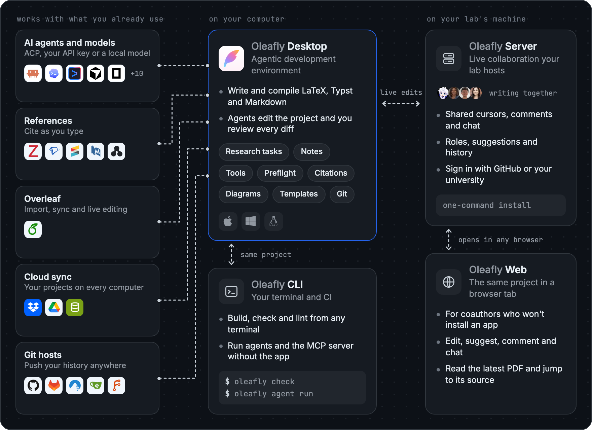
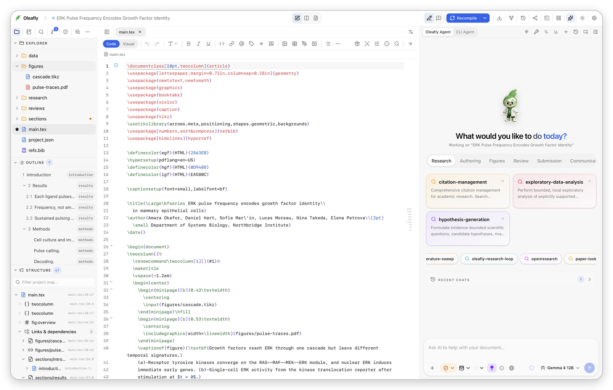
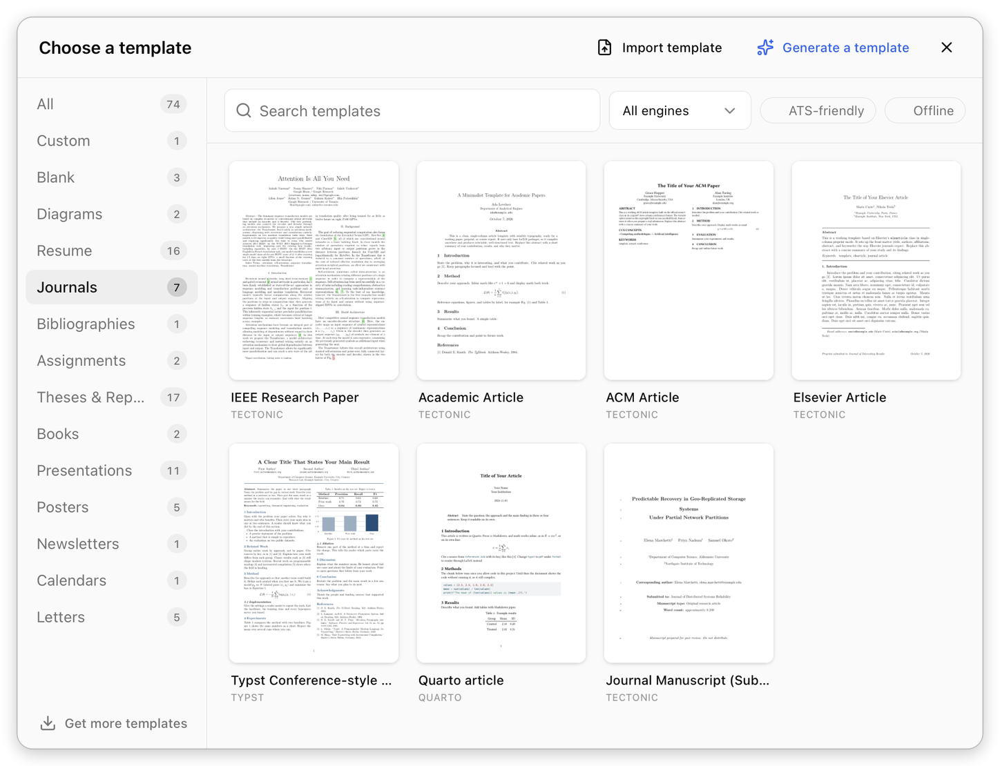

<div align="center">


# Oleafly <sup><em>beta</em></sup>

**Deutsch** | [English](../../README.md) | [Español](README.es.md) | [Français](README.fr.md) | [日本語](README.ja.md) | [한국어](README.ko.md) | [Português](README.pt.md) | [Русский](README.ru.md) | [中文](README.zh.md) | [العربية](README.ar.md)

[](https://github.com/Oleafly/Oleafly/releases/latest)
[](https://github.com/Oleafly/Oleafly/releases/latest)
[](https://github.com/Oleafly/Oleafly/releases/latest)

[](https://github.com/Oleafly/Oleafly/issues) [](https://github.com/Oleafly/Oleafly/releases) [](https://github.com/Oleafly/Oleafly/actions/workflows/ci.yml) [](https://sonarcloud.io/summary/new_code?id=Oleafly_Oleafly) [](https://sonarcloud.io/component_measures?id=Oleafly_Oleafly&metric=coverage) [](https://github.com/Oleafly/Oleafly/pulse) [](https://github.com/Oleafly/Oleafly/commits/main) [](../../LICENSE) [](https://oleafly.com/discord) [](https://github.com/Oleafly/Oleafly)

<a href="https://trendshift.io/repositories/99082"></a>

**Ein LaTeX-, Typst- und Markdown-Editor für die Forschung, mit Zusammenarbeit in Echtzeit.**

Oleafly ist ein kostenloser Open-Source-Arbeitsbereich für das wissenschaftliche Schreiben. Dazu gehören eine agentische Entwicklungsumgebung für den Desktop unter macOS, Windows und Linux, ein Server, den deine Arbeitsgruppe für die Zusammenarbeit in Echtzeit betreibt, ein Kommandozeilen-Tool für lokale Builds und CI und eine Webansicht für Mitautor:innen im Browser. Oleafly kompiliert LaTeX, Typst und Markdown ohne Einrichtung und hält jedes Projekt als Git-Repository mit automatischen Checkpoints. Zum Werkzeugkasten für die Forschung gehören mehr als 1.700 Vorlagen, Zotero, BibTeX, Statistikrechner, die Suche in arXiv, Semantic Scholar, Crossref, PubMed und OpenAlex sowie Preflight-Prüfungen auf defekte Referenzen, fehlende Abbildungen, Anonymitätslecks bei Blindbegutachtung und PDF/UA. Arbeite in Echtzeit auf dem Server zusammen, der sich mit einem Befehl installieren lässt, mit gemeinsamen Cursorn, Kommentaren, Chat, nachverfolgten Änderungen, Rollen und Zusammenführung nach Offline-Arbeit. Claude Code, Codex und 13 weitere KI-Agenten arbeiten in deinem Projekt, jede Änderung als Diff, den du prüfst, und experimentelle Rechercheaufgaben führen im Hintergrund in isolierten Worktrees eine Literaturübersicht oder eine Überarbeitung aus, innerhalb eines Budgets, das du festlegst. Das Kommandozeilen-Tool (`check`, `lint`, `mcp`, `ask`, `agent run`, `daemon`) macht das alles für Terminals und CI zugänglich.

<p>
  <a href="https://github.com/Oleafly/Oleafly/releases/latest"><strong>Kostenlos herunterladen</strong></a>
· <a href="https://oleafly.com/docs/">Anleitungen lesen</a> · <a href="https://github.com/Oleafly/oleafly-server">Server betreiben</a> · <a href="../development.md">Aus dem Quellcode bauen</a>
</p>


Für immer kostenlos · Open Source · Kein Oleafly-Konto · Kein Tracking

</div>

<div align="center">
  
</div>

## Warum Oleafly

Seit Jahren wird das Schreiben in der Forschung nur gemietet. Deine Forschungsarbeit liegt auf dem Server von jemand anderem, und was Forschende am meisten brauchen, steckt hinter einem Bezahltarif. Mit Oleafly bekommst du das alles kostenlos. Das heißt Zusammenarbeit in Echtzeit mit so vielen Mitautor:innen, wie du einlädst, vollständige Versionshistorie, Synchronisierung mit jedem Git-Host, Zotero, Grammatikprüfung und KI-Agenten mit deiner eigenen Anmeldung oder deinem eigenen Schlüssel, auf einem Server, den deine Arbeitsgruppe betreibt. Es braucht kein Konto, sendet keine Telemetrie und funktioniert offline.

<p align="center">
  
</p>

- Schreibe in Echtzeit mit deinen Mitautor:innen, mit gemeinsamen Cursorn und Kommentaren, auf einem Server, den deine Arbeitsgruppe mit einem einzigen Befehl einrichtet.
- Ein Editor für lange Dokumente: Vervollständigung für Labels, Zitate und Befehle, Fehlerprüfung während des Schreibens, eine Gliederung des ganzen Projekts, Vim- und Emacs-Tastenbelegung, ein visueller Modus und eine durchsuchbare Palette mit 236 LaTeX-Symbolen.
- Kompiliere auf deinem eigenen Computer. Tectonic, Typst und Pandoc sind eingebaut, und TeX Live, MacTeX, MiKTeX oder TinyTeX übernehmen, wenn ein Projekt eine vollständige Distribution braucht.
- Ein Klick ins PDF springt zum Quelltext und wieder zurück, und das letzte fehlerfreie PDF bleibt sichtbar, während du einen Fehler behebst.
- Jedes Projekt ist ein Git-Repository, das du zu GitHub, GitLab, Gitea, Forgejo, Codeberg oder deinem eigenen Git-Server pushen kannst, und Checkpoints speichern nach jeder erfolgreichen Kompilierung einen Snapshot.
- Zitiere beim Schreiben aus deiner Zotero-Bibliothek und durchsuche arXiv, Semantic Scholar, Crossref, PubMed und OpenAlex, ohne den Editor zu verlassen.
- Rechtschreib- und Grammatikprüfung, abgestimmt auf wissenschaftliches Schreiben, laufen auf deinem Computer.
- Preflight findet vor der Einreichung defekte Referenzen, fehlende Abbildungen, nicht eingebettete Schriften, Lücken bei der Barrierefreiheit und alles, was in einer Blindbegutachtung die Anonymität aufheben würde.
- Zeichne Abbildungen, die als TikZ-, Typst- oder Mermaid-Code erhalten bleiben, und beginne mit einer von mehr als 1.700 Vorlagen für Paper, Dissertationen, Folien, Poster und Lebensläufe.
- PDFs, Bilder, Tabellenkalkulationen, `.bib`-Dateien, HTML-Seiten, Foliensätze und Whiteboards öffnen sich im Projekt, jeweils in einer eigenen Ansicht.
- Importiere aus Word, einem PDF, einer arXiv-Quelle, einem Git-Repository oder einem Overleaf-Konto.
- Sind Mitautor:innen noch bei einem Online-LaTeX-Dienst wie Overleaf? Bearbeite mit ihnen live dasselbe Projekt von Oleafly aus, während sie in dessen Web-Editor bleiben. Die Live-Bearbeitung ist experimentell und standardmäßig ausgeschaltet. Schalte sie unter „Einstellungen > Experimente“ ein.
- Der Befehl `oleafly` kompiliert, prüft und synchronisiert deine Projekte aus jedem Terminal oder CI-Job heraus, mit denselben Compilern und Einstellungen wie die App.
- Die Cloud-Synchronisierung hält deine Projekte auf jedem Computer bereit, den du nutzt, und du kannst offline weiterschreiben.
- Claude Code, Codex und 13 weitere Agenten arbeiten direkt in deinem Projekt, oder du verbindest ein beliebiges Modell, auch lokale. KI ist optional, und jede Änderung, die sie vornimmt, ist ein Diff, den du prüfen und rückgängig machen kannst.
- Rechercheaufgaben führen eine Literaturübersicht, einen Evidenz-Audit oder eine Überarbeitung in einer separaten Kopie des Projekts aus, während du weiterschreibst, und du wählst, welche geänderten Dateien du behältst. Sie sind experimentell und standardmäßig ausgeschaltet. Schalte sie unter „Einstellungen > Experimente“ ein.
- Notes legt deine Forschungsnotizen als Markdown-Dateien neben deinen Projekten ab, mit Links, Tags, Aufgaben und einem Kalender. Notes ist ebenfalls experimentell und standardmäßig ausgeschaltet.

## Gemeinsam live schreiben

Teile ein Projekt auf den Oleafly Server deiner Arbeitsgruppe, und alle bearbeiten gleichzeitig dieselben Dateien. Du siehst Cursor und Auswahl jeder Person, wer online ist und was sich geändert hat, während du weg warst. Klicke auf den Avatar einer Person, um zu der Zeile zu springen, an der sie gerade arbeitet.

<p align="center">
  
</p>

- Kommentiere jede Auswahl in LaTeX, Typst oder Markdown, antworte dann, erwähne jemanden, löse einen Kommentar auf oder öffne ihn wieder. Wer erwähnt wird, bekommt eine E-Mail und kann diese E-Mails abschalten.
- Änderungen, die du offline machst, werden zusammengeführt, sobald du wieder verbunden bist. Überschneiden sie sich mit denen einer anderen Person, zeigt Oleafly dir beide und fragt, bevor es etwas übernimmt.
- Auch KI-Änderungen, Zotero-Zitate, Umbenennungen, Löschungen und Abbildungen werden übertragen. Ersetzen zwei Personen gleichzeitig dieselbe Abbildung, bleiben beide Versionen erhalten.
- Hauptdatei, Compiler, Sprache der Rechtschreibprüfung und Typst-Optionen werden geteilt, sodass das ganze Team das Projekt auf dieselbe Weise kompiliert.
- Jedes Projekt hat Rollen für Eigentümer, Bearbeiter, Gutachter, Kommentatoren und Betrachter. Bearbeitungen von Gutachtern werden zu Vorschlägen, und auch Eigentümer und Bearbeiter können in den Modus Vorschlagen wechseln. Gäste, die per E-Mail eingeladen werden, sehen nur die Projekte, zu denen sie eingeladen wurden.
- Jedes geteilte Projekt hat einen Chat und einen Verlauf, in dem du Versionen vergleichen, eine davon wiederherstellen oder ihr einen Namen geben kannst.
- Mitautor:innen können ein geteiltes Projekt in ihrem Browser öffnen, wenn der Browserzugriff auf dem Server eingeschaltet ist, und das PDF der letzten Kompilierung lesen.

<table>
  <tr>
    <td width="50%" valign="top">
      
      <h3>Im Projekt-Chat besprechen</h3>
      Jedes geteilte Projekt hat einen eigenen Chat mit Erwähnungen und Reaktionen, sodass das Gespräch neben der Datei bleibt, um die es geht.
    </td>
    <td width="50%" valign="top">
      
      <h3>Sehen, wer da ist</h3>
      Der Bereich „Live-Zusammenarbeit“ listet alle Personen im Projekt, ihre Rolle und die Datei, die jede Person geöffnet hat. Unter der Liste steht ein Feed mit der letzten Aktivität.
    </td>
  </tr>
</table>

### Den Server selbst betreiben

Oleafly Server lässt sich mit einem Befehl auf einem Linux-Rechner installieren, ob das eine Workstation im Labor, eine VM der Universität oder ein kleiner Cloud-Server ist:

```bash
curl -fsSL https://oleafly.com/server/install.sh | sudo sh
```

Es ist eine einzelne Rust-Binärdatei, die SQLite nutzt, Dateien auf der Festplatte oder in einem beliebigen S3-kompatiblen Speicher ablegt und E-Mails über SMTP verschickt, wenn du das einrichtest. Angemeldet wird mit GitHub oder einem beliebigen OpenID-Connect-Anbieter, sodass das Single Sign-on deiner Universität funktioniert. Es gibt fertige Konfigurationen für Docker Compose, Coolify, Render und systemd sowie Anleitungen für Railway, Cloudflare Tunnel und Zertifikate von Universitäten.

Admins bekommen in Oleafly eine Konsole für Personen, Zugriffsregeln, Projekte, E-Mail und das Sicherheitsprotokoll. Jedes Gerät signiert seine Änderungen, und der Server baut jeden Snapshot aus dieser signierten Historie auf, statt hochgeladenen Dateien zu vertrauen.

<p align="center">
  
</p>

Im [Server-Leitfaden](https://github.com/Oleafly/oleafly-server) findest du Einrichtung, Backups und die vollständige Liste, wer was tun darf.

## Cloud-Synchronisierung zwischen deinen Computern

Schalte die Cloud-Synchronisierung ein, und die Projekte deiner Bibliothek sowie deine App-Einstellungen begleiten dich von einem Computer zum nächsten. Jeder Download wird mit seinem Eintrag abgeglichen, bevor er eine Datei ersetzt, und eine geöffnete Datei mit ungespeicherten Änderungen wird nie überschrieben.

Du kannst mit Dropbox, mit Google Drive oder mit einem eigenen Bucket bei Amazon S3, Google Cloud Storage, MinIO oder einem anderen S3-kompatiblen Dienst synchronisieren. Wähle einen Anbieter unter „Einstellungen > Datenspeicher > Cloud-Synchronisierung“. Dieselbe Seite hat einen Balken, der zeigt, was der Oleafly-Datenordner enthält und was den Platz belegt.

<p align="center">
  
</p>

- Bearbeiten zwei Computer dieselbe Datei, bleiben beide Versionen erhalten, jeweils nach dem Computer benannt, der sie geschrieben hat.
- Löschst du den größten Teil eines Projekts auf einmal, wird die Löschung zurückgehalten, bis du sie bestätigst, damit ein einziger Fehlgriff das Projekt nicht überall leert.
- Dateien, die auf einem anderen Computer gelöscht werden, landen hier im Papierkorb, statt zu verschwinden.
- Auf einem neuen Computer fragt Oleafly einmal, ob die Einstellungen dieses Computers oder die synchronisierten gelten sollen.

## Deine Projekte mitnehmen

Du wechselst von einem Online-LaTeX-Editor? Melde dich einmal aus Oleafly heraus bei deinem Konto an, wähle die gewünschten Projekte aus, und sie kommen mit ihren Dateien, ihrem Compiler und ihrer Hauptdatei herüber, bereit zum Kompilieren. Das funktioniert auch mit dem eigenen Server einer Universität.

Mit einem Git-Token aus diesem Konto kann Oleafly ein importiertes Projekt in beide Richtungen synchron halten, sodass Mitautor:innen, die online bleiben, weiterarbeiten wie bisher. Die Synchronisierung in beide Richtungen nutzt die eigene Git-Integration des Dienstes, die auf dem Konto der Person, der das Projekt gehört, einen kostenpflichtigen Tarif oder einen Universitätstarif voraussetzt.

Die Live-Bearbeitung geht weiter und braucht kein Git-Token. Schalte sie ein, und du arbeitest mit den Mitautor:innen, die online bleiben, gleichzeitig am selben Projekt: Tippen, neue Dateien und Umbenennungen kommen in etwa einer Sekunde auf beiden Seiten an, und du siehst, wo jede Person arbeitet. Bricht deine Verbindung ab, tippe weiter, und es holt auf, sobald du wieder da bist. Meldet sich dein Konto mit Google, deiner Institution oder einem Passkey an, nutze „Im Browser anmelden“. Die Live-Bearbeitung ist experimentell. Schalte sie unter „Einstellungen > Experimente“ ein.

<p align="center">
  
</p>

Du kannst auch mit einem Projekt-ZIP, einem GitHub-Repository, einem Word-Dokument, einem arXiv-Quellpaket oder einem PDF beginnen, das Oleafly als bearbeitbares LaTeX neu aufbaut. Oder öffne einen Ordner dort, wo er bereits liegt.

## KI-Agenten, die in deinem Projekt arbeiten

Wähle einen Agenten aus dem Katalog, und er arbeitet in deinem Projekt, mit Quelltext, PDF und Kompilierungsprotokoll in Reichweite. Jeder Agent meldet sich mit seinem eigenen Konto an und nutzt sein eigenes Modell. Oleafly gibt ihm das Projekt und die Werkzeuge drumherum.

<p align="center">
  
</p>

<table>
  <tr>
    <td width="50%" valign="top">
      
      <h3>Oleafly Assistant</h3>
      Der eingebaute Assistent läuft mit einem Anbieter, den du verbindest, oder mit einem lokalen Modell. Er öffnet sich mit Skills für die Forschung, nach Aufgaben gruppiert: Recherche, Manuskripterstellung, Abbildungen, Review und Einreichung.
    </td>
    <td width="50%" valign="top">
      
      <h3>CLI-Agenten</h3>
      Wähle Claude Code, Codex, Gemini CLI oder einen anderen Agenten in der Zeile über dem Nachrichtenfeld. Er arbeitet neben deinem Quelltext und dem kompilierten PDF.
    </td>
  </tr>
</table>

<div align="center">
<table>
  <tr>
    <td align="center" valign="top" width="135"><br />Claude&nbsp;Code</td>
    <td align="center" valign="top" width="135"><br />Codex&nbsp;CLI</td>
    <td align="center" valign="top" width="135"><br />Gemini&nbsp;CLI</td>
    <td align="center" valign="top" width="135"><br />Pi</td>
    <td align="center" valign="top" width="135"><br />OpenCode</td>
  </tr>
  <tr>
    <td align="center" valign="top" width="135"><br />OpenClaw</td>
    <td align="center" valign="top" width="135"><br />Cline</td>
    <td align="center" valign="top" width="135"><br />Hermes&nbsp;Agent</td>
    <td align="center" valign="top" width="135"><br />CodeBuddy</td>
    <td align="center" valign="top" width="135"><br />Kimi&nbsp;Code</td>
  </tr>
  <tr>
    <td align="center" valign="top" width="135"><br />Grok&nbsp;Build</td>
    <td align="center" valign="top" width="135"><br />Cursor</td>
    <td align="center" valign="top" width="135"><br />DeepSeek Harness</td>
    <td align="center" valign="top" width="135"><br />Qoder</td>
    <td align="center" valign="top" width="135"><br />Antigravity&nbsp;CLI</td>
  </tr>
</table>
</div>

<p align="center"><sub>Diese Markierungen kennzeichnen kompatible Werkzeuge und bleiben Eigentum der jeweiligen Rechteinhaber. Sie stellen keine Empfehlung dar.</sub></p>

Lieber ein Chat-Assistent? Verbinde einen gehosteten Anbieter, einen beliebigen OpenAI-kompatiblen Endpunkt oder ein lokales Modell in Ollama, llama.cpp oder Lemonade.

- Jede Dateiänderung ist ein Diff. Gib jede einzeln frei, lass den Assistenten selbstständig arbeiten oder lege Regeln pro Werkzeug fest, und mache eine einzelne Datei oder einen ganzen Durchlauf rückgängig.
- Im Plan mode erfasst der Assistent das Projekt, bevor irgendetwas geschrieben wird.
- Kein API-Schlüssel? Paper Review, Inline-Bearbeitungen, Fix with AI sowie die Bild- und Gleichungswerkzeuge laufen auch auf einem CLI-Agenten, bei dem du schon angemeldet bist.
- Agenten können die Desktop-Apps und Websites nutzen, die du erlaubst, etwa das Einreichungsformular einer Zeitschrift oder ein Statistikpaket. Das läuft über Cua Driver, den du selbst installierst.
- Eine Literaturübersicht oder eine Überarbeitung kann in einem eigenen Git-Worktree laufen, während du weiterschreibst. Du entscheidest, welche geänderten Dateien du behältst.
- 39 Skills für die Forschung werden mit der App ausgeliefert, darunter Literatursichtung, verwandte Arbeiten, Prüfung von Behauptungen und Antwortschreiben an Gutachter:innen. `npx skills add Oleafly/Oleafly` installiert sie auch in Claude Code, Codex und anderen Agenten.
- Ein lokaler MCP-Server lässt einen externen KI-Client dieselben Projektwerkzeuge nutzen. Er lauscht nur auf 127.0.0.1.
- `oleafly mcp` stellt Claude Code, Codex, Cursor und Gemini CLI die Projektwerkzeuge über stdio bereit, ob die App offen ist oder nicht.
- Jede Version enthält `oleafly.mcpb`. Öffne die Datei, und Claude Desktop installiert Oleafly als Erweiterung. Die MCP Registry führt sie als `io.github.Oleafly/oleafly`.

KI ist optional. Editor, Compiler, PDF, Zitate, Korrektur und Prüfungen funktionieren alle auch mit ausgeschalteter KI.

## LaTeX, Typst und Markdown, kompiliert auf deinem Computer

Tectonic, Typst und Pandoc werden mit der App ausgeliefert, sodass ein neues Projekt kompiliert, ohne dass du etwas installieren musst. Braucht ein Projekt eine vollständige TeX-Distribution, stelle es auf latexmk mit TeX Live, MacTeX, MiKTeX oder einem TinyTeX um, das Oleafly für dich installiert.

<p align="center">
  
</p>

- Klicke ins PDF, um zum Quelltext zu springen, und wieder zurück. LaTeX nutzt dafür SyncTeX, Typst ab Version 0.13 nutzt Tinymist.
- Kompilierungsfehler verweisen auf die Zeile, die sie verursacht hat, und das letzte fehlerfreie PDF bleibt sichtbar, während du sie behebst.
- Im visuellen Modus bearbeitest du eine seitenähnliche Ansicht, und der Quelltext ist nur einen Klick entfernt.
- Vervollständigung und Live-Diagnosen für Labels, Zitate, Befehle, Umgebungen und Dateipfade im ganzen Projekt.
- Rechtschreib- und Grammatikprüfung laufen lokal und sind auf wissenschaftliches Schreiben abgestimmt.
- XeLaTeX, LuaLaTeX sowie upLaTeX oder pLaTeX für japanische Dokumente.
- Quarto- und Calepin-Dokumente führen ihren R-, Python- oder Julia-Code aus, sobald du Code für das Projekt erlaubst. Oleafly kann beide Werkzeuge für dich herunterladen.
- Ein Markdown-Dokument lässt sich als Artikel, Bericht, Buch, Folien, Poster, Brief oder Lebenslauf bauen. Setze `type:` im Front Matter.

<p align="center">
  
</p>

Die PDF-Vorschau hat Suche, eine Dokumentgliederung, Einzel- und Doppelseitenansicht sowie Anpassen an Breite oder Höhe.

## Zitate, Abbildungen, Prüfungen und Vorlagen

<table>
  <tr>
    <td width="50%" valign="top">
      
      <h3>Beim Schreiben aus Zotero zitieren</h3>
      Tippe <code>@</code> und einen Teil eines Autors, Titels oder Jahres, um aus deiner Zotero-Bibliothek zu zitieren. Oleafly fügt nur diesen einen Eintrag zur <code>.bib</code> des Projekts hinzu. Citation Search deckt arXiv, Semantic Scholar, Crossref, PubMed und OpenAlex ab.
    </td>
    <td width="50%" valign="top">
      
      <h3>Abbildungen zeichnen, die Code bleiben</h3>
      Diagram Composer zeichnet auf einer Arbeitsfläche und schreibt TikZ, fletcher für Typst oder Mermaid. Ändere die Zeichnung oder den Code, und das jeweils andere zieht nach.
    </td>
  </tr>
  <tr>
    <td width="50%" valign="top">
      
      <h3>Vor der Einreichung prüfen</h3>
      Preflight findet defekte Referenzen, fehlende Abbildungen, nicht eingebettete Schriften, Lücken bei der Barrierefreiheit und alles, was in einer Blindbegutachtung die Autor:innen verraten würde. Es gibt Profile für arXiv, IEEE, ACM, Zeitschriften und Dissertationen.
    </td>
    <td width="50%" valign="top">
      
      <h3>Mit über 1.700 Vorlagen beginnen</h3>
      Artikel, Dissertationen, Beamer-Vorträge, Poster, Lebensläufe und Paper im Stil von Konferenzen und Zeitschriften, jeweils mit gerenderter Vorschau, bevor du das Projekt erstellst.
    </td>
  </tr>
</table>

## Git, Historie und ein Terminal

Jedes Projekt ist ein normaler Ordner mit einem normalen Git-Repository. Über das Source-Control-Panel kannst du Änderungen stagen, Diffs ansehen, committen, pushen, pullen und auf GitHub, GitLab, Gitea, Forgejo, Codeberg oder deinem eigenen Server veröffentlichen, oder du nutzt dein eigenes Terminal, denn vor ihm ist nichts verborgen. Checkpoints speichern nach jeder erfolgreichen Kompilierung einen lokalen Snapshot, sodass du zu einem früheren Stand zurückkehren kannst, ohne einen Commit zu machen.

<p align="center">
  
</p>

Unter dem Editor sitzt ein Terminal-Dock mit bis zu zehn Tabs pro Projekt. Ein Cmd-Klick (Ctrl-Klick) auf einen Dateipfad in der Ausgabe öffnet die Datei an dieser Zeile.

<table>
  <tr>
    <td width="50%" valign="top">
      
      <h3>Ein Terminal unter dem Editor</h3>
      Führe Git, ein Build-Skript oder den Befehl <code>oleafly</code> im Projektordner aus, ohne das Fenster zu verlassen.
    </td>
    <td width="50%" valign="top">
      
      <h3>Eine Version nach jeder Kompilierung</h3>
      Versioning speichert nach jeder erfolgreichen Kompilierung einen Snapshot des Quelltexts. Stelle jeden davon mit einem Klick wieder her, ohne Commit.
    </td>
  </tr>
  <tr>
    <td width="50%" valign="top">
      
      <h3>Dein Git-Host oder dein eigener Server</h3>
      Melde dich bei GitHub, GitLab oder Codeberg an oder gib die Adresse eines Gitea- oder Forgejo-Servers an, den du betreibst. Danach pushst, pullst und veröffentlichst du aus dem Source-Control-Panel.
    </td>
    <td width="50%" valign="top">
      
      <h3>Sehen, wohin der Platz geht</h3>
      Die Einstellungen zeigen, wie viel Platz deine Projekte, PDFs, die Git-Historie und die eigenen Daten der App auf der Festplatte belegen. Gelöschte Projekte warten im Papierkorb.
    </td>
  </tr>
</table>

Der Befehl `oleafly` arbeitet aus jedem Terminal mit denselben Projekten: kompilieren, bei jeder Änderung neu kompilieren, vor dem Einreichen prüfen, mit einem Online-LaTeX-Dienst synchronisieren oder den Oleafly-Agenten ausführen, ohne die App zu öffnen. Jeder Befehl kann JSON mit festen Exit-Codes für Skripte und CI ausgeben. Mehr dazu im [Leitfaden zur Kommandozeile](../cli.md).

## Notes für deine Forschung

Notes ist eine Wissensdatenbank neben deinen Projekten. Jede Notiz ist eine Markdown-Datei, die dir gehört, bearbeitet in einem visuellen Editor mit Callouts, Tabellen, Charts, Diagrammen, Mathematik, Links und Backlinks, Tags und Aufgaben mit Fälligkeitsdatum. Notes ist experimentell und standardmäßig ausgeschaltet. Schalte es unter „Einstellungen > Experimente“ ein.

<p align="center">
  
</p>

- Notizen öffnen sich als Tabs, die du aufteilen und andocken kannst. Notes Home listet sie mit Suche, Tags, einer Aufgabenliste und einem Kalender.
- Eine Notiz kann mit einer Vorlage beginnen und als `notes/<Title>.md` in einem Projekt liegen.
- Teile eine Notiz über den Server deiner Arbeitsgruppe, um sie gemeinsam zu bearbeiten, und kommentiere eine Auswahl so, wie du es in einer Projektdatei tust.
- Der Assistent oder ein CLI-Agent kann Änderungen an einer Notiz vorschlagen. Du nimmst jede direkt an der Stelle an oder lehnst sie ab.
- Die Schnellerfassung ist ein kleines schwebendes Fenster für einen Gedanken, den du festhalten willst.
- Füge einen Link zu einem Beitrag auf X ein, und die Notiz behält Autor, Datum und Text des Beitrags.

## Oleafly anpassen

Oleafly folgt der Hell- oder Dunkeleinstellung deines Systems, oder du wählst selbst eine. Wähle eine Akzentfarbe, den Platz des Home-Docks und was hinter deinen Projekten gezeichnet wird. Der Editor hat eigene Schrift, eigenes Theme, eigene Farben und Tastenbelegungen, und Notes zeigt eine Live-Vorschau, während du Schrift und Abstände änderst.

<table>
  <tr>
    <td width="50%" valign="top">
      
      <h3>Akzent, Dock und Hintergrund</h3>
      Sechs Akzentfarben, ein Dock links, unten oder rechts und Punkte, ein Raster oder nichts hinter deinen Projekten.
    </td>
    <td width="50%" valign="top">
      
      <h3>Schrift, die zu dir passt</h3>
      Wähle Schrift, Größe und Abstände für deine Notizen und sieh in der Vorschau sofort, was sich ändert.
    </td>
  </tr>
  <tr>
    <td width="50%" valign="top">
      
      <h3>Hell oder dunkel</h3>
      Wechsle in der Symbolleiste oder lass Oleafly deinem System folgen.
    </td>
    <td width="50%" valign="top">
      
      <h3>Auch Notes dunkel</h3>
      Charts, Tabellen und Callouts in einer Notiz sind für Dunkel genauso gezeichnet wie für Hell.
    </td>
  </tr>
</table>

## Und noch viel mehr

<details>
<summary>Über 40 Werkzeuge für Konvertierung, Zitate und Mathematik</summary>

Die Tools-Galerie befindet sich in der Beta und ist standardmäßig ausgeschaltet. Schalte sie unter „Einstellungen > Experimente > LaTeX-Werkzeuge“ ein.

#### Import und Formatkonvertierung

| Tool | Verwendung |
| --- | --- |
| PDF to LaTeX | Aus einem PDF bearbeitbares LaTeX rekonstruieren, wobei Mathematik, Abbildungen und Struktur erhalten bleiben, soweit die Quelle dies zulässt |
| arXiv to LaTeX | Ein arXiv-Quellpaket per ID herunterladen oder ein gespeichertes Archiv von der Festplatte entpacken |
| Image to LaTeX | Ein Bild mit Notizen, Gleichungen oder einer Tabelle in bearbeitbares LaTeX umwandeln |
| Equation to LaTeX | Getippten mathematischen Text oder ein Gleichungsbild in LaTeX konvertieren |
| Excel to LaTeX | Ein Excel-, CSV- oder TSV-Blatt in eine maskierte LaTeX-Tabelle konvertieren |
| HTML to LaTeX | Eingefügtes HTML in ein eigenständiges LaTeX-Dokument konvertieren |
| Image to Typst | Ein Bild mit Notizen, Gleichungen oder einer Tabelle in bearbeitbares Typst umwandeln |
| LaTeX to HTML | LaTeX mit MathML-Gleichungen in eigenständiges HTML konvertieren |
| LaTeX to Image | Eine Gleichung rendern und als PNG oder SVG exportieren |
| LaTeX to Markdown | Ein LaTeX-Dokument in portables Markdown konvertieren |
| LaTeX to Typst | LaTeX in Typst-Quelltext konvertieren, den du kopieren, speichern oder als Projekt öffnen kannst |
| LaTeX to Word | Ein Word-Dokument erstellen, dessen Gleichungen als native Word-Mathematik gespeichert werden |
| Markdown to LaTeX | Markdown-Notizen in ein eigenständiges LaTeX-Dokument konvertieren |
| Markdown to Typst | Markdown-Notizen in Typst-Quelltext konvertieren |
| Mermaid to LaTeX | Ein Mermaid-Flussdiagramm in bearbeitbaren TikZ-Code konvertieren |
| PDF to Markdown | Textebene, Gleichungen und Abbildungen eines PDFs in Markdown extrahieren |
| PDF to Typst | Textebene, Gleichungen und Abbildungen eines PDFs in Typst extrahieren |
| Table to LaTeX | Eine LaTeX-Tabelle in einem visuellen Editor für Zeilen und Spalten erstellen |
| Typst Editor | Ein Typst-Projekt mit Quelltextbearbeitung, Live-Vorschau und PDF-Export starten |
| Visual Typst Editor | Ein Typst-Dokument im Projekteditor mit Live-Vorschau starten |
| Typst to LaTeX | Typst-Markup für Zeitschriften und Einreichungen in LaTeX konvertieren |
| arXiv to Typst | Ein arXiv-Quellpaket in Typst konvertieren, mit einer Kompilierprüfung, die auflistet, was nicht konvertiert wurde |
| CSV to Typst | CSV- oder TSV-Zeilen einfügen und eine maskierte Typst-Tabelle erhalten |
| Equation to Typst | Getippte LaTeX-Mathematik oder ein Gleichungsbild in Typst-Mathematik konvertieren |
| Excel to Typst | Ein Excel-, CSV- oder TSV-Blatt in eine maskierte Typst-Tabelle konvertieren |
| HTML to Typst | Eingefügtes HTML in ein eigenständiges Typst-Dokument konvertieren |
| Mermaid to Typst | Ein Mermaid-Flussdiagramm in bearbeitbaren fletcher-Code konvertieren |
| Typst to HTML | Typst-Markup in eigenständiges HTML mit MathML-Gleichungen konvertieren |
| Typst to Markdown | Typst-Markup in portables Markdown konvertieren |
| Typst to Word | Ein Word-Dokument erstellen, dessen Gleichungen als native Word-Mathematik gespeichert werden |
| Word to Typst | Ein Word-Dokument in Typst konvertieren und extrahierte Medien zusammenhalten |
| Word to LaTeX | Ein Word-Dokument in LaTeX konvertieren und extrahierte Medien zusammenhalten |

#### Mathematik, Tabellen, Schreiben und Validierung

| Tool | Verwendung |
| --- | --- |
| BibTeX Validator | `.bib`-Dateien auf Syntaxfehler, fehlende Pflichtfelder und doppelte Schlüssel prüfen |
| Statistics Calculators | p-Werte, Stichprobengrößen und Konfidenzintervalle lokal berechnen |
| Writing Generators | Mit dem Assistenten aus dem geöffneten Dokument ein Abstract, eine Zusammenfassung, eine Paraphrase oder eine Gliederung für eine Dissertation erstellen |
| Symbol Reference | LaTeX-Symbole durchsuchen und eines am Cursor einfügen oder in einer Typst-Datei seinen Typst-Namen |

#### Literatur, Referenzen und Recherche

| Tool | Verwendung |
| --- | --- |
| Find Citations | Wissenschaftliche Indizes durchsuchen, einen Entwurf auf fehlende Belege prüfen und BibTeX exportieren |
| arXiv Citation Generator | Eine arXiv-Arbeit suchen und ihr Zitat in acht Stilen formatieren |
| Bibliography Generator | Eine Bibliografie aus strukturierten Angaben oder BibTeX erstellen, validieren, sortieren und exportieren |
| Citation Generator | Aus Artikeldetails oder einer wissenschaftlichen Kennung ein formatiertes Zitat und BibTeX erstellen |
| Citation Generators by Style | Eine Referenz in APA, MLA, Chicago, IEEE, Harvard, Vancouver, AMA und ACS vergleichen |
| DOI to BibTeX | Einen DOI-Datensatz abrufen, seine Felder prüfen und BibTeX exportieren |
| ISBN to BibTeX | Buchmetadaten per ISBN abrufen, korrigieren und exportieren |
| PubMed to BibTeX | Einen PubMed-Datensatz per PMID abrufen, prüfen und exportieren |
| URL to BibTeX | DOI-, arXiv- und PubMed-Links erkennen oder ein bearbeitbares Webseitenzitat erstellen |
| Lab Search | Forschungseinrichtungen über das OpenAlex-Verzeichnis finden |
| Conference Deadlines | Konferenzfristen, überwiegend aus der Informatik, filtern und Countdowns anzeigen |

</details>

<details>
<summary>Die 39 Skills für die Forschung, die mit Oleafly ausgeliefert werden</summary>

Skills sind gewöhnliche `SKILL.md`-Ordner, die dem Agent-Skills-Format folgen. Führe einen mit einem Slash-Befehl aus, füge eigene hinzu oder teile sie mit kompatiblen CLI-Agenten auf demselben Computer.

Das gebündelte `research-core`-Paket enthält 39 Skills. Die folgenden Namen sind die IDs, die der Katalog und die Projekteinstellungen verwenden.

| Kategorie | Skills |
| --- | --- |
| Recherche und Literatur | `citation-management`, `exploratory-data-analysis`, `hypothesis-generation`, `literature-review`, `oleafly-experiment-loop`, `oleafly-literature-sweep`, `oleafly-research-loop`, `openresearch`, `paper-lookup`, `research-lookup`, `scientific-brainstorming`, `scientific-critical-thinking` |
| Manuskripterstellung und Analyse | `experimental-design`, `oleafly-data-analysis`, `oleafly-manuscript-scaffold`, `oleafly-related-work`, `scientific-writing`, `statistical-analysis`, `statistical-power`, `venue-templates` |
| Abbildungen und Visualisierung | `oleafly-figure-prep`, `scientific-schematics`, `scientific-visualization` |
| Review und Evidenz | `oleafly-response-letter`, `oleafly-review-manuscript`, `oleafly-verify-claims`, `peer-review`, `scholar-evaluation` |
| Einreichung | `oleafly-pre-submission` |
| Kommunikation | `oleafly-slides-and-posters`, `pptx-posters`, `research-grants`, `scientific-slides` |
| Werkzeuge und Automatisierung | `desktop-apps`, `import-refine`, `oleafly-cli`, `oleafly-latex-build`, `pdf-to-latex`, `template-generate` |

</details>

<details>
<summary>Details zum Editor</summary>

- Eine durchsuchbare Palette mit 236 LaTeX-Symbolen, die in Typst-Dateien die Typst-Namen einfügt.
- Eine Gliederungsleiste am rechten Rand des Editors markiert jede Überschrift und den Abschnitt, den du gerade liest. Öffne sie für Abschnittsnummern und die PDF-Seite jeder Überschrift aus der letzten Kompilierung.
- Ansichten für die anderen Dateien eines Projekts: ein PDF mit der vollen Werkzeugleiste der Vorschau, zoombare Bilder, CSV- und Excel-Blätter als sortierbare Tabelle, eine durchsuchbare Liste für `.bib`-Dateien und eine Live-Vorschau für HTML.
- Foliensätze in TSX zeigen beim Tippen eine Vorschau und werden wie ein PDF präsentiert. Eine Datei namens `something.excalidraw` öffnet sich als Whiteboard, auf dem du skizzieren kannst.
- Ein Doppelklick auf eine `.tex`-, `.typ`- oder `.md`-Datei im Dateimanager öffnet sie in Oleafly.
- Vim- und Emacs-Tastenbelegung, Tabs für mehrere Dateien, Code-Faltung, projektweites Suchen und Ersetzen sowie Wortzählung.
- Benenne eine Datei um oder verschiebe sie, und Oleafly passt die Pfade an, die auf sie zeigen.
- Themes für den hellen und den dunklen Modus, jede installierte Schrift, bearbeitbare Syntaxfarben und der Zen-Modus.
- Dateisymbole sind nach Dateityp eingefärbt. Wechsle unter „Einstellungen > Darstellung > Projekt“ zu kurzen Typ-Kennzeichen wie TEX oder PDF.
- Die Oberfläche gibt es in 22 Sprachen.
- Befehlspalette unter Cmd+K (Ctrl+K) und ein einziges Suchfeld für Projekte, Dokumente, Einstellungen und Werkzeuge unter Cmd+Shift+F (Ctrl+Shift+F).

</details>

## Erste Schritte

1. [Lade Oleafly](https://github.com/Oleafly/Oleafly/releases/latest) für deinen Computer herunter.
2. Erstelle ein Projekt aus einer Vorlage, importiere eines oder öffne einen Ordner, den du schon hast.
3. Drücke Cmd+Enter (Ctrl+Enter unter Windows und Linux), um zu kompilieren.
4. Um mit anderen zu schreiben, klicke auf **Teilen** und sende das Projekt an den Oleafly Server deiner Arbeitsgruppe.

| Plattform | Paket | Download |
| --- | --- | --- |
| macOS · Apple Silicon | DMG | [](https://github.com/Oleafly/Oleafly/releases/latest) |
| macOS · Intel | DMG (`x64`) | [](https://github.com/Oleafly/Oleafly/releases/latest) |
| Windows · x86_64 | MSI oder EXE | [](https://github.com/Oleafly/Oleafly/releases/latest) |
| Linux · x86_64 | AppImage, DEB oder RPM | [](https://github.com/Oleafly/Oleafly/releases/latest) |
| Linux · ARM64 | AppImage, DEB oder RPM | [](https://github.com/Oleafly/Oleafly/releases/latest) |

Die Linux-Pakete benötigen glibc 2.35 oder neuer (Ubuntu 22.04, Debian 12 oder später). Releases enthalten signierte Update-Artefakte, und der In-App-Updater prüft die Signatur, bevor er etwas installiert.

## Häufige Fragen

<details>
<summary>Brauche ich ein Konto?</summary>

Kein Oleafly-Konto. Du kannst schreiben, kompilieren und Git nutzen, ohne dich irgendwo anzumelden. Für die Live-Zusammenarbeit meldest du dich mit GitHub oder der Anmeldung deiner Universität am Server deiner Arbeitsgruppe an, und die Cloud-Synchronisierung meldet sich bei deinem Cloud-Speicher an.

</details>

<details>
<summary>Funktioniert es offline?</summary>

Ja. Schreiben, Kompilieren, das PDF, Korrektur, Preflight, Git und Checkpoints laufen alle auf deinem Computer. LaTeX kompiliert offline, sobald die gebündelte Engine die benötigten Pakete hat, und Typst, sobald seine Pakete im Cache liegen. Geteilte Projekte behalten deine Änderungen und führen sie zusammen, sobald du wieder verbunden bist.

</details>

<details>
<summary>Was geht über das Netzwerk?</summary>

Nur das, was du anforderst: Teilen mit deinem Server, Cloud-Synchronisierung, ein Online-LaTeX-Dienst, aus dem du importierst oder den du live bearbeitest, Literatur- und DOI-Abfragen, dein Git-Host, gehostete KI-Anbieter, MCP-Server, die du verbindest, sowie optionale Downloads von Engines, Paketen und Vorlagen. Release-Builds prüfen außerdem beim Start der App, ob ein Update vorliegt. Ein lokales Modell hält den KI-Verkehr auf deinem Computer.

</details>

<details>
<summary>Kann meine Universität oder Firma den Server hosten?</summary>

Ja, genau dafür ist er gedacht. Oleafly Server läuft auf deinem eigenen Rechner oder in deinem Cloud-Konto, meldet Personen über GitHub oder einen beliebigen OpenID-Connect-Anbieter an und speichert Dateien auf der Festplatte oder in S3-kompatiblem Speicher. Der [Server-Leitfaden](https://github.com/Oleafly/oleafly-server) behandelt Installation, Backups und Rollen.

</details>

## Mehr erfahren

- [Produktanleitungen](https://oleafly.com/docs/)
- [Oleafly Server](https://github.com/Oleafly/oleafly-server)
- [Funktionsübersicht](../features.md)
- [Editor-Leitfaden](../Editor.md)
- [PDF-Vorschau](../PDFPreview.md)
- [Zitate und Literatur](../Citations.md)
- [Tools-Galerie](../Tools.md)
- [Preflight- und Barrierefreiheitsprüfungen](../Preflight.md)
- [Vorlagen](../Templates.md)
- [Diagram Composer](../DiagramComposer.md)
- [Git und Source Control](../SourceControl.md)
- [Checkpoints](../Checkpoints.md)
- [KI-Copilot](../AICopilot.md)
- [Skills](../Skills.md)
- [MCP-Integration](../mcp.md)
- [Kommandozeilen-Tool](../cli.md)
- [Entwicklungsumgebung](../development.md)
- [Changelog](../../CHANGELOG.md)

## Community und Support

Danke an alle, die einen Pull Request geschickt haben, und an die Menschen, deren Issues die meisten Releases geprägt haben.

<p>
<a href="https://github.com/palmtenor" title="Teng Qin (palmtenor)"></a>
<a href="https://github.com/wahidmounir" title="wahidmounir"></a>
<a href="https://github.com/Jianxinnn" title="Jianx (Jianxinnn)"></a>
<a href="https://github.com/multics" title="Not AI (multics)"></a>
<a href="https://github.com/um1chc5" title="Vũ Vương An (um1chc5)"></a>
<a href="https://github.com/a-green-hand-jack" title="Jack Wu (a-green-hand-jack)"></a>
<a href="https://github.com/DEENUU1" title="Kacper Włodarczyk (DEENUU1)"></a>
<a href="https://github.com/mvanhorn" title="Matt Van Horn (mvanhorn)"></a>
<a href="https://github.com/vincencwolff" title="Alexander Wolff (vincencwolff)"></a>
<a href="https://github.com/ssbodda-powern" title="ssbodda-powern"></a>
<a href="https://github.com/Fravoj3" title="Fravoj3"></a>
<a href="https://github.com/Entrery901" title="Pavel Entrery (Entrery901)"></a>
<a href="https://github.com/CherryYang05" title="Minyang Bao (CherryYang05)"></a>
<a href="https://github.com/MaverickJohn026" title="MaverickJohn026"></a>
<a href="https://github.com/marlondecol" title="Marlon Luís de Col (marlondecol)"></a>
</p>

Tritt der [Oleafly-Community auf Discord](https://oleafly.com/discord) bei: Stelle Fragen, hol dir Hilfe bei einem störrischen Build, zeig, woran du schreibst, und stimme darüber ab, was als Nächstes gebaut wird. Kostenlos und offen für alle. Lieber auf GitHub? Melde einen Fehler oder wünsche dir eine Funktion in den [GitHub Issues](https://github.com/Oleafly/Oleafly/issues).

Oleafly sammelt keine Telemetrie, also weiß niemand, wer es nutzt, bis du es sagst. Schreibst du deine Dissertation oder die Paper deiner Arbeitsgruppe damit? Sag Hallo in [Wer nutzt Oleafly?](https://github.com/Oleafly/Oleafly/discussions/502).

Oleafly wird von [Prajwal Murthy](https://github.com/prajwal-svm) und Mitwirkenden entwickelt. Beiträge zu Code, Vorlagen, Dokumentation und Feedback sind willkommen. Lies den [Leitfaden zum Mitwirken](../../CONTRIBUTING.md), wenn du dich beteiligen möchtest.

Wenn du Oleafly nutzt, hilft ein [GitHub-Stern](https://github.com/Oleafly/Oleafly) anderen Forschenden, es zu finden.

## Oleafly zitieren

<details>
<summary>Den BibTeX-Eintrag kopieren</summary>

```bibtex
@software{oleafly,
  author  = {Venkateshmurthy, Prajwal S. and {The Oleafly contributors}},
  title   = {Oleafly: a local-first workspace for research writing},
  year    = {2026},
  version = {0.4.13},
  url     = {https://github.com/Oleafly/Oleafly},
  license = {AGPL-3.0-or-later}
}
```

</details>

[Sicherheit](../../SECURITY.md) · [Verhaltenskodex](../../CODE_OF_CONDUCT.md) · [AGPL-3.0-or-later](../../LICENSE)

## Star-Verlauf

<a href="https://www.star-history.com/?repos=Oleafly%2FOleafly&type=date&legend=top-left">
 <picture>
   <source media="(prefers-color-scheme: dark)" srcset="https://api.star-history.com/chart?repos=Oleafly/Oleafly&type=date&theme=dark&legend=top-left&sealed_token=aHz2JA-SBvmD73PyT7aCcCqMyAUvCPtidSAAvsQQxR8-1xdB-RZ-oXHKRnqIJUfSICl6Dd3_XPcHgb5Menvk_FfalfMb1GRbJC_TdeTMBVDi3jVUIXBBdovZ4dufhj4JWF3UXptJhw8pGmB6lqQ-X7gDOWu_bkPTQ7k-Q0VeBiq_jNgwRb7RSMgrSb-P" />
   <source media="(prefers-color-scheme: light)" srcset="https://api.star-history.com/chart?repos=Oleafly/Oleafly&type=date&legend=top-left&sealed_token=aHz2JA-SBvmD73PyT7aCcCqMyAUvCPtidSAAvsQQxR8-1xdB-RZ-oXHKRnqIJUfSICl6Dd3_XPcHgb5Menvk_FfalfMb1GRbJC_TdeTMBVDi3jVUIXBBdovZ4dufhj4JWF3UXptJhw8pGmB6lqQ-X7gDOWu_bkPTQ7k-Q0VeBiq_jNgwRb7RSMgrSb-P" />
   
 </picture>
</a>
