<div align="center">


# Oleafly <sup><em>beta</em></sup>

[Deutsch](README.de.md) | [English](../../README.md) | **Español** | [Français](README.fr.md) | [日本語](README.ja.md) | [한국어](README.ko.md) | [Português](README.pt.md) | [Русский](README.ru.md) | [中文](README.zh.md) | [العربية](README.ar.md)

[](https://github.com/Oleafly/Oleafly/releases/latest)
[](https://github.com/Oleafly/Oleafly/releases/latest)
[](https://github.com/Oleafly/Oleafly/releases/latest)

[](https://github.com/Oleafly/Oleafly/issues) [](https://github.com/Oleafly/Oleafly/releases) [](https://github.com/Oleafly/Oleafly/actions/workflows/ci.yml) [](https://sonarcloud.io/summary/new_code?id=Oleafly_Oleafly) [](https://sonarcloud.io/component_measures?id=Oleafly_Oleafly&metric=coverage) [](https://github.com/Oleafly/Oleafly/pulse) [](https://github.com/Oleafly/Oleafly/commits/main) [](../../LICENSE) [](https://oleafly.com/discord) [](https://github.com/Oleafly/Oleafly)

**Un editor colaborativo en directo de LaTeX, Typst y Markdown para la investigación.**

Oleafly es un editor potente para escribir artículos de investigación y tesis en LaTeX, Typst y Markdown. El código fuente, el PDF, las citas, las figuras, las comprobaciones y el historial de Git de un proyecto están en un mismo lugar. Escribe con tus coautores en tiempo real, mantén tus proyectos sincronizados entre ordenadores e incorpora al proyecto Claude Code, Codex o el modelo que prefieras.

<p>
  <a href="https://github.com/Oleafly/Oleafly/releases/latest"><strong>Descarga gratis</strong></a>
· <a href="https://oleafly.com/docs/">Consulta las guías</a> · <a href="https://github.com/Oleafly/oleafly-server">Aloja un servidor</a> · <a href="../development.md">Compila desde el código fuente</a>
</p>


Gratis para siempre · Código abierto · Sin cuenta de Oleafly · Sin seguimiento

</div>

<div align="center">
  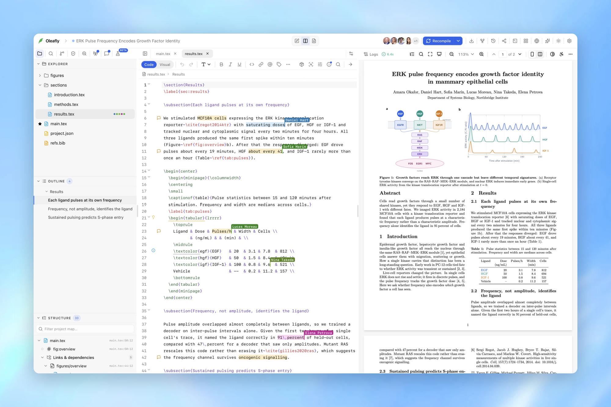
</div>

## Por qué Oleafly

Todo aquí es gratis, incluido lo que otros editores reservan para sus planes de pago: colaboración en tiempo real con tantos coautores como invites, historial de versiones completo, sincronización con Git y GitHub, Zotero, corrección gramatical e IA.

- Escribe con tus coautores en tiempo real, con cursores y comentarios compartidos, en un servidor que tu laboratorio instala con un solo comando.
- Un editor pensado para documentos largos: completado de etiquetas, citas y comandos, comprobación de errores en directo, un esquema de todo el proyecto, combinaciones de teclas de Vim y Emacs, un modo visual y una paleta de 236 símbolos LaTeX en la que puedes buscar.
- Compila en tu propio ordenador. Tectonic, Typst y Pandoc vienen integrados, y TeX Live, MacTeX, MiKTeX o TinyTeX toman el relevo cuando un proyecto necesita una distribución completa.
- Haz clic en el PDF para saltar al código fuente y volver, y el último PDF correcto sigue en pantalla mientras corriges un error.
- Cada proyecto es un repositorio de Git que puedes subir a GitHub, GitLab, Gitea, Forgejo, Codeberg o tu propio servidor Git, y Checkpoints guarda una instantánea después de cada compilación correcta.
- Cita desde tu biblioteca de Zotero mientras escribes y busca en arXiv, Semantic Scholar, Crossref, PubMed y OpenAlex sin salir del editor.
- La corrección ortográfica y gramatical, adaptada a la escritura académica, se ejecuta en tu ordenador.
- Preflight detecta referencias rotas, figuras ausentes, fuentes que no se incrustaron, carencias de accesibilidad y cualquier cosa que rompa el anonimato de una revisión, antes de que hagas el envío.
- Dibuja figuras que se conservan como código TikZ, Typst o Mermaid, y empieza con más de 1700 plantillas para artículos, tesis, diapositivas, pósteres y currículums.
- Importa desde Word, un PDF, un código fuente de arXiv, un repositorio de Git o una cuenta de un servicio de LaTeX en línea.
- El comando `oleafly` compila, comprueba y sincroniza tus proyectos desde cualquier terminal o trabajo de CI, con los mismos compiladores y ajustes que la aplicación.
- La sincronización en la nube mantiene tus proyectos en cada ordenador que usas, y puedes seguir escribiendo sin conexión.
- Claude Code, Codex y 12 agentes más trabajan dentro de tu proyecto, o puedes conectar cualquier modelo, incluidos los locales. La IA es opcional, y cada cambio que hace es una diferencia que puedes revisar y deshacer.
- Las tareas de investigación hacen una revisión bibliográfica, una auditoría de evidencias o una pasada de revisión en una copia separada del proyecto mientras sigues escribiendo, y tú eliges qué archivos modificados conservar. Son experimentales y vienen desactivadas de forma predeterminada; se activan en Ajustes > Experimentación.

## Escribe en equipo, en directo

Comparte un proyecto en el Oleafly Server de tu laboratorio y todos editan los mismos archivos a la vez. Ves el cursor y la selección de cada persona, quién está conectado y qué cambió mientras no estabas. Haz clic en el avatar de alguien para saltar a la línea en la que está trabajando.

<p align="center">
  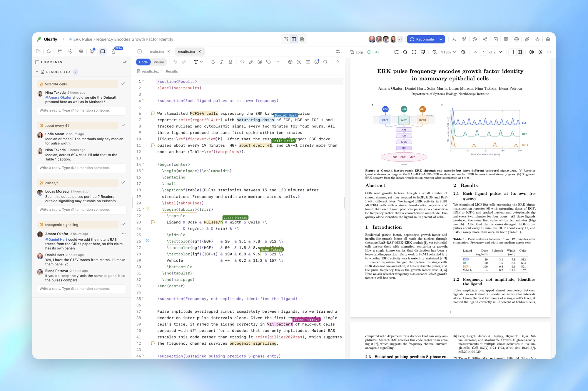
</p>

- Comenta cualquier selección en LaTeX, Typst o Markdown, y después responde, menciona a alguien, resuelve o vuelve a abrir. Un coautor mencionado recibe un solo correo electrónico, y puede desactivar esos avisos.
- Las ediciones que haces sin conexión se fusionan cuando vuelves a conectarte. Si se solapan con las de otra persona, Oleafly te muestra ambas y pregunta antes de aplicar nada.
- Las ediciones de la IA, las citas de Zotero, los cambios de nombre, los borrados y las figuras también se sincronizan. Si dos personas reemplazan la misma figura a la vez, se conservan ambas versiones.
- El archivo principal, el compilador, el idioma de la ortografía y las opciones de Typst se comparten, así que todo el equipo compila el proyecto de la misma manera.
- Cada proyecto tiene un propietario, editores y lectores. Los invitados por correo electrónico solo ven los proyectos a los que se les invitó.

### Aloja el servidor por tu cuenta

Oleafly Server se instala con un solo comando en una máquina Linux, ya sea una estación de trabajo del laboratorio, una máquina virtual de la universidad o un pequeño servidor en la nube:

```bash
curl -fsSL https://oleafly.com/server/install.sh | sudo sh
```

Es un único binario de Rust que usa SQLite, guarda los archivos en el disco o en cualquier almacenamiento compatible con S3 y envía correo electrónico por SMTP si lo configuras. Las personas inician sesión con GitHub o con cualquier proveedor de OpenID Connect, así que funciona el inicio de sesión único de tu universidad. Hay configuraciones listas para Docker Compose, Coolify, Render y systemd, y guías para Railway, Cloudflare Tunnel y los certificados universitarios.

Los administradores tienen una consola en Oleafly para las personas, las reglas de acceso, los proyectos, el correo electrónico y el registro de seguridad. Cada dispositivo firma sus cambios, y el servidor construye cada instantánea a partir de ese historial firmado en lugar de fiarse de lo que se sube.

<p align="center">
  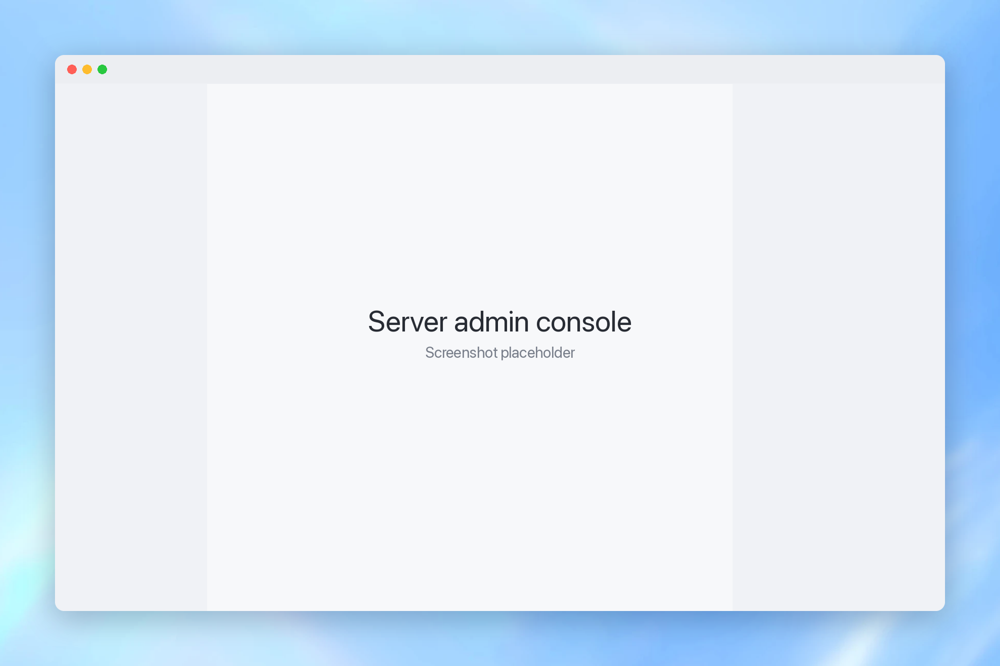
</p>

Lee la [guía del servidor](https://github.com/Oleafly/oleafly-server) para la configuración, las copias de seguridad y la lista completa de quién puede hacer qué.

## Sincronización en la nube entre tus ordenadores

Activa la sincronización en la nube y los proyectos de tu biblioteca y los ajustes de la aplicación te siguen de un ordenador a otro. Cada descarga se comprueba con su registro antes de reemplazar un archivo, y un archivo que tienes abierto con cambios sin guardar nunca se sobrescribe.

<p align="center">
  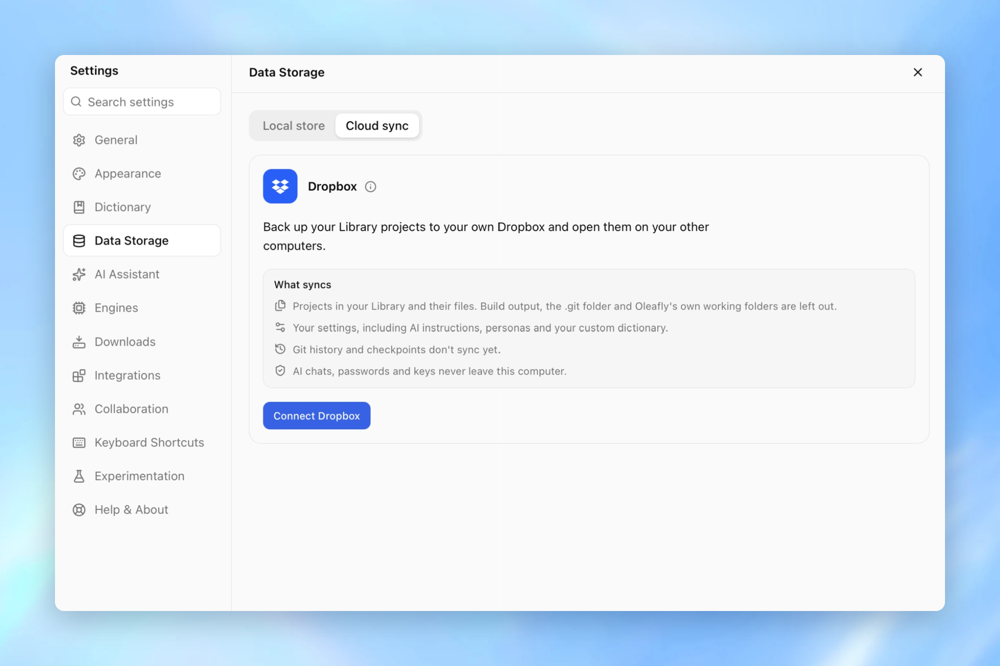
</p>

- Cuando dos ordenadores editan el mismo archivo, se conservan ambas versiones, cada una con el nombre del ordenador que la escribió.
- Borrar la mayor parte de un proyecto de una vez deja el borrado en espera hasta que lo confirmes, así que un descuido no puede vaciarlo en todas partes.
- Los archivos borrados en otro ordenador van a la Papelera de este en lugar de desaparecer.
- En un ordenador nuevo, Oleafly pregunta una sola vez si quieres conservar los ajustes de este ordenador o los sincronizados.

## Trae tus proyectos contigo

¿Vienes de un editor de LaTeX en línea? Inicia sesión en tu cuenta una vez desde Oleafly, elige los proyectos que quieras y llegan con sus archivos, su compilador y su archivo principal, listos para compilar. También funciona con el servidor propio de una universidad.

Con un token de Git de esa cuenta, Oleafly puede mantener sincronizado un proyecto importado en ambas direcciones, así que los coautores que siguen en línea trabajan como hasta ahora. La sincronización bidireccional usa la integración de Git del propio servicio, que requiere un plan de pago o universitario en la cuenta del propietario del proyecto.

<p align="center">
  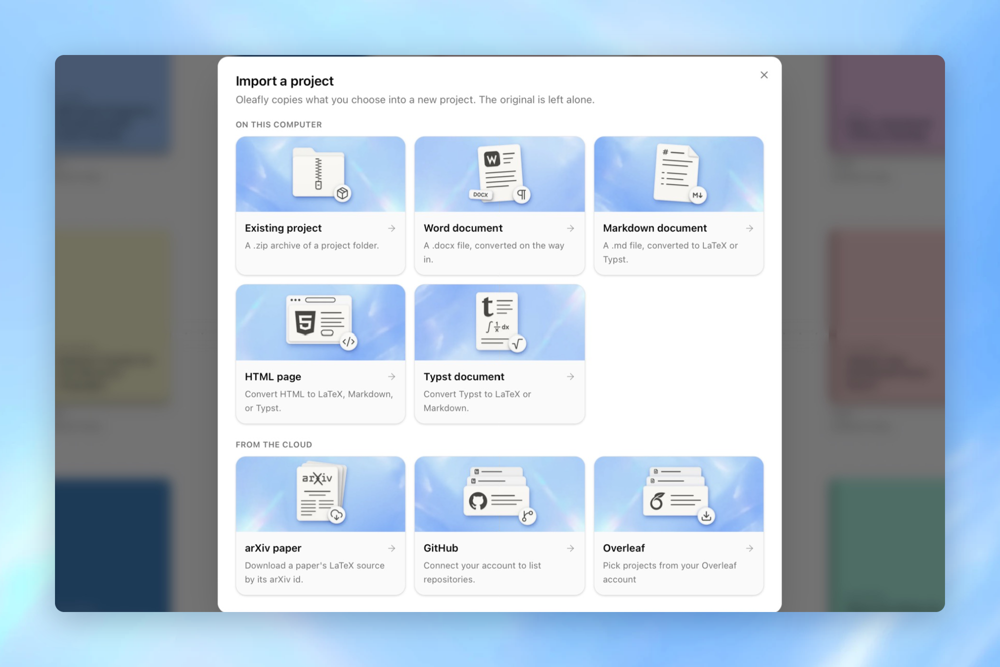
</p>

También puedes empezar con un ZIP de proyecto, un repositorio de GitHub, un documento de Word, un paquete de código fuente de arXiv o un PDF que Oleafly reconstruye como LaTeX editable. O abre una carpeta allí donde ya está.

## Agentes de IA que trabajan dentro de tu proyecto

Elige un agente del catálogo y trabajará en tu proyecto con el código fuente, el PDF y el registro de compilación a su alcance. Cada agente inicia sesión con su propia cuenta y usa su propio modelo. Oleafly le da el proyecto y las herramientas que lo rodean.

<p align="center">
  
</p>

<div align="center">
<table>
  <tr>
    <td align="center" valign="top" width="135"><br />Claude&nbsp;Code</td>
    <td align="center" valign="top" width="135"><br />Codex&nbsp;CLI</td>
    <td align="center" valign="top" width="135"><br />Gemini&nbsp;CLI</td>
    <td align="center" valign="top" width="135"><br />Pi</td>
    <td align="center" valign="top" width="135"><br />OpenCode</td>
    <td align="center" valign="top" width="135"><br />OpenClaw</td>
    <td align="center" valign="top" width="135"><br />Cline</td>
  </tr>
  <tr>
    <td align="center" valign="top" width="135"><br />Hermes&nbsp;Agent</td>
    <td align="center" valign="top" width="135"><br />CodeBuddy</td>
    <td align="center" valign="top" width="135"><br />Kimi&nbsp;Code</td>
    <td align="center" valign="top" width="135"><br />Grok&nbsp;Build</td>
    <td align="center" valign="top" width="135"><br />Cursor</td>
    <td align="center" valign="top" width="135"><br />DeepSeek Harness</td>
    <td align="center" valign="top" width="135"><br />Qoder</td>
  </tr>
</table>
</div>

<p align="center"><sub>Estas marcas identifican herramientas compatibles y siguen siendo propiedad de sus respectivos titulares. No implican respaldo.</sub></p>

¿Prefieres un asistente de chat? Conecta un proveedor alojado, cualquier endpoint compatible con OpenAI o un modelo local de Ollama.

- Cada cambio en un archivo es una diferencia. Aprueba cada uno, deja que el asistente trabaje por su cuenta o define reglas por herramienta, y deshaz un solo archivo o un turno completo.
- El modo de planificación traza el proyecto antes de que se escriba nada.
- Una revisión bibliográfica o una pasada de revisión puede ejecutarse en su propio worktree de Git mientras sigues escribiendo. Tú eliges qué archivos modificados conservar.
- La aplicación incluye 39 skills de investigación, entre ellas rastreos bibliográficos, trabajo relacionado, verificación de afirmaciones y cartas de respuesta a revisores. `npx skills add Oleafly/Oleafly` también las instala en Claude Code, Codex y otros agentes.
- Un servidor MCP local permite que un cliente de IA externo use las mismas herramientas del proyecto. Solo escucha en 127.0.0.1.
- `oleafly mcp` ofrece las herramientas del proyecto a Claude Code, Codex, Cursor y Gemini CLI por stdio, con la aplicación abierta o cerrada.
- Cada versión incluye `oleafly.mcpb`. Ábrelo y Claude Desktop instala Oleafly como extensión. El MCP Registry lo lista como `io.github.Oleafly/oleafly`.

La IA es opcional. El editor, el compilador, el PDF, las citas, la corrección y las comprobaciones funcionan con ella desactivada.

## LaTeX, Typst y Markdown, compilados en tu ordenador

Tectonic, Typst y Pandoc vienen con la aplicación, así que un proyecto nuevo compila sin instalar nada. Cuando un proyecto necesita una distribución TeX completa, cámbialo a latexmk con TeX Live, MacTeX, MiKTeX o un TinyTeX que Oleafly instala por ti.

<p align="center">
  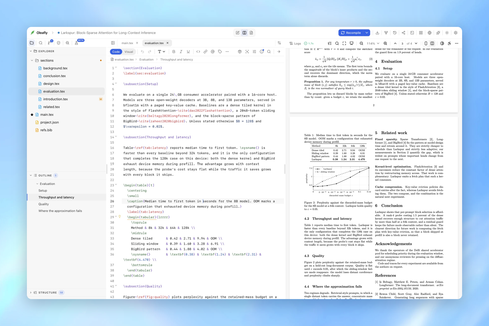
</p>

- Haz clic en el PDF para saltar al código fuente, y viceversa. LaTeX usa SyncTeX, y Typst 0.13 o posterior usa Tinymist.
- Los errores de compilación enlazan con la línea que los causó, y el último PDF correcto sigue en pantalla mientras los corriges.
- El modo visual te permite editar en una vista parecida a la página, con el código fuente a un clic.
- Completado y diagnósticos en directo para etiquetas, citas, comandos, entornos y rutas de archivos en todo el proyecto.
- La corrección ortográfica y gramatical se ejecuta en local y está adaptada a la escritura académica.
- XeLaTeX, LuaLaTeX, y upLaTeX o pLaTeX para documentos en japonés.

## Citas, figuras, comprobaciones y plantillas

<table>
  <tr>
    <td width="50%" valign="top">
      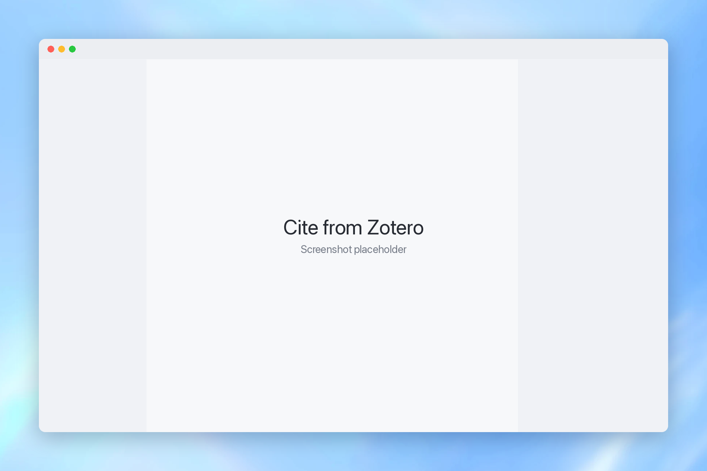
      <h3>Cita desde Zotero mientras escribes</h3>
      Escribe <code>@</code> y parte de un autor, un título o un año para citar desde tu biblioteca de Zotero. Oleafly añade solo esa entrada al <code>.bib</code> del proyecto. Citation Search abarca arXiv, Semantic Scholar, Crossref, PubMed y OpenAlex.
    </td>
    <td width="50%" valign="top">
      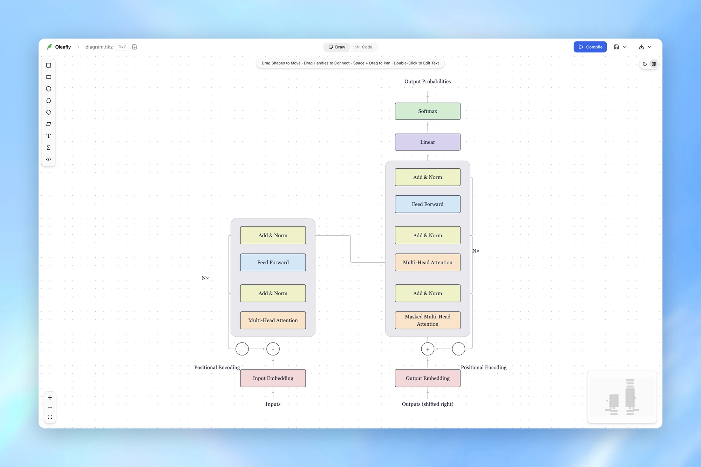
      <h3>Dibuja figuras que se conservan como código</h3>
      Diagram Composer dibuja en un lienzo y escribe TikZ, fletcher para Typst o Mermaid. Cambia el dibujo o el código y el otro se actualiza.
    </td>
  </tr>
  <tr>
    <td width="50%" valign="top">
      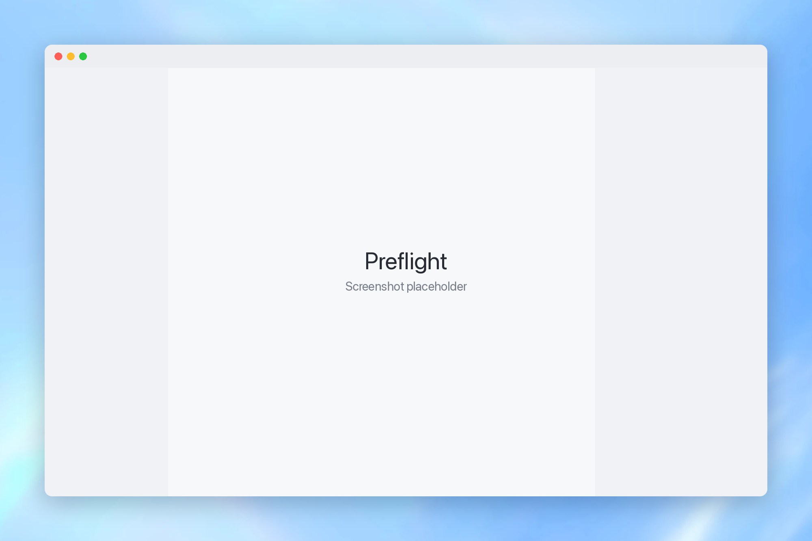
      <h3>Comprueba antes de enviar</h3>
      Preflight encuentra referencias rotas, figuras ausentes, fuentes que no se incrustaron, carencias de accesibilidad y cualquier cosa que revele a los autores en una revisión anónima. Tiene perfiles para arXiv, IEEE, ACM, revistas y tesis.
    </td>
    <td width="50%" valign="top">
      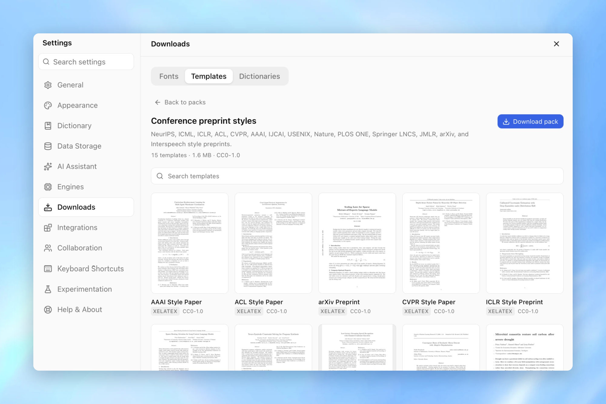
      <h3>Empieza con más de 1700 plantillas</h3>
      Artículos, tesis, charlas de Beamer, pósteres, currículums y artículos con el estilo de congresos y revistas, cada uno con una vista previa renderizada antes de crear el proyecto.
    </td>
  </tr>
</table>

## Git, historial y un terminal

Cada proyecto es una carpeta normal con un repositorio de Git normal. Prepara archivos, compara diferencias, haz commit, push y pull, y publica en GitHub, GitLab, Gitea, Forgejo, Codeberg o tu propio servidor desde el panel Source Control, o usa tu propio terminal, ya que no se le oculta nada. Checkpoints guarda una instantánea local después de cada compilación correcta, así que puedes volver atrás sin hacer un commit.

<p align="center">
  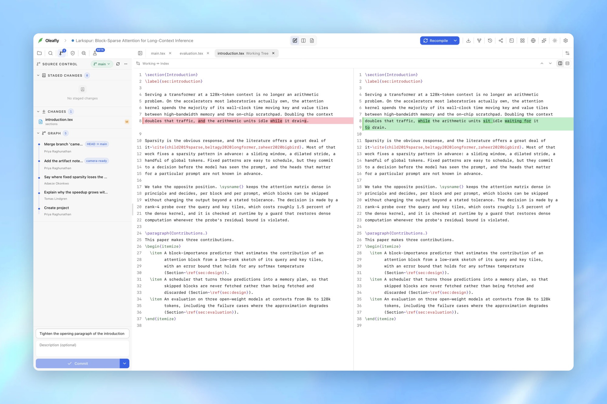
</p>

Bajo el editor hay un terminal acoplado con hasta diez pestañas por proyecto. Haz Cmd-clic (Ctrl-clic) en una ruta de archivo de su salida para abrirlo en esa línea.

El comando `oleafly` trabaja con los mismos proyectos desde cualquier terminal: compila, vuelve a compilar con cada cambio, comprueba antes de enviar, sincroniza con un servicio de LaTeX en línea o ejecuta el agente de Oleafly sin abrir la aplicación. Cada comando puede imprimir JSON con códigos de salida estables para scripts y CI. Consulta la [guía de la línea de comandos](../cli.md).

## Y mucho más

<details>
<summary>Más de 40 herramientas de conversión, citas y matemáticas</summary>

La galería de herramientas está en beta y viene desactivada de forma predeterminada. Actívala en Ajustes > Experimentación > Herramientas de LaTeX.

#### Importación y conversión de formatos

| Herramienta | Úsala para |
| --- | --- |
| PDF to LaTeX | Reconstruir LaTeX editable desde un PDF, conservando las matemáticas, figuras y estructura cuando el origen lo permite |
| arXiv to LaTeX | Descargar un paquete de código fuente de arXiv por ID o desempaquetar un archivo guardado en el disco |
| Image to LaTeX | Convertir una imagen de notas, ecuaciones o una tabla en LaTeX editable |
| Equation to LaTeX | Convertir matemáticas escritas o una imagen de una ecuación en LaTeX |
| Excel to LaTeX | Convertir una hoja de Excel, CSV o TSV en una tabla LaTeX con caracteres escapados |
| HTML to LaTeX | Convertir HTML pegado en un documento LaTeX independiente |
| Image to Typst | Convertir una imagen de notas, ecuaciones o una tabla en Typst editable |
| LaTeX to HTML | Convertir LaTeX en HTML independiente con ecuaciones MathML |
| LaTeX to Image | Renderizar una ecuación y exportar un PNG o SVG |
| LaTeX to Markdown | Convertir un documento LaTeX en Markdown portable |
| LaTeX to Typst | Convertir LaTeX en código fuente Typst que puedes copiar, guardar o abrir como proyecto |
| LaTeX to Word | Crear un documento Word con ecuaciones guardadas como matemáticas nativas de Word |
| Markdown to LaTeX | Convertir notas Markdown en un documento LaTeX independiente |
| Markdown to Typst | Convertir notas Markdown en código fuente Typst |
| Mermaid to LaTeX | Convertir un diagrama de flujo Mermaid en código TikZ editable |
| PDF to Markdown | Extraer la capa de texto, las ecuaciones y las figuras de un PDF a Markdown |
| PDF to Typst | Extraer la capa de texto, las ecuaciones y las figuras de un PDF a Typst |
| Table to LaTeX | Crear una tabla LaTeX en un editor visual de filas y columnas |
| Typst Editor | Iniciar un proyecto Typst con edición del código fuente, vista previa en directo y exportación PDF |
| Visual Typst Editor | Iniciar un documento Typst en el editor del proyecto con vista previa en directo |
| Typst to LaTeX | Convertir el marcado Typst en LaTeX para revistas y envíos |
| arXiv to Typst | Convertir un paquete de código fuente de arXiv a Typst, con una comprobación de compilación que indica lo que no se convirtió |
| CSV to Typst | Pegar filas CSV o TSV y obtener una tabla Typst con caracteres escapados |
| Equation to Typst | Convertir matemáticas LaTeX escritas o una imagen de una ecuación en matemáticas de Typst |
| Excel to Typst | Convertir una hoja de Excel, CSV o TSV en una tabla Typst con caracteres escapados |
| HTML to Typst | Convertir HTML pegado en un documento Typst independiente |
| Mermaid to Typst | Convertir un diagrama de flujo Mermaid en código fletcher editable |
| Typst to HTML | Convertir el marcado Typst en HTML independiente con ecuaciones MathML |
| Typst to Markdown | Convertir el marcado Typst en Markdown portable |
| Typst to Word | Crear un documento Word con ecuaciones guardadas como matemáticas nativas de Word |
| Word to Typst | Convertir un documento Word en Typst y mantener juntos los recursos multimedia extraídos |
| Word to LaTeX | Convertir un documento Word en LaTeX y mantener juntos los recursos multimedia extraídos |

#### Matemáticas, tablas, escritura y validación

| Herramienta | Úsala para |
| --- | --- |
| BibTeX Validator | Comprobar archivos `.bib` en busca de errores de sintaxis, campos obligatorios ausentes y claves duplicadas |
| Statistics Calculators | Calcular valores p, tamaños de muestra e intervalos de confianza en local |
| Writing Generators | Preparar un resumen, una síntesis, una paráfrasis o un esquema de tesis a partir del documento abierto con el asistente |
| Symbol Reference | Consultar símbolos LaTeX e insertar uno en el cursor, o su nombre Typst en un archivo Typst |

#### Literatura, referencias e investigación

| Herramienta | Úsala para |
| --- | --- |
| Find Citations | Buscar en índices académicos, analizar un borrador para detectar soporte ausente y exportar BibTeX |
| arXiv Citation Generator | Buscar un artículo de arXiv y dar formato a su cita en ocho estilos |
| Bibliography Generator | Crear, validar, ordenar y exportar una bibliografía a partir de datos estructurados o BibTeX |
| Citation Generator | Convertir los datos de un artículo o un identificador académico en una cita formateada y BibTeX |
| Citation Generators by Style | Comparar una referencia en APA, MLA, Chicago, IEEE, Harvard, Vancouver, AMA y ACS |
| DOI to BibTeX | Recuperar el registro de un DOI, revisar sus campos y exportar BibTeX |
| ISBN to BibTeX | Recuperar metadatos de un libro a partir de un ISBN, corregirlos y exportar BibTeX |
| PubMed to BibTeX | Recuperar un registro de PubMed desde su PMID, revisarlo y exportar BibTeX |
| URL to BibTeX | Reconocer enlaces DOI, arXiv y PubMed o crear una cita editable de una página web |
| Lab Search | Encontrar instituciones de investigación mediante el directorio de OpenAlex |
| Conference Deadlines | Filtrar fechas límite de conferencias, la mayoría de informática, y ver cuentas atrás |

</details>

<details>
<summary>Las 39 skills de investigación incluidas con Oleafly</summary>

Las skills son carpetas `SKILL.md` normales que siguen la estructura de Agent Skills. Ejecuta una con un comando de barra, añade las tuyas o compártelas con agentes CLI compatibles en el mismo ordenador.

El paquete `research-core` incluido contiene 39 skills. Los nombres siguientes son los identificadores que usan el catálogo y los ajustes del proyecto.

| Categoría | Skills |
| --- | --- |
| Investigación y literatura | `citation-management`, `exploratory-data-analysis`, `hypothesis-generation`, `literature-review`, `oleafly-experiment-loop`, `oleafly-literature-sweep`, `oleafly-research-loop`, `openresearch`, `paper-lookup`, `research-lookup`, `scientific-brainstorming`, `scientific-critical-thinking` |
| Autoría y análisis de manuscritos | `experimental-design`, `oleafly-data-analysis`, `oleafly-manuscript-scaffold`, `oleafly-related-work`, `scientific-writing`, `statistical-analysis`, `statistical-power`, `venue-templates` |
| Figuras y visualización | `oleafly-figure-prep`, `scientific-schematics`, `scientific-visualization` |
| Revisión y evidencias | `oleafly-response-letter`, `oleafly-review-manuscript`, `oleafly-verify-claims`, `peer-review`, `scholar-evaluation` |
| Envío | `oleafly-pre-submission` |
| Comunicación | `oleafly-slides-and-posters`, `pptx-posters`, `research-grants`, `scientific-slides` |
| Herramientas y automatización | `desktop-apps`, `import-refine`, `oleafly-cli`, `oleafly-latex-build`, `pdf-to-latex`, `template-generate` |

</details>

<details>
<summary>Detalles del editor</summary>

- Una paleta de 236 símbolos LaTeX en la que puedes buscar, que inserta los nombres de Typst en los archivos Typst.
- Combinaciones de teclas de Vim y Emacs, pestañas para varios archivos, plegado de código, buscar y reemplazar en todo el proyecto, y recuento de palabras.
- Cambia el nombre de un archivo o muévelo, y Oleafly actualiza las rutas que apuntan a él.
- Temas para el modo claro y el oscuro, cualquier fuente instalada, colores de sintaxis editables y modo Zen.
- La interfaz está disponible en 21 idiomas.
- Paleta de comandos con Cmd+K (Ctrl+K), y un único cuadro de búsqueda para proyectos, documentos, ajustes y herramientas con Cmd+Shift+F (Ctrl+Shift+F).

</details>

## Primeros pasos

1. [Descarga Oleafly](https://github.com/Oleafly/Oleafly/releases/latest) para tu ordenador.
2. Crea un proyecto a partir de una plantilla, importa uno o abre una carpeta que ya tengas.
3. Pulsa Cmd+Enter (Ctrl+Enter en Windows y Linux) para compilar.
4. Para escribir con otras personas, haz clic en **Compartir** y envía el proyecto al Oleafly Server de tu laboratorio.

| Plataforma | Paquete | Descarga |
| --- | --- | --- |
| macOS · Apple Silicon | DMG | [](https://github.com/Oleafly/Oleafly/releases/latest) |
| Windows · x86_64 | MSI o EXE | [](https://github.com/Oleafly/Oleafly/releases/latest) |
| Linux · x86_64 | AppImage, DEB o RPM | [](https://github.com/Oleafly/Oleafly/releases/latest) |
| Linux · ARM64 | AppImage, DEB o RPM | [](https://github.com/Oleafly/Oleafly/releases/latest) |

En x86_64, los paquetes de Linux necesitan glibc 2.35 o una versión posterior (Ubuntu 22.04 o posterior). Los paquetes ARM64 se compilan en Ubuntu 24.04. Las versiones incluyen artefactos de actualización firmados, y el actualizador integrado comprueba la firma antes de instalar nada.

## Preguntas frecuentes

<details>
<summary>¿Necesito una cuenta?</summary>

No necesitas una cuenta de Oleafly. Puedes escribir, compilar y usar Git sin iniciar sesión en nada. Para la colaboración en directo inicias sesión en el servidor de tu laboratorio con GitHub o con el inicio de sesión de tu universidad, y la sincronización en la nube inicia sesión en tu almacenamiento en la nube.

</details>

<details>
<summary>¿Funciona sin conexión?</summary>

Sí. La escritura, la compilación, el PDF, la corrección, Preflight, Git y Checkpoints funcionan en tu ordenador. LaTeX compila sin conexión cuando el motor incluido ya tiene los paquetes que necesita, y Typst cuando sus paquetes están en caché. Los proyectos compartidos conservan tus ediciones y las fusionan cuando vuelves a conectarte.

</details>

<details>
<summary>¿Qué pasa por la red?</summary>

Solo lo que pides: compartir con tu servidor, la sincronización en la nube, las búsquedas de literatura y DOI, GitHub, los proveedores de IA alojados, los servidores MCP que conectes y las descargas opcionales de motores, paquetes y plantillas. Las versiones publicadas también comprueban si hay una actualización cuando se inicia la aplicación. Un modelo local de Ollama mantiene el tráfico de la IA en tu ordenador.

</details>

<details>
<summary>¿Puede mi universidad o empresa alojar el servidor?</summary>

Sí, esa es la idea. Oleafly Server se ejecuta en tu propia máquina o cuenta en la nube, permite iniciar sesión mediante GitHub o cualquier proveedor de OpenID Connect y guarda los archivos en el disco o en un almacenamiento compatible con S3. La [guía del servidor](https://github.com/Oleafly/oleafly-server) cubre la instalación, las copias de seguridad y los roles.

</details>

## Más información

- [Guías del producto](https://oleafly.com/docs/)
- [Oleafly Server](https://github.com/Oleafly/oleafly-server)
- [Mapa de funciones](../features.md)
- [Guía del editor](../Editor.md)
- [Vista previa del PDF](../PDFPreview.md)
- [Citas y literatura](../Citations.md)
- [Galería de herramientas](../Tools.md)
- [Preflight y comprobaciones de accesibilidad](../Preflight.md)
- [Plantillas](../Templates.md)
- [Diagram Composer](../DiagramComposer.md)
- [Git y control del código fuente](../SourceControl.md)
- [Checkpoints](../Checkpoints.md)
- [AI Copilot](../AICopilot.md)
- [Skills](../Skills.md)
- [Integración con MCP](../mcp.md)
- [Herramienta de línea de comandos](../cli.md)
- [Configuración de desarrollo](../development.md)
- [Registro de cambios](../../CHANGELOG.md)

## Comunidad y asistencia

Únete a la [comunidad de Oleafly en Discord](https://oleafly.com/discord) para hacer preguntas, pedir ayuda con una compilación rebelde, enseñar lo que estás escribiendo y votar qué se construye después. Es gratis y está abierta a todo el mundo. ¿Prefieres GitHub? Informa de errores o solicita funciones en las [incidencias de GitHub](https://github.com/Oleafly/Oleafly/issues).

Oleafly está creado por [Prajwal Murthy](https://github.com/prajwal-svm) y sus colaboradores. Las contribuciones al código, las plantillas, la documentación y los comentarios son bienvenidos. Lee la [guía de contribución](../../CONTRIBUTING.md) para participar.

Si usas Oleafly, una [estrella en GitHub](https://github.com/Oleafly/Oleafly) ayuda a que otros investigadores lo encuentren.

## Cita Oleafly

<details>
<summary>Copia la entrada BibTeX</summary>

```bibtex
@software{oleafly,
  author  = {Venkateshmurthy, Prajwal S. and {The Oleafly contributors}},
  title   = {Oleafly: a local-first workspace for research writing},
  year    = {2026},
  version = {0.4.8},
  url     = {https://github.com/Oleafly/Oleafly},
  license = {AGPL-3.0-or-later}
}
```

</details>

[Seguridad](../../SECURITY.md) · [Código de conducta](../../CODE_OF_CONDUCT.md) · [AGPL-3.0-or-later](../../LICENSE)

## Historial de estrellas

<a href="https://www.star-history.com/?repos=Oleafly%2FOleafly&type=date&legend=top-left">
 <picture>
   <source media="(prefers-color-scheme: dark)" srcset="https://api.star-history.com/chart?repos=Oleafly/Oleafly&type=date&theme=dark&legend=top-left&sealed_token=aHz2JA-SBvmD73PyT7aCcCqMyAUvCPtidSAAvsQQxR8-1xdB-RZ-oXHKRnqIJUfSICl6Dd3_XPcHgb5Menvk_FfalfMb1GRbJC_TdeTMBVDi3jVUIXBBdovZ4dufhj4JWF3UXptJhw8pGmB6lqQ-X7gDOWu_bkPTQ7k-Q0VeBiq_jNgwRb7RSMgrSb-P" />
   <source media="(prefers-color-scheme: light)" srcset="https://api.star-history.com/chart?repos=Oleafly/Oleafly&type=date&legend=top-left&sealed_token=aHz2JA-SBvmD73PyT7aCcCqMyAUvCPtidSAAvsQQxR8-1xdB-RZ-oXHKRnqIJUfSICl6Dd3_XPcHgb5Menvk_FfalfMb1GRbJC_TdeTMBVDi3jVUIXBBdovZ4dufhj4JWF3UXptJhw8pGmB6lqQ-X7gDOWu_bkPTQ7k-Q0VeBiq_jNgwRb7RSMgrSb-P" />
   
 </picture>
</a>
