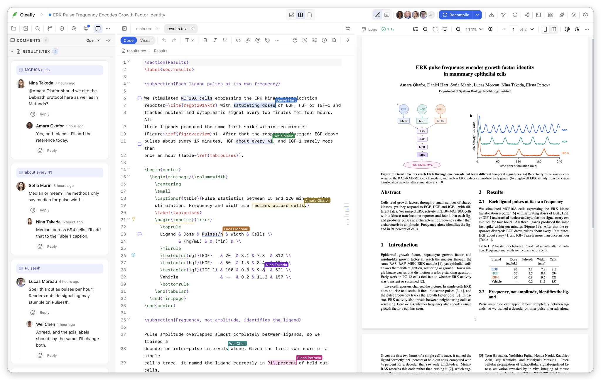
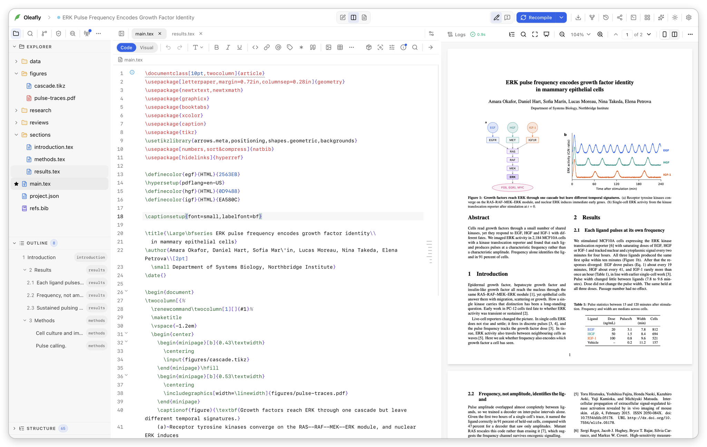
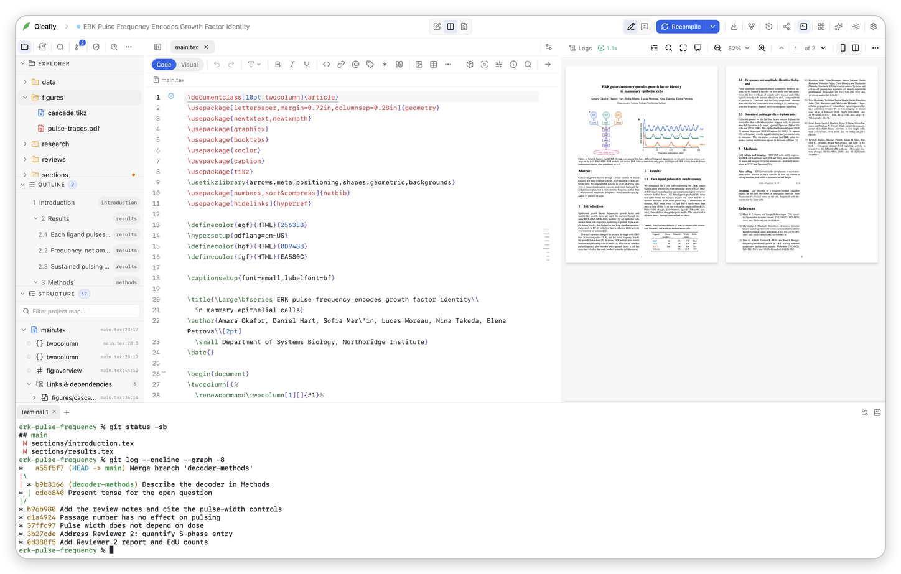
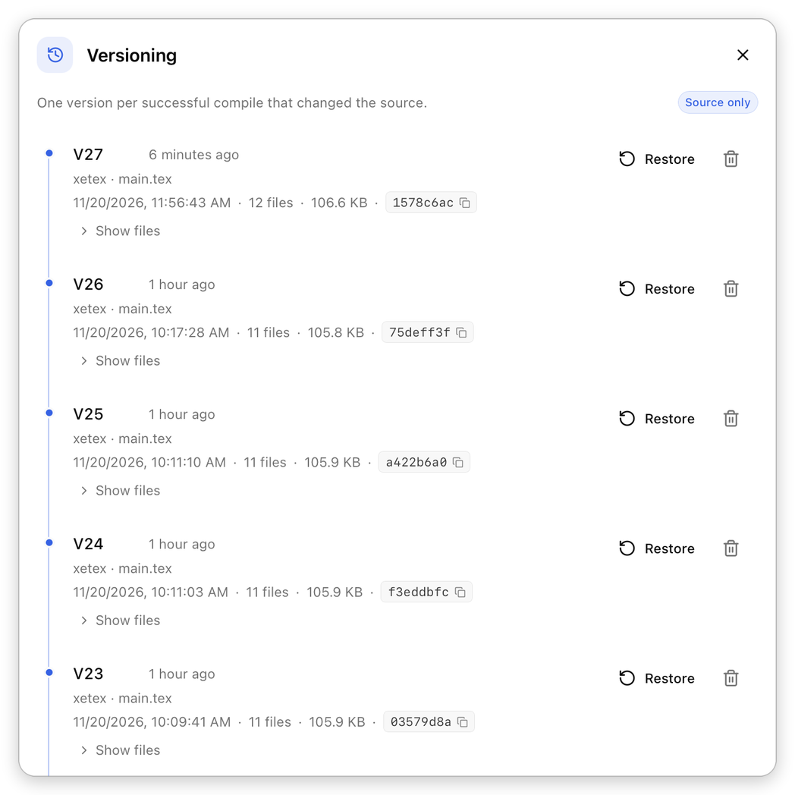

<div align="center">


# Oleafly <sup><em>beta</em></sup>

[Deutsch](README.de.md) | [English](../../README.md) | [Español](README.es.md) | [Français](README.fr.md) | **日本語** | [한국어](README.ko.md) | [Português](README.pt.md) | [Русский](README.ru.md) | [中文](README.zh.md) | [العربية](README.ar.md)

[](https://github.com/Oleafly/Oleafly/releases/latest)
[](https://github.com/Oleafly/Oleafly/releases/latest)
[](https://github.com/Oleafly/Oleafly/releases/latest)

[](https://github.com/Oleafly/Oleafly/issues) [](https://github.com/Oleafly/Oleafly/releases) [](https://github.com/Oleafly/Oleafly/actions/workflows/ci.yml) [](https://sonarcloud.io/summary/new_code?id=Oleafly_Oleafly) [](https://sonarcloud.io/component_measures?id=Oleafly_Oleafly&metric=coverage) [](https://github.com/Oleafly/Oleafly/pulse) [](https://github.com/Oleafly/Oleafly/commits/main) [](../../LICENSE) [](https://oleafly.com/discord) [](https://github.com/Oleafly/Oleafly)

**リアルタイムで共同編集できる、研究のためのLaTeX、Typst、Markdownエディタ。**

Oleaflyは、科学研究の執筆のための、無料でオープンソースのワークスペースです。macOS、Windows、Linux向けのエージェント型開発環境のデスクトップアプリ、研究室がホストしてリアルタイム共同編集に使うサーバー、ローカルビルドとCI向けのコマンドラインツール、共著者がブラウザで使うウェブビューが含まれます。LaTeX、Typst、Markdownをセットアップなしでコンパイルし、すべてのプロジェクトを自動Checkpoints付きのGitリポジトリとして保持します。研究ツールとして、1,700以上のテンプレート、Zotero、BibTeX、統計計算ツール、arXiv、Semantic Scholar、Crossref、PubMed、OpenAlexをまたぐ検索、壊れた参照、欠落した図、匿名査読で著者が分かってしまう箇所、PDF/UAを調べるPreflightチェックがあります。1つのコマンドでインストールできるサーバーで、共有カーソル、コメント、チャット、変更の追跡、ロール、オフラインマージを使ってリアルタイムに共同作業できます。Claude Code、Codexとほか13のAIエージェントがプロジェクト内で動作し、すべての編集は確認できる差分になります。試験的なリサーチタスクは、文献レビューや改訂作業を、自分で決めた予算の範囲内で、分離されたworktreeを使ってバックグラウンドで実行します。CLI（`check`、`lint`、`mcp`、`ask`、`agent run`、`daemon`）を使えば、これらすべてをターミナルやCIから使えます。

<p>
  <a href="https://github.com/Oleafly/Oleafly/releases/latest"><strong>無料でダウンロード</strong></a>
· <a href="https://oleafly.com/docs/">ガイドを読む</a> · <a href="https://github.com/Oleafly/oleafly-server">サーバーを立てる</a> · <a href="../development.md">ソースからビルドする</a>
</p>


永久無料 · オープンソース · Oleaflyアカウント不要 · トラッキングなし

</div>

<div align="center">
  
</div>

## Oleaflyを選ぶ理由

長年、研究の執筆は借りるものでした。研究の成果は他人のサーバーに置かれ、研究者にいちばん必要な機能は有料プランの向こうにあります。Oleaflyなら、それがすべて無料で手に入ります。招待した共著者が何人でも使えるリアルタイム共同編集、完全なバージョン履歴、任意のGitホストとの同期、Zotero、文法チェック、そして自分のサインインまたはキーで使うAIエージェントを、研究室が運用するサーバー上で使えます。アカウントは不要で、テレメトリーは送信せず、オフラインでも動作します。

<p align="center">
  
</p>

- 研究室が1つのコマンドで立ち上げたサーバー上で、共有カーソルとコメントを使いながら共著者とリアルタイムで執筆できます。
- 長い文書のために作られたエディタです。ラベル、引用、コマンドの補完、リアルタイムのエラーチェック、プロジェクト全体のアウトライン、VimとEmacsのキーバインド、ビジュアルモード、検索できる236個のLaTeX記号パレットを備えています。
- 自分のコンピューターでコンパイルできます。Tectonic、Typst、Pandocを内蔵し、プロジェクトに完全なディストリビューションが必要なときはTeX Live、MacTeX、MiKTeX、TinyTeXが引き継ぎます。
- PDFをクリックするとソースへ移動でき、ソースからPDFへ戻ることもできます。エラーを直している間も、最後に正常にコンパイルできたPDFが画面に残ります。
- すべてのプロジェクトはGitHub、GitLab、Gitea、Forgejo、Codeberg、または自分のGitサーバーにpushできるGitリポジトリで、Checkpointsはコンパイルが成功するたびにスナップショットを保存します。
- 入力しながらZoteroライブラリから引用でき、エディタを離れずにarXiv、Semantic Scholar、Crossref、PubMed、OpenAlexを検索できます。
- 学術的な文章向けに調整されたスペルチェックと文法チェックが、自分のコンピューター上で動作します。
- Preflightは、投稿前に壊れた参照、欠落した図、埋め込まれていないフォント、アクセシビリティの不備、匿名査読で著者が分かってしまう箇所を見つけます。
- TikZ、Typst、Mermaidのコードのまま残る図を描けます。論文、学位論文、スライド、ポスター、履歴書向けの1,700以上のテンプレートから始めることもできます。
- PDF、画像、スプレッドシート、`.bib`ファイル、HTMLページ、スライド、ホワイトボードをプロジェクト内で開けます。それぞれ専用のビューアーで表示されます。
- Word、PDF、arXivソース、Gitリポジトリ、Overleafアカウントからインポートできます。
- 共著者がまだOverleafのようなオンラインのLaTeXサービスにいますか？相手がそのウェブエディタに残ったまま、Oleaflyから同じプロジェクトをリアルタイムに一緒に編集できます。リアルタイム編集は試験的な機能で、デフォルトではオフです。「設定」>「実験的な機能」でオンにします。
- `oleafly`コマンドを使うと、どのターミナルやCIジョブからでも、アプリと同じコンパイラーと設定でプロジェクトのビルド、チェック、同期ができます。
- クラウド同期で、使っているすべてのコンピューターにプロジェクトが揃い、オフラインでも執筆を続けられます。
- Claude Code、Codex、ほか13のエージェントがプロジェクト内で動作します。ローカルモデルを含む任意のモデルを接続することもできます。AIは任意で、AIによる変更はすべて確認して元に戻せる差分になります。
- リサーチタスクでは、執筆を続けている間に文献レビュー、根拠の監査、改訂作業をプロジェクトの別のコピーで実行し、残す変更ファイルを自分で選べます。試験的な機能で、デフォルトではオフです。「設定」>「実験的な機能」でオンにできます。
- Notesは、リサーチノートをMarkdownファイルとしてプロジェクトの横に保管します。リンク、タグ、タスク、カレンダーも使えます。こちらも試験的な機能で、デフォルトではオフです。

## リアルタイムで一緒に書く

プロジェクトを研究室のOleafly Serverで共有すると、全員が同じファイルを同時に編集できます。各メンバーのカーソルと選択範囲、オンライン中の人、離れている間に変わった内容が表示されます。アバターをクリックすると、その人が作業している行へ移動します。

<p align="center">
  
</p>

- LaTeX、Typst、Markdownの任意の選択範囲にコメントし、返信、メンション、解決、再オープンができます。メンションされた共著者にはメールが1通届き、このメールはオフにできます。
- オフラインで行った編集は、再接続したときにマージされます。ほかの人の編集と重なる場合、Oleaflyは両方を表示し、何かを適用する前に確認します。
- AIによる編集、Zoteroの引用、名前の変更、削除、図もすべて共有されます。2人が同時に同じ図を差し替えた場合は、両方のバージョンが残ります。
- メインファイル、コンパイラ、スペルチェックの言語、Typstのオプションも共有されるので、チーム全員が同じ方法でプロジェクトをコンパイルします。
- 各プロジェクトにはオーナー、編集者、レビュアー、コメント投稿者、閲覧者がいます。レビュアーの編集は提案になり、オーナーと編集者も提案モードに切り替えられます。メールで招待されたゲストには、招待されたプロジェクトだけが表示されます。
- 各共有プロジェクトにはチャットと履歴があり、履歴ではバージョンを比較したり、復元したり、名前を付けたりできます。
- サーバーでブラウザアクセスが有効になっていれば、共著者は共有プロジェクトをブラウザで開き、最新のコンパイルで作られたPDFを読めます。

<table>
  <tr>
    <td width="50%" valign="top">
      
      <h3>プロジェクトチャットで相談する</h3>
      共有プロジェクトにはそれぞれ専用のチャットがあり、メンションとリアクションが使えるので、会話はその対象のファイルの隣に残ります。
    </td>
    <td width="50%" valign="top">
      
      <h3>誰がいるかを見る</h3>
      リアルタイム共同編集パネルには、プロジェクトにいる全員、そのロール、各自が開いているファイルが表示されます。一覧の下には最近のアクティビティのフィードがあります。
    </td>
  </tr>
</table>

### サーバーを自分で運用する

Oleafly Serverは、研究室のワークステーション、大学のVM、小規模なクラウドサーバーなど、Linuxマシンに1つのコマンドでインストールできます。

```bash
curl -fsSL https://oleafly.com/server/install.sh | sudo sh
```

SQLiteを使う単一のRustバイナリで、ファイルはディスクまたは任意のS3互換ストレージに保存し、設定すればSMTPでメールを送信します。ユーザーはGitHubまたは任意のOpenID Connectプロバイダーでサインインするため、大学のシングルサインオンも使えます。Docker Compose、Coolify、Render、systemd向けの設定が用意されており、Railway、Cloudflare Tunnel、大学の証明書についてのガイドもあります。

管理者はOleaflyのコンソールで、ユーザー、アクセスルール、プロジェクト、メール、セキュリティログを管理できます。各デバイスは自分の変更に署名し、サーバーはアップロードをそのまま信頼するのではなく、署名された履歴から各スナップショットを組み立てます。

<p align="center">
  
</p>

セットアップ、バックアップ、誰が何をできるかの一覧については、[サーバーガイド](https://github.com/Oleafly/oleafly-server)を読んでください。

## コンピューター間のクラウド同期

クラウド同期をオンにすると、ライブラリのプロジェクトとアプリの設定が、あるコンピューターから次のコンピューターへ引き継がれます。ダウンロードしたものは、ファイルを置き換える前に必ず記録と照合され、未保存の変更がある開いたファイルが上書きされることはありません。

同期先にはDropbox、Google Drive、またはAmazon S3、Google Cloud Storage、MinIOなどのS3互換サービスにある自分のバケットを選べます。「設定」>「データストレージ」>「クラウド同期」から1つ選びます。同じページには、Oleaflyのデータフォルダーに何が入っていて何が容量を使っているかを示すバーがあります。

<p align="center">
  
</p>

- 2台のコンピューターで同じファイルを編集した場合は両方のバージョンが残り、それぞれ書き込んだコンピューターの名前が付きます。
- プロジェクトの大部分を一度に削除すると、確認するまでその削除は保留されるので、1回の誤操作ですべてのコンピューターからプロジェクトが消えることはありません。
- 別のコンピューターで削除されたファイルは、消えてしまうのではなく、このコンピューターのゴミ箱に移動します。
- 新しいコンピューターでは、このコンピューターの設定と同期された設定のどちらを使うかを、Oleaflyが一度だけ尋ねます。

## 今あるプロジェクトを持ち込む

オンラインのLaTeXエディタから移行しますか？Oleaflyからアカウントに一度サインインし、必要なプロジェクトを選ぶと、ファイル、コンパイラ、メインファイルごと移行され、すぐにコンパイルできます。大学が独自に運用しているサーバーにも対応しています。

そのアカウントのGitトークンがあれば、Oleaflyはインポートしたプロジェクトを双方向に同期できるので、オンラインで作業を続ける共著者はこれまでどおりの方法で作業できます。双方向同期はそのサービス自身のGit連携を使うため、プロジェクトのオーナーのアカウントに有料プランまたは大学向けプランが必要です。

リアルタイム編集はさらに進んだ機能で、Gitトークンは不要です。オンにすると、あなたとオンラインに残った共著者が同じプロジェクトで同時に作業できます。入力、新しいファイル、名前の変更は1秒ほどで双方に届き、それぞれが作業している場所も見えます。接続が切れても入力を続けられ、つながったときに追いつきます。アカウントがGoogle、所属機関、パスキーでサインインする場合は、「ブラウザでサインイン」を使います。リアルタイム編集は試験的な機能です。「設定」>「実験的な機能」でオンにします。

<p align="center">
  
</p>

プロジェクトのZIP、GitHubリポジトリ、Word文書、arXivのソースバンドル、またはOleaflyが編集可能なLaTeXとして再構成するPDFから始めることもできます。フォルダを今ある場所のまま開くこともできます。

## プロジェクトの中で働くAIエージェント

カタログからエージェントを選ぶと、ソース、PDF、コンパイルログにすぐ手が届く状態で、プロジェクトの中で作業します。各エージェントは自分のアカウントでサインインし、自分のモデルを使います。Oleaflyはプロジェクトとその周りのツールを提供します。

<p align="center">
  
</p>

<table>
  <tr>
    <td width="50%" valign="top">
      
      <h3>Oleafly Assistant</h3>
      内蔵のアシスタントは、接続したプロバイダーまたはローカルモデルで動作します。開くと、リサーチ、原稿作成、図、レビュー、投稿というタスク別にまとめられたリサーチskillが表示されます。
    </td>
    <td width="50%" valign="top">
      
      <h3>CLIエージェント</h3>
      メッセージ欄の上の行から、Claude Code、Codex、Gemini CLI、またはほかのエージェントを選びます。ソースとコンパイル済みのPDFの横で作業します。
    </td>
  </tr>
</table>

<div align="center">
<table>
  <tr>
    <td align="center" valign="top" width="135"><br />Claude&nbsp;Code</td>
    <td align="center" valign="top" width="135"><br />Codex&nbsp;CLI</td>
    <td align="center" valign="top" width="135"><br />Gemini&nbsp;CLI</td>
    <td align="center" valign="top" width="135"><br />Pi</td>
    <td align="center" valign="top" width="135"><br />OpenCode</td>
  </tr>
  <tr>
    <td align="center" valign="top" width="135"><br />OpenClaw</td>
    <td align="center" valign="top" width="135"><br />Cline</td>
    <td align="center" valign="top" width="135"><br />Hermes&nbsp;Agent</td>
    <td align="center" valign="top" width="135"><br />CodeBuddy</td>
    <td align="center" valign="top" width="135"><br />Kimi&nbsp;Code</td>
  </tr>
  <tr>
    <td align="center" valign="top" width="135"><br />Grok&nbsp;Build</td>
    <td align="center" valign="top" width="135"><br />Cursor</td>
    <td align="center" valign="top" width="135"><br />DeepSeek Harness</td>
    <td align="center" valign="top" width="135"><br />Qoder</td>
    <td align="center" valign="top" width="135"><br />Antigravity&nbsp;CLI</td>
  </tr>
</table>
</div>

<p align="center"><sub>これらのマークは対応するツールを示すもので、各所有者に帰属します。推奨や承認を意味するものではありません。</sub></p>

チャット形式のアシスタントを使いたいですか？ホスト型プロバイダー、任意のOpenAI互換エンドポイント、またはOllama、llama.cpp、Lemonadeのローカルモデルを接続できます。

- ファイルの変更はすべて差分になります。1つずつ承認するか、アシスタントに任せて作業させるか、ツールごとにルールを設定でき、1ファイル単位でもターン全体でも元に戻せます。
- Planモードでは、何かを書き込む前にプロジェクトの全体像を把握します。
- APIキーがない場合は、すでにサインインしているCLIエージェントで、Paper Review、インライン編集、Fix with AI、画像と数式のツールを実行できます。
- エージェントは、許可したデスクトップアプリやウェブサイトを使えます。たとえば、ジャーナルの投稿フォームや統計パッケージです。Cua Driver経由で動作し、これは自分でインストールします。
- 執筆を続けている間に、文献レビューや改訂作業を専用のGit worktreeで実行できます。残す変更ファイルは自分で選びます。
- 文献調査、関連研究、主張の検証、査読者への回答書など、39個のリサーチskillがアプリに同梱されています。`npx skills add Oleafly/Oleafly`で、Claude Code、Codexなどのエージェントにもインストールできます。
- ローカルMCPサーバーを使うと、外部のAIクライアントも同じプロジェクトツールを使えます。待ち受けるのは127.0.0.1だけです。
- `oleafly mcp`は、アプリを開いていてもいなくても、Claude Code、Codex、Cursor、Gemini CLIにstdio経由でプロジェクトツールを提供します。
- 各リリースには`oleafly.mcpb`が含まれています。開くと、Claude DesktopがOleaflyを拡張機能としてインストールします。MCP Registryには`io.github.Oleafly/oleafly`として掲載されています。

AIは任意です。エディタ、コンパイラ、PDF、引用、校正、チェックは、AIをオフにしてもすべて動作します。

## LaTeX、Typst、Markdownを自分のコンピューターでコンパイル

Tectonic、Typst、Pandocはアプリに同梱されているので、新しいプロジェクトは何もインストールせずにコンパイルできます。プロジェクトに完全なTeXディストリビューションが必要な場合は、TeX Live、MacTeX、MiKTeX、またはOleaflyがインストールするTinyTeXを使うlatexmkに切り替えます。

<p align="center">
  
</p>

- PDFをクリックするとソースへ移動し、ソースからPDFへ戻ることもできます。LaTeXではSyncTeXを、Typst 0.13以降ではTinymistを使います。
- コンパイルエラーは原因となった行にリンクされ、修正している間も最後に正常にコンパイルできたPDFが画面に残ります。
- ビジュアルモードでは、ページのような表示で編集でき、ソースにはワンクリックで戻れます。
- プロジェクト全体のラベル、引用、コマンド、環境、ファイルパスの補完とリアルタイム診断。
- スペルチェックと文法チェックはローカルで動作し、学術的な文章向けに調整されています。
- XeLaTeX、LuaLaTeX、日本語文書向けのupLaTeXまたはpLaTeXに対応。
- QuartoとCalepinの文書は、プロジェクトでコードを許可すると、R、Python、Juliaのコードを実行します。どちらのツールもOleaflyがダウンロードできます。
- Markdown文書は、論文、レポート、書籍、スライド、ポスター、レター、履歴書としてビルドできます。front matterに`type:`を設定します。

<p align="center">
  
</p>

PDFビューアーには、検索、文書のアウトライン、1ページ表示と2ページ表示、幅や高さに合わせる表示があります。

## 引用、図、チェック、テンプレート

<table>
  <tr>
    <td width="50%" valign="top">
      
      <h3>入力しながらZoteroから引用する</h3>
      <code>@</code>に続けて著者、タイトル、年の一部を入力すると、Zoteroライブラリから引用できます。Oleaflyはプロジェクトの<code>.bib</code>にその項目だけを追加します。Citation SearchはarXiv、Semantic Scholar、Crossref、PubMed、OpenAlexを検索できます。
    </td>
    <td width="50%" valign="top">
      
      <h3>コードのまま残る図を描く</h3>
      Diagram Composerはキャンバス上で図を描き、TikZ、Typst向けのfletcher、またはMermaidのコードを書き出します。図とコードのどちらを変えても、もう一方が追従します。
    </td>
  </tr>
  <tr>
    <td width="50%" valign="top">
      
      <h3>投稿前にチェックする</h3>
      Preflightは、壊れた参照、欠落した図、埋め込まれていないフォント、アクセシビリティの不備、匿名査読で著者が分かってしまう箇所を見つけます。arXiv、IEEE、ACM、ジャーナル、学位論文向けのプロファイルがあります。
    </td>
    <td width="50%" valign="top">
      
      <h3>1,700以上のテンプレートから始める</h3>
      論文、学位論文、Beamerの発表スライド、ポスター、履歴書、投稿先スタイルの論文があり、プロジェクトを作成する前にそれぞれのレンダリング済みプレビューを確認できます。
    </td>
  </tr>
</table>

## Git、履歴、ターミナル

すべてのプロジェクトは、普通のGitリポジトリを持つ普通のフォルダーです。Source Controlパネルから、ステージ、差分表示、コミット、push、pull、GitHub、GitLab、Gitea、Forgejo、Codeberg、または自分のサーバーへの公開ができます。ターミナルから隠しているものは何もないので、自分のターミナルを使うこともできます。Checkpointsはコンパイルが成功するたびにローカルスナップショットを保存するので、コミットを作らずに以前の状態に戻せます。

<p align="center">
  
</p>

エディタの下にはターミナルドックがあり、1プロジェクトにつき最大10個のタブを開けます。出力内のファイルパスをCmd+クリック（Ctrl+クリック）すると、そのファイルを該当する行で開けます。

<table>
  <tr>
    <td width="50%" valign="top">
      
      <h3>エディタの下のターミナル</h3>
      ウィンドウを離れずに、プロジェクトフォルダーでGit、ビルドスクリプト、<code>oleafly</code>コマンドを実行できます。
    </td>
    <td width="50%" valign="top">
      
      <h3>コンパイルのたびにバージョンを保存</h3>
      Versioningは、コンパイルが成功するたびにソースのスナップショットを保存します。どれでもワンクリックで復元でき、コミットは必要ありません。
    </td>
  </tr>
  <tr>
    <td width="50%" valign="top">
      
      <h3>好きなGitホスト、または自分のサーバー</h3>
      GitHub、GitLab、Codebergにサインインするか、自分で運用するGiteaまたはForgejoサーバーのアドレスを追加します。その後は、Source Controlパネルからpush、pull、公開ができます。
    </td>
    <td width="50%" valign="top">
      
      <h3>容量の行き先を見る</h3>
      設定には、プロジェクト、PDF、Git履歴、アプリ自身のデータがディスク上でどれだけの容量を使っているかが表示されます。削除したプロジェクトはゴミ箱で待機します。
    </td>
  </tr>
</table>

`oleafly`コマンドを使えば、どのターミナルからでも同じプロジェクトを扱えます。ビルド、変更のたびの再ビルド、投稿前のチェック、オンラインのLaTeXサービスとの同期に加えて、アプリを開かずにOleaflyのエージェントを実行することもできます。どのコマンドも、スクリプトやCI向けに安定した終了コード付きのJSONを出力できます。詳しくは[コマンドラインガイド](../cli.md)をご覧ください。

## 研究のためのNotes

Notesは、プロジェクトの横にあるナレッジベースです。各ノートは自分が所有するMarkdownファイルで、コールアウト、表、グラフ、図、数式、リンクとバックリンク、タグ、期限付きのタスクを備えたリッチエディタで編集します。Notesは試験的な機能で、デフォルトではオフです。「設定」>「実験的な機能」でオンにします。

<p align="center">
  
</p>

- ノートはタブとして開き、分割やドックへの配置ができます。Notes Homeには、検索、タグ、タスクリスト、カレンダーとともにノートが一覧表示されます。
- ノートはテンプレートから始めることもでき、`notes/<Title>.md`としてプロジェクトの中に置けます。
- ノートを研究室のサーバーで共有すると一緒に編集でき、プロジェクトのファイルと同じように選択範囲にコメントできます。
- アシスタントやCLIエージェントは、ノートへの変更を提案できます。1つずつその場で承認または却下します。
- クイックキャプチャは、残しておきたい考えを書き留めるための小さなフローティングウィンドウです。
- Xの投稿へのリンクを貼ると、ノートに投稿の作者、日付、本文が保存されます。

## Oleaflyを自分好みにする

Oleaflyはシステムのライトモードまたはダークモードの設定に従います。自分で選ぶこともできます。アクセントカラー、Homeドックの位置、プロジェクトの背後に描くものを選べます。エディタには専用のフォント、テーマ、色、キーバインドがあり、Notesでは書体と間隔を変えるとライブプレビューが表示されます。

<table>
  <tr>
    <td width="50%" valign="top">
      
      <h3>アクセント、ドック、背景</h3>
      6色のアクセントカラー、左、下、右から選べるドック、プロジェクトの背後に表示するドット、グリッド、または何もなしを選べます。
    </td>
    <td width="50%" valign="top">
      
      <h3>好みの書体</h3>
      ノートの書体、サイズ、間隔を選ぶと、変更に合わせてプレビューが変わります。
    </td>
  </tr>
  <tr>
    <td width="50%" valign="top">
      
      <h3>ライトとダーク</h3>
      ツールバーから切り替えるか、Oleaflyにシステムの設定に従わせます。
    </td>
    <td width="50%" valign="top">
      
      <h3>Notesもダーク</h3>
      ノートのグラフ、表、コールアウトは、ライトだけでなくダーク向けにも描画されます。
    </td>
  </tr>
</table>

## ほかにもたくさん

<details>
<summary>40以上の変換、引用、数式ツール</summary>

Toolsギャラリーはbetaで、デフォルトではオフです。Settingsの「実験的な機能」>「LaTeX ツール」で有効にできます。

#### インポートと形式変換

| ツール | 用途 |
| --- | --- |
| PDF to LaTeX | PDFから、可能な範囲で数式、図、構造を保った編集可能なLaTeXを再構成 |
| arXiv to LaTeX | IDでarXivのソースバンドルをダウンロードするか、保存済みアーカイブをディスクから展開 |
| Image to LaTeX | ノート、数式、表の画像を編集可能なLaTeXに変換 |
| Equation to LaTeX | 入力した数式または数式画像をLaTeXに変換 |
| Excel to LaTeX | Excel、CSV、TSVのシートをエスケープ済みのLaTeX表に変換 |
| HTML to LaTeX | 貼り付けたHTMLをスタンドアロンのLaTeX文書に変換 |
| Image to Typst | ノート、数式、表の画像を編集可能なTypstに変換 |
| LaTeX to HTML | LaTeXをMathML数式付きのスタンドアロンHTMLに変換 |
| LaTeX to Image | 数式をレンダリングしてPNGまたはSVGとしてエクスポート |
| LaTeX to Markdown | LaTeX文書をポータブルなMarkdownに変換 |
| LaTeX to Typst | LaTeXをコピー、保存、プロジェクトとして開けるTypstソースに変換 |
| LaTeX to Word | 数式をネイティブのWord数式として保存したWord文書を作成 |
| Markdown to LaTeX | MarkdownのメモをスタンドアロンのLaTeX文書に変換 |
| Markdown to Typst | MarkdownのメモをTypstソースに変換 |
| Mermaid to LaTeX | Mermaidフローチャートを編集可能なTikZコードに変換 |
| PDF to Markdown | PDFのテキストレイヤー、数式、図をMarkdownに抽出 |
| PDF to Typst | PDFのテキストレイヤー、数式、図をTypstに抽出 |
| Table to LaTeX | 行と列を編集できるビジュアルエディタでLaTeX表を作成 |
| Typst Editor | ソース編集、ライブプレビュー、PDFエクスポートを備えたTypstプロジェクトを開始 |
| Visual Typst Editor | プロジェクトエディタでライブプレビュー付きのTypst文書を開始 |
| Typst to LaTeX | ジャーナルや投稿向けにTypstマークアップをLaTeXへ変換 |
| arXiv to Typst | arXivのソースバンドルをTypstに変換し、変換できなかった部分を一覧にするコンパイルチェックを実行 |
| CSV to Typst | CSVまたはTSVの行を貼り付けて、エスケープ済みのTypst表を作成 |
| Equation to Typst | 入力したLaTeX数式または数式画像をTypstの数式に変換 |
| Excel to Typst | Excel、CSV、TSVのシートをエスケープ済みのTypst表に変換 |
| HTML to Typst | 貼り付けたHTMLをスタンドアロンのTypst文書に変換 |
| Mermaid to Typst | Mermaidフローチャートを編集可能なfletcherコードに変換 |
| Typst to HTML | TypstマークアップをMathML数式付きのスタンドアロンHTMLに変換 |
| Typst to Markdown | TypstマークアップをポータブルなMarkdownに変換 |
| Typst to Word | 数式をネイティブのWord数式として保存したWord文書を作成 |
| Word to Typst | Word文書をTypstに変換し、抽出したメディアをまとめて保持 |
| Word to LaTeX | Word文書をLaTeXに変換し、抽出したメディアをまとめて保持 |

#### 数式、表、執筆、検証

| ツール | 用途 |
| --- | --- |
| BibTeX Validator | `.bib`ファイルの構文エラー、必須フィールドの欠落、重複キーを確認 |
| Statistics Calculators | p値、サンプルサイズ、信頼区間をローカルで計算 |
| Writing Generators | 開いている文書から、アシスタントを使ってアブストラクト、要約、言い換え、学位論文のアウトラインを作成 |
| Symbol Reference | LaTeX記号を参照し、カーソル位置に挿入。Typstファイルでは記号のTypst名を挿入 |

#### 文献、参考文献、リサーチ

| ツール | 用途 |
| --- | --- |
| Find Citations | 学術インデックスを検索し、原稿をスキャンして不足している根拠を探し、BibTeXをエクスポート |
| arXiv Citation Generator | arXiv論文を検索し、8種類のスタイルで引用を整形 |
| Bibliography Generator | 構造化された詳細またはBibTeXから文献目録を作成、検証、並べ替え、エクスポート |
| Citation Generator | 論文の詳細または学術識別子を整形済み引用とBibTeXに変換 |
| Citation Generators by Style | APA、MLA、Chicago、IEEE、Harvard、Vancouver、AMA、ACSで1つの参考文献を比較 |
| DOI to BibTeX | DOIレコードを取得し、フィールドを確認してBibTeXをエクスポート |
| ISBN to BibTeX | ISBNから書籍メタデータを取得し、修正してBibTeXをエクスポート |
| PubMed to BibTeX | PMIDからPubMedレコードを取得し、確認してBibTeXをエクスポート |
| URL to BibTeX | DOI、arXiv、PubMedのリンクを認識するか、編集可能なウェブページ引用を作成 |
| Lab Search | OpenAlexディレクトリから研究機関を探す |
| Conference Deadlines | 主にコンピューターサイエンス分野の学会締切を絞り込み、カウントダウンを表示 |

</details>

<details>
<summary>Oleaflyに同梱される39個のリサーチskill</summary>

skillはAgent Skillsの形式に従う通常の`SKILL.md`フォルダーです。スラッシュコマンドで実行したり、自分のskillを追加したり、同じコンピューター上の対応するCLIエージェントと共有したりできます。

同梱の`research-core`パックには39個のskillがあります。以下の名前は、カタログとプロジェクト設定で使われるIDです。

| カテゴリ | Skills |
| --- | --- |
| リサーチと文献 | `citation-management`、`exploratory-data-analysis`、`hypothesis-generation`、`literature-review`、`oleafly-experiment-loop`、`oleafly-literature-sweep`、`oleafly-research-loop`、`openresearch`、`paper-lookup`、`research-lookup`、`scientific-brainstorming`、`scientific-critical-thinking` |
| 原稿作成と分析 | `experimental-design`、`oleafly-data-analysis`、`oleafly-manuscript-scaffold`、`oleafly-related-work`、`scientific-writing`、`statistical-analysis`、`statistical-power`、`venue-templates` |
| 図と可視化 | `oleafly-figure-prep`、`scientific-schematics`、`scientific-visualization` |
| レビューと根拠 | `oleafly-response-letter`、`oleafly-review-manuscript`、`oleafly-verify-claims`、`peer-review`、`scholar-evaluation` |
| 投稿 | `oleafly-pre-submission` |
| コミュニケーション | `oleafly-slides-and-posters`、`pptx-posters`、`research-grants`、`scientific-slides` |
| ツールと自動化 | `desktop-apps`、`import-refine`、`oleafly-cli`、`oleafly-latex-build`、`pdf-to-latex`、`template-generate` |

</details>

<details>
<summary>エディタの詳細</summary>

- 検索できる236個のLaTeX記号パレット。Typstファイルでは記号のTypst名を挿入します。
- エディタの右端にあるアウトラインレールは、各見出しと今読んでいる節を示します。開くと、節番号と、直近のコンパイルに基づく各見出しのPDFページが表示されます。
- プロジェクト内のほかのファイル用のビューア。フルのプレビューツールバー付きのPDF、拡大できる画像、並べ替えできる表としてのCSVとExcelのシート、検索できる`.bib`ファイルの一覧、HTMLのライブプレビューです。
- TSXで書いたスライドは、入力しながらプレビューされ、PDFのようにプレゼンできます。`something.excalidraw`という名前のファイルは、スケッチできるホワイトボードとして開きます。
- ファイルマネージャーで`.tex`、`.typ`、`.md`ファイルをダブルクリックすると、Oleaflyで開きます。
- VimとEmacsのキーバインド、複数ファイルのタブ、折りたたみ、プロジェクト全体の検索と置換、単語数。
- ファイルの名前を変更したり移動したりすると、Oleaflyはそのファイルを指すパスを更新します。
- ライトモードとダークモードのテーマ、インストール済みの任意のフォント、編集できる構文の色、Zenモード。
- ファイルアイコンはファイルの種類ごとに色分けされます。「設定」>「外観」>「プロジェクト」で、TEXやPDFのような短い種類バッジに切り替えられます。
- インターフェースは22言語で利用できます。
- Cmd+K（Ctrl+K）でコマンドパレットを、Cmd+Shift+F（Ctrl+Shift+F）でプロジェクト、文書、設定、ツールをまとめて検索できる検索ボックスを開けます。

</details>

## 使い始める

1. お使いのコンピューター向けに[Oleaflyをダウンロード](https://github.com/Oleafly/Oleafly/releases/latest)します。
2. テンプレートからプロジェクトを作成するか、プロジェクトをインポートするか、手元にあるフォルダーを開きます。
3. Cmd+Enter（WindowsとLinuxではCtrl+Enter）を押してコンパイルします。
4. ほかの人と一緒に書くには、**共有**をクリックしてプロジェクトを研究室のOleafly Serverに送ります。

| プラットフォーム | パッケージ | ダウンロード |
| --- | --- | --- |
| macOS · Apple Silicon | DMG | [](https://github.com/Oleafly/Oleafly/releases/latest) |
| macOS · Intel | DMG (`x64`) | [](https://github.com/Oleafly/Oleafly/releases/latest) |
| Windows · x86_64 | MSIまたはEXE | [](https://github.com/Oleafly/Oleafly/releases/latest) |
| Linux · x86_64 | AppImage、DEB、またはRPM | [](https://github.com/Oleafly/Oleafly/releases/latest) |
| Linux · ARM64 | AppImage、DEB、またはRPM | [](https://github.com/Oleafly/Oleafly/releases/latest) |

Linuxパッケージにはglibc 2.35以降（Ubuntu 22.04、Debian 12以降）が必要です。リリースには署名付き更新アーティファクトが含まれ、アプリ内アップデーターはインストール前に署名を確認します。

## よくある質問

<details>
<summary>アカウントは必要ですか？</summary>

Oleaflyのアカウントは必要ありません。何にもサインインせずに、執筆、コンパイル、Gitの利用ができます。リアルタイム共同編集では、GitHubまたは大学のサインインで研究室のサーバーにサインインし、クラウド同期ではクラウドストレージにサインインします。

</details>

<details>
<summary>オフラインで使えますか？</summary>

はい。執筆、コンパイル、PDF、校正、Preflight、Git、Checkpointsはすべて自分のコンピューター上で動作します。LaTeXは同梱エンジンに必要なパッケージが揃えばオフラインでビルドでき、Typstはパッケージがキャッシュされればオフラインでビルドできます。共有プロジェクトでは編集内容が保持され、再接続したときにマージされます。

</details>

<details>
<summary>ネットワークに送られるものは何ですか？</summary>

自分で求めたものだけです。サーバーとの共有、クラウド同期、インポートやリアルタイム編集に使うオンラインのLaTeXサービス、文献とDOIの検索、使っているGitホスト、ホスト型AIプロバイダー、接続したMCPサーバー、任意で行うエンジン・パッケージ・テンプレートのダウンロードです。また、リリースビルドはアプリの起動時に更新を確認します。ローカルモデルを使えば、AIとの通信はコンピューター内に留まります。

</details>

<details>
<summary>大学や会社でサーバーをホストできますか？</summary>

はい、まさにそのための設計です。Oleafly Serverは自分のマシンやクラウドアカウント上で動作し、GitHubまたは任意のOpenID Connectプロバイダーでユーザーをサインインさせ、ファイルをディスクまたはS3互換ストレージに保存します。インストール、バックアップ、ロールについては[サーバーガイド](https://github.com/Oleafly/oleafly-server)で説明しています。

</details>

## さらに読む

- [製品ガイド](https://oleafly.com/docs/)
- [Oleafly Server](https://github.com/Oleafly/oleafly-server)
- [機能マップ](../features.md)
- [エディタガイド](../Editor.md)
- [PDFプレビュー](../PDFPreview.md)
- [引用と文献](../Citations.md)
- [ツールギャラリー](../Tools.md)
- [Preflightとアクセシビリティチェック](../Preflight.md)
- [テンプレート](../Templates.md)
- [Diagram Composer](../DiagramComposer.md)
- [Gitとソース管理](../SourceControl.md)
- [Checkpoints](../Checkpoints.md)
- [AI Copilot](../AICopilot.md)
- [Skills](../Skills.md)
- [MCP統合](../mcp.md)
- [コマンドラインツール](../cli.md)
- [開発環境のセットアップ](../development.md)
- [変更履歴](../../CHANGELOG.md)

## コミュニティとサポート

プルリクエストを送ってくれたすべての人と、Issueでいちばん多くのリリースを形づくってくれた人たちに感謝します。

<p>
<a href="https://github.com/palmtenor" title="Teng Qin (palmtenor)"></a>
<a href="https://github.com/wahidmounir" title="wahidmounir"></a>
<a href="https://github.com/Jianxinnn" title="Jianx (Jianxinnn)"></a>
<a href="https://github.com/multics" title="Not AI (multics)"></a>
<a href="https://github.com/um1chc5" title="Vũ Vương An (um1chc5)"></a>
<a href="https://github.com/a-green-hand-jack" title="Jack Wu (a-green-hand-jack)"></a>
<a href="https://github.com/DEENUU1" title="Kacper Włodarczyk (DEENUU1)"></a>
<a href="https://github.com/mvanhorn" title="Matt Van Horn (mvanhorn)"></a>
<a href="https://github.com/vincencwolff" title="Alexander Wolff (vincencwolff)"></a>
<a href="https://github.com/ssbodda-powern" title="ssbodda-powern"></a>
<a href="https://github.com/Fravoj3" title="Fravoj3"></a>
<a href="https://github.com/Entrery901" title="Pavel Entrery (Entrery901)"></a>
<a href="https://github.com/CherryYang05" title="Minyang Bao (CherryYang05)"></a>
<a href="https://github.com/MaverickJohn026" title="MaverickJohn026"></a>
<a href="https://github.com/marlondecol" title="Marlon Luís de Col (marlondecol)"></a>
</p>

[Discord の Oleafly コミュニティ](https://oleafly.com/discord)に参加して、質問したり、うまく通らないビルドの相談をしたり、執筆中の原稿を見せたり、次に作る機能へ投票したりできます。無料で、どなたでも参加できます。GitHub を使いたい場合は、バグ報告や機能の要望を [GitHub Issues](https://github.com/Oleafly/Oleafly/issues)に送ってください。

Oleaflyはテレメトリーを収集しないので、あなたが名乗り出るまで、誰が使っているか分かりません。学位論文や研究室の論文をOleaflyで書いていますか？[Oleaflyを使っているのは誰？](https://github.com/Oleafly/Oleafly/discussions/502)で、ぜひ一言どうぞ。

Oleaflyは[Prajwal Murthy](https://github.com/prajwal-svm)とコントリビューターによって開発されています。コード、テンプレート、ドキュメントへの貢献やフィードバックを歓迎します。参加するには[コントリビューションガイド](../../CONTRIBUTING.md)を読んでください。

Oleaflyを使っているなら、[GitHubでスターを付ける](https://github.com/Oleafly/Oleafly)と、ほかの研究者が見つけやすくなります。

## Oleaflyを引用する

<details>
<summary>BibTeXエントリをコピー</summary>

```bibtex
@software{oleafly,
  author  = {Venkateshmurthy, Prajwal S. and {The Oleafly contributors}},
  title   = {Oleafly: a local-first workspace for research writing},
  year    = {2026},
  version = {0.4.13},
  url     = {https://github.com/Oleafly/Oleafly},
  license = {AGPL-3.0-or-later}
}
```

</details>

[セキュリティ](../../SECURITY.md) · [行動規範](../../CODE_OF_CONDUCT.md) · [AGPL-3.0-or-later](../../LICENSE)

## スター履歴

<a href="https://www.star-history.com/?repos=Oleafly%2FOleafly&type=date&legend=top-left">
 <picture>
   <source media="(prefers-color-scheme: dark)" srcset="https://api.star-history.com/chart?repos=Oleafly/Oleafly&type=date&theme=dark&legend=top-left&sealed_token=aHz2JA-SBvmD73PyT7aCcCqMyAUvCPtidSAAvsQQxR8-1xdB-RZ-oXHKRnqIJUfSICl6Dd3_XPcHgb5Menvk_FfalfMb1GRbJC_TdeTMBVDi3jVUIXBBdovZ4dufhj4JWF3UXptJhw8pGmB6lqQ-X7gDOWu_bkPTQ7k-Q0VeBiq_jNgwRb7RSMgrSb-P" />
   <source media="(prefers-color-scheme: light)" srcset="https://api.star-history.com/chart?repos=Oleafly/Oleafly&type=date&legend=top-left&sealed_token=aHz2JA-SBvmD73PyT7aCcCqMyAUvCPtidSAAvsQQxR8-1xdB-RZ-oXHKRnqIJUfSICl6Dd3_XPcHgb5Menvk_FfalfMb1GRbJC_TdeTMBVDi3jVUIXBBdovZ4dufhj4JWF3UXptJhw8pGmB6lqQ-X7gDOWu_bkPTQ7k-Q0VeBiq_jNgwRb7RSMgrSb-P" />
   
 </picture>
</a>
