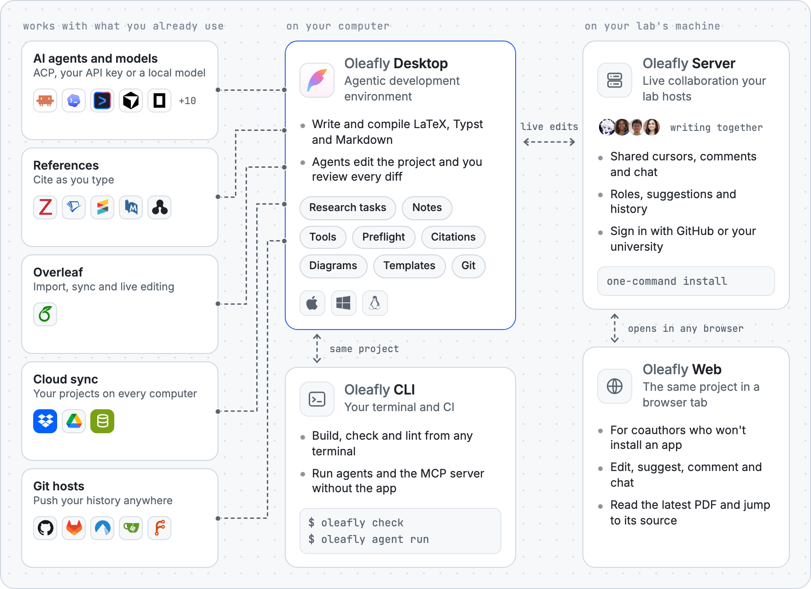
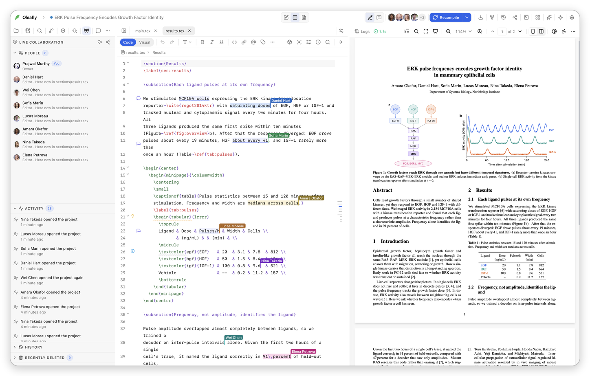

<div align="center">


# Oleafly <sup><em>beta</em></sup>

[Deutsch](README.de.md) | [English](../../README.md) | [Español](README.es.md) | [Français](README.fr.md) | [日本語](README.ja.md) | **한국어** | [Português](README.pt.md) | [Русский](README.ru.md) | [中文](README.zh.md) | [العربية](README.ar.md)

[](https://github.com/Oleafly/Oleafly/releases/latest)
[](https://github.com/Oleafly/Oleafly/releases/latest)
[](https://github.com/Oleafly/Oleafly/releases/latest)

[](https://github.com/Oleafly/Oleafly/issues) [](https://github.com/Oleafly/Oleafly/releases) [](https://github.com/Oleafly/Oleafly/actions/workflows/ci.yml) [](https://sonarcloud.io/summary/new_code?id=Oleafly_Oleafly) [](https://sonarcloud.io/component_measures?id=Oleafly_Oleafly&metric=coverage) [](https://github.com/Oleafly/Oleafly/pulse) [](https://github.com/Oleafly/Oleafly/commits/main) [](../../LICENSE) [](https://oleafly.com/discord) [](https://github.com/Oleafly/Oleafly)

<a href="https://trendshift.io/repositories/99082"></a>

**연구를 위한 실시간 협업 LaTeX, Typst 및 Markdown 편집기.**

Oleafly는 과학 연구 글쓰기를 위한 무료 오픈 소스 작업 공간입니다. macOS, Windows 및 Linux용 에이전트 기반 개발 환경인 데스크톱 앱, 연구실이 호스팅하는 실시간 협업용 서버, 로컬 빌드와 CI를 위한 명령줄 도구, 공동 저자가 브라우저에서 보는 웹 보기로 이루어져 있습니다. LaTeX, Typst 및 Markdown을 설정 없이 컴파일하고, 모든 프로젝트를 자동 체크포인트가 있는 Git 저장소로 보관합니다. 연구 도구에는 1,700개 이상의 템플릿, Zotero, BibTeX, 통계 계산기, arXiv, Semantic Scholar, Crossref, PubMed 및 OpenAlex 검색, 그리고 끊어진 참조, 누락된 그림, 익명 심사 유출 및 PDF/UA를 확인하는 Preflight 검사가 있습니다. 명령 하나로 설치되는 서버에서 공유 커서, 댓글, 채팅, 변경 내용 추적, 역할 및 오프라인 병합과 함께 실시간으로 협업하세요. Claude Code, Codex 및 그 밖의 13개 AI 에이전트가 프로젝트 안에서 작업하며, 모든 편집은 직접 검토하는 diff로 남습니다. 실험 기능인 연구 작업은 문헌 검토나 수정 작업을 격리된 worktree에서 직접 정한 예산 안에서 백그라운드로 실행합니다. CLI(`check`, `lint`, `mcp`, `ask`, `agent run`, `daemon`)는 이 모두를 터미널과 CI에서 쓸 수 있게 합니다.

<p>
  <a href="https://github.com/Oleafly/Oleafly/releases/latest"><strong>무료로 다운로드</strong></a>
· <a href="https://oleafly.com/docs/">가이드 읽기</a> · <a href="https://github.com/Oleafly/oleafly-server">서버 운영하기</a> · <a href="../development.md">소스에서 빌드하기</a>
</p>


영원히 무료 · 오픈 소스 · Oleafly 계정 없음 · 추적 없음

</div>

<div align="center">
  <picture>
    <source media="(prefers-color-scheme: dark)" srcset="../assets/readme/oleafly-overview.png" />
    <source media="(prefers-color-scheme: light)" srcset="../assets/readme/oleafly-overview-light.png" />
    
  </picture>
</div>

## Oleafly를 선택하는 이유

수년 동안 연구 글쓰기는 빌려 쓰는 것이었습니다. 연구 작업은 남의 서버에 놓이고, 연구자에게 가장 필요한 기능은 유료 요금제 뒤에 잠겨 있습니다. Oleafly에서는 이 모두를 무료로 쓸 수 있습니다. 초대한 공동 저자 모두와 하는 실시간 협업, 전체 버전 이력, 모든 Git 호스트와의 동기화, Zotero, 문법 검사, 그리고 연구실이 운영하는 서버에서 내 로그인이나 키로 쓰는 AI 에이전트가 그렇습니다. 계정이 필요 없고, 텔레메트리를 보내지 않으며, 오프라인에서도 작동합니다.

<p align="center">
  
</p>

- 연구실이 명령 하나로 설정하는 서버에서 공유 커서와 댓글을 사용해 공동 저자와 실시간으로 함께 쓰세요.
- 긴 문서를 위해 만든 편집기: 레이블, 인용 및 명령 완성, 실시간 오류 검사, 프로젝트 전체 개요, Vim 및 Emacs 키, 시각 모드, 그리고 검색할 수 있는 LaTeX 기호 236개 팔레트.
- 자신의 컴퓨터에서 컴파일하세요. Tectonic, Typst 및 Pandoc이 내장되어 있고, 프로젝트에 전체 배포판이 필요하면 TeX Live, MacTeX, MiKTeX 또는 TinyTeX가 이어받습니다.
- PDF를 클릭하면 소스로 이동하고 다시 돌아올 수 있으며, 오류를 고치는 동안 마지막으로 정상 컴파일된 PDF가 화면에 남아 있습니다.
- 모든 프로젝트는 GitHub, GitLab, Gitea, Forgejo, Codeberg 또는 직접 운영하는 Git 서버에 push할 수 있는 Git 저장소이며, Checkpoints는 컴파일에 성공할 때마다 스냅샷을 저장합니다.
- 입력하면서 Zotero 라이브러리에서 바로 인용하고, 편집기를 떠나지 않고 arXiv, Semantic Scholar, Crossref, PubMed 및 OpenAlex를 검색하세요.
- 학술 글쓰기에 맞춘 맞춤법 및 문법 검사가 컴퓨터에서 실행됩니다.
- Preflight는 제출하기 전에 끊어진 참조, 누락된 그림, 내장되지 않은 글꼴, 접근성 문제, 그리고 익명 심사에서 저자를 드러낼 수 있는 모든 것을 찾아냅니다.
- TikZ, Typst 또는 Mermaid 코드로 남는 그림을 그리고, 논문, 학위 논문, 슬라이드, 포스터 및 이력서를 위한 1,700개 이상의 템플릿에서 시작하세요.
- PDF, 이미지, 스프레드시트, `.bib` 파일, HTML 페이지, 슬라이드 덱 및 화이트보드가 프로젝트 안에서 각각 전용 뷰어로 열립니다.
- Word, PDF, arXiv 소스, Git 저장소 또는 Overleaf 계정에서 가져오세요.
- 아직 Overleaf 같은 온라인 LaTeX 서비스를 쓰는 공동 저자가 있나요? 그들이 웹 편집기에 남아 있어도 Oleafly에서 같은 프로젝트를 함께 실시간으로 편집할 수 있습니다. 실시간 편집은 실험 기능이며 기본적으로 꺼져 있습니다. 설정 > 실험 기능에서 켤 수 있습니다.
- `oleafly` 명령으로 어떤 터미널이나 CI 작업에서든 앱과 같은 컴파일러와 설정으로 프로젝트를 빌드하고 검사하고 동기화할 수 있습니다.
- 클라우드 동기화로 사용하는 모든 컴퓨터에 프로젝트를 유지하고, 오프라인에서도 계속 쓸 수 있습니다.
- Claude Code, Codex 및 그 밖의 13개 에이전트가 프로젝트 안에서 작업하며, 로컬 모델을 포함해 어떤 모델이든 연결할 수도 있습니다. AI는 선택 사항이며, AI가 만드는 각 변경 사항은 검토하고 실행 취소할 수 있는 diff입니다.
- 연구 작업은 계속 글을 쓰는 동안 프로젝트의 별도 복사본에서 문헌 검토, 근거 감사 또는 수정 작업을 실행하며, 변경된 파일 중 남길 파일은 직접 고릅니다. 이 작업은 실험 기능이며 기본적으로 꺼져 있습니다. 설정 > 실험 기능에서 켤 수 있습니다.
- Notes는 연구 노트를 프로젝트 옆에 Markdown 파일로 보관하며, 링크, 태그, 작업 및 캘린더를 제공합니다. 이것도 실험 기능이며 기본적으로 꺼져 있습니다.

## 실시간으로 함께 쓰세요

프로젝트를 연구실의 Oleafly Server에 공유하면 모두가 같은 파일을 동시에 편집합니다. 각 사람의 커서와 선택 영역, 접속 중인 사람, 자리를 비운 동안 바뀐 내용을 볼 수 있습니다. 누군가의 아바타를 클릭하면 그 사람이 작업 중인 줄로 이동합니다.

<p align="center">
  
</p>

- LaTeX, Typst 또는 Markdown의 어떤 선택 영역에든 댓글을 달고, 답글을 달거나, 다른 사람을 멘션하거나, 해결하거나 다시 열 수 있습니다. 멘션된 공동 저자는 이메일을 한 통 받으며, 이 이메일은 끌 수 있습니다.
- 오프라인에서 한 편집은 다시 연결되면 병합됩니다. 다른 사람의 편집과 겹치면 Oleafly가 양쪽을 모두 보여 주고 무엇이든 적용하기 전에 먼저 묻습니다.
- AI 편집, Zotero 인용, 이름 바꾸기, 삭제 및 그림도 모두 함께 전달됩니다. 두 사람이 같은 그림을 동시에 교체하면 두 버전이 모두 보존됩니다.
- 주 파일, 컴파일러, 맞춤법 검사 언어 및 Typst 옵션이 공유되므로 팀 전체가 같은 방식으로 프로젝트를 컴파일합니다.
- 각 프로젝트에는 소유자, 편집자, 검토자, 댓글 작성자 및 열람자가 있습니다. 검토자의 편집은 제안이 되며, 소유자와 편집자도 제안 모드로 전환할 수 있습니다. 이메일로 초대된 게스트는 초대받은 프로젝트만 볼 수 있습니다.
- 각 공유 프로젝트에는 채팅과 기록이 있으며, 기록에서 버전을 비교하거나 복원하거나 이름을 붙일 수 있습니다.
- 서버에서 브라우저 접근이 켜져 있으면 공동 저자는 공유 프로젝트를 브라우저에서 열고 가장 최근 컴파일의 PDF를 읽을 수 있습니다.

<table>
  <tr>
    <td width="50%" valign="top">
      
      <h3>프로젝트 채팅으로 이야기하세요</h3>
      각 공유 프로젝트에는 멘션과 반응이 있는 자체 채팅이 있어, 대화가 그 대상인 파일 옆에 남습니다.
    </td>
    <td width="50%" valign="top">
      
      <h3>누가 있는지 확인하세요</h3>
      Live collaboration 패널은 프로젝트에 있는 모든 사람과 그들의 역할, 각자 열어 둔 파일을 나열합니다. 목록 아래에는 최근 활동 피드가 있습니다.
    </td>
  </tr>
</table>

### 서버를 직접 운영하세요

연구실 워크스테이션, 대학 VM, 작은 클라우드 서버 등 Linux 컴퓨터라면 어디서든 다음 명령 하나로 Oleafly Server를 설치할 수 있습니다.

```bash
curl -fsSL https://oleafly.com/server/install.sh | sudo sh
```

SQLite를 사용하는 단일 Rust 바이너리로, 파일을 디스크나 S3 호환 저장소에 보관하고, 설정하면 SMTP로 이메일을 보냅니다. 사용자는 GitHub 또는 OpenID Connect 제공업체로 로그인하므로 대학의 통합 인증(SSO)을 그대로 사용할 수 있습니다. Docker Compose, Coolify, Render 및 systemd용 구성이 준비되어 있고, Railway, Cloudflare Tunnel 및 대학 인증서에 대한 가이드도 있습니다.

관리자는 Oleafly 안에서 사용자, 접근 규칙, 프로젝트, 이메일 및 보안 로그를 관리하는 콘솔을 사용할 수 있습니다. 모든 기기는 자신의 변경 사항에 서명하며, 서버는 업로드된 내용을 그대로 믿지 않고 서명된 이력으로 각 스냅샷을 만듭니다.

<p align="center">
  
</p>

설정, 백업, 그리고 누가 무엇을 할 수 있는지에 대한 전체 목록은 [서버 가이드](https://github.com/Oleafly/oleafly-server)를 읽어 보세요.

## 여러 컴퓨터 간 클라우드 동기화

클라우드 동기화를 켜면 라이브러리의 프로젝트와 앱 설정이 어느 컴퓨터로 옮겨 가든 따라옵니다. 모든 다운로드는 파일을 교체하기 전에 기록과 대조해 확인되며, 저장하지 않은 변경 사항이 있는 열린 파일은 절대 덮어쓰지 않습니다.

Dropbox, Google Drive, 또는 Amazon S3, Google Cloud Storage, MinIO 같은 S3 호환 서비스에 있는 내 버킷으로 동기화할 수 있습니다. 설정 > 데이터 저장소 > 클라우드 동기화에서 하나를 고르세요. 같은 페이지에는 Oleafly 데이터 폴더에 무엇이 들어 있고 무엇이 공간을 차지하는지 보여 주는 막대가 있습니다.

<p align="center">
  
</p>

- 두 컴퓨터가 같은 파일을 편집하면 두 버전이 모두 보존되며, 각각 그 파일을 쓴 컴퓨터의 이름이 붙습니다.
- 프로젝트의 대부분을 한 번에 삭제하면 확인할 때까지 보류되므로, 실수 한 번으로 모든 곳에서 프로젝트가 비워지지 않습니다.
- 다른 컴퓨터에서 삭제한 파일은 사라지는 대신 이 컴퓨터의 휴지통으로 이동합니다.
- 새 컴퓨터에서는 Oleafly가 이 컴퓨터의 설정과 동기화된 설정 중 무엇을 유지할지 한 번 묻습니다.

## 프로젝트를 그대로 가져오세요

온라인 LaTeX 편집기에서 옮겨 오시나요? Oleafly에서 그 계정에 한 번 로그인하고 원하는 프로젝트를 고르면, 파일, 컴파일러 및 주 파일과 함께 바로 컴파일할 수 있는 상태로 옮겨집니다. 대학이 자체 운영하는 서버에서도 작동합니다.

그 계정의 Git 토큰이 있으면 Oleafly가 가져온 프로젝트를 양방향으로 동기화할 수 있으므로, 온라인에 남는 공동 저자는 지금처럼 계속 작업할 수 있습니다. 양방향 동기화는 해당 서비스 자체의 Git 연동을 사용하며, 이 연동에는 프로젝트 소유자 계정의 유료 또는 대학 요금제가 필요합니다.

실시간 편집은 한 걸음 더 나아가며 Git 토큰이 필요 없습니다. 켜면 나와 온라인에 남은 공동 저자가 같은 프로젝트에서 동시에 작업합니다. 입력, 새 파일, 이름 바꾸기가 1초 안팎에 양쪽에 전달되고, 각자 어디서 작업하는지 볼 수 있습니다. 연결이 끊겨도 계속 입력하면 다시 연결될 때 따라잡습니다. 계정이 Google, 소속 기관 또는 패스키로 로그인한다면 브라우저로 로그인을 사용하세요. 실시간 편집은 실험 기능입니다. 설정 > 실험 기능에서 켤 수 있습니다.

<p align="center">
  
</p>

프로젝트 ZIP, GitHub 저장소, Word 문서, arXiv 소스 번들, 또는 Oleafly가 편집 가능한 LaTeX로 재구성하는 PDF에서 시작할 수도 있습니다. 폴더를 지금 있는 위치에서 그대로 열 수도 있습니다.

## 프로젝트 안에서 작업하는 AI 에이전트

카탈로그에서 에이전트를 고르면 소스, PDF 및 컴파일 로그를 가까이 둔 채 프로젝트 안에서 작업합니다. 각 에이전트는 자체 계정으로 로그인하고 자체 모델을 사용합니다. Oleafly는 프로젝트와 그 주변 도구를 제공합니다.

<p align="center">
  
</p>

<table>
  <tr>
    <td width="50%" valign="top">
      
      <h3>Oleafly Assistant</h3>
      내장 어시스턴트는 연결한 제공업체나 로컬 모델에서 실행됩니다. 연구, 작성, 그림, 검토 및 제출 등 작업별로 묶인 연구 skill과 함께 열립니다.
    </td>
    <td width="50%" valign="top">
      
      <h3>CLI 에이전트</h3>
      메시지 상자 위의 줄에서 Claude Code, Codex, Gemini CLI 또는 다른 에이전트를 고르세요. 소스와 컴파일된 PDF 옆에서 작업합니다.
    </td>
  </tr>
</table>

<div align="center">
<table>
  <tr>
    <td align="center" valign="top" width="135"><br />Claude&nbsp;Code</td>
    <td align="center" valign="top" width="135"><br />Codex&nbsp;CLI</td>
    <td align="center" valign="top" width="135"><br />Gemini&nbsp;CLI</td>
    <td align="center" valign="top" width="135"><br />Pi</td>
    <td align="center" valign="top" width="135"><br />OpenCode</td>
  </tr>
  <tr>
    <td align="center" valign="top" width="135"><br />OpenClaw</td>
    <td align="center" valign="top" width="135"><br />Cline</td>
    <td align="center" valign="top" width="135"><br />Hermes&nbsp;Agent</td>
    <td align="center" valign="top" width="135"><br />CodeBuddy</td>
    <td align="center" valign="top" width="135"><br />Kimi&nbsp;Code</td>
  </tr>
  <tr>
    <td align="center" valign="top" width="135"><br />Grok&nbsp;Build</td>
    <td align="center" valign="top" width="135"><br />Cursor</td>
    <td align="center" valign="top" width="135"><br />DeepSeek Harness</td>
    <td align="center" valign="top" width="135"><br />Qoder</td>
    <td align="center" valign="top" width="135"><br />Antigravity&nbsp;CLI</td>
  </tr>
</table>
</div>

<p align="center"><sub>이 표시는 호환되는 도구를 식별하기 위한 것이며 각 소유자의 재산입니다. 보증을 의미하지 않습니다.</sub></p>

채팅 어시스턴트가 더 편하다면 호스팅 제공업체, OpenAI 호환 엔드포인트 또는 Ollama, llama.cpp, Lemonade의 로컬 모델을 연결하세요.

- 모든 파일 변경은 diff로 표시됩니다. 하나씩 승인하거나, 어시스턴트가 알아서 작업하게 하거나, 도구별 규칙을 정할 수 있으며, 파일 하나 또는 한 차례 전체를 실행 취소할 수 있습니다.
- Plan 모드는 무언가를 쓰기 전에 프로젝트를 파악합니다.
- API 키가 없나요? Paper Review, 인라인 편집, Fix with AI, 이미지 및 수식 도구는 이미 로그인한 CLI 에이전트에서 실행할 수 있습니다.
- 에이전트는 학술지 투고 양식이나 통계 패키지처럼 허용한 데스크톱 앱과 웹사이트를 사용할 수 있습니다. 직접 설치하는 Cua Driver를 통해 작동합니다.
- 문헌 검토나 수정 작업은 별도의 Git worktree에서 실행할 수 있으므로 그동안 계속 글을 쓸 수 있습니다. 변경된 파일 중 남길 파일은 직접 선택합니다.
- 문헌 조사, 관련 연구, 주장 검증 및 심사 의견 답변서를 포함한 39개의 연구 skill이 앱에 포함되어 있습니다. `npx skills add Oleafly/Oleafly`로 Claude Code, Codex 등 다른 에이전트에도 설치할 수 있습니다.
- 로컬 MCP 서버를 사용하면 외부 AI 클라이언트가 같은 프로젝트 도구를 쓸 수 있습니다. 이 서버는 127.0.0.1에서만 연결을 받습니다.
- `oleafly mcp`는 앱이 열려 있든 닫혀 있든 Claude Code, Codex, Cursor, Gemini CLI에 stdio로 프로젝트 도구를 제공합니다.
- 각 릴리스에는 `oleafly.mcpb`가 포함되어 있습니다. 파일을 열면 Claude Desktop이 Oleafly를 확장 프로그램으로 설치합니다. MCP Registry에는 `io.github.Oleafly/oleafly`로 등록되어 있습니다.

AI는 선택 사항입니다. 편집기, 컴파일러, PDF, 인용, 교정 및 검사는 모두 AI를 끈 상태에서도 작동합니다.

## 컴퓨터에서 컴파일하는 LaTeX, Typst 및 Markdown

Tectonic, Typst 및 Pandoc이 앱에 포함되어 있으므로 새 프로젝트는 아무것도 설치하지 않고 컴파일됩니다. 프로젝트에 전체 TeX 배포판이 필요하면 TeX Live, MacTeX, MiKTeX 또는 Oleafly가 대신 설치해 주는 TinyTeX와 함께 latexmk로 전환하세요.

<p align="center">
  
</p>

- PDF를 클릭하면 소스로 이동하고, 다시 돌아올 수도 있습니다. LaTeX는 SyncTeX를, Typst 0.13 이상은 Tinymist를 사용합니다.
- 컴파일 오류는 원인이 된 줄에 연결되며, 오류를 고치는 동안 마지막으로 정상 컴파일된 PDF가 화면에 남아 있습니다.
- 시각 모드에서는 페이지와 비슷한 화면에서 편집할 수 있고, 클릭 한 번으로 소스로 돌아갈 수 있습니다.
- 프로젝트 전체의 레이블, 인용, 명령, 환경 및 파일 경로에 대한 완성과 실시간 진단.
- 맞춤법 및 문법 검사는 로컬에서 실행되며 학술 글쓰기에 맞춰져 있습니다.
- XeLaTeX, LuaLaTeX, 그리고 일본어 문서를 위한 upLaTeX 또는 pLaTeX.
- Quarto 및 Calepin 문서는 프로젝트에서 코드를 허용하면 R, Python 또는 Julia 코드를 실행합니다. Oleafly가 두 도구 중 필요한 것을 대신 다운로드할 수 있습니다.
- Markdown 문서는 논문, 보고서, 책, 슬라이드, 포스터, 편지 또는 이력서로 빌드할 수 있습니다. front matter에 `type:`을 설정하세요.

<p align="center">
  
</p>

PDF 뷰어에는 검색, 문서 개요, 한 페이지 및 두 페이지 보기, 너비 또는 높이에 맞춤이 있습니다.

## 인용, 그림, 검사 및 템플릿

<table>
  <tr>
    <td width="50%" valign="top">
      
      <h3>입력하면서 Zotero에서 인용하세요</h3>
      <code>@</code>와 저자, 제목 또는 연도의 일부를 입력해 Zotero 라이브러리에서 인용하세요. Oleafly는 그 항목 하나만 프로젝트의 <code>.bib</code>에 추가합니다. Citation Search는 arXiv, Semantic Scholar, Crossref, PubMed 및 OpenAlex를 검색합니다.
    </td>
    <td width="50%" valign="top">
      
      <h3>코드로 남는 그림을 그리세요</h3>
      Diagram Composer는 캔버스에 그린 그림을 TikZ, Typst용 fletcher 또는 Mermaid 코드로 작성합니다. 그림이나 코드를 바꾸면 다른 쪽도 따라 바뀝니다.
    </td>
  </tr>
  <tr>
    <td width="50%" valign="top">
      
      <h3>제출하기 전에 확인하세요</h3>
      Preflight는 끊어진 참조, 누락된 그림, 내장되지 않은 글꼴, 접근성 문제, 그리고 익명 심사에서 저자를 드러낼 수 있는 모든 것을 찾아냅니다. arXiv, IEEE, ACM, 학술지 및 학위 논문을 위한 프로필이 있습니다.
    </td>
    <td width="50%" valign="top">
      
      <h3>1,700개 이상의 템플릿에서 시작하세요</h3>
      논문, 학위 논문, Beamer 발표, 포스터, 이력서 및 학회 스타일 논문이 있으며, 프로젝트를 만들기 전에 각각의 렌더링된 미리보기를 볼 수 있습니다.
    </td>
  </tr>
</table>

## Git, 이력 및 터미널

모든 프로젝트는 일반 Git 저장소가 들어 있는 일반 폴더입니다. Source Control 패널에서 스테이징, diff 확인, 커밋, push, pull 및 GitHub, GitLab, Gitea, Forgejo, Codeberg 또는 직접 운영하는 서버로의 게시를 하거나, 터미널에도 숨겨지는 것이 없으므로 평소 쓰는 터미널을 사용하세요. Checkpoints는 컴파일에 성공할 때마다 로컬 스냅샷을 저장하므로 커밋하지 않고도 이전 상태로 되돌릴 수 있습니다.

<p align="center">
  
</p>

편집기 아래에는 프로젝트마다 최대 10개의 탭을 열 수 있는 터미널 도크가 있습니다. 출력에 있는 파일 경로를 Cmd-click(Ctrl-click)하면 그 줄에서 파일이 열립니다.

<table>
  <tr>
    <td width="50%" valign="top">
      
      <h3>편집기 아래의 터미널</h3>
      창을 떠나지 않고 프로젝트 폴더에서 Git, 빌드 스크립트 또는 <code>oleafly</code> 명령을 실행하세요.
    </td>
    <td width="50%" valign="top">
      
      <h3>컴파일할 때마다 버전 하나</h3>
      Versioning은 컴파일에 성공할 때마다 소스의 스냅샷을 저장합니다. 커밋 없이 클릭 한 번으로 어느 것이든 복원할 수 있습니다.
    </td>
  </tr>
  <tr>
    <td width="50%" valign="top">
      
      <h3>내 Git 호스트 또는 내 서버</h3>
      GitHub, GitLab 또는 Codeberg에 로그인하거나, 직접 운영하는 Gitea 또는 Forgejo 서버의 주소를 추가하세요. 그러면 Source Control 패널에서 push, pull 및 게시를 할 수 있습니다.
    </td>
    <td width="50%" valign="top">
      
      <h3>공간이 어디에 쓰이는지 보세요</h3>
      설정에서 프로젝트, PDF, Git 이력 및 앱 자체 데이터가 디스크에서 차지하는 공간을 볼 수 있습니다. 삭제한 프로젝트는 휴지통에서 대기합니다.
    </td>
  </tr>
</table>

`oleafly` 명령은 어떤 터미널에서든 같은 프로젝트를 다룹니다. 빌드, 변경할 때마다 다시 빌드, 제출 전 검사, 온라인 LaTeX 서비스와의 동기화를 할 수 있고, 앱을 열지 않고 Oleafly 에이전트를 실행할 수도 있습니다. 모든 명령은 스크립트와 CI를 위해 안정적인 종료 코드와 함께 JSON을 출력할 수 있습니다. 자세한 내용은 [명령줄 가이드](../cli.md)를 참고하세요.

## 연구를 위한 노트

Notes는 프로젝트 옆에 놓이는 지식 베이스입니다. 각 노트는 내가 소유하는 Markdown 파일이며, 콜아웃, 표, 차트, 다이어그램, 수식, 링크와 백링크, 태그, 마감일이 있는 작업을 지원하는 리치 편집기에서 편집합니다. Notes는 실험 기능이며 기본적으로 꺼져 있습니다. 설정 > 실험 기능에서 켤 수 있습니다.

<p align="center">
  
</p>

- 노트는 나누고 도킹할 수 있는 탭으로 열립니다. Notes Home은 검색, 태그, 작업 목록 및 캘린더와 함께 노트를 나열합니다.
- 노트는 템플릿에서 시작할 수 있고 프로젝트 안에 `notes/<Title>.md`로 둘 수 있습니다.
- 노트를 연구실 서버로 공유해 함께 편집하고, 프로젝트 파일에서 하듯 선택 영역에 댓글을 달 수 있습니다.
- 어시스턴트나 CLI 에이전트가 노트의 변경을 제안할 수 있습니다. 각 제안을 그 자리에서 수락하거나 거절합니다.
- 빠른 캡처는 남기고 싶은 생각을 위한 작은 플로팅 창입니다.
- X 게시물 링크를 붙여 넣으면 노트가 게시물의 작성자, 날짜 및 텍스트를 보관합니다.

## Oleafly를 내 방식으로 꾸미세요

Oleafly는 시스템의 밝은 모드 또는 어두운 모드 설정을 따르며, 직접 고를 수도 있습니다. 강조 색, Home 도크의 위치, 프로젝트 뒤에 그려지는 배경을 고르세요. 편집기에는 자체 글꼴, 테마, 색상 및 키 바인딩이 있고, Notes는 서체와 간격을 바꾸는 동안 실시간 미리보기를 보여 줍니다.

<table>
  <tr>
    <td width="50%" valign="top">
      
      <h3>강조 색, 도크 및 배경</h3>
      강조 색 여섯 가지, 왼쪽, 아래 또는 오른쪽 도크, 그리고 프로젝트 뒤의 점, 격자 또는 아무것도 없음 중에서 고를 수 있습니다.
    </td>
    <td width="50%" valign="top">
      
      <h3>내게 맞는 서체</h3>
      노트의 서체, 크기 및 간격을 고르고 바뀌는 미리보기를 바로 확인하세요.
    </td>
  </tr>
  <tr>
    <td width="50%" valign="top">
      
      <h3>밝게 또는 어둡게</h3>
      도구 모음에서 전환하거나 Oleafly가 시스템을 따르게 하세요.
    </td>
    <td width="50%" valign="top">
      
      <h3>Notes도 어둡게</h3>
      노트의 차트, 표 및 콜아웃은 밝은 모드뿐 아니라 어두운 모드에서도 어울리게 그려집니다.
    </td>
  </tr>
</table>

## 그 밖의 많은 기능

<details>
<summary>40개 이상의 변환, 인용 및 수식 도구</summary>

Tools 갤러리는 beta이며 기본적으로 꺼져 있습니다. Settings > '실험 기능' > 'LaTeX 도구'에서 켜세요.

#### 가져오기 및 형식 변환

| 도구 | 용도 |
| --- | --- |
| PDF to LaTeX | 소스가 허용하는 범위에서 수식, 그림 및 구조를 보존하면서 PDF에서 편집 가능한 LaTeX를 재구성 |
| arXiv to LaTeX | ID로 arXiv 소스 번들을 다운로드하거나 디스크에 저장된 아카이브를 풀기 |
| Image to LaTeX | 메모, 수식 또는 표 이미지를 편집 가능한 LaTeX로 변환 |
| Equation to LaTeX | 입력한 수식이나 수식 이미지를 LaTeX로 변환 |
| Excel to LaTeX | Excel, CSV 또는 TSV 시트를 이스케이프된 LaTeX 표로 변환 |
| HTML to LaTeX | 붙여 넣은 HTML을 독립적인 LaTeX 문서로 변환 |
| Image to Typst | 메모, 수식 또는 표 이미지를 편집 가능한 Typst로 변환 |
| LaTeX to HTML | LaTeX를 MathML 수식이 있는 독립적인 HTML로 변환 |
| LaTeX to Image | 수식을 렌더링하고 PNG 또는 SVG로 내보내기 |
| LaTeX to Markdown | LaTeX 문서를 이식 가능한 Markdown으로 변환 |
| LaTeX to Typst | 복사하거나 저장하거나 프로젝트로 열 수 있는 Typst 소스로 LaTeX를 변환 |
| LaTeX to Word | 수식을 네이티브 Word 수학으로 저장하는 Word 문서 만들기 |
| Markdown to LaTeX | Markdown 메모를 독립적인 LaTeX 문서로 변환 |
| Markdown to Typst | Markdown 메모를 Typst 소스로 변환 |
| Mermaid to LaTeX | Mermaid 순서도를 편집 가능한 TikZ 코드로 변환 |
| PDF to Markdown | PDF의 텍스트 레이어, 수식 및 그림을 Markdown으로 추출 |
| PDF to Typst | PDF의 텍스트 레이어, 수식 및 그림을 Typst로 추출 |
| Table to LaTeX | 시각적인 행과 열 편집기에서 LaTeX 표 만들기 |
| Typst Editor | 소스 편집, 실시간 미리보기 및 PDF 내보내기로 Typst 프로젝트 시작 |
| Visual Typst Editor | 프로젝트 편집기에서 실시간 미리보기가 있는 Typst 문서 시작 |
| Typst to LaTeX | 학술지와 제출용 LaTeX로 Typst 마크업 변환 |
| arXiv to Typst | arXiv 소스 번들을 Typst로 변환하고, 컴파일 검사로 변환되지 않은 항목을 나열 |
| CSV to Typst | CSV 또는 TSV 행을 붙여 넣어 이스케이프된 Typst 표 만들기 |
| Equation to Typst | 입력한 LaTeX 수식이나 수식 이미지를 Typst 수식으로 변환 |
| Excel to Typst | Excel, CSV 또는 TSV 시트를 이스케이프된 Typst 표로 변환 |
| HTML to Typst | 붙여 넣은 HTML을 독립적인 Typst 문서로 변환 |
| Mermaid to Typst | Mermaid 순서도를 편집 가능한 fletcher 코드로 변환 |
| Typst to HTML | Typst 마크업을 MathML 수식이 있는 독립적인 HTML로 변환 |
| Typst to Markdown | Typst 마크업을 이식 가능한 Markdown으로 변환 |
| Typst to Word | 수식을 네이티브 Word 수학으로 저장하는 Word 문서 만들기 |
| Word to Typst | Word 문서를 Typst로 변환하고 추출된 미디어를 함께 유지 |
| Word to LaTeX | Word 문서를 LaTeX로 변환하고 추출된 미디어를 함께 유지 |

#### 수식, 표, 글쓰기 및 검증

| 도구 | 용도 |
| --- | --- |
| BibTeX Validator | `.bib` 파일의 구문 오류, 필수 필드 누락 및 중복 키 확인 |
| Statistics Calculators | p-value, 표본 크기 및 신뢰 구간을 로컬에서 계산 |
| Writing Generators | 어시스턴트로 열린 문서에서 초록, 요약, 바꿔쓰기 또는 학위 논문 개요 준비 |
| Symbol Reference | LaTeX 기호를 찾아 커서 위치에 삽입하거나, Typst 파일에서는 해당 기호의 Typst 이름을 삽입 |

#### 문헌, 참조 및 연구

| 도구 | 용도 |
| --- | --- |
| Find Citations | 학술 색인을 검색하고, 초안에서 근거가 부족한 부분을 찾고, BibTeX로 내보내기 |
| arXiv Citation Generator | arXiv 논문을 찾고 8가지 형식으로 인용 서식 지정 |
| Bibliography Generator | 구조화된 세부 정보나 BibTeX에서 참고문헌을 만들고, 검증하고, 정렬하고, 내보내기 |
| Citation Generator | 논문 세부 정보나 학술 식별자를 서식이 지정된 인용과 BibTeX로 변환 |
| Citation Generators by Style | APA, MLA, Chicago, IEEE, Harvard, Vancouver, AMA 및 ACS 형식으로 한 참고문헌 비교 |
| DOI to BibTeX | DOI 레코드를 가져오고 필드를 검토한 뒤 BibTeX로 내보내기 |
| ISBN to BibTeX | ISBN에서 도서 메타데이터를 가져오고 수정한 뒤 BibTeX로 내보내기 |
| PubMed to BibTeX | PMID에서 PubMed 레코드를 가져오고 검토한 뒤 BibTeX로 내보내기 |
| URL to BibTeX | DOI, arXiv 및 PubMed 링크를 인식하거나 편집 가능한 웹페이지 인용 만들기 |
| Lab Search | OpenAlex 디렉터리에서 연구 기관 찾기 |
| Conference Deadlines | 주로 컴퓨터 과학 분야인 학회 마감일을 필터링하고 카운트다운 보기 |

</details>

<details>
<summary>Oleafly에 포함된 39개의 연구 skill</summary>

Skills는 Agent Skills 형식을 따르는 일반 `SKILL.md` 폴더입니다. 슬래시 명령으로 skill을 실행하거나, 직접 만든 skill을 추가하거나, 같은 컴퓨터의 호환 CLI 에이전트와 공유하세요.

번들 `research-core` 팩에는 39개의 skill이 들어 있습니다. 아래 이름은 카탈로그와 프로젝트 설정에서 사용하는 ID입니다.

| 범주 | Skills |
| --- | --- |
| 연구 및 문헌 | `citation-management`, `exploratory-data-analysis`, `hypothesis-generation`, `literature-review`, `oleafly-experiment-loop`, `oleafly-literature-sweep`, `oleafly-research-loop`, `openresearch`, `paper-lookup`, `research-lookup`, `scientific-brainstorming`, `scientific-critical-thinking` |
| 원고 작성 및 분석 | `experimental-design`, `oleafly-data-analysis`, `oleafly-manuscript-scaffold`, `oleafly-related-work`, `scientific-writing`, `statistical-analysis`, `statistical-power`, `venue-templates` |
| 그림 및 시각화 | `oleafly-figure-prep`, `scientific-schematics`, `scientific-visualization` |
| 검토 및 근거 | `oleafly-response-letter`, `oleafly-review-manuscript`, `oleafly-verify-claims`, `peer-review`, `scholar-evaluation` |
| 제출 | `oleafly-pre-submission` |
| 커뮤니케이션 | `oleafly-slides-and-posters`, `pptx-posters`, `research-grants`, `scientific-slides` |
| 도구 및 자동화 | `desktop-apps`, `import-refine`, `oleafly-cli`, `oleafly-latex-build`, `pdf-to-latex`, `template-generate` |

</details>

<details>
<summary>편집기 세부 사항</summary>

- 검색할 수 있는 LaTeX 기호 236개 팔레트로, Typst 파일에서는 Typst 이름을 삽입합니다.
- 편집기 오른쪽 가장자리의 개요 레일이 각 제목과 지금 읽고 있는 섹션을 표시합니다. 열면 섹션 번호와 마지막 컴파일 기준 각 제목의 PDF 페이지가 보입니다.
- 프로젝트의 다른 파일을 위한 뷰어: 전체 미리보기 도구 모음이 있는 PDF, 확대할 수 있는 이미지, 정렬할 수 있는 표로 보는 CSV 및 Excel 시트, `.bib` 파일을 위한 검색 가능한 목록, 그리고 HTML 실시간 미리보기.
- TSX로 작성한 슬라이드 덱은 입력하는 동안 미리 보이고 PDF처럼 발표할 수 있습니다. `something.excalidraw`라는 이름의 파일은 그림을 그릴 수 있는 화이트보드로 열립니다.
- 파일 관리자에서 `.tex`, `.typ` 또는 `.md` 파일을 더블 클릭하면 Oleafly에서 열립니다.
- Vim 및 Emacs 키 바인딩, 다중 파일 탭, 코드 접기, 프로젝트 전체 검색 및 바꾸기, 단어 수.
- 파일 이름을 바꾸거나 파일을 옮기면 Oleafly가 그 파일을 가리키는 경로를 업데이트합니다.
- 밝은 모드와 어두운 모드용 테마, 설치된 모든 글꼴, 편집 가능한 구문 색상 및 Zen 모드.
- 파일 아이콘은 파일 형식별로 색이 지정됩니다. 설정 > 모양 > 프로젝트에서 TEX나 PDF 같은 짧은 형식 배지로 바꿀 수 있습니다.
- 인터페이스는 22개 언어로 제공됩니다.
- Cmd+K(Ctrl+K)로 여는 명령 팔레트, 그리고 Cmd+Shift+F(Ctrl+Shift+F)로 여는 프로젝트, 문서, 설정 및 도구 통합 검색창.

</details>

## 시작하기

1. 사용하는 컴퓨터에 맞는 [Oleafly를 다운로드](https://github.com/Oleafly/Oleafly/releases/latest)하세요.
2. 템플릿에서 프로젝트를 만들거나, 프로젝트를 가져오거나, 이미 있는 폴더를 여세요.
3. Cmd+Enter(Windows와 Linux에서는 Ctrl+Enter)를 눌러 컴파일하세요.
4. 다른 사람과 함께 쓰려면 **공유**를 클릭하고 프로젝트를 연구실의 Oleafly Server로 보내세요.

| 플랫폼 | 패키지 | 다운로드 |
| --- | --- | --- |
| macOS · Apple Silicon | DMG | [](https://github.com/Oleafly/Oleafly/releases/latest) |
| macOS · Intel | DMG (`x64`) | [](https://github.com/Oleafly/Oleafly/releases/latest) |
| Windows · x86_64 | MSI 또는 EXE | [](https://github.com/Oleafly/Oleafly/releases/latest) |
| Linux · x86_64 | AppImage, DEB 또는 RPM | [](https://github.com/Oleafly/Oleafly/releases/latest) |
| Linux · ARM64 | AppImage, DEB 또는 RPM | [](https://github.com/Oleafly/Oleafly/releases/latest) |

Linux 패키지에는 glibc 2.35 이상(Ubuntu 22.04, Debian 12 이상)이 필요합니다. 릴리스에는 서명된 업데이트 산출물이 포함되며, 앱 내 업데이터는 무엇이든 설치하기 전에 서명을 확인합니다.

## 자주 묻는 질문

<details>
<summary>계정이 필요한가요?</summary>

Oleafly 계정은 필요하지 않습니다. 어디에도 로그인하지 않고 글을 쓰고, 컴파일하고, Git을 사용할 수 있습니다. 실시간 협업에서는 GitHub나 대학 로그인으로 연구실 서버에 로그인하고, 클라우드 동기화에서는 사용하는 클라우드 저장소에 로그인합니다.

</details>

<details>
<summary>오프라인에서도 작동하나요?</summary>

네. 글쓰기, 컴파일, PDF, 교정, Preflight, Git 및 Checkpoints는 모두 컴퓨터에서 실행됩니다. LaTeX는 번들 엔진에 필요한 패키지가 갖춰지면 오프라인으로 빌드되고, Typst는 패키지가 캐시되면 오프라인으로 빌드됩니다. 공유 프로젝트는 편집 내용을 보관했다가 다시 연결되면 병합합니다.

</details>

<details>
<summary>네트워크로 무엇이 전송되나요?</summary>

직접 요청한 것만 전송됩니다. 서버와의 공유, 클라우드 동기화, 가져오거나 실시간으로 편집하는 온라인 LaTeX 서비스, 문헌 및 DOI 조회, 사용하는 Git 호스트, 호스팅 AI 제공업체, 연결한 MCP 서버, 그리고 선택적인 엔진, 패키지 및 템플릿 다운로드입니다. 릴리스 빌드는 앱이 시작될 때 업데이트도 확인합니다. 로컬 모델을 사용하면 AI 트래픽이 컴퓨터 안에 머뭅니다.

</details>

<details>
<summary>대학이나 회사에서 서버를 호스팅할 수 있나요?</summary>

네, 바로 그런 용도로 만들었습니다. Oleafly Server는 자체 컴퓨터나 클라우드 계정에서 실행되고, GitHub 또는 OpenID Connect 제공업체를 통해 사용자를 로그인시키며, 파일을 디스크나 S3 호환 저장소에 보관합니다. 설치, 백업 및 역할은 [서버 가이드](https://github.com/Oleafly/oleafly-server)에서 다룹니다.

</details>

## 더 알아보기

- [제품 가이드](https://oleafly.com/docs/)
- [Oleafly Server](https://github.com/Oleafly/oleafly-server)
- [기능 지도](../features.md)
- [편집기 가이드](../Editor.md)
- [PDF 미리보기](../PDFPreview.md)
- [인용 및 문헌](../Citations.md)
- [도구 갤러리](../Tools.md)
- [Preflight 및 접근성 검사](../Preflight.md)
- [템플릿](../Templates.md)
- [Diagram Composer](../DiagramComposer.md)
- [Git 및 Source Control](../SourceControl.md)
- [Checkpoints](../Checkpoints.md)
- [AI Copilot](../AICopilot.md)
- [Skills](../Skills.md)
- [MCP 통합](../mcp.md)
- [명령줄 도구](../cli.md)
- [개발 환경 설정](../development.md)
- [변경 로그](../../CHANGELOG.md)

## 커뮤니티와 지원

풀 리퀘스트를 보내 주신 모든 분, 그리고 이슈로 가장 많은 릴리스를 이끌어 주신 분들께 감사드립니다.

<p>
<a href="https://github.com/palmtenor" title="Teng Qin (palmtenor)"></a>
<a href="https://github.com/wahidmounir" title="wahidmounir"></a>
<a href="https://github.com/Jianxinnn" title="Jianx (Jianxinnn)"></a>
<a href="https://github.com/multics" title="Not AI (multics)"></a>
<a href="https://github.com/um1chc5" title="Vũ Vương An (um1chc5)"></a>
<a href="https://github.com/a-green-hand-jack" title="Jack Wu (a-green-hand-jack)"></a>
<a href="https://github.com/DEENUU1" title="Kacper Włodarczyk (DEENUU1)"></a>
<a href="https://github.com/mvanhorn" title="Matt Van Horn (mvanhorn)"></a>
<a href="https://github.com/vincencwolff" title="Alexander Wolff (vincencwolff)"></a>
<a href="https://github.com/ssbodda-powern" title="ssbodda-powern"></a>
<a href="https://github.com/Fravoj3" title="Fravoj3"></a>
<a href="https://github.com/Entrery901" title="Pavel Entrery (Entrery901)"></a>
<a href="https://github.com/CherryYang05" title="Minyang Bao (CherryYang05)"></a>
<a href="https://github.com/MaverickJohn026" title="MaverickJohn026"></a>
<a href="https://github.com/marlondecol" title="Marlon Luís de Col (marlondecol)"></a>
</p>

[Discord의 Oleafly 커뮤니티](https://oleafly.com/discord)에 참여해 질문하고, 잘 풀리지 않는 빌드에 도움을 받고, 쓰고 있는 글을 공유하고, 다음에 만들 기능에 투표하세요. 무료이며 누구나 참여할 수 있습니다. GitHub가 더 편하다면 [GitHub Issues](https://github.com/Oleafly/Oleafly/issues)에서 버그를 신고하거나 기능을 요청하세요.

Oleafly는 텔레메트리를 수집하지 않으므로 누가 쓰는지는 직접 알려 주기 전까지 아무도 모릅니다. 학위 논문이나 연구실의 논문을 Oleafly로 쓰고 있나요? [Who's using Oleafly?](https://github.com/Oleafly/Oleafly/discussions/502)에서 인사를 남겨 주세요.

Oleafly는 [Prajwal Murthy](https://github.com/prajwal-svm)와 기여자가 만들고 있습니다. 코드, 템플릿, 문서 및 피드백에 대한 기여를 환영합니다. 참여하려면 [기여 가이드](../../CONTRIBUTING.md)를 읽어 보세요.

Oleafly를 사용한다면 [GitHub에서 별을 눌러](https://github.com/Oleafly/Oleafly) 다른 연구자도 이 프로젝트를 찾을 수 있게 도와주세요.

## Oleafly 인용하기

<details>
<summary>BibTeX 항목 복사</summary>

```bibtex
@software{oleafly,
  author  = {Venkateshmurthy, Prajwal S. and {The Oleafly contributors}},
  title   = {Oleafly: a local-first workspace for research writing},
  year    = {2026},
  version = {0.4.13},
  url     = {https://github.com/Oleafly/Oleafly},
  license = {AGPL-3.0-or-later}
}
```

</details>

[보안](../../SECURITY.md) · [행동 강령](../../CODE_OF_CONDUCT.md) · [AGPL-3.0-or-later](../../LICENSE)

## 스타 기록

<a href="https://www.star-history.com/?repos=Oleafly%2FOleafly&type=date&legend=top-left">
 <picture>
   <source media="(prefers-color-scheme: dark)" srcset="https://api.star-history.com/chart?repos=Oleafly/Oleafly&type=date&theme=dark&legend=top-left&sealed_token=aHz2JA-SBvmD73PyT7aCcCqMyAUvCPtidSAAvsQQxR8-1xdB-RZ-oXHKRnqIJUfSICl6Dd3_XPcHgb5Menvk_FfalfMb1GRbJC_TdeTMBVDi3jVUIXBBdovZ4dufhj4JWF3UXptJhw8pGmB6lqQ-X7gDOWu_bkPTQ7k-Q0VeBiq_jNgwRb7RSMgrSb-P" />
   <source media="(prefers-color-scheme: light)" srcset="https://api.star-history.com/chart?repos=Oleafly/Oleafly&type=date&legend=top-left&sealed_token=aHz2JA-SBvmD73PyT7aCcCqMyAUvCPtidSAAvsQQxR8-1xdB-RZ-oXHKRnqIJUfSICl6Dd3_XPcHgb5Menvk_FfalfMb1GRbJC_TdeTMBVDi3jVUIXBBdovZ4dufhj4JWF3UXptJhw8pGmB6lqQ-X7gDOWu_bkPTQ7k-Q0VeBiq_jNgwRb7RSMgrSb-P" />
   
 </picture>
</a>
