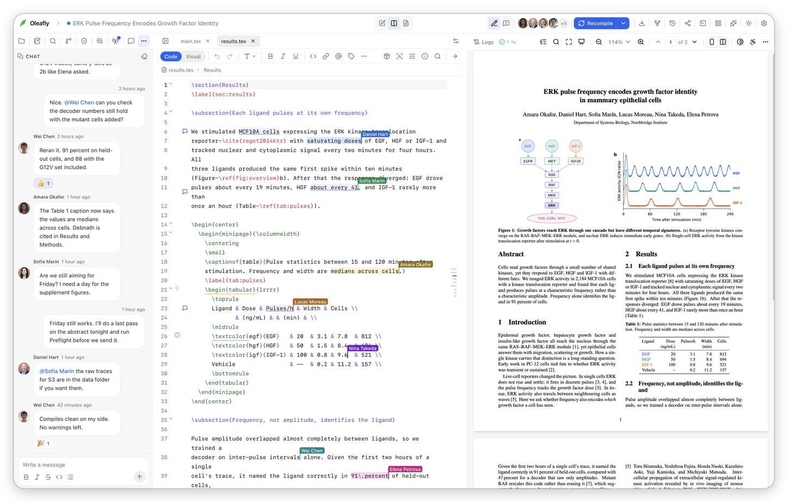
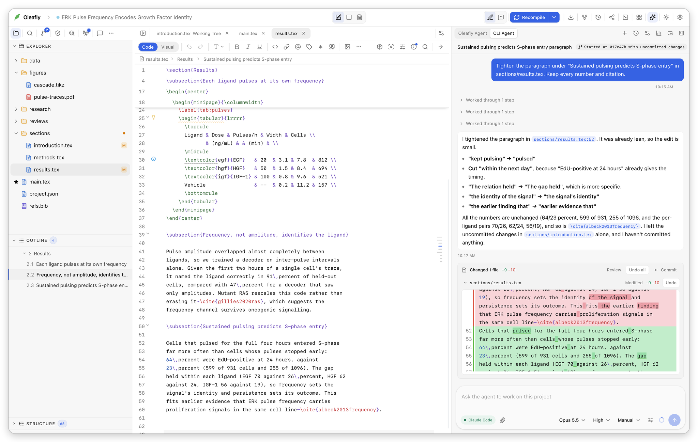

<div align="center">


# Oleafly <sup><em>beta</em></sup>

[Deutsch](README.de.md) | [English](../../README.md) | [Español](README.es.md) | [Français](README.fr.md) | [日本語](README.ja.md) | [한국어](README.ko.md) | **Português** | [Русский](README.ru.md) | [中文](README.zh.md) | [العربية](README.ar.md)

[](https://github.com/Oleafly/Oleafly/releases/latest)
[](https://github.com/Oleafly/Oleafly/releases/latest)
[](https://github.com/Oleafly/Oleafly/releases/latest)

[](https://github.com/Oleafly/Oleafly/issues) [](https://github.com/Oleafly/Oleafly/releases) [](https://github.com/Oleafly/Oleafly/actions/workflows/ci.yml) [](https://sonarcloud.io/summary/new_code?id=Oleafly_Oleafly) [](https://sonarcloud.io/component_measures?id=Oleafly_Oleafly&metric=coverage) [](https://github.com/Oleafly/Oleafly/pulse) [](https://github.com/Oleafly/Oleafly/commits/main) [](../../LICENSE) [](https://oleafly.com/discord) [](https://github.com/Oleafly/Oleafly)

<a href="https://trendshift.io/repositories/99082"></a>

**Um editor de LaTeX, Typst e Markdown para pesquisa, com colaboração ao vivo.**

Oleafly é um espaço de trabalho gratuito e de código aberto para a escrita científica. Inclui um ambiente de desenvolvimento agêntico para macOS, Windows e Linux, um servidor que o seu laboratório hospeda para a colaboração ao vivo, uma ferramenta de linha de comando para compilações locais e CI, e uma visualização web para coautores no navegador. Compila LaTeX, Typst e Markdown sem nenhuma configuração e mantém cada projeto como um repositório Git com checkpoints automáticos. O kit de pesquisa tem mais de 1.700 modelos, Zotero, BibTeX, calculadoras estatísticas, busca no arXiv, no Semantic Scholar, no Crossref, no PubMed e no OpenAlex, e verificações do Preflight para referências quebradas, figuras ausentes, vazamentos em revisão cega e PDF/UA. Colabore em tempo real no servidor, que se instala com um único comando, com cursores compartilhados, comentários, chat, alterações rastreadas, papéis e mesclagem offline. Claude Code, Codex e mais 13 agentes de IA trabalham no seu projeto, com cada edição como um diff que você revisa, e as tarefas de pesquisa experimentais fazem uma revisão de literatura ou uma rodada de revisão em segundo plano, em worktrees isolados, dentro de um orçamento que você define. A CLI (`check`, `lint`, `mcp`, `ask`, `agent run`, `daemon`) abre tudo isso para terminais e CI.

<p>
  <a href="https://github.com/Oleafly/Oleafly/releases/latest"><strong>Baixar gratuitamente</strong></a>
· <a href="https://oleafly.com/docs/">Ler os guias</a> · <a href="https://github.com/Oleafly/oleafly-server">Executar um servidor</a> · <a href="../development.md">Compilar a partir do código-fonte</a>
</p>


Gratuito para sempre · Código aberto · Sem conta do Oleafly · Sem rastreamento

</div>

<div align="center">
  
</div>

## Por que Oleafly

Durante anos, a escrita científica foi alugada. Seu trabalho de pesquisa fica no servidor de outra pessoa, e o que um pesquisador mais precisa está trancado atrás de um plano pago. Com o Oleafly, você tem tudo isso de graça. Isso inclui colaboração em tempo real com quantos coautores você convidar, histórico de versões completo, sincronização com qualquer serviço de hospedagem Git, Zotero, verificação gramatical e agentes de IA com o seu próprio login ou chave, em um servidor que o seu laboratório executa. Não exige conta, não envia telemetria e funciona offline.

<p align="center">
  
</p>

- Escreva com seus coautores em tempo real, com cursores e comentários compartilhados, em um servidor que seu laboratório configura com um único comando.
- Um editor feito para documentos longos: completação de labels, citações e comandos, verificação de erros ao vivo, um esquema do projeto inteiro, atalhos do Vim e do Emacs, um modo visual e uma paleta pesquisável de 236 símbolos LaTeX.
- Compile no seu próprio computador. Tectonic, Typst e Pandoc vêm integrados, e TeX Live, MacTeX, MiKTeX ou TinyTeX assumem quando um projeto precisa de uma distribuição completa.
- Clique no PDF para ir à fonte e voltar, e o último PDF válido continua na tela enquanto você corrige um erro.
- Cada projeto é um repositório Git que você pode enviar ao GitHub, GitLab, Gitea, Forgejo, Codeberg ou ao seu próprio servidor Git, e os checkpoints salvam um snapshot depois de cada compilação bem-sucedida.
- Cite da sua biblioteca do Zotero enquanto digita e pesquise arXiv, Semantic Scholar, Crossref, PubMed e OpenAlex sem sair do editor.
- A correção ortográfica e gramatical, ajustada para a escrita acadêmica, roda no seu computador.
- O Preflight encontra referências quebradas, figuras ausentes, fontes que não foram incorporadas, falhas de acessibilidade e qualquer coisa que quebre o anonimato de uma revisão cega, antes de você submeter.
- Desenhe figuras que continuam como código TikZ, Typst ou Mermaid e comece a partir de mais de 1.700 modelos para artigos, teses, apresentações, pôsteres e currículos.
- PDFs, imagens, planilhas, arquivos `.bib`, páginas HTML, apresentações e quadros brancos abrem dentro do projeto, cada um em seu próprio visualizador.
- Importe do Word, de um PDF, de uma fonte do arXiv, de um repositório Git ou de uma conta do Overleaf.
- Coautores ainda em um serviço de LaTeX online como o Overleaf? Edite o mesmo projeto ao vivo com eles pelo Oleafly enquanto eles continuam no editor web do serviço. A edição ao vivo é experimental e vem desligada por padrão. Ative em Configurações > Experimentação.
- O comando `oleafly` compila, verifica e sincroniza seus projetos em qualquer terminal ou job de CI, com os mesmos compiladores e configurações do aplicativo.
- A sincronização na nuvem mantém seus projetos em todos os computadores que você usa, e você pode continuar escrevendo offline.
- Claude Code, Codex e mais 13 agentes trabalham dentro do seu projeto, ou conecte qualquer modelo, inclusive locais. A IA é opcional, e cada alteração que ela faz é um diff que você pode revisar e desfazer.
- As tarefas de pesquisa fazem uma revisão de literatura, uma auditoria de evidências ou uma rodada de revisão em uma cópia separada do projeto enquanto você continua escrevendo, e você escolhe quais arquivos alterados manter. Elas são experimentais e vêm desligadas por padrão. Ative em Configurações > Experimentação.
- As Notas guardam suas notas de pesquisa como arquivos Markdown ao lado dos seus projetos, com links, tags, tarefas e um calendário. Elas também são experimentais e vêm desligadas por padrão.

## Escreva em conjunto, ao vivo

Compartilhe um projeto no Oleafly Server do seu laboratório e todos editam os mesmos arquivos ao mesmo tempo. Você vê o cursor e a seleção de cada pessoa, quem está online e o que mudou enquanto você estava fora. Clique no avatar de alguém para ir à linha em que essa pessoa está trabalhando.

<p align="center">
  
</p>

- Comente qualquer seleção em LaTeX, Typst ou Markdown e depois responda, mencione alguém, resolva ou reabra. Um coautor mencionado recebe um e-mail e pode desativar esses avisos.
- As edições feitas offline são mescladas quando você se reconecta. Se elas se sobrepuserem às de outra pessoa, o Oleafly mostra as duas e pergunta antes de aplicar qualquer coisa.
- Edições de IA, citações do Zotero, renomeações, exclusões e figuras também são sincronizadas. Se duas pessoas substituírem a mesma figura ao mesmo tempo, as duas versões são mantidas.
- O arquivo principal, o compilador, o idioma da correção ortográfica e as opções do Typst são compartilhados, então a equipe inteira compila o projeto do mesmo jeito.
- Cada projeto tem um proprietário, editores, revisores, comentaristas e leitores. As edições dos revisores viram sugestões, e proprietários e editores também podem mudar para o modo Sugestão. Convidados por e-mail veem apenas os projetos para os quais foram convidados.
- Cada projeto compartilhado tem um chat e um histórico onde você pode comparar versões, restaurar uma delas ou dar um nome a ela.
- Coautores podem abrir um projeto compartilhado no navegador quando o acesso pelo navegador está ativado no servidor, e ler o PDF da última compilação.

<table>
  <tr>
    <td width="50%" valign="top">
      
      <h3>Converse no chat do projeto</h3>
      Cada projeto compartilhado tem o próprio chat, com menções e reações, para que a conversa fique ao lado do arquivo de que ela trata.
    </td>
    <td width="50%" valign="top">
      
      <h3>Veja quem está aqui</h3>
      O painel Colaboração ao vivo lista todos os que estão no projeto, o papel de cada um e o arquivo que cada pessoa tem aberto. Abaixo da lista há um feed de atividade recente.
    </td>
  </tr>
</table>

### Execute o servidor você mesmo

O Oleafly Server é instalado com um único comando em uma máquina Linux, seja uma estação de trabalho do laboratório, uma VM da universidade ou um pequeno servidor na nuvem:

```bash
curl -fsSL https://oleafly.com/server/install.sh | sudo sh
```

É um único binário Rust que usa SQLite, guarda os arquivos em disco ou em qualquer armazenamento compatível com S3 e envia e-mails por SMTP, se você configurar. As pessoas entram com o GitHub ou com qualquer provedor OpenID Connect, então o login único da sua universidade funciona. Há configurações prontas para Docker Compose, Coolify, Render e systemd, e guias para Railway, Cloudflare Tunnel e certificados universitários.

Os administradores têm um console no Oleafly para pessoas, regras de acesso, projetos, e-mail e o log de segurança. Cada dispositivo assina suas alterações, e o servidor monta cada snapshot a partir desse histórico assinado em vez de confiar em uploads.

<p align="center">
  
</p>

Leia o [guia do servidor](https://github.com/Oleafly/oleafly-server) para configuração, backups e a lista completa de quem pode fazer o quê.

## Sincronização na nuvem entre seus computadores

Ative a sincronização na nuvem e os projetos da sua biblioteca e as configurações do aplicativo acompanham você de um computador para outro. Cada download é conferido com o seu registro antes de substituir um arquivo, e um arquivo aberto com alterações não salvas nunca é sobrescrito.

Você pode sincronizar com o Dropbox, com o Google Drive ou com um bucket seu no Amazon S3, no Google Cloud Storage, no MinIO ou em outro serviço compatível com S3. Escolha um em Configurações > Armazenamento de dados > Sincronização na nuvem. A mesma página tem uma barra que mostra o que a pasta de dados do Oleafly guarda e o que ocupa o espaço.

<p align="center">
  
</p>

- Quando dois computadores editam o mesmo arquivo, as duas versões são mantidas, cada uma com o nome do computador que a escreveu.
- Excluir a maior parte de um projeto de uma vez o coloca em espera até você confirmar, para que um movimento errado não o esvazie em todos os lugares.
- Arquivos excluídos em outro computador vão para a Lixeira aqui em vez de desaparecer.
- Em um computador novo, o Oleafly pergunta uma vez se deve manter as configurações deste computador ou as sincronizadas.

## Traga seus projetos com você

Está migrando de um editor de LaTeX online? Entre na sua conta uma vez pelo Oleafly, escolha os projetos que quiser e eles chegam com seus arquivos, compilador e arquivo principal, prontos para compilar. Também funciona com o servidor próprio de uma universidade.

Com um token Git dessa conta, o Oleafly pode manter um projeto importado sincronizado nos dois sentidos, para que os coautores que continuam online sigam trabalhando como trabalham hoje. A sincronização bidirecional usa a integração Git do próprio serviço, que exige um plano pago ou universitário na conta do proprietário do projeto.

A edição ao vivo vai além e não precisa de token Git. Ative-a e você e os coautores que continuam online trabalham no mesmo projeto ao mesmo tempo: digitação, arquivos novos e renomeações chegam aos dois lados em cerca de um segundo, e você vê onde cada pessoa está trabalhando. Se a sua conexão cair, continue digitando, e tudo se atualiza quando você voltar. Se a sua conta entra com o Google, com a sua instituição ou com uma passkey, use Entrar pelo navegador. A edição ao vivo é experimental. Ative em Configurações > Experimentação.

<p align="center">
  
</p>

Você também pode começar a partir de um ZIP de projeto, um repositório do GitHub, um documento Word, um pacote de fonte do arXiv ou um PDF que o Oleafly reconstrói como LaTeX editável. Ou abra uma pasta onde ela já está.

## Agentes de IA que trabalham dentro do seu projeto

Escolha um agente no catálogo e ele trabalha no seu projeto com a fonte, o PDF e o log de compilação ao alcance. Cada agente entra com a própria conta e usa o próprio modelo. O Oleafly fornece o projeto e as ferramentas ao redor dele.

<p align="center">
  
</p>

<table>
  <tr>
    <td width="50%" valign="top">
      
      <h3>Oleafly Assistant</h3>
      O assistente integrado roda em um provedor que você conecta ou em um modelo local. Ele abre com skills de pesquisa agrupadas por tarefa: pesquisa, autoria, figuras, revisão e submissão.
    </td>
    <td width="50%" valign="top">
      
      <h3>Agentes CLI</h3>
      Escolha o Claude Code, o Codex, o Gemini CLI ou outro agente na linha acima da caixa de mensagem. Ele trabalha ao lado do seu código-fonte e do PDF compilado.
    </td>
  </tr>
</table>

<div align="center">
<table>
  <tr>
    <td align="center" valign="top" width="135"><br />Claude&nbsp;Code</td>
    <td align="center" valign="top" width="135"><br />Codex&nbsp;CLI</td>
    <td align="center" valign="top" width="135"><br />Gemini&nbsp;CLI</td>
    <td align="center" valign="top" width="135"><br />Pi</td>
    <td align="center" valign="top" width="135"><br />OpenCode</td>
  </tr>
  <tr>
    <td align="center" valign="top" width="135"><br />OpenClaw</td>
    <td align="center" valign="top" width="135"><br />Cline</td>
    <td align="center" valign="top" width="135"><br />Hermes&nbsp;Agent</td>
    <td align="center" valign="top" width="135"><br />CodeBuddy</td>
    <td align="center" valign="top" width="135"><br />Kimi&nbsp;Code</td>
  </tr>
  <tr>
    <td align="center" valign="top" width="135"><br />Grok&nbsp;Build</td>
    <td align="center" valign="top" width="135"><br />Cursor</td>
    <td align="center" valign="top" width="135"><br />DeepSeek Harness</td>
    <td align="center" valign="top" width="135"><br />Qoder</td>
    <td align="center" valign="top" width="135"><br />Antigravity&nbsp;CLI</td>
  </tr>
</table>
</div>

<p align="center"><sub>Estas marcas identificam ferramentas compatíveis e pertencem aos respectivos proprietários. Não implicam endosso.</sub></p>

Prefere um assistente de chat? Conecte um provedor hospedado, qualquer endpoint compatível com OpenAI ou um modelo local no Ollama, no llama.cpp ou no Lemonade.

- Toda alteração de arquivo é um diff. Aprove cada uma, deixe o assistente trabalhar por conta própria ou defina regras por ferramenta, e desfaça um único arquivo ou um turno inteiro.
- O Plan mode mapeia o projeto antes que qualquer coisa seja escrita.
- Sem chave de API? O Paper Review, as edições inline, o Fix with AI e as ferramentas de imagem e equação podem rodar em um agente CLI em que você já entrou.
- Os agentes podem usar os aplicativos de desktop e os sites que você permitir, como o formulário de submissão de um periódico ou um pacote estatístico. Isso funciona pelo Cua Driver, que você mesmo instala.
- Uma revisão de literatura ou uma rodada de revisão pode rodar em um Git worktree próprio enquanto você continua escrevendo. Você escolhe quais arquivos alterados manter.
- 39 skills de pesquisa vêm com o aplicativo, incluindo varreduras de literatura, trabalhos relacionados, verificação de afirmações e cartas de resposta aos revisores. `npx skills add Oleafly/Oleafly` também as instala no Claude Code, no Codex e em outros agentes.
- Um servidor MCP local permite que um cliente de IA externo use as mesmas ferramentas do projeto. Ele escuta apenas em 127.0.0.1.
- `oleafly mcp` dá ao Claude Code, Codex, Cursor e Gemini CLI as ferramentas do projeto via stdio, com o aplicativo aberto ou fechado.
- Cada versão inclui `oleafly.mcpb`. Abra o arquivo e o Claude Desktop instala o Oleafly como extensão. O MCP Registry o lista como `io.github.Oleafly/oleafly`.

A IA é opcional. O editor, o compilador, o PDF, as citações, a revisão de texto e as verificações funcionam com ela desligada.

## LaTeX, Typst e Markdown, compilados no seu computador

Tectonic, Typst e Pandoc vêm com o aplicativo, então um projeto novo compila sem instalar nada. Quando um projeto precisa de uma distribuição TeX completa, mude-o para latexmk com TeX Live, MacTeX, MiKTeX ou um TinyTeX que o Oleafly instala para você.

<p align="center">
  
</p>

- Clique no PDF para ir à fonte, e volte de novo. O LaTeX usa SyncTeX, e o Typst 0.13 ou mais recente usa o Tinymist.
- Os erros de compilação apontam para a linha que os causou, e o último PDF válido continua na tela enquanto você os corrige.
- O modo visual permite editar em uma visualização parecida com a página, com a fonte a um clique de distância.
- Completação e diagnósticos ao vivo para labels, citações, comandos, ambientes e caminhos de arquivo em todo o projeto.
- A correção ortográfica e gramatical roda localmente e é ajustada para a escrita acadêmica.
- XeLaTeX, LuaLaTeX e upLaTeX ou pLaTeX para documentos em japonês.
- Documentos Quarto e Calepin executam seu código em R, Python ou Julia assim que você permite código no projeto. O Oleafly pode baixar qualquer uma das duas ferramentas para você.
- Um documento Markdown pode ser compilado como artigo, relatório, livro, apresentação, pôster, carta ou currículo. Defina `type:` no front matter dele.

<p align="center">
  
</p>

O visualizador de PDF tem busca, esquema do documento, visualização de uma ou duas páginas e ajuste à largura ou à altura.

## Citações, figuras, verificações e modelos

<table>
  <tr>
    <td width="50%" valign="top">
      
      <h3>Cite do Zotero enquanto digita</h3>
      Digite <code>@</code> e parte de um autor, título ou ano para citar da sua biblioteca do Zotero. O Oleafly adiciona só essa entrada ao <code>.bib</code> do projeto. O Citation Search cobre arXiv, Semantic Scholar, Crossref, PubMed e OpenAlex.
    </td>
    <td width="50%" valign="top">
      
      <h3>Desenhe figuras que continuam como código</h3>
      O Diagram Composer desenha em uma tela e escreve TikZ, fletcher para Typst ou Mermaid. Mude o desenho ou o código e o outro acompanha.
    </td>
  </tr>
  <tr>
    <td width="50%" valign="top">
      
      <h3>Verifique antes de submeter</h3>
      O Preflight encontra referências quebradas, figuras ausentes, fontes que não foram incorporadas, falhas de acessibilidade e qualquer coisa que revele os autores em uma revisão cega. Ele tem perfis para arXiv, IEEE, ACM, periódicos e teses.
    </td>
    <td width="50%" valign="top">
      
      <h3>Comece a partir de mais de 1.700 modelos</h3>
      Artigos, teses, apresentações em Beamer, pôsteres, currículos e artigos no estilo de conferências e periódicos, cada um com uma prévia renderizada antes de você criar o projeto.
    </td>
  </tr>
</table>

## Git, histórico e um terminal

Cada projeto é uma pasta comum com um repositório Git comum. Prepare arquivos, veja diffs, faça commit, push e pull e publique no GitHub, GitLab, Gitea, Forgejo, Codeberg ou no seu próprio servidor pelo painel Controle de versão, ou use seu próprio terminal, já que nada fica escondido dele. Os checkpoints salvam um snapshot local depois de cada compilação bem-sucedida, para que você possa voltar atrás sem fazer um commit.

<p align="center">
  
</p>

Um terminal fica encaixado abaixo do editor, com até dez abas por projeto. Use Cmd+clique (Ctrl+clique) em um caminho de arquivo na saída para abri-lo naquela linha.

<table>
  <tr>
    <td width="50%" valign="top">
      
      <h3>Um terminal abaixo do editor</h3>
      Execute o Git, um script de build ou o comando <code>oleafly</code> na pasta do projeto sem sair da janela.
    </td>
    <td width="50%" valign="top">
      
      <h3>Uma versão depois de cada compilação</h3>
      O Versionamento guarda um snapshot da fonte depois de cada compilação bem-sucedida. Restaure qualquer um deles com um clique, sem precisar de commit.
    </td>
  </tr>
  <tr>
    <td width="50%" valign="top">
      
      <h3>Seu serviço Git ou seu próprio servidor</h3>
      Entre no GitHub, no GitLab ou no Codeberg, ou adicione o endereço de um servidor Gitea ou Forgejo que você executa. Depois faça push, pull e publique pelo painel Controle de versão.
    </td>
    <td width="50%" valign="top">
      
      <h3>Veja para onde vai o espaço</h3>
      As configurações mostram quanto espaço em disco ocupam seus projetos, PDFs, histórico do Git e os dados do próprio aplicativo. Projetos excluídos esperam na Lixeira.
    </td>
  </tr>
</table>

O comando `oleafly` trabalha com os mesmos projetos em qualquer terminal: compile, recompile a cada mudança, verifique antes de enviar, sincronize com um serviço de LaTeX online ou execute o agente do Oleafly sem abrir o aplicativo. Todo comando pode imprimir JSON com códigos de saída estáveis para scripts e CI. Veja o [guia da linha de comando](../cli.md).

## Notas para a sua pesquisa

As Notas são uma base de conhecimento que fica ao lado dos seus projetos. Cada nota é um arquivo Markdown seu, editado em um editor visual com callouts, tabelas, gráficos, diagramas, matemática, links e backlinks, tags e tarefas com prazos. As Notas são experimentais e vêm desligadas por padrão. Ative em Configurações > Experimentação.

<p align="center">
  
</p>

- As notas abrem como abas que você pode dividir e encaixar. O Início de Notas as lista com busca, tags, uma lista de tarefas e um calendário.
- Uma nota pode partir de um modelo e ficar dentro de um projeto como `notes/<Title>.md`.
- Compartilhe uma nota pelo servidor do seu laboratório para editá-la em conjunto e comente uma seleção como você faz em um arquivo de projeto.
- O assistente ou um agente CLI pode sugerir alterações em uma nota. Você aceita ou rejeita cada uma ali mesmo.
- A captura rápida é uma pequena janela flutuante para um pensamento que você quer guardar.
- Cole um link para um post no X e a nota guarda o autor, a data e o texto do post.

## Personalize o Oleafly

O Oleafly segue a configuração clara ou escura do seu sistema, ou você escolhe uma. Escolha uma cor de destaque, onde o dock do Início fica e o que é desenhado atrás dos seus projetos. O editor tem a própria fonte, tema, cores e atalhos de teclado, e as Notas mostram uma prévia ao vivo enquanto você muda a tipografia e o espaçamento.

<table>
  <tr>
    <td width="50%" valign="top">
      
      <h3>Cor de destaque, dock e fundo</h3>
      Seis cores de destaque, um dock à esquerda, embaixo ou à direita, e pontos, uma grade ou nada atrás dos seus projetos.
    </td>
    <td width="50%" valign="top">
      
      <h3>Uma tipografia a seu gosto</h3>
      Escolha a tipografia, o tamanho e o espaçamento das suas notas e veja a prévia mudar enquanto você ajusta.
    </td>
  </tr>
  <tr>
    <td width="50%" valign="top">
      
      <h3>Claro ou escuro</h3>
      Troque pela barra de ferramentas ou deixe o Oleafly seguir o seu sistema.
    </td>
    <td width="50%" valign="top">
      
      <h3>Escuro também nas Notas</h3>
      Gráficos, tabelas e callouts de uma nota são desenhados tanto para o escuro quanto para o claro.
    </td>
  </tr>
</table>

## E muito mais

<details>
<summary>Mais de 40 ferramentas de conversão, citação e matemática</summary>

A galeria Ferramentas está em beta e vem desligada por padrão. Ative em Configurações > Experimentação > Ferramentas LaTeX.

#### Importação e conversão de formatos

| Ferramenta | Use para |
| --- | --- |
| PDF to LaTeX | Reconstruir LaTeX editável a partir de PDF, preservando matemática, figuras e estrutura quando a fonte permite |
| arXiv to LaTeX | Baixar um pacote de fonte do arXiv por ID ou desempacotar um arquivo salvo no disco |
| Image to LaTeX | Transformar uma imagem de notas, equações ou tabela em LaTeX editável |
| Equation to LaTeX | Converter matemática digitada ou uma imagem de equação em LaTeX |
| Excel to LaTeX | Converter uma planilha Excel, CSV ou TSV em uma tabela LaTeX com escapes |
| HTML to LaTeX | Converter HTML colado em um documento LaTeX independente |
| Image to Typst | Transformar uma imagem de notas, equações ou tabela em Typst editável |
| LaTeX to HTML | Converter LaTeX em HTML independente com equações MathML |
| LaTeX to Image | Renderizar uma equação e exportar PNG ou SVG |
| LaTeX to Markdown | Converter um documento LaTeX em Markdown portátil |
| LaTeX to Typst | Converter LaTeX em fonte Typst para copiar, salvar ou abrir como projeto |
| LaTeX to Word | Criar um documento Word com equações guardadas como matemática nativa do Word |
| Markdown to LaTeX | Converter notas Markdown em um documento LaTeX independente |
| Markdown to Typst | Converter notas Markdown em fonte Typst |
| Mermaid to LaTeX | Converter um fluxograma Mermaid em código TikZ editável |
| PDF to Markdown | Extrair a camada de texto, as equações e as figuras de um PDF para Markdown |
| PDF to Typst | Extrair a camada de texto, as equações e as figuras de um PDF para Typst |
| Table to LaTeX | Criar uma tabela LaTeX em um editor visual de linhas e colunas |
| Typst Editor | Iniciar um projeto Typst com edição de fonte, prévia ao vivo e exportação PDF |
| Visual Typst Editor | Iniciar um documento Typst no editor do projeto com prévia ao vivo |
| Typst to LaTeX | Converter marcação Typst em LaTeX para periódicos e submissões |
| arXiv to Typst | Converter um pacote de fonte do arXiv para Typst, com uma verificação de compilação que lista o que não foi convertido |
| CSV to Typst | Colar linhas CSV ou TSV e obter uma tabela Typst com escapes |
| Equation to Typst | Converter matemática LaTeX digitada ou uma imagem de equação em matemática Typst |
| Excel to Typst | Converter uma planilha Excel, CSV ou TSV em uma tabela Typst com escapes |
| HTML to Typst | Converter HTML colado em um documento Typst independente |
| Mermaid to Typst | Converter um fluxograma Mermaid em código fletcher editável |
| Typst to HTML | Converter marcação Typst em HTML independente com equações MathML |
| Typst to Markdown | Converter marcação Typst em Markdown portátil |
| Typst to Word | Criar um documento Word com equações guardadas como matemática nativa do Word |
| Word to Typst | Converter um documento Word em Typst e manter as mídias extraídas juntas |
| Word to LaTeX | Converter um documento Word em LaTeX e manter as mídias extraídas juntas |

#### Matemática, tabelas, escrita e validação

| Ferramenta | Use para |
| --- | --- |
| BibTeX Validator | Verificar arquivos `.bib` em busca de erros de sintaxe, campos obrigatórios ausentes e chaves duplicadas |
| Statistics Calculators | Calcular valores-p, tamanhos de amostra e intervalos de confiança localmente |
| Writing Generators | Preparar resumo, síntese, paráfrase ou esquema de tese a partir do documento aberto, com o assistente |
| Symbol Reference | Consultar símbolos LaTeX e inserir um no cursor ou, em um arquivo Typst, seu nome Typst |

#### Literatura, referências e pesquisa

| Ferramenta | Use para |
| --- | --- |
| Find Citations | Pesquisar índices acadêmicos, procurar suporte ausente em um rascunho e exportar BibTeX |
| arXiv Citation Generator | Consultar um artigo do arXiv e formatar sua citação em oito estilos |
| Bibliography Generator | Criar, validar, ordenar e exportar uma bibliografia de detalhes estruturados ou BibTeX |
| Citation Generator | Transformar detalhes de um artigo ou um identificador acadêmico em uma citação formatada e BibTeX |
| Citation Generators by Style | Comparar uma referência em APA, MLA, Chicago, IEEE, Harvard, Vancouver, AMA e ACS |
| DOI to BibTeX | Recuperar um registro DOI, revisar seus campos e exportar BibTeX |
| ISBN to BibTeX | Recuperar metadados de livro por ISBN, corrigi-los e exportar BibTeX |
| PubMed to BibTeX | Recuperar um registro PubMed pelo PMID, revisá-lo e exportar BibTeX |
| URL to BibTeX | Reconhecer links DOI, arXiv e PubMed ou criar uma citação editável de página web |
| Lab Search | Encontrar instituições de pesquisa pelo diretório OpenAlex |
| Conference Deadlines | Filtrar prazos de conferências, a maioria de ciência da computação, e ver contagens regressivas |

</details>

<details>
<summary>As 39 skills de pesquisa que vêm com o Oleafly</summary>

Skills são pastas `SKILL.md` comuns que seguem o formato Agent Skills. Execute uma com um comando de barra, adicione as suas ou compartilhe-as com agentes CLI compatíveis no mesmo computador.

O pacote `research-core` incluído traz 39 skills. Os nomes abaixo são os IDs usados pelo catálogo e nas configurações do projeto.

| Categoria | Skills |
| --- | --- |
| Pesquisa e literatura | `citation-management`, `exploratory-data-analysis`, `hypothesis-generation`, `literature-review`, `oleafly-experiment-loop`, `oleafly-literature-sweep`, `oleafly-research-loop`, `openresearch`, `paper-lookup`, `research-lookup`, `scientific-brainstorming`, `scientific-critical-thinking` |
| Autoria e análise de manuscritos | `experimental-design`, `oleafly-data-analysis`, `oleafly-manuscript-scaffold`, `oleafly-related-work`, `scientific-writing`, `statistical-analysis`, `statistical-power`, `venue-templates` |
| Figuras e visualização | `oleafly-figure-prep`, `scientific-schematics`, `scientific-visualization` |
| Revisão e evidências | `oleafly-response-letter`, `oleafly-review-manuscript`, `oleafly-verify-claims`, `peer-review`, `scholar-evaluation` |
| Submissão | `oleafly-pre-submission` |
| Comunicação | `oleafly-slides-and-posters`, `pptx-posters`, `research-grants`, `scientific-slides` |
| Ferramentas e automação | `desktop-apps`, `import-refine`, `oleafly-cli`, `oleafly-latex-build`, `pdf-to-latex`, `template-generate` |

</details>

<details>
<summary>Detalhes do editor</summary>

- Uma paleta pesquisável de 236 símbolos LaTeX, que insere os nomes Typst em arquivos Typst.
- Um trilho de esquema na borda direita do editor marca cada título e a seção que você está lendo. Abra-o para ver os números das seções e a página do PDF de cada título na última compilação.
- Visualizadores para os outros arquivos de um projeto: um PDF com a barra de prévia completa, imagens com zoom, planilhas CSV e Excel como uma tabela ordenável, uma lista pesquisável para arquivos `.bib` e uma prévia ao vivo para HTML.
- Apresentações escritas em TSX têm prévia enquanto você digita e são exibidas como um PDF. Um arquivo chamado `something.excalidraw` abre como um quadro branco no qual você pode desenhar.
- Clique duas vezes em um arquivo `.tex`, `.typ` ou `.md` no gerenciador de arquivos e ele abre no Oleafly.
- Atalhos do Vim e do Emacs, abas para vários arquivos, dobramento de código, buscar e substituir em todo o projeto e contagem de palavras.
- Renomeie ou mova um arquivo e o Oleafly atualiza os caminhos que apontam para ele.
- Temas para os modos claro e escuro, qualquer fonte instalada, cores de sintaxe editáveis e modo Zen.
- Os ícones de arquivo são coloridos por tipo de arquivo. Mude para selos de tipo curtos como TEX ou PDF em Configurações > Aparência > Projeto.
- A interface está disponível em 22 idiomas.
- Paleta de comandos em Cmd+K (Ctrl+K) e uma única caixa de busca para projetos, documentos, configurações e ferramentas em Cmd+Shift+F (Ctrl+Shift+F).

</details>

## Primeiros passos

1. [Baixe o Oleafly](https://github.com/Oleafly/Oleafly/releases/latest) para o seu computador.
2. Crie um projeto a partir de um modelo, importe um ou abra uma pasta que você já tem.
3. Pressione Cmd+Enter (Ctrl+Enter no Windows e no Linux) para compilar.
4. Para escrever com outras pessoas, clique em **Compartilhar** e envie o projeto para o Oleafly Server do seu laboratório.

| Plataforma | Pacote | Download |
| --- | --- | --- |
| macOS · Apple Silicon | DMG | [](https://github.com/Oleafly/Oleafly/releases/latest) |
| macOS · Intel | DMG (`x64`) | [](https://github.com/Oleafly/Oleafly/releases/latest) |
| Windows · x86_64 | MSI ou EXE | [](https://github.com/Oleafly/Oleafly/releases/latest) |
| Linux · x86_64 | AppImage, DEB ou RPM | [](https://github.com/Oleafly/Oleafly/releases/latest) |
| Linux · ARM64 | AppImage, DEB ou RPM | [](https://github.com/Oleafly/Oleafly/releases/latest) |

Os pacotes Linux exigem glibc 2.35 ou mais recente (Ubuntu 22.04, Debian 12 ou posterior). Os releases incluem artefatos de atualização assinados, e o atualizador do aplicativo verifica a assinatura antes de instalar qualquer coisa.

## Perguntas frequentes

<details>
<summary>Preciso de uma conta?</summary>

Não de uma conta do Oleafly. Você pode escrever, compilar e usar o Git sem entrar em nada. Na colaboração ao vivo, você entra no servidor do seu laboratório com o GitHub ou com o login da sua universidade, e a sincronização na nuvem se conecta ao seu armazenamento na nuvem.

</details>

<details>
<summary>Funciona offline?</summary>

Sim. A escrita, a compilação, o PDF, a revisão de texto, o Preflight, o Git e os checkpoints rodam no seu computador. O LaTeX compila offline quando o mecanismo incluído já tem os pacotes de que precisa, e o Typst quando seus pacotes estão em cache. Projetos compartilhados guardam suas edições e as mesclam quando você se reconecta.

</details>

<details>
<summary>O que passa pela rede?</summary>

Só o que você pede: compartilhar com o seu servidor, sincronização na nuvem, um serviço de LaTeX online do qual você importa ou que edita ao vivo, buscas de literatura e DOI, o seu serviço Git, provedores de IA hospedados, servidores MCP que você conecta e downloads opcionais de mecanismos, pacotes e modelos. Os builds de release também verificam se há uma atualização quando o aplicativo é aberto. Um modelo local mantém o tráfego de IA no seu computador.

</details>

<details>
<summary>Minha universidade ou empresa pode hospedar o servidor?</summary>

Sim, essa é a ideia. O Oleafly Server roda na sua própria máquina ou conta na nuvem, faz o login das pessoas pelo GitHub ou por qualquer provedor OpenID Connect e guarda os arquivos em disco ou em armazenamento compatível com S3. O [guia do servidor](https://github.com/Oleafly/oleafly-server) cobre instalação, backups e papéis.

</details>

## Saiba mais

- [Guias do produto](https://oleafly.com/docs/)
- [Oleafly Server](https://github.com/Oleafly/oleafly-server)
- [Mapa de recursos](../features.md)
- [Guia do editor](../Editor.md)
- [Prévia do PDF](../PDFPreview.md)
- [Citações e literatura](../Citations.md)
- [Galeria de ferramentas](../Tools.md)
- [Preflight e verificações de acessibilidade](../Preflight.md)
- [Modelos](../Templates.md)
- [Diagram Composer](../DiagramComposer.md)
- [Git e controle de código-fonte](../SourceControl.md)
- [Checkpoints](../Checkpoints.md)
- [AI Copilot](../AICopilot.md)
- [Skills](../Skills.md)
- [Integração MCP](../mcp.md)
- [Ferramenta de linha de comando](../cli.md)
- [Configuração de desenvolvimento](../development.md)
- [Changelog](../../CHANGELOG.md)

## Comunidade e suporte

Agradecemos a todos que enviaram um pull request e às pessoas cujas issues moldaram mais versões.

<p>
<a href="https://github.com/palmtenor" title="Teng Qin (palmtenor)"></a>
<a href="https://github.com/wahidmounir" title="wahidmounir"></a>
<a href="https://github.com/Jianxinnn" title="Jianx (Jianxinnn)"></a>
<a href="https://github.com/multics" title="Not AI (multics)"></a>
<a href="https://github.com/um1chc5" title="Vũ Vương An (um1chc5)"></a>
<a href="https://github.com/a-green-hand-jack" title="Jack Wu (a-green-hand-jack)"></a>
<a href="https://github.com/DEENUU1" title="Kacper Włodarczyk (DEENUU1)"></a>
<a href="https://github.com/mvanhorn" title="Matt Van Horn (mvanhorn)"></a>
<a href="https://github.com/vincencwolff" title="Alexander Wolff (vincencwolff)"></a>
<a href="https://github.com/ssbodda-powern" title="ssbodda-powern"></a>
<a href="https://github.com/Fravoj3" title="Fravoj3"></a>
<a href="https://github.com/Entrery901" title="Pavel Entrery (Entrery901)"></a>
<a href="https://github.com/CherryYang05" title="Minyang Bao (CherryYang05)"></a>
<a href="https://github.com/MaverickJohn026" title="MaverickJohn026"></a>
<a href="https://github.com/marlondecol" title="Marlon Luís de Col (marlondecol)"></a>
</p>

Entre na [comunidade do Oleafly no Discord](https://oleafly.com/discord) para fazer perguntas, pedir ajuda com uma compilação teimosa, mostrar o que você está escrevendo e votar no que será construído em seguida. É gratuita e aberta a todos. Prefere o GitHub? Relate um bug ou solicite um recurso nas [Issues do GitHub](https://github.com/Oleafly/Oleafly/issues).

O Oleafly não coleta telemetria, então ninguém sabe quem o usa até você contar. Está escrevendo sua tese ou os artigos do seu laboratório com ele? Diga olá em [Quem usa o Oleafly?](https://github.com/Oleafly/Oleafly/discussions/502).

Oleafly é desenvolvido por [Prajwal Murthy](https://github.com/prajwal-svm) e colaboradores. Contribuições para código, modelos, documentação e feedback são bem-vindas. Leia o [guia de contribuição](../../CONTRIBUTING.md).

Se você usa o Oleafly, uma [estrela no GitHub](https://github.com/Oleafly/Oleafly) ajuda outros pesquisadores a encontrá-lo.

## Citar Oleafly

<details>
<summary>Copiar a entrada BibTeX</summary>

```bibtex
@software{oleafly,
  author  = {Venkateshmurthy, Prajwal S. and {The Oleafly contributors}},
  title   = {Oleafly: a local-first workspace for research writing},
  year    = {2026},
  version = {0.4.14},
  url     = {https://github.com/Oleafly/Oleafly},
  license = {AGPL-3.0-or-later}
}
```

</details>

[Segurança](../../SECURITY.md) · [Código de Conduta](../../CODE_OF_CONDUCT.md) · [AGPL-3.0-or-later](../../LICENSE)

## Histórico de estrelas

<a href="https://www.star-history.com/?repos=Oleafly%2FOleafly&type=date&legend=top-left">
 <picture>
   <source media="(prefers-color-scheme: dark)" srcset="https://api.star-history.com/chart?repos=Oleafly/Oleafly&type=date&theme=dark&legend=top-left&sealed_token=aHz2JA-SBvmD73PyT7aCcCqMyAUvCPtidSAAvsQQxR8-1xdB-RZ-oXHKRnqIJUfSICl6Dd3_XPcHgb5Menvk_FfalfMb1GRbJC_TdeTMBVDi3jVUIXBBdovZ4dufhj4JWF3UXptJhw8pGmB6lqQ-X7gDOWu_bkPTQ7k-Q0VeBiq_jNgwRb7RSMgrSb-P" />
   <source media="(prefers-color-scheme: light)" srcset="https://api.star-history.com/chart?repos=Oleafly/Oleafly&type=date&legend=top-left&sealed_token=aHz2JA-SBvmD73PyT7aCcCqMyAUvCPtidSAAvsQQxR8-1xdB-RZ-oXHKRnqIJUfSICl6Dd3_XPcHgb5Menvk_FfalfMb1GRbJC_TdeTMBVDi3jVUIXBBdovZ4dufhj4JWF3UXptJhw8pGmB6lqQ-X7gDOWu_bkPTQ7k-Q0VeBiq_jNgwRb7RSMgrSb-P" />
   
 </picture>
</a>
