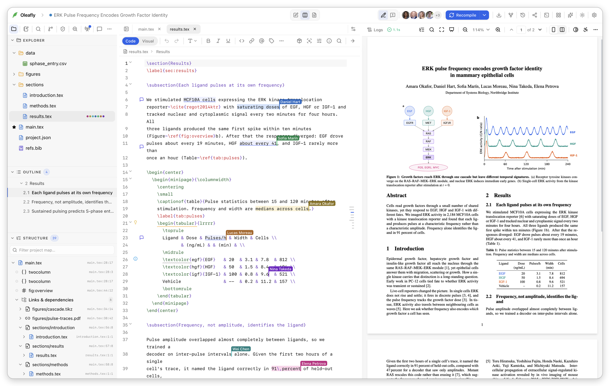
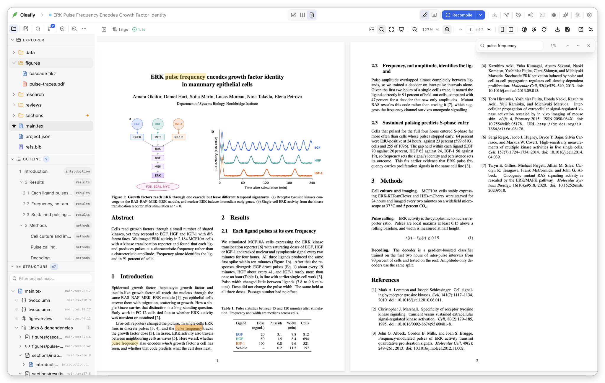
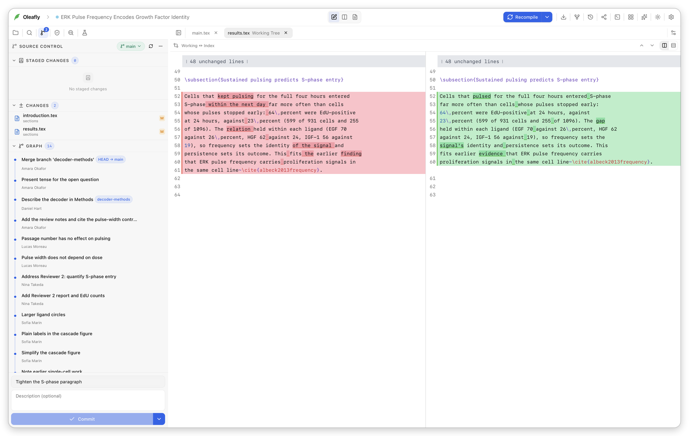
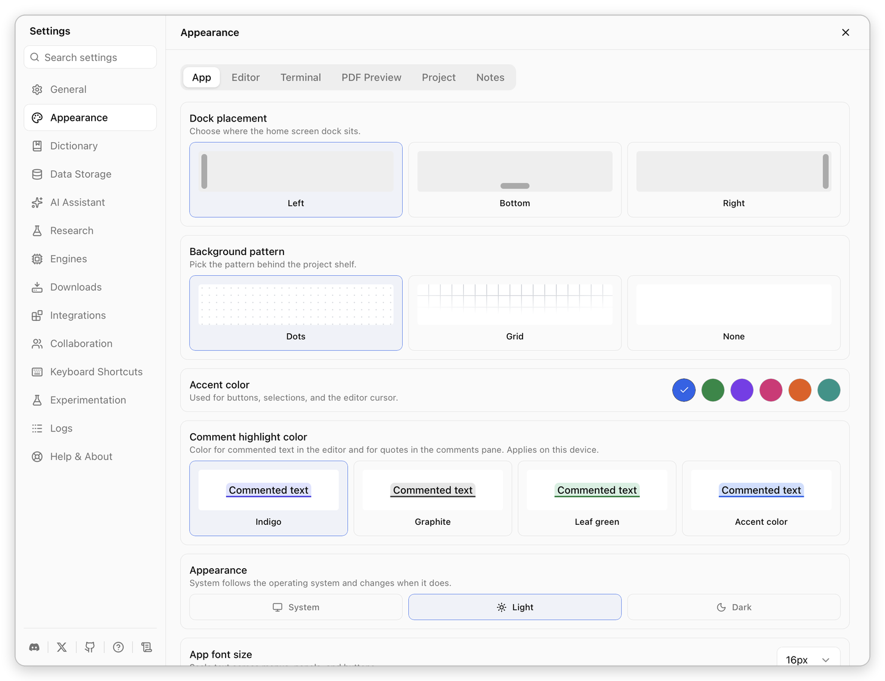

<div align="center">


# Oleafly <sup><em>beta</em></sup>

[Deutsch](README.de.md) | [English](../../README.md) | [Español](README.es.md) | [Français](README.fr.md) | [日本語](README.ja.md) | [한국어](README.ko.md) | [Português](README.pt.md) | **Русский** | [中文](README.zh.md) | [العربية](README.ar.md)

[](https://github.com/Oleafly/Oleafly/releases/latest)
[](https://github.com/Oleafly/Oleafly/releases/latest)
[](https://github.com/Oleafly/Oleafly/releases/latest)

[](https://github.com/Oleafly/Oleafly/issues) [](https://github.com/Oleafly/Oleafly/releases) [](https://github.com/Oleafly/Oleafly/actions/workflows/ci.yml) [](https://sonarcloud.io/summary/new_code?id=Oleafly_Oleafly) [](https://sonarcloud.io/component_measures?id=Oleafly_Oleafly&metric=coverage) [](https://github.com/Oleafly/Oleafly/pulse) [](https://github.com/Oleafly/Oleafly/commits/main) [](../../LICENSE) [](https://oleafly.com/discord) [](https://github.com/Oleafly/Oleafly)

**Редактор LaTeX, Typst и Markdown для научной работы с совместным редактированием в реальном времени.**

Oleafly является бесплатной рабочей средой с открытым исходным кодом для научного письма. В неё входят настольная агентная среда разработки для macOS, Windows и Linux, сервер, который ваша лаборатория размещает для совместной работы в реальном времени, инструмент командной строки для локальных сборок и CI и веб-версия для соавторов в браузере. Она компилирует LaTeX, Typst и Markdown без настройки и хранит каждый проект как репозиторий Git с автоматическими checkpoints. В исследовательский набор входят более 1700 шаблонов, Zotero, BibTeX, калькуляторы статистики, поиск по arXiv, Semantic Scholar, Crossref, PubMed и OpenAlex и проверки Preflight на сломанные ссылки, отсутствующие рисунки, утечки при слепом рецензировании и PDF/UA. Работайте вместе в реальном времени на сервере, который устанавливается одной командой, с общими курсорами, комментариями, чатом, отслеживаемыми изменениями, ролями и объединением правок, сделанных без сети. Claude Code, Codex и ещё 13 ИИ-агентов работают в вашем проекте, каждая их правка представлена как diff, который вы проверяете, а экспериментальные исследовательские задачи в фоне проводят обзор литературы или правку текста в изолированных worktree в рамках бюджета, который вы задаёте. CLI (`check`, `lint`, `mcp`, `ask`, `agent run`, `daemon`) открывает всё это для терминалов и CI.

<p>
  <a href="https://github.com/Oleafly/Oleafly/releases/latest"><strong>Скачать бесплатно</strong></a>
· <a href="https://oleafly.com/docs/">Читать руководства</a> · <a href="https://github.com/Oleafly/oleafly-server">Запустить сервер</a> · <a href="../development.md">Собрать из исходников</a>
</p>


Бесплатно навсегда · Открытый исходный код · Без аккаунта Oleafly · Без отслеживания

</div>

<div align="center">
  
</div>

## Почему Oleafly

Годами научное письмо приходилось арендовать. Ваша исследовательская работа лежит на чужом сервере, а то, что исследователю нужнее всего, закрыто платным тарифом. С Oleafly всё это вы получаете бесплатно. Это совместная работа в реальном времени с любым числом соавторов, которых вы пригласите, полная история версий, синхронизация с любым хостингом Git, Zotero, проверка грамматики и ИИ-агенты с вашим собственным входом или ключом, на сервере, который запускает ваша лаборатория. Аккаунт не нужен, телеметрия не отправляется, а работать можно и без сети.

<p align="center">
  
</p>

- Пишите вместе с соавторами в реальном времени, с общими курсорами и комментариями, на сервере, который ваша лаборатория разворачивает одной командой.
- Редактор, созданный для длинных документов: дополнение labels, цитат и команд, проверка ошибок на лету, структура всего проекта, клавиши Vim и Emacs, визуальный режим и палитра из 236 символов LaTeX с поиском.
- Компилируйте на своём компьютере. Tectonic, Typst и Pandoc встроены, а TeX Live, MacTeX, MiKTeX или TinyTeX подключаются, когда проекту нужен полный дистрибутив.
- Щелчок в PDF ведёт к исходнику и обратно, а последний удачный PDF остаётся на экране, пока вы исправляете ошибку.
- Каждый проект является репозиторием Git, который можно отправить на GitHub, GitLab, Gitea, Forgejo, Codeberg или собственный Git-сервер, а checkpoints сохраняют снимок после каждой успешной компиляции.
- Цитируйте из библиотеки Zotero прямо при наборе и ищите в arXiv, Semantic Scholar, Crossref, PubMed и OpenAlex, не выходя из редактора.
- Проверка орфографии и грамматики, настроенная для академических текстов, работает на вашем компьютере.
- Preflight ещё до отправки находит сломанные ссылки, отсутствующие рисунки, невстроенные шрифты, пробелы в доступности и всё, что может раскрыть авторов при слепом рецензировании.
- Создавайте рисунки, которые остаются кодом TikZ, Typst или Mermaid, и начинайте с более чем 1700 шаблонов статей, диссертаций, презентаций, постеров и резюме.
- PDF, изображения, таблицы, файлы `.bib`, HTML-страницы, презентации и доски открываются внутри проекта, каждый в своём просмотрщике.
- Импортируйте из Word, PDF, исходников arXiv, репозитория Git или аккаунта Overleaf.
- Соавторы всё ещё в онлайн-сервисе LaTeX вроде Overleaf? Редактируйте с ними один проект вживую из Oleafly, пока они остаются в его веб-редакторе. Живое редактирование экспериментальное и по умолчанию выключено. Включите его в разделе «Настройки» > «Эксперименты».
- Команда `oleafly` собирает, проверяет и синхронизирует ваши проекты из любого терминала или задачи CI теми же компиляторами и с теми же настройками, что и приложение.
- Облачная синхронизация держит ваши проекты на каждом вашем компьютере, а писать можно и без интернета.
- Claude Code, Codex и ещё 13 агентов работают прямо в вашем проекте, или подключите любую модель, в том числе локальную. ИИ необязателен, и каждое его изменение представлено как diff, который можно проверить и отменить.
- Исследовательские задачи проводят обзор литературы, аудит доказательств или правку текста в отдельной копии проекта, пока вы продолжаете писать, а вы выбираете, какие изменённые файлы оставить. Они экспериментальные и по умолчанию выключены. Включите их в разделе «Настройки» > «Эксперименты».
- Notes хранит ваши исследовательские заметки как файлы Markdown рядом с проектами, со ссылками, тегами, задачами и календарём. Они тоже экспериментальные и по умолчанию выключены.

## Пишите вместе в реальном времени

Поделитесь проектом через Oleafly Server вашей лаборатории, и все смогут редактировать одни и те же файлы одновременно. Вы видите курсор и выделение каждого участника, кто сейчас в сети и что изменилось, пока вас не было. Щёлкните по аватару человека, чтобы перейти к строке, над которой он работает.

<p align="center">
  
</p>

- Комментируйте любое выделение в LaTeX, Typst или Markdown, затем отвечайте, упоминайте людей, закрывайте обсуждения и открывайте их снова. Упомянутый соавтор получает одно письмо и может отключить такие письма.
- Правки, сделанные без сети, объединяются при повторном подключении. Если они пересекаются с чужими, Oleafly показывает оба варианта и спрашивает, прежде чем что-либо применить.
- Правки ИИ, цитаты из Zotero, переименования, удаления и рисунки тоже передаются. Если два человека одновременно заменят один и тот же рисунок, сохранятся обе версии.
- Главный файл, компилятор, язык проверки орфографии и параметры Typst общие, поэтому вся команда компилирует проект одинаково.
- У каждого проекта есть владелец, редакторы, рецензенты, комментаторы и читатели. Правки рецензентов становятся предложениями, а владельцы и редакторы тоже могут перейти в режим предложений. Гости, приглашённые по email, видят только те проекты, в которые их пригласили.
- У каждого общего проекта есть чат и история, где можно сравнивать версии, восстанавливать одну из них или давать ей имя.
- Соавторы могут открыть общий проект в браузере, если на сервере включён доступ через браузер, и читать PDF последней компиляции.

<table>
  <tr>
    <td width="50%" valign="top">
      
      <h3>Обсуждайте в чате проекта</h3>
      У каждого общего проекта есть свой чат с упоминаниями и реакциями, так что разговор остаётся рядом с файлом, о котором он.
    </td>
    <td width="50%" valign="top">
      
      <h3>Смотрите, кто здесь</h3>
      Панель Live collaboration показывает всех, кто работает над проектом, их роль и файл, который открыт у каждого. Под списком находится лента недавней активности.
    </td>
  </tr>
</table>

### Запустите сервер сами

Oleafly Server устанавливается одной командой на машину с Linux, будь то рабочая станция лаборатории, университетская виртуальная машина или небольшой облачный сервер:

```bash
curl -fsSL https://oleafly.com/server/install.sh | sudo sh
```

Это один исполняемый файл на Rust, который использует SQLite, хранит файлы на диске или в любом S3-совместимом хранилище и отправляет письма по SMTP, если вы это настроите. Пользователи входят через GitHub или любого провайдера OpenID Connect, так что работает единый вход вашего университета. Есть готовые конфигурации для Docker Compose, Coolify, Render и systemd, а также руководства для Railway, Cloudflare Tunnel и университетских сертификатов.

Администраторы получают в Oleafly консоль для управления пользователями, правилами доступа, проектами, почтой и журналом безопасности. Каждое устройство подписывает свои изменения, и сервер собирает каждый снимок из этой подписанной истории, а не доверяет загрузкам.

<p align="center">
  
</p>

Настройка, резервные копии и полный список того, кто что может делать, описаны в [руководстве по серверу](https://github.com/Oleafly/oleafly-server).

## Облачная синхронизация между компьютерами

Включите облачную синхронизацию, и проекты из вашей библиотеки и настройки приложения будут переходить вместе с вами с одного компьютера на другой. Каждая загрузка сверяется со своей записью, прежде чем заменить файл, а открытый файл с несохранёнными изменениями никогда не перезаписывается.

Синхронизировать можно с Dropbox, с Google Drive или с собственным бакетом в Amazon S3, Google Cloud Storage, MinIO или другом сервисе, совместимом с S3. Выберите один в разделе «Настройки» > «Хранилище данных» > «Облачная синхронизация». На той же странице есть полоса, которая показывает, что занимает папка данных Oleafly и что отнимает место.

<p align="center">
  
</p>

- Если два компьютера изменили один и тот же файл, сохраняются обе версии, и каждая названа по имени компьютера, который её записал.
- Удаление большей части проекта за один раз ждёт вашего подтверждения, так что одно неудачное действие не сможет опустошить проект на всех компьютерах.
- Файлы, удалённые на другом компьютере, попадают здесь в Корзину, а не исчезают бесследно.
- На новом компьютере Oleafly один раз спрашивает, оставить настройки этого компьютера или синхронизированные.

## Берите проекты с собой

Переходите с онлайн-редактора LaTeX? Один раз войдите в свой аккаунт из Oleafly, выберите нужные проекты, и они перенесутся со своими файлами, компилятором и главным файлом, готовые к компиляции. Это работает и с собственным сервером университета.

С токеном Git из этого аккаунта Oleafly может синхронизировать импортированный проект в обе стороны, так что соавторы, которые остаются в онлайн-редакторе, продолжают работать как прежде. Двусторонняя синхронизация использует собственную интеграцию сервиса с Git, а для неё нужен платный или университетский тариф в аккаунте владельца проекта.

Живое редактирование идёт дальше и не требует токена Git. Включите его, и вы вместе с соавторами, которые остаются в онлайн-сервисе, работаете над одним проектом одновременно: набранный текст, новые файлы и переименования доходят до другой стороны примерно за секунду, и вы видите, где работает каждый. Если соединение пропадёт, продолжайте печатать, и всё догонится, когда оно вернётся. Если ваш аккаунт входит через Google, вашу организацию или passkey, используйте «Войти через браузер». Живое редактирование экспериментальное. Включите его в разделе «Настройки» > «Эксперименты».

<p align="center">
  
</p>

Можно также начать с ZIP проекта, репозитория GitHub, документа Word, исходного пакета arXiv или PDF, который Oleafly восстановит как редактируемый LaTeX. Или откройте папку прямо там, где она лежит.

## ИИ-агенты, которые работают внутри проекта

Выберите агента из каталога, и он будет работать в вашем проекте, имея под рукой исходник, PDF и лог компиляции. Каждый агент входит со своим аккаунтом и использует свою модель. Oleafly даёт ему проект и инструменты вокруг него.

<p align="center">
  
</p>

<table>
  <tr>
    <td width="50%" valign="top">
      
      <h3>Oleafly Assistant</h3>
      Встроенный ассистент работает на подключённом вами провайдере или на локальной модели. Он открывается с исследовательскими skills, сгруппированными по задачам: исследование, написание, рисунки, проверка и отправка.
    </td>
    <td width="50%" valign="top">
      
      <h3>CLI-агенты</h3>
      Выберите Claude Code, Codex, Gemini CLI или другого агента в ряду над полем сообщения. Он работает рядом с вашим исходником и скомпилированным PDF.
    </td>
  </tr>
</table>

<div align="center">
<table>
  <tr>
    <td align="center" valign="top" width="135"><br />Claude&nbsp;Code</td>
    <td align="center" valign="top" width="135"><br />Codex&nbsp;CLI</td>
    <td align="center" valign="top" width="135"><br />Gemini&nbsp;CLI</td>
    <td align="center" valign="top" width="135"><br />Pi</td>
    <td align="center" valign="top" width="135"><br />OpenCode</td>
  </tr>
  <tr>
    <td align="center" valign="top" width="135"><br />OpenClaw</td>
    <td align="center" valign="top" width="135"><br />Cline</td>
    <td align="center" valign="top" width="135"><br />Hermes&nbsp;Agent</td>
    <td align="center" valign="top" width="135"><br />CodeBuddy</td>
    <td align="center" valign="top" width="135"><br />Kimi&nbsp;Code</td>
  </tr>
  <tr>
    <td align="center" valign="top" width="135"><br />Grok&nbsp;Build</td>
    <td align="center" valign="top" width="135"><br />Cursor</td>
    <td align="center" valign="top" width="135"><br />DeepSeek Harness</td>
    <td align="center" valign="top" width="135"><br />Qoder</td>
    <td align="center" valign="top" width="135"><br />Antigravity&nbsp;CLI</td>
  </tr>
</table>
</div>

<p align="center"><sub>Эти знаки обозначают совместимые инструменты и принадлежат их владельцам. Они не означают одобрение.</sub></p>

Предпочитаете ассистента в чате? Подключите облачного провайдера, любой OpenAI-совместимый endpoint или локальную модель в Ollama, llama.cpp или Lemonade.

- Каждое изменение файла представлено как diff. Подтверждайте каждое, позвольте ассистенту работать самостоятельно или задайте правила для каждого инструмента, а отменить можно один файл или всю реплику.
- Plan mode составляет карту проекта до того, как что-либо будет записано.
- Нет ключа API? Paper Review, правки на месте, Fix with AI и инструменты для изображений и формул могут работать на CLI-агенте, в который вы уже вошли.
- Агенты могут пользоваться разрешёнными вами настольными приложениями и сайтами, например формой отправки в журнал или статистическим пакетом. Это работает через Cua Driver, который вы устанавливаете сами.
- Обзор литературы или правка текста может выполняться в собственном Git worktree, пока вы продолжаете писать. Вы выбираете, какие изменённые файлы оставить.
- С приложением поставляются 39 исследовательских skills, включая поиск литературы, раздел о связанных работах, проверку утверждений и ответы рецензентам. Команда `npx skills add Oleafly/Oleafly` устанавливает их и в Claude Code, Codex и других агентов.
- Локальный MCP-сервер позволяет внешнему ИИ-клиенту использовать те же инструменты проекта. Он слушает только 127.0.0.1.
- `oleafly mcp` даёт Claude Code, Codex, Cursor и Gemini CLI инструменты проекта через stdio, открыто приложение или нет.
- В каждый релиз входит `oleafly.mcpb`. Откройте его, и Claude Desktop установит Oleafly как расширение. В реестре MCP он значится как `io.github.Oleafly/oleafly`.

ИИ необязателен. Редактор, компилятор, PDF, цитаты, вычитка и проверки работают и при выключенном ИИ.

## LaTeX, Typst и Markdown с компиляцией на вашем компьютере

Tectonic, Typst и Pandoc входят в приложение, поэтому новый проект компилируется без установки чего-либо. Если проекту нужен полный дистрибутив TeX, переключите его на latexmk с TeX Live, MacTeX, MiKTeX или TinyTeX, который Oleafly установит за вас.

<p align="center">
  
</p>

- Щёлкните в PDF, чтобы перейти к исходнику, и обратно. LaTeX использует SyncTeX, а Typst 0.13 или новее использует Tinymist.
- Ошибки компиляции ссылаются на строку, которая их вызвала, а последний удачный PDF остаётся на экране, пока вы их исправляете.
- Визуальный режим позволяет редактировать текст в виде, похожем на страницу, а исходник остаётся в одном щелчке.
- Дополнение и диагностика на лету для labels, цитат, команд, окружений и путей к файлам во всём проекте.
- Проверка орфографии и грамматики выполняется локально и настроена для академических текстов.
- XeLaTeX, LuaLaTeX, а для японских документов upLaTeX или pLaTeX.
- Документы Quarto и Calepin выполняют свой код на R, Python или Julia, как только вы разрешите запуск кода для проекта. Oleafly может сам скачать любой из этих инструментов.
- Документ Markdown можно собрать как статью, отчёт, книгу, презентацию, постер, письмо или резюме. Задайте `type:` в его front matter.

<p align="center">
  
</p>

В просмотрщике PDF есть поиск, оглавление документа, режимы одной и двух страниц и подгонка по ширине или высоте.

## Цитаты, рисунки, проверки и шаблоны

<table>
  <tr>
    <td width="50%" valign="top">
      
      <h3>Цитируйте из Zotero прямо при наборе</h3>
      Введите <code>@</code> и часть имени автора, названия или года, чтобы процитировать работу из библиотеки Zotero. Oleafly добавляет в <code>.bib</code> проекта только эту запись. Citation Search ищет в arXiv, Semantic Scholar, Crossref, PubMed и OpenAlex.
    </td>
    <td width="50%" valign="top">
      
      <h3>Рисунки, которые остаются кодом</h3>
      Diagram Composer рисует на холсте и пишет код TikZ, fletcher для Typst или Mermaid. Измените рисунок или код, и второе обновится следом.
    </td>
  </tr>
  <tr>
    <td width="50%" valign="top">
      
      <h3>Проверьте перед отправкой</h3>
      Preflight находит сломанные ссылки, отсутствующие рисунки, невстроенные шрифты, пробелы в доступности и всё, что может раскрыть авторов при слепом рецензировании. В нём есть профили для arXiv, IEEE, ACM, журналов и диссертаций.
    </td>
    <td width="50%" valign="top">
      
      <h3>Более 1700 шаблонов для старта</h3>
      Статьи, диссертации, доклады Beamer, постеры, резюме и статьи в стиле конкретных изданий, и у каждого шаблона есть отрендеренный предпросмотр ещё до создания проекта.
    </td>
  </tr>
</table>

## Git, история и терминал

Каждый проект представляет собой обычную папку с обычным репозиторием Git. Добавляйте изменения в staging, смотрите diff, делайте commit, push и pull и публикуйте на GitHub, GitLab, Gitea, Forgejo, Codeberg или собственный сервер из панели Source Control или используйте собственный терминал, ведь от него ничего не скрыто. Checkpoints сохраняют локальный снимок после каждой успешной компиляции, так что можно откатиться, не делая коммит.

<p align="center">
  
</p>

Под редактором находится панель терминала, до десяти вкладок на проект. Cmd-щелчок (Ctrl-щелчок) по пути к файлу в выводе открывает файл на этой строке.

<table>
  <tr>
    <td width="50%" valign="top">
      
      <h3>Терминал под редактором</h3>
      Запускайте Git, скрипт сборки или команду <code>oleafly</code> в папке проекта, не выходя из окна.
    </td>
    <td width="50%" valign="top">
      
      <h3>Версия после каждой компиляции</h3>
      Versioning сохраняет снимок исходника после каждой успешной компиляции. Восстановите любой из них одним щелчком, коммит не нужен.
    </td>
  </tr>
  <tr>
    <td width="50%" valign="top">
      
      <h3>Ваш хостинг Git или собственный сервер</h3>
      Войдите в GitHub, GitLab или Codeberg или добавьте адрес сервера Gitea или Forgejo, который вы запускаете сами. Затем делайте push, pull и публикуйте из панели Source Control.
    </td>
    <td width="50%" valign="top">
      
      <h3>Узнайте, куда уходит место</h3>
      Настройки показывают, сколько места на диске занимают ваши проекты, PDF, история Git и собственные данные приложения. Удалённые проекты ждут в Корзине.
    </td>
  </tr>
</table>

Команда `oleafly` работает с теми же проектами из любого терминала: собирает, пересобирает при каждом изменении, проверяет перед отправкой, синхронизирует с онлайн-сервисом LaTeX или запускает агента Oleafly, не открывая приложение. Любая команда может выводить JSON со стабильными кодами выхода для скриптов и CI. Подробнее в [руководстве по командной строке](../cli.md).

## Notes для ваших исследований

Notes является базой знаний, которая находится рядом с вашими проектами. Каждая заметка является файлом Markdown, который принадлежит вам. Её можно редактировать в визуальном редакторе с выносками, таблицами, графиками, диаграммами, формулами, ссылками и обратными ссылками, тегами и задачами со сроками. Notes экспериментальная и по умолчанию выключена. Включите её в разделе «Настройки» > «Эксперименты».

<p align="center">
  
</p>

- Заметки открываются во вкладках, которые можно делить и закреплять. Notes Home показывает их списком с поиском, тегами, списком задач и календарём.
- Заметка может начинаться с шаблона и лежать внутри проекта как `notes/<Title>.md`.
- Поделитесь заметкой через сервер лаборатории, чтобы редактировать её вместе, и комментируйте выделение так же, как в файле проекта.
- Ассистент или CLI-агент может предлагать изменения в заметке. Вы принимаете или отклоняете каждое прямо на месте.
- Quick capture открывается в небольшом плавающем окне, когда нужно сохранить мысль.
- Вставьте ссылку на пост в X, и заметка сохранит автора, дату и текст поста.

## Настройте Oleafly под себя

Oleafly следует светлой или тёмной настройке вашей системы, или вы выбираете сами. Выберите акцентный цвет, положение дока Home и то, что рисуется за вашими проектами. У редактора есть свой шрифт, тема, цвета и сочетания клавиш, а Notes показывает живой предпросмотр, пока вы меняете гарнитуру и интервалы.

<table>
  <tr>
    <td width="50%" valign="top">
      
      <h3>Акцент, док и фон</h3>
      Шесть акцентных цветов, док слева, снизу или справа и точки, сетка или ничего за вашими проектами.
    </td>
    <td width="50%" valign="top">
      
      <h3>Шрифт по вкусу</h3>
      Выберите гарнитуру, размер и интервалы для заметок и смотрите, как меняется предпросмотр.
    </td>
  </tr>
  <tr>
    <td width="50%" valign="top">
      
      <h3>Светлая или тёмная</h3>
      Переключайте на панели инструментов или позвольте Oleafly следовать за системой.
    </td>
    <td width="50%" valign="top">
      
      <h3>Тёмная тема и в Notes</h3>
      Графики, таблицы и выноски в заметке нарисованы и для тёмной, и для светлой темы.
    </td>
  </tr>
</table>

## И многое другое

<details>
<summary>Более 40 инструментов для конвертации, цитат и математики</summary>

Галерея Tools пока в beta и по умолчанию выключена. Включите её в разделе «Настройки» > «Эксперименты» > «Инструменты LaTeX».

#### Импорт и конвертация форматов

| Инструмент | Для чего |
| --- | --- |
| PDF to LaTeX | Восстановить редактируемый LaTeX из PDF, сохранив доступные формулы, рисунки и структуру |
| arXiv to LaTeX | Скачать исходный пакет arXiv по ID или распаковать сохранённый архив |
| Image to LaTeX | Превратить изображение заметок, формулы или таблицы в редактируемый LaTeX |
| Equation to LaTeX | Преобразовать набранную формулу или изображение формулы в LaTeX |
| Excel to LaTeX | Преобразовать лист Excel, CSV или TSV в экранированную таблицу LaTeX |
| HTML to LaTeX | Преобразовать вставленный HTML в отдельный документ LaTeX |
| Image to Typst | Превратить изображение заметок, формулы или таблицы в редактируемый Typst |
| LaTeX to HTML | Преобразовать LaTeX в отдельный HTML с уравнениями MathML |
| LaTeX to Image | Отрендерить формулу и экспортировать PNG или SVG |
| LaTeX to Markdown | Преобразовать документ LaTeX в переносимый Markdown |
| LaTeX to Typst | Преобразовать LaTeX в исходник Typst для копирования, сохранения или проекта |
| LaTeX to Word | Создать Word-документ с уравнениями как нативной математикой Word |
| Markdown to LaTeX | Преобразовать заметки Markdown в отдельный документ LaTeX |
| Markdown to Typst | Преобразовать заметки Markdown в исходник Typst |
| Mermaid to LaTeX | Преобразовать блок-схему Mermaid в редактируемый TikZ |
| PDF to Markdown | Извлечь текстовый слой, формулы и рисунки PDF в Markdown |
| PDF to Typst | Извлечь текстовый слой, формулы и рисунки PDF в Typst |
| Table to LaTeX | Создать таблицу LaTeX в визуальном редакторе строк и столбцов |
| Typst Editor | Начать проект Typst с редактированием, предпросмотром и экспортом PDF |
| Visual Typst Editor | Открыть документ Typst в редакторе проекта с живым предпросмотром |
| Typst to LaTeX | Преобразовать разметку Typst в LaTeX для журналов и отправки |
| arXiv to Typst | Преобразовать исходный пакет arXiv в Typst с проверкой компиляции, которая перечисляет, что не удалось преобразовать |
| CSV to Typst | Вставить строки CSV или TSV и получить экранированную таблицу Typst |
| Equation to Typst | Преобразовать набранную формулу LaTeX или изображение формулы в математику Typst |
| Excel to Typst | Преобразовать лист Excel, CSV или TSV в экранированную таблицу Typst |
| HTML to Typst | Преобразовать вставленный HTML в отдельный документ Typst |
| Mermaid to Typst | Преобразовать блок-схему Mermaid в редактируемый код fletcher |
| Typst to HTML | Преобразовать разметку Typst в отдельный HTML с уравнениями MathML |
| Typst to Markdown | Преобразовать разметку Typst в переносимый Markdown |
| Typst to Word | Создать Word-документ с уравнениями как нативной математикой Word |
| Word to Typst | Преобразовать Word в Typst и сохранить извлечённые медиафайлы рядом |
| Word to LaTeX | Преобразовать Word в LaTeX и сохранить извлечённые медиафайлы рядом |

#### Математика, таблицы, письмо и проверка

| Инструмент | Для чего |
| --- | --- |
| BibTeX Validator | Проверить файлы `.bib` на синтаксические ошибки, отсутствующие обязательные поля и повторные ключи |
| Statistics Calculators | Локально посчитать p-value, размеры выборки и доверительные интервалы |
| Writing Generators | Подготовить с помощью ассистента abstract, summary, paraphrase или план диссертации из открытого документа |
| Symbol Reference | Найти символ LaTeX и вставить его в позицию курсора, а в файле Typst вставить его имя в Typst |

#### Литература, ссылки и исследования

| Инструмент | Для чего |
| --- | --- |
| Find Citations | Искать по научным индексам, находить неподкреплённые места и экспортировать BibTeX |
| arXiv Citation Generator | Найти статью arXiv и оформить цитату в восьми стилях |
| Bibliography Generator | Создать, проверить, отсортировать и экспортировать библиографию из деталей или BibTeX |
| Citation Generator | Превратить данные статьи или идентификатор в оформленную цитату и BibTeX |
| Citation Generators by Style | Сравнить одну ссылку в APA, MLA, Chicago, IEEE, Harvard, Vancouver, AMA и ACS |
| DOI to BibTeX | Получить запись DOI, проверить поля и экспортировать BibTeX |
| ISBN to BibTeX | Получить метаданные книги по ISBN, исправить их и экспортировать BibTeX |
| PubMed to BibTeX | Получить запись PubMed по PMID, проверить её и экспортировать BibTeX |
| URL to BibTeX | Распознать ссылки DOI, arXiv и PubMed или создать редактируемую цитату веб-страницы |
| Lab Search | Найти исследовательские организации через каталог OpenAlex |
| Conference Deadlines | Фильтровать сроки конференций, в основном по компьютерным наукам, и смотреть обратный отсчёт |

</details>

<details>
<summary>39 исследовательских skills, которые поставляются с Oleafly</summary>

Skills представляют собой обычные папки `SKILL.md` в формате Agent Skills. Запускайте skill через slash-команду, добавляйте свои или передавайте их совместимым CLI-агентам на том же компьютере.

Встроенный пакет `research-core` содержит 39 skills. Ниже перечислены ID, используемые каталогом и в настройках проекта.

| Категория | Skills |
| --- | --- |
| Исследования и литература | `citation-management`, `exploratory-data-analysis`, `hypothesis-generation`, `literature-review`, `oleafly-experiment-loop`, `oleafly-literature-sweep`, `oleafly-research-loop`, `openresearch`, `paper-lookup`, `research-lookup`, `scientific-brainstorming`, `scientific-critical-thinking` |
| Написание и анализ манускрипта | `experimental-design`, `oleafly-data-analysis`, `oleafly-manuscript-scaffold`, `oleafly-related-work`, `scientific-writing`, `statistical-analysis`, `statistical-power`, `venue-templates` |
| Рисунки и визуализация | `oleafly-figure-prep`, `scientific-schematics`, `scientific-visualization` |
| Ревью и доказательства | `oleafly-response-letter`, `oleafly-review-manuscript`, `oleafly-verify-claims`, `peer-review`, `scholar-evaluation` |
| Отправка | `oleafly-pre-submission` |
| Коммуникация | `oleafly-slides-and-posters`, `pptx-posters`, `research-grants`, `scientific-slides` |
| Инструменты и автоматизация | `desktop-apps`, `import-refine`, `oleafly-cli`, `oleafly-latex-build`, `pdf-to-latex`, `template-generate` |

</details>

<details>
<summary>Подробнее о редакторе</summary>

- Палитра из 236 символов LaTeX с поиском, которая в файлах Typst вставляет имена Typst.
- Полоса структуры на правом краю редактора отмечает каждый заголовок и раздел, который вы читаете. Откройте её, чтобы увидеть номера разделов и страницу PDF каждого заголовка по последней компиляции.
- Просмотрщики для остальных файлов проекта: PDF с полной панелью инструментов предпросмотра, изображения с масштабированием, листы CSV и Excel как сортируемая таблица, список с поиском для файлов `.bib` и живой предпросмотр для HTML.
- Презентации, написанные на TSX, показываются в предпросмотре по мере набора и демонстрируются как PDF. Файл с именем `something.excalidraw` открывается как доска, на которой можно рисовать.
- Дважды щёлкните файл `.tex`, `.typ` или `.md` в файловом менеджере, и он откроется в Oleafly.
- Сочетания клавиш Vim и Emacs, вкладки для нескольких файлов, сворачивание кода, поиск и замена по всему проекту и подсчёт слов.
- Переименуйте или переместите файл, и Oleafly обновит пути, которые на него указывают.
- Темы для светлого и тёмного режима, любой установленный шрифт, настраиваемые цвета подсветки синтаксиса и режим Zen.
- Значки файлов окрашены по типу файла. Переключитесь на короткие значки типа, например TEX или PDF, в разделе «Настройки» > «Внешний вид» > «Проект».
- Интерфейс доступен на 22 языках.
- Палитра команд по Cmd+K (Ctrl+K) и единое поле поиска по проектам, документам, настройкам и инструментам по Cmd+Shift+F (Ctrl+Shift+F).

</details>

## Начало работы

1. [Скачайте Oleafly](https://github.com/Oleafly/Oleafly/releases/latest) для своего компьютера.
2. Создайте проект из шаблона, импортируйте готовый или откройте уже существующую папку.
3. Нажмите Cmd+Enter (Ctrl+Enter в Windows и Linux), чтобы скомпилировать.
4. Чтобы писать вместе с другими, нажмите **Поделиться** и отправьте проект на Oleafly Server вашей лаборатории.

| Платформа | Пакет | Скачать |
| --- | --- | --- |
| macOS · Apple Silicon | DMG | [](https://github.com/Oleafly/Oleafly/releases/latest) |
| macOS · Intel | DMG (`x64`) | [](https://github.com/Oleafly/Oleafly/releases/latest) |
| Windows · x86_64 | MSI или EXE | [](https://github.com/Oleafly/Oleafly/releases/latest) |
| Linux · x86_64 | AppImage, DEB или RPM | [](https://github.com/Oleafly/Oleafly/releases/latest) |
| Linux · ARM64 | AppImage, DEB или RPM | [](https://github.com/Oleafly/Oleafly/releases/latest) |

Пакетам Linux нужен glibc 2.35 или новее (Ubuntu 22.04, Debian 12 или новее). В релизах есть подписанные артефакты обновления, а встроенный механизм обновления проверяет подпись, прежде чем что-либо установить.

## Частые вопросы

<details>
<summary>Нужен ли мне аккаунт?</summary>

Аккаунт Oleafly не нужен. Писать, компилировать и работать с Git можно, ни во что не входя. Для совместной работы в реальном времени вы входите на сервер лаборатории через GitHub или систему входа вашего университета, а для облачной синхронизации входите в своё облачное хранилище.

</details>

<details>
<summary>Работает ли Oleafly без интернета?</summary>

Да. Написание текста, компиляция, PDF, вычитка, Preflight, Git и checkpoints работают на вашем компьютере. LaTeX собирается без сети, когда у встроенного движка уже есть нужные пакеты, а Typst, когда его пакеты есть в кэше. Общие проекты сохраняют ваши правки и объединяют их при повторном подключении.

</details>

<details>
<summary>Что передаётся по сети?</summary>

Только то, что вы сами запрашиваете: совместный доступ через ваш сервер, облачная синхронизация, онлайн-сервис LaTeX, из которого вы импортируете или в котором редактируете вживую, поиск литературы и DOI, ваш хостинг Git, облачные провайдеры ИИ, подключённые вами MCP-серверы и необязательные загрузки движков, пакетов и шаблонов. Релизные сборки также проверяют наличие обновления при запуске приложения. Локальная модель оставляет трафик ИИ на вашем компьютере.

</details>

<details>
<summary>Может ли мой университет или компания разместить сервер у себя?</summary>

Да, в этом и смысл. Oleafly Server работает на вашей машине или в вашем облачном аккаунте, выполняет вход пользователей через GitHub или любого провайдера OpenID Connect и хранит файлы на диске или в S3-совместимом хранилище. Установка, резервные копии и роли описаны в [руководстве по серверу](https://github.com/Oleafly/oleafly-server).

</details>

## Узнать больше

- [Руководства продукта](https://oleafly.com/docs/)
- [Oleafly Server](https://github.com/Oleafly/oleafly-server)
- [Карта функций](../features.md)
- [Руководство редактора](../Editor.md)
- [Предпросмотр PDF](../PDFPreview.md)
- [Цитаты и литература](../Citations.md)
- [Галерея инструментов](../Tools.md)
- [Preflight и доступность](../Preflight.md)
- [Шаблоны](../Templates.md)
- [Diagram Composer](../DiagramComposer.md)
- [Git и контроль исходников](../SourceControl.md)
- [Checkpoints](../Checkpoints.md)
- [AI Copilot](../AICopilot.md)
- [Skills](../Skills.md)
- [Интеграция MCP](../mcp.md)
- [Инструмент командной строки](../cli.md)
- [Настройка разработки](../development.md)
- [Список изменений](../../CHANGELOG.md)

## Сообщество и поддержка

Спасибо всем, кто прислал pull request, и тем, чьи issues повлияли на самое большое число релизов.

<p>
<a href="https://github.com/palmtenor" title="Teng Qin (palmtenor)"></a>
<a href="https://github.com/wahidmounir" title="wahidmounir"></a>
<a href="https://github.com/Jianxinnn" title="Jianx (Jianxinnn)"></a>
<a href="https://github.com/multics" title="Not AI (multics)"></a>
<a href="https://github.com/um1chc5" title="Vũ Vương An (um1chc5)"></a>
<a href="https://github.com/a-green-hand-jack" title="Jack Wu (a-green-hand-jack)"></a>
<a href="https://github.com/DEENUU1" title="Kacper Włodarczyk (DEENUU1)"></a>
<a href="https://github.com/mvanhorn" title="Matt Van Horn (mvanhorn)"></a>
<a href="https://github.com/vincencwolff" title="Alexander Wolff (vincencwolff)"></a>
<a href="https://github.com/ssbodda-powern" title="ssbodda-powern"></a>
<a href="https://github.com/Fravoj3" title="Fravoj3"></a>
<a href="https://github.com/Entrery901" title="Pavel Entrery (Entrery901)"></a>
<a href="https://github.com/CherryYang05" title="Minyang Bao (CherryYang05)"></a>
<a href="https://github.com/MaverickJohn026" title="MaverickJohn026"></a>
<a href="https://github.com/marlondecol" title="Marlon Luís de Col (marlondecol)"></a>
</p>

Присоединяйтесь к [сообществу Oleafly в Discord](https://oleafly.com/discord): задавайте вопросы, просите помощи с упрямой сборкой, показывайте, над чем работаете, и голосуйте за то, что появится следующим. Это бесплатно и открыто для всех. Предпочитаете GitHub? Сообщайте об ошибках и просите функции в [GitHub Issues](https://github.com/Oleafly/Oleafly/issues).

Oleafly не собирает телеметрию, поэтому никто не знает, кто им пользуется, пока вы сами не скажете. Пишете диссертацию или статьи своей лаборатории в Oleafly? Поздоровайтесь в [Who's using Oleafly?](https://github.com/Oleafly/Oleafly/discussions/502).

Oleafly создают [Prajwal Murthy](https://github.com/prajwal-svm) и участники проекта. Мы принимаем вклад в код, шаблоны, документацию и обратную связь. Чтобы присоединиться, прочитайте [руководство для участников](../../CONTRIBUTING.md).

Если вы используете Oleafly, [звезда на GitHub](https://github.com/Oleafly/Oleafly) поможет другим исследователям найти проект.

## Как цитировать Oleafly

<details>
<summary>Скопировать запись BibTeX</summary>

```bibtex
@software{oleafly,
  author  = {Venkateshmurthy, Prajwal S. and {The Oleafly contributors}},
  title   = {Oleafly: a local-first workspace for research writing},
  year    = {2026},
  version = {0.4.12},
  url     = {https://github.com/Oleafly/Oleafly},
  license = {AGPL-3.0-or-later}
}
```

</details>

[Безопасность](../../SECURITY.md) · [Кодекс поведения](../../CODE_OF_CONDUCT.md) · [AGPL-3.0-or-later](../../LICENSE)

## История звёзд

<a href="https://www.star-history.com/?repos=Oleafly%2FOleafly&type=date&legend=top-left">
 <picture>
   <source media="(prefers-color-scheme: dark)" srcset="https://api.star-history.com/chart?repos=Oleafly/Oleafly&type=date&theme=dark&legend=top-left&sealed_token=aHz2JA-SBvmD73PyT7aCcCqMyAUvCPtidSAAvsQQxR8-1xdB-RZ-oXHKRnqIJUfSICl6Dd3_XPcHgb5Menvk_FfalfMb1GRbJC_TdeTMBVDi3jVUIXBBdovZ4dufhj4JWF3UXptJhw8pGmB6lqQ-X7gDOWu_bkPTQ7k-Q0VeBiq_jNgwRb7RSMgrSb-P" />
   <source media="(prefers-color-scheme: light)" srcset="https://api.star-history.com/chart?repos=Oleafly/Oleafly&type=date&legend=top-left&sealed_token=aHz2JA-SBvmD73PyT7aCcCqMyAUvCPtidSAAvsQQxR8-1xdB-RZ-oXHKRnqIJUfSICl6Dd3_XPcHgb5Menvk_FfalfMb1GRbJC_TdeTMBVDi3jVUIXBBdovZ4dufhj4JWF3UXptJhw8pGmB6lqQ-X7gDOWu_bkPTQ7k-Q0VeBiq_jNgwRb7RSMgrSb-P" />
   
 </picture>
</a>
