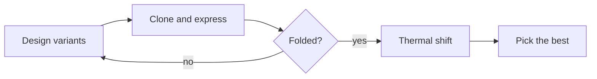
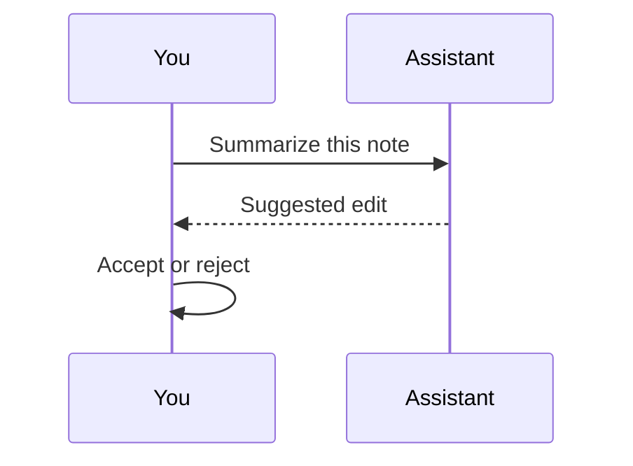

Every block a note can hold. Click **Source** on a block to see and edit what draws it, and type `/` on an empty line to insert a new one.

## Charts

```chart
{"type": "bar", "title": "Melting temperature by variant", "unit": "°C", "yLabel": "Tm (°C)", "categories": ["WT", "A12V", "G45P", "Triple"], "series": [{"name": "Run 1", "values": [52.1, 54.8, 56.3, 61.0], "errors": [0.4, 0.5, 0.3, 0.6]}, {"name": "Run 2", "values": [52.4, 55.1, 55.9, 60.6], "errors": [0.3, 0.4, 0.4, 0.5]}]}
```

```chart
{"type": "line", "title": "Unfolding curves", "xLabel": "Temperature (°C)", "yLabel": "Fraction unfolded", "categories": ["40", "45", "50", "55", "60", "65", "70"], "series": [{"name": "WT", "values": [0.02, 0.08, 0.31, 0.72, 0.94, 0.99, 1.0]}, {"name": "Triple", "values": [0.01, 0.02, 0.06, 0.18, 0.49, 0.83, 0.97]}]}
```

```chart
{"type": "scatter", "title": "Stability against activity", "xLabel": "ΔTm (°C)", "yLabel": "Relative activity", "series": [{"name": "Single mutants", "points": [[1.2, 0.98], [2.7, 0.91], [3.9, 0.85], [-0.8, 1.02], [3.1, 0.64]]}, {"name": "Combinations", "points": [[6.5, 0.82], [8.6, 0.77]]}]}
```

```chart
{"type": "donut", "title": "Where the week went", "unit": "h", "categories": ["Cloning", "Expression", "Assays", "Analysis"], "series": [{"name": "Hours", "values": [12, 20, 9, 6]}]}
```

## Function plots

```plot
title: Two-state unfolding model
y = 1 / (1 + exp(-(x - 55) / 2.5))
y = 1 / (1 + exp(-(x - 61) / 2.5))
domain: 40, 75
range: 0, 1
labels: Temperature (°C), Fraction unfolded
point: 55, 0.5, WT Tm
point: 61, 0.5, Triple Tm
```

```plot
title: A parametric curve
x = cos(3t), y = sin(2t)
t: 0, 2*pi
```

## Tables

A csv block is sortable and filterable, with a summary row:

```csv
variant,mutations,Tm (°C),ΔTm (°C),activity
WT,0,52.2,0.0,1.00
A12V,1,54.9,2.7,0.91
G45P,1,56.1,3.9,0.85
S88T,1,51.4,-0.8,1.02
Triple,3,60.8,8.6,0.77
```

Plain Markdown tables work too:

| Buffer | pH | Salt (mM) |
| --- | --- | --- |
| HEPES | 7.5 | 150 |
| Tris | 8.0 | 100 |

## Math and chemistry

```latex
\begin{align}
\Delta G(T) &= \Delta H_m \left(1 - \frac{T}{T_m}\right) - \Delta C_p \left[(T_m - T) + T \ln \frac{T}{T_m}\right]
\end{align}
```

```latex
\ce{E + S <=> ES -> E + P}
```

## Typst

```typst
$ sum_(k=1)^n k = (n(n+1)) / 2 $
```

## Diagrams





## SVG

```svg
<svg xmlns="http://www.w3.org/2000/svg" viewBox="0 0 230 80"><rect x="4" y="20" width="64" height="40" rx="8" fill="#90dbf4"/><rect x="83" y="20" width="64" height="40" rx="8" fill="#cfbaf0"/><rect x="162" y="20" width="64" height="40" rx="8" fill="#98f5e1"/><text x="36" y="45" font-family="sans-serif" font-size="12" text-anchor="middle">Design</text><text x="115" y="45" font-family="sans-serif" font-size="12" text-anchor="middle">Build</text><text x="194" y="45" font-family="sans-serif" font-size="12" text-anchor="middle">Test</text></svg>
```

## HTML, press Run

```html
<div style="font-family: system-ui; padding: 12px">
  <label>Temperature <input id="t" type="range" min="40" max="75" value="55"> <span id="v"></span> °C</label>
  <p id="out"></p>
</div>
<script>
  const t = document.getElementById("t");
  const v = document.getElementById("v");
  const out = document.getElementById("out");
  const update = () => {
    const x = Number(t.value);
    const f = 1 / (1 + Math.exp(-(x - 55) / 2.5));
    v.textContent = x;
    out.textContent = "Wild type is " + (f * 100).toFixed(0) + "% unfolded.";
  };
  t.addEventListener("input", update);
  update();
</script>
```

## React, press Run

```jsx
import { useState } from "react";
import { LineChart, Line, XAxis, YAxis, Tooltip, ResponsiveContainer } from "recharts";

export default function Unfolding() {
  const [tm, setTm] = useState(55);
  const data = Array.from({ length: 36 }, (_, i) => {
    const x = 40 + i;
    return { x, f: 1 / (1 + Math.exp(-(x - tm) / 2.5)) };
  });
  return (
    <div className="p-3 font-sans text-sm">
      <label className="flex items-center gap-2">
        Tm <input type="range" min={45} max={70} value={tm} onChange={(event) => setTm(Number(event.target.value))} /> {tm} °C
      </label>
      <div style={{ height: 200 }}>
        <ResponsiveContainer>
          <LineChart data={data}>
            <XAxis dataKey="x" />
            <YAxis domain={[0, 1]} />
            <Tooltip />
            <Line type="monotone" dataKey="f" dot={false} stroke="#1982c4" />
          </LineChart>
        </ResponsiveContainer>
      </div>
    </div>
  );
}
```

## Chemical structures

```smiles
Aspirin: CC(=O)OC1=CC=CC=C1C(=O)O
Caffeine: CN1C=NC2=C1C(=O)N(C(=O)N2C)C
Tryptophan: N[C@@H](CC1=CNC2=CC=CC=C12)C(=O)O
```

## 3D molecule

```molecule
format: xyz
style: stick
9
ethanol
C -0.0014 -0.0083 0.0000
C 1.5133 -0.0109 0.0000
O 1.9567 1.3388 0.0000
H -0.3878 1.0165 0.0000
H -0.3943 -0.5148 0.8848
H -0.3943 -0.5148 -0.8848
H 1.8835 -0.5294 0.8848
H 1.8835 -0.5294 -0.8848
H 2.9256 1.3359 0.0000
```

## Sequences

```sequence
>egfp_start First 120 bases of EGFP
ATGGTGAGCAAGGGCGAGGAGCTGTTCACCGGGGTGGTGCCCATCCTGGTCGAGCTGGACGGCGACGTAAACGGCCACAAGTTCAGCGTGTCCGGCGAGGGCGAGGGCGATGCCACCTAC
```

## Code

```python
import numpy as np

def fraction_unfolded(t, tm, width=2.5):
    return 1 / (1 + np.exp(-(t - tm) / width))
```

```r
fit <- nls(f ~ 1 / (1 + exp(-(t - tm) / w)), start = list(tm = 55, w = 2.5))
```
